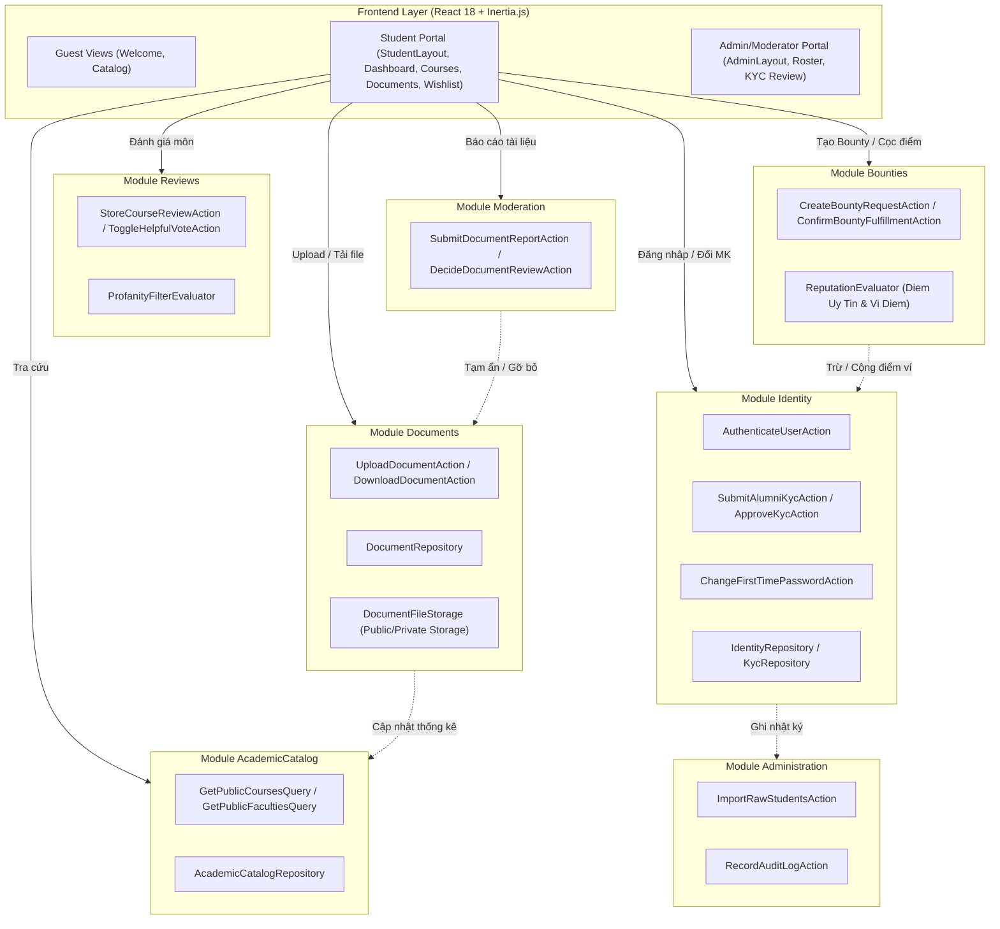
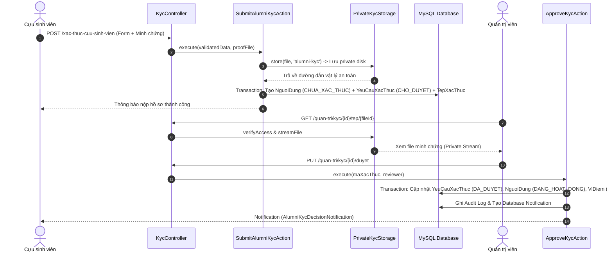
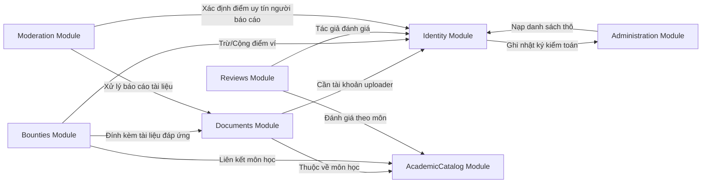

# BÁO CÁO AUDIT TOÀN DIỆN PHÂN HỆ SINH VIÊN VÀ CỰU SINH VIÊN
## AGU Academic Hub — Nền Tảng Học Thuật & Tài Liệu Trường Đại Học An Giang

---

| Thông Tin Kiểm Tra | Chi Tiết |
| :--- | :--- |
| **Dự Án** | AGU Academic Hub (ĐHQG-HCM / Trường Đại học An Giang) |
| **Kiến Trúc** | Modular Monolith (Laravel 11 + Inertia.js React 18 + MySQL/SQLite) |
| **Đối Tượng Trọng Tâm** | `SINH_VIEN` (Sinh viên hiện hành) & `CUU_SINH_VIEN` (Cựu sinh viên) |
| **Thời Điểm Kiểm Tra** | Tháng 11/2026 |
| **Vai Trò Kiểm Tra** | Senior Software Engineer & System Auditor |
| **Tình Trạng Suite Test** | **160 Passed / 0 Failed** (859 Assertions) |
| **Đường Dẫn Báo Cáo** | `.md/reportChange/BAO_CAO_AUDIT_MODULE_SINH_VIEN_CUU_SINH_VIEN.md` |

---

## 1. Tóm Tắt Điều Hành (Executive Summary)

Báo cáo này là kết quả rà soát độc lập, toàn diện về mặt kỹ thuật và nghiệp vụ đối với hai nhóm người dùng trọng yếu trong hệ thống AGU Academic Hub: **Sinh viên hiện hành (`SINH_VIEN`)** và **Cựu sinh viên (`CUU_SINH_VIEN`)**.

### 1.1. Hiện Trạng Tổng Quan
Hệ thống đã hoàn thành việc tái cấu trúc từ mô hình MVC truyền thống sang kiến trúc **Modular Monolith** phân chia thành 7 Bounded Contexts độc lập trong thư mục `app/Modules/`. Hai nhóm người dùng `SINH_VIEN` và `CUU_SINH_VIEN` đã có khung nghiệp vụ cốt lõi hoạt động tốt với bộ test gồm 160 ca kiểm thử (859 assertions) đạt tỷ lệ passed 100%.

Tuy nhiên, quá trình audit chuyên sâu mã nguồn thực tế và đối chiếu chéo với Bộ tài liệu thiết kế (`TaiLieuYeuCau.md`, `TaiLieuThietKe.md`, `TaiLieuKyThuat.md`) đã phát hiện các điểm nghẽn nghiêm trọng (Blockers/Defects), một số rủi ro bảo mật dữ liệu và độ vênh giữa tài liệu đặc tả và mã nguồn thực tế.

### 1.2. Tỷ Lệ Hoàn Thành Theo Miền Chức Năng

| Miền Chức Năng | Tỷ Lệ Hoàn Thành Nghiệp Vụ | Trạng Thái Đánh Giá | Ghi Chú Trọng Tâm |
| :--- | :---: | :---: | :--- |
| **1. Đăng ký, Đăng nhập & Vòng đời** | **85%** | `PARTIAL` | Luồng sinh viên thô tốt; Luồng từ chối KYC cựu sinh viên bị kẹt bế tắc. |
| **2. Hồ sơ Người Dùng (Profile)** | **60%** | `PARTIAL` | Modal xem profile tốt; Trang chỉnh sửa Profile tách rời layout và thiếu ràng buộc email AGU. |
| **3. KYC Cựu Sinh Viên** | **90%** | `VERIFIED` | Pipeline KYC, Private Storage, Signed URL và Audit Log hoạt động chuẩn mực. |
| **4. Quyền & Ranh Giới Bảo Mật** | **85%** | `VERIFIED` | Middleware `CheckRole`, `EnsurePasswordChanged` hoạt động; Chống IDOR ở mức khá. |
| **5. Điểm Uy Tín & Ví Điểm (Bounty)** | **70%** | `DEFECT` | Logic đóng băng/giải ngân tốt; **Giao diện `/vi-diem` bị lỗi 404/Crash do thiếu file frontend**. |
| **6. Danh Mục Học Thuật (Catalog)** | **95%** | `VERIFIED` | Tra cứu Khoa, Môn học, Cây danh mục hoạt động mượt mà. |
| **7. Tài Liệu Học Tập (Documents)** | **85%** | `VERIFIED` | Lọc trùng SHA-256 tầng 1, tải lên, xem trước PDF, tải về, Upvote chuẩn. |
| **8. Đánh Giá & Bình Luận (Reviews)** | **90%** | `VERIFIED` | Review môn học, lọc từ nhạy cảm, Upvote hữu ích, Báo cáo vi phạm hoàn chỉnh. |
| **9. Yêu Cầu Tài Liệu (Wishlist/Bounties)** | **95%** | `VERIFIED` | Tạo yêu cầu, cọc điểm, nộp tài liệu đáp ứng, xác nhận giải ngân điểm đầy đủ. |
| **10. Thông Báo & Dashboard** | **80%** | `PARTIAL` | Notification API polling và Dashboard thống kê hoạt động; Thiếu Email channel. |
| **11. Trạng Thái Tài Khoản & Toàn Vẹn** | **85%** | `VERIFIED` | Enums đồng bộ; Database transactions áp dụng nghiêm ngặt cho các luồng rủi ro. |

### 1.3. Các Phát Hiện & Khiếm Khuyết Chặn Luồng (Key Defects & Risks)
1. **[P1 - Critical Defect] Lỗi Crash giao diện Ví Điểm (`/vi-diem`):**
   Route `GET /vi-diem` gọi `Inertia::render('Wallet/Index')` nhưng file `resources/js/Pages/Wallet/Index.jsx` **không tồn tại** trên ổ đĩa. Mọi sinh viên bấm vào liên kết Ví điểm sẽ gặp lỗi sập trang Inertia.
2. **[P1 - Business Blocker] Bế tắc luồng Cựu sinh viên bị từ chối KYC:**
   Khi hồ sơ KYC bị Admin từ chối (`TU_CHOI`), tài khoản vẫn ở trạng thái `CHUA_XAC_THUC`. Hệ thống chặn đăng nhập, nhưng `AlumniKycRequest` lại chặn đăng ký lại do ràng buộc `unique:nguoi_dung,email`. Người dùng không có bất kỳ endpoint nào để upload lại bằng chứng hay chỉnh sửa hồ sơ.
3. **[P2 - Vulnerability / Crash] Thiếu validate `unique:nguoi_dung,mssv` khi Cựu sinh viên đăng ký KYC:**
   `AlumniKycRequest` chỉ kiểm tra unique email, không kiểm tra unique MSSV. Nếu ứng viên nhập trùng MSSV đã có trong bảng `nguoi_dung`, lệnh `NguoiDung::create()` bắn lỗi SQL unhandled exception (HTTP 500) thay vì trả về lỗi validation thân thiện.
4. **[P2 - Architecture Inconsistency] Khởi tạo ví điểm sớm sai đặc tả:**
   Theo SRS, người dùng chỉ nhận 100 điểm thưởng kích hoạt tài khoản khi hoàn tất đổi mật khẩu lần đầu (Sinh viên) hoặc được duyệt KYC (Cựu sinh viên). Tuy nhiên, hook `NguoiDung::booted()` tự động tạo ví điểm ngay khi bản ghi người dùng vừa được tạo trong database.
5. **[P2 - Missing Business Rule] Tự động duyệt toàn bộ tài liệu tải lên:**
   Tại `UploadDocumentAction`, mọi tài liệu tải lên đều được gán cứng `trang_thai = 'DA_DUYET'`. Hệ thống hoàn toàn dựa vào cơ chế "hậu kiểm" qua báo cáo vi phạm (`BaoCaoViPham`) chứ không có bước tiền kiểm như một số tài liệu yêu cầu ban đầu đề cập.

---

## 2. Phạm Vi Và Phương Pháp Audit (Scope & Methodology)

### 2.1. Phạm Vi Kiểm Tra
Rà soát toàn bộ các thành phần hệ thống liên quan trực tiếp đến 2 Actor:
- `SINH_VIEN`: Sinh viên đang theo học tại Trường Đại học An Giang.
- `CUU_SINH_VIEN`: Cựu sinh viên đã tốt nghiệp, tham gia chia sẻ tài liệu và tham gia thị trường săn thưởng.

### 2.2. Quy Ước Trạng Thái Đánh Giá
- `VERIFIED`: Đã triển khai đầy đủ cả Backend, Frontend, Routing, Database và có Test Case kiểm chứng thành công.
- `IMPLEMENTED_UNVERIFIED`: Đã viết code logic nhưng thiếu Test Case tự động hoặc chưa tích hợp kiểm thử E2E.
- `PARTIAL`: Đã triển khai một phần luồng (ví dụ: có Backend Action nhưng thiếu UI, hoặc UI bị ngắt kết nối).
- `MISSING`: Chưa được triển khai (chưa có code Backend lẫn Frontend).
- `DEFECT`: Đã triển khai nhưng có lỗi logic, xung đột mã nguồn, hoặc gây sập hệ thống (Exception/500/Crash).
- `UNKNOWN`: Chưa đủ cơ sở dữ liệu hoặc thông tin trong repository để đưa ra kết luận dứt khoát.

### 2.3. Phương Pháp Kiểm Chứng Kỹ Thuật
1. **Kiểm tra tĩnh (Static Code Inspection):** Duyệt từng dòng mã trong Controller, Action, Form Request, Service, Repository, Model, Migration và Frontend Pages/Components.
2. **Kiểm tra động (Dynamic Routing & Middleware Audit):** Kiểm kê 128 routes đăng ký qua `php artisan route:list`.
3. **Thực thi bộ Test tự động (Automated Test Execution):** Chạy toàn bộ test suite bằng `php artisan test` (SQLite In-Memory).
4. **Đối chiếu chéo (Cross-Referencing):** So sánh các quy tắc nghiệp vụ trong tài liệu BRD/SRS/Tài liệu thiết kế với hành vi code thực tế.

---

## 3. Danh Sách Tài Liệu Đã Đối Chiếu (Documentation Cross-Reference)

| Tài Liệu / Yêu Cầu | Quy Tắc Nghiệp Vụ Đặc Tả | Vị Trí Triển Khai Dự Kiến | Bằng Chứng Thực Tế | Kết Luận & Đánh Giá |
| :--- | :--- | :--- | :--- | :--- |
| **TaiLieuYeuCau.md (FR-01.1)** | Sinh viên đăng nhập lần đầu bằng MSSV và mật khẩu mặc định từ danh sách thô | `app/Modules/Identity/` | `AuthenticateUserAction.php:40-45`, `IdentityRepository.php:48-60` | `VERIFIED`: Tra cứu `danh_sach_sinh_vien_raw`, khởi tạo tài khoản tự động. |
| **TaiLieuYeuCau.md (FR-01.2)** | Bắt buộc đổi mật khẩu lần đầu trước khi vào hệ thống | `app/Http/Middleware/EnsurePasswordChanged.php` | `EnsurePasswordChanged.php:28-44`, `FirstTimePasswordController.php:24` | `VERIFIED`: Chặn toàn bộ route web trừ `password.change*`, `logout`, `notifications.*`. |
| **TaiLieuYeuCau.md (FR-01.3)** | Cấp 100 điểm thưởng ví khi kích hoạt tài khoản | `ChangeFirstTimePasswordAction.php`, `ApproveKycAction.php` | `ChangeFirstTimePasswordAction.php:26-29`, `NguoiDung.php:111-118` | `DEFECT`: Điểm ví đã bị tạo sớm 100 điểm ngay tại hook `NguoiDung::booted()`. |
| **TaiLieuYeuCau.md (FR-01.4)** | Đăng ký cựu sinh viên kèm minh chứng (bằng tốt nghiệp / bảng điểm) | `SubmitAlumniKycAction.php`, `AlumniKycRequest.php` | `KycController.php:28-36`, `PrivateKycStorage.php:14-24` | `VERIFIED`: Tải file vào private storage `app/kyc-proofs/`, tạo yêu cầu `CHO_DUYET`. |
| **TaiLieuYeuCau.md (FR-01.5)** | Admin duyệt/từ chối KYC; Thông báo kết quả cho ứng viên | `ApproveKycAction.php`, `RejectKycAction.php` | `ApproveKycAction.php:38-55`, `AlumniKycDecisionNotification.php:20` | `PARTIAL`: Duyệt/từ chối tốt; nhưng thông báo chỉ lưu DB, cựu SV bị từ chối không thể login để đọc. |
| **TaiLieuYeuCau.md (FR-02.1)** | Cấu trúc phân cấp Khoa -> Chuyên ngành -> Môn học | `app/Modules/AcademicCatalog/` | `FacultyController.php`, `CourseController.php`, `AcademicCatalogRepository.php` | `VERIFIED`: Tra cứu công khai cho cả khách lẫn người dùng đăng nhập. |
| **TaiLieuYeuCau.md (FR-03.1)** | Tải lên tài liệu học tập, lọc trùng SHA-256 | `UploadDocumentAction.php` | `DocumentController.php:73-86`, `DocumentDeduplicationEvaluator.php:15` | `VERIFIED`: Chặn trùng SHA-256 100% trong cùng môn học; Tự động gán `DA_DUYET`. |
| **TaiLieuYeuCau.md (FR-03.3)** | Tải tài liệu, tăng biến đếm lượt tải tự động | `DownloadDocumentAction.php` | `DocumentController.php:118-121`, `DocumentRepository.php:145` | `VERIFIED`: Tăng `luot_tai`, phục vụ file an toàn qua BinaryFileResponse. |
| **TaiLieuYeuCau.md (FR-04.1)** | Đánh giá môn học, xếp hạng sao, lọc từ nhạy cảm | `app/Modules/Reviews/` | `CourseReviewController.php`, `ProfanityFilterEvaluator.php` | `VERIFIED`: Lọc từ bậy từ config/database, tính điểm trung bình môn học. |
| **TaiLieuYeuCau.md (FR-05.1)** | Wishlist & Săn thưởng tài liệu (Bounties) | `app/Modules/Bounties/` | `WishlistBountyController.php`, `ReputationEvaluator.php:35-85` | `VERIFIED`: Đóng băng điểm ví, nộp tài liệu giải quyết, giải ngân điểm và tăng uy tín. |
| **TaiLieuYeuCau.md (FR-05.2)** | Quản lý ví điểm và xem lịch sử giao dịch | `WalletController.php` | `WalletController.php:14`, thiếu `resources/js/Pages/Wallet/Index.jsx` | `DEFECT`: Backend có Controller nhưng không có file Frontend React tương ứng. |
| **TaiLieuThietKe.md** | Phân quyền vai trò: `SINH_VIEN`, `CUU_SINH_VIEN`, `KIEM_DUYET_VIEN`, `QUAN_TRI_VIEN` | `CheckRole.php`, Enums | `VaiTroNguoiDung.php`, `CheckRole.php:22-38` | `VERIFIED`: Rào chắn route nghiêm ngặt bằng Middleware `role:NAME`. |
| **TaiLieuKyThuat.md** | Private storage cho tài liệu minh chứng KYC | `PrivateKycStorage.php` | `config/filesystems.php`, `app/Modules/Identity/Infrastructure/Storage/` | `VERIFIED`: Minh chứng lưu riêng biệt, truy xuất qua stream có xác thực Admin. |

---

## 4. Kiến Trúc Và Các Bounded Contexts Liên Quan (Architecture & Module Map)

AGU Academic Hub được tổ chức theo kiến trúc **Modular Monolith** kết hợp nguyên lý DDD (Domain-Driven Design). Mã nguồn được chia thành 7 Modules tại `app/Modules/`:



### Cách thức giao tiếp giữa các Bounded Contexts:
1. **Query Direct Invocation:** Controller hoặc Middleware gọi trực tiếp Service/Query Class của module khác (ví dụ: `HandleInertiaRequests` gọi `GetPublicFacultiesQuery` của `AcademicCatalog`).
2. **Database Level Foreign Keys:** Các bảng dùng chung khóa ngoại liên kết tới `nguoi_dung` (`ma_nguoi_dung`) và `mon_hoc` (`ma_mon_hoc`).
3. **Audit Logging Integration:** Các Action nhạy cảm (duyệt KYC, nạp sinh viên raw) gọi `RecordAuditLogAction` hoặc `AuditLogger` của Module `Administration`.
4. **Notifications:** Module sử dụng Laravel Database Notifications (`notifications` table) thông qua model `ThongBao`.

---

## 5. Bản Đồ Kỹ Thuật (Route -> Controller -> Query/Action -> Repository -> Database -> Frontend)

Dưới đây là bảng tổng hợp ánh xạ toàn bộ các luồng thao tác dành cho `SINH_VIEN` và `CUU_SINH_VIEN`:

| Route Name & URI | Method | Middleware | Controller & Method | Query / Action / Service | Model & Database Table | Frontend View (Inertia/API) |
| :--- | :---: | :--- | :--- | :--- | :--- | :--- |
| `login`<br>`/dang-nhap` | `GET` | `guest` | `AuthenticatedSessionController::create` | - | `nguoi_dung` | `Auth/Login.jsx` |
| `login.store`<br>`/dang-nhap` | `POST` | `guest` | `AuthenticatedSessionController::store` | `AuthenticateUserAction` | `nguoi_dung`<br>`danh_sach_sinh_vien_raw` | Redirect `/trang-chu` hoặc `/doi-mat-khau` |
| `logout`<br>`/dang-xuat` | `POST` | `auth` | `AuthenticatedSessionController::destroy` | Laravel Auth Guard | Sessions | Redirect `/` |
| `password.change`<br>`/doi-mat-khau` | `GET` | `auth` | `FirstTimePasswordController::show` | - | `nguoi_dung` | `Auth/FirstTimePassword.jsx` |
| `password.change.update`<br>`/doi-mat-khau` | `POST` | `auth` | `FirstTimePasswordController::update` | `ChangeFirstTimePasswordAction` | `nguoi_dung`<br>`vi_diem`<br>`danh_sach_sinh_vien_raw` | Redirect `/trang-chu` |
| `kyc.create`<br>`/xac-thuc-cuu-sinh-vien` | `GET` | `guest` | `KycController::create` | - | `khoa` | `Auth/AlumniKyc.jsx` |
| `kyc.store`<br>`/xac-thuc-cuu-sinh-vien` | `POST` | `guest` | `KycController::store` | `SubmitAlumniKycAction`<br>`PrivateKycStorage` | `nguoi_dung`<br>`yeu_cau_xac_thuc`<br>`tep_xac_thuc` | Redirect `/dang-nhap` (Flash pending) |
| `dashboard`<br>`/trang-chu` | `GET` | `auth`, `verified`, `EnsurePasswordChanged` | `DashboardController::__invoke` | `GetPublicFacultiesQuery` | `nguoi_dung`, `khoa`, `mon_hoc`, `tai_lieu` | `Dashboard.jsx` (StudentLayout) |
| `profile.edit`<br>`/ho-so` | `GET` | `auth` | `ProfileController::edit` | `GetUserProfileQuery` | `nguoi_dung` | `Profile/Edit.jsx` (AuthenticatedLayout) |
| `profile.update`<br>`/ho-so` | `PATCH` | `auth` | `ProfileController::update` | `UpdateUserProfileAction` | `nguoi_dung` | Redirect `/ho-so` |
| `courses.index`<br>`/mon-hoc` | `GET` | None (Public) | `CourseController::index` | `GetPublicCoursesQuery` | `mon_hoc`, `khoa`, `tai_lieu` | `Documents/Index.jsx` |
| `courses.show`<br>`/mon-hoc/{code}` | `GET` | None (Public) | `CourseController::show` | `GetPublicCoursesQuery` | `mon_hoc`, `tai_lieu` | `Documents/Index.jsx` |
| `documents.create`<br>`/tai-lieu/dang-tai` | `GET` | `auth`, `verified` | `DocumentController::create` | - | `khoa`, `mon_hoc` | `Documents/Index.jsx` (`isUploadMode: true`) |
| `documents.store`<br>`/tai-lieu/dang-tai` | `POST` | `auth`, `verified` | `DocumentController::store` | `UploadDocumentAction`<br>`DocumentDeduplicationEvaluator` | `tai_lieu` | Redirect `/tai-lieu/{id}` |
| `documents.check-duplicate`<br>`/tai-lieu/kiem-tra-trung-lap` | `POST` | `auth`, `verified` | `DocumentController::checkDuplicate` | `CheckDuplicateDocumentQuery` | `tai_lieu` | JSON Response (409 hoặc 200) |
| `documents.show`<br>`/tai-lieu/{id}` | `GET` | `auth`, `verified` | `DocumentController::show` | `GetDocumentDetailQuery` | `tai_lieu`, `mon_hoc` | `Documents/Index.jsx` |
| `documents.download`<br>`/tai-lieu/{id}/tai-ve` | `GET` | `auth`, `verified` | `DocumentController::download` | `DownloadDocumentAction` | `tai_lieu` | Binary File Stream Response |
| `documents.upvote`<br>`/tai-lieu/{id}/binh-chon` | `POST` | `auth`, `verified` | `DocumentController::upvote` | `UpvoteDocumentAction` | `tai_lieu`, `tai_lieu_upvotes` | JSON Response (`upvotes` count) |
| `reports.document.store`<br>`/bao-cao/tai-lieu` | `POST` | `auth`, `verified` | `DocumentReportController::store` | `SubmitDocumentReportAction` | `bao_cao_vi_pham`, `tai_lieu` | Back with Flash Success |
| `courses.reviews.index`<br>`/mon-hoc/{code}/danh-gia` | `GET` | `auth` | `CourseReviewController::index` | `GetCourseReviewsQuery` | `danh_gia_mon_hoc`, `mon_hoc` | `Reviews/CourseReviews.jsx` |
| `courses.reviews.store`<br>`/mon-hoc/{code}/danh-gia` | `POST` | `auth` | `CourseReviewController::store` | `StoreCourseReviewAction`<br>`ProfanityFilterEvaluator` | `danh_gia_mon_hoc` | Back with Flash Success |
| `reviews.helpful`<br>`/danh-gia/{id}/huu-ich` | `POST` | `auth` | `CourseReviewController::binhChonHuuIch` | `ToggleHelpfulVoteAction` | `danh_gia_huu_ich` | Back with Flash Status |
| `document-requests.index`<br>`/yeu-cau-tai-lieu` | `GET` | `auth` | `WishlistBountyController::index` | `GetWishlistBountyListQuery` | `yeu_cau_tai_lieu` | `Wishlist/Index.jsx` |
| `document-requests.store`<br>`/yeu-cau-tai-lieu` | `POST` | `auth` | `WishlistBountyController::store` | `CreateBountyRequestAction`<br>`ReputationEvaluator` | `yeu_cau_tai_lieu`, `vi_diem`, `giao_dich_diem` | Redirect `/yeu-cau-tai-lieu` |
| `document-requests.show`<br>`/yeu-cau-tai-lieu/{id}` | `GET` | `auth` | `WishlistBountyController::show` | `GetWishlistBountyDetailQuery` | `yeu_cau_tai_lieu`, `dap_ung_yeu_cau` | `Wishlist/Show.jsx` |
| `document-requests.fulfill`<br>`/yeu-cau-tai-lieu/{id}/dong-gop` | `POST` | `auth` | `WishlistBountyController::fulfill` | `FulfillBountyRequestAction` | `dap_ung_yeu_cau`, `tai_lieu` | Back with Flash Message |
| `document-requests.confirm`<br>`/yeu-cau-tai-lieu/{id}/xac-nhan` | `POST` | `auth` | `WishlistBountyController::confirm` | `ConfirmBountyFulfillmentAction`<br>`ReputationEvaluator` | `vi_diem`, `giao_dich_diem`, `nguoi_dung` | Back with Flash Message |
| `wallet.index`<br>`/vi-diem` | `GET` | `auth` | `WalletController::index` | *None* | `vi_diem` | **MISSING: `Wallet/Index.jsx`** (Crash) |
| `notifications.index`<br>`/thong-bao` | `GET` | `auth` | `NotificationController::index` | Eloquent Notifications | `notifications` | JSON Response |
| `notifications.read`<br>`/thong-bao/{id}/doc` | `POST` | `auth` | `NotificationController::markAsRead` | Eloquent Notifications | `notifications` | JSON Response |

---

## 6. Ma Trận Tính Năng Toàn Phạm Vi (Comprehensive Feature Matrix)

Ma trận dưới đây kiểm kê 22 tính năng nghiệp vụ của `SINH_VIEN` và `CUU_SINH_VIEN`:

| # | Mã Nghiệp Vụ & Tên Tính Năng | Nhóm Áp Dụng | Bounded Context | Route & Method | Middleware | Controller & Method | Query / Action / Service | Model & Bảng DB | Giao Diện Frontend | Trạng Thái | Bằng Chứng Kiểm Thử & Đánh Giá |
| :---: | :--- | :---: | :---: | :--- | :--- | :--- | :--- | :--- | :--- | :---: | :--- |
| **01** | Đăng nhập sinh viên lần đầu | `SINH_VIEN` | `Identity` | `POST /dang-nhap` | `guest` | `AuthenticatedSessionController@store` | `AuthenticateUserAction` | `danh_sach_sinh_vien_raw`, `nguoi_dung` | `Auth/Login.jsx` | `VERIFIED` | `StudentFirstTimeLoginTest.php`<br>Tự động tạo account thô thành công. |
| **02** | Đổi mật khẩu bắt buộc lần đầu | `SINH_VIEN` | `Identity` | `POST /doi-mat-khau` | `auth`, `EnsurePasswordChanged` | `FirstTimePasswordController@update` | `ChangeFirstTimePasswordAction` | `nguoi_dung`, `vi_diem`, `danh_sach_sinh_vien_raw` | `Auth/FirstTimePassword.jsx` | `VERIFIED` | `StudentFirstTimeLoginTest.php`<br>Cập nhật trạng thái `DANG_HOAT_DONG`. |
| **03** | Đăng ký KYC Cựu sinh viên | `CUU_SINH_VIEN` | `Identity` | `POST /xac-thuc-cuu-sinh-vien` | `guest` | `KycController@store` | `SubmitAlumniKycAction`, `PrivateKycStorage` | `nguoi_dung`, `yeu_cau_xac_thuc`, `tep_xac_thuc` | `Auth/AlumniKyc.jsx` | `VERIFIED` | `AlumniKycTest.php`<br>File lưu vào `app/kyc-proofs/`, private. |
| **04** | Đăng nhập chờ duyệt / từ chối KYC | `CUU_SINH_VIEN` | `Identity` | `POST /dang-nhap` | `guest` | `AuthenticatedSessionController@store` | `AuthenticateUserAction`, `IdentityRuleEvaluator` | `nguoi_dung`, `yeu_cau_xac_thuc` | `Auth/Login.jsx` | `PARTIAL` | Chặn login chuẩn. Bị từ chối thì báo lỗi nhưng không cho nộp lại hồ sơ. |
| **05** | Duyệt & Kích hoạt Cựu sinh viên | `CUU_SINH_VIEN` | `Identity` | `PUT /quan-tri/kyc/{id}/duyet` | `auth`, `role:QUAN_TRI_VIEN` | `KycManagementController@approve` | `ApproveKycAction`, `AuditLogger` | `nguoi_dung`, `yeu_cau_xac_thuc`, `vi_diem` | `Admin/Kyc/Index.jsx` | `VERIFIED` | `AlumniKycWorkflowTest.php`<br>Tài khoản chuyển `DANG_HOAT_DONG`, cấp 100 điểm. |
| **06** | Xem hồ sơ cá nhân qua Header | Cả hai | `Identity` | Client Side | `auth` | `StudentHeader.jsx` | Inertia Props (`auth.user`) | `nguoi_dung` | Modal trên `StudentHeader.jsx` | `VERIFIED` | Hiển thị đầy đủ Họ tên, MSSV, Email, Khoa, Điểm uy tín. |
| **07** | Chỉnh sửa hồ sơ cá nhân | Cả hai | `Identity` | `PATCH /ho-so` | `auth` | `ProfileController@update` | `UpdateUserProfileAction` | `nguoi_dung` | `Profile/Edit.jsx` | `PARTIAL` | `ProfileTest.php`<br>Dùng `AuthenticatedLayout`, không có link từ `StudentHeader`. |
| **08** | Tra cứu danh mục Khoa & Môn học | Cả hai | `AcademicCatalog` | `GET /khoa`, `GET /mon-hoc` | Public | `FacultyController`, `CourseController` | `GetPublicCoursesQuery`, `GetPublicFacultiesQuery` | `khoa`, `chuyen_nganh`, `mon_hoc` | `Documents/Index.jsx` | `VERIFIED` | `FacultyCourseTreeTest.php`<br>Sidebar render cây phân cấp chính xác. |
| **09** | Tải lên tài liệu học tập mới | Cả hai | `Documents` | `POST /tai-lieu/dang-tai` | `auth`, `verified` | `DocumentController@store` | `UploadDocumentAction`, `DocumentDeduplicationEvaluator` | `tai_lieu` | `Documents/Index.jsx` | `VERIFIED` | `DocumentUploadTest.php`<br>Kiểm tra trùng mã băm SHA-256 tầng 1. |
| **10** | Tự động duyệt tài liệu tải lên | Cả hai | `Documents` | Background | `UploadDocumentAction` | Gán cứng `DA_DUYET` | - | `tai_lieu` | - | `DEFECT` | Tài liệu không qua tiền kiểm duyệt, tiềm ẩn nguy cơ spam nội dung rác. |
| **11** | Xem chi tiết & Xem trước PDF | Cả hai | `Documents` | `GET /tai-lieu/{id}/xem-truoc` | `auth`, `verified` | `DocumentController@preview` | `PreviewDocumentAction` | `tai_lieu` | In-browser PDF stream | `VERIFIED` | Stream trực tiếp file với Content-Type `application/pdf`. |
| **12** | Tải tài liệu về máy | Cả hai | `Documents` | `GET /tai-lieu/{id}/tai-ve` | `auth`, `verified` | `DocumentController@download` | `DownloadDocumentAction` | `tai_lieu` | Download Stream | `VERIFIED` | Tự động tăng `luot_tai` thêm 1. |
| **13** | Upvote tài liệu học tập | Cả hai | `Documents` | `POST /tai-lieu/{id}/binh-chon` | `auth`, `verified` | `DocumentController@upvote` | `UpvoteDocumentAction` | `tai_lieu_upvotes`, `tai_lieu` | AJAX Button | `VERIFIED` | Toggle vote, tự động tăng/giảm `diem_tin_nhiem`. |
| **14** | Báo cáo tài liệu vi phạm | Cả hai | `Moderation` | `POST /bao-cao/tai-lieu` | `auth`, `verified` | `DocumentReportController@store` | `SubmitDocumentReportAction`, `DocumentReportRecalculator` | `bao_cao_vi_pham`, `tai_lieu` | Report Modal | `VERIFIED` | Đạt 3 báo cáo -> `CHO_KIEM_TRA`; 5 báo cáo -> `TAM_AN_KIEM_TRA`. |
| **15** | Xem đánh giá môn học | Cả hai | `Reviews` | `GET /mon-hoc/{code}/danh-gia` | `auth` | `CourseReviewController@index` | `GetCourseReviewsQuery` | `danh_gia_mon_hoc`, `mon_hoc` | `Reviews/CourseReviews.jsx` | `VERIFIED` | `CourseReviewTest.php`<br>Phân trang, tính điểm trung bình sao. |
| **16** | Đăng bài đánh giá môn học | Cả hai | `Reviews` | `POST /mon-hoc/{code}/danh-gia` | `auth` | `CourseReviewController@store` | `StoreCourseReviewAction`, `ProfanityFilterEvaluator` | `danh_gia_mon_hoc` | `Reviews/CourseReviews.jsx` | `VERIFIED` | Chặn từ cấm theo từ điển regex nhạy cảm. |
| **17** | Bình chọn review hữu ích | Cả hai | `Reviews` | `POST /danh-gia/{id}/huu-ich` | `auth` | `CourseReviewController@binhChonHuuIch` | `ToggleHelpfulVoteAction` | `danh_gia_huu_ich`, `danh_gia_mon_hoc` | AJAX Button | `VERIFIED` | Tăng trường `so_luot_huu_ich`. |
| **18** | Xem danh sách yêu cầu tài liệu | Cả hai | `Bounties` | `GET /yeu-cau-tai-lieu` | `auth` | `WishlistBountyController@index` | `GetWishlistBountyListQuery` | `yeu_cau_tai_lieu`, `mon_hoc` | `Wishlist/Index.jsx` | `VERIFIED` | Lọc theo môn học, trạng thái mở/đóng. |
| **19** | Tạo yêu cầu tài liệu (Treo Bounty) | Cả hai | `Bounties` | `POST /yeu-cau-tai-lieu` | `auth` | `WishlistBountyController@store` | `CreateBountyRequestAction`, `ReputationEvaluator` | `yeu_cau_tai_lieu`, `vi_diem`, `giao_dich_diem` | Form Modal | `VERIFIED` | Đóng băng điểm khả dụng: `diem_kha_dung -= X`, `diem_tam_giu += X`. |
| **20** | Đóng góp & Giải ngân Bounty | Cả hai | `Bounties` | `POST /.../dong-gop`<br>`POST /.../xac-nhan` | `auth` | `WishlistBountyController@confirm` | `ConfirmBountyFulfillmentAction`, `ReputationEvaluator` | `dap_ung_yeu_cau`, `vi_diem`, `nguoi_dung` | `Wishlist/Show.jsx` | `VERIFIED` | `BountyWorkflowTest.php`<br>Cộng điểm cho người nộp, tăng `diem_uy_tin`. |
| **21** | Xem giao diện Ví Điểm cá nhân | Cả hai | `Bounties` | `GET /vi-diem` | `auth` | `WalletController@index` | Không có | `vi_diem`, `giao_dich_diem` | `Wallet/Index.jsx` | `DEFECT` | File frontend không tồn tại. Gây lỗi sập trang. |
| **22** | Xem & Đánh dấu đọc Thông báo | Cả hai | `Identity` | `GET /thong-bao`<br>`POST /thong-bao/{id}/doc` | `auth` | `NotificationController` | Laravel Notification System | `notifications` | `NotificationDropdown.jsx` | `VERIFIED` | Polling realtime đếm thông báo chưa đọc trên Header. |

---

## 7. Phân Tích Chi Tiết Từng Nhóm Nghiệp Vụ (Detailed Analysis)

### 7.1. Đăng Ký, Đăng Nhập Và Vòng Đời Tài Khoản

#### Luồng Sinh Viên Hiện Hành (`SINH_VIEN`):
1. **Nguồn dữ liệu danh sách:** Bảng `danh_sach_sinh_vien_raw` được nạp bởi Ban Quản Trị qua `ImportRawStudentsAction.php`. Mỗi dòng gồm: `mssv`, `ho_ten`, `email_sv`, `mat_khau_mac_dinh`, `ma_khoa`, `da_kich_hoat`. Mật khẩu mặc định quy ước là `Agu@<MSSV>`.
2. **Đăng nhập lần đầu:** Tại `AuthenticateUserAction.php:40-45`, nếu tài khoản chưa có trong bảng `nguoi_dung`, hệ thống tìm trong `danh_sach_sinh_vien_raw`. Nếu mật khẩu khớp với `mat_khau_mac_dinh`, tài khoản chính thức được tạo trong `nguoi_dung` với `trang_thai = TrangThaiNguoiDung::CHUA_XAC_THUC` và `vai_tro = VaiTroNguoiDung::SINH_VIEN`.
3. **Chặn chuyển hướng đổi mật khẩu:** Middleware toàn cục `EnsurePasswordChanged.php` chặn mọi yêu cầu truy cập của sinh viên có trạng thái `CHUA_XAC_THUC`, ngoại trừ các tuyến `password.change*`, `logout`, và `notifications.*`.
4. **Đổi mật khẩu & Kích hoạt:** Tại `ChangeFirstTimePasswordAction.php`, khi sinh viên nhập mật khẩu mới:
   - `nguoi_dung.mat_khau` được hash và cập nhật.
   - `nguoi_dung.trang_thai` chuyển thành `DANG_HOAT_DONG`.
   - `danh_sach_sinh_vien_raw.da_kich_hoat` được gán `true`.
   - Gửi thông báo kích hoạt `StudentAccountActivatedNotification`.
5. **Đăng nhập lần sau:** Xác thực trực tiếp qua bảng `nguoi_dung`, có bảo vệ chống vét cạn (Rate Limiting: 5 lần/phút theo IP + login key).
6. **Xử lý tài khoản khóa:** `IdentityRuleEvaluator::canLogin()` kiểm tra nếu `trang_thai === TAM_KHOA` sẽ lập tức chặn đăng nhập và xuất thông báo liên hệ quản trị viên.

#### Luồng Cựu Sinh Viên (`CUU_SINH_VIEN`):
1. **Đăng ký tài khoản:** Cựu sinh viên điền form công khai tại `/xac-thuc-cuu-sinh-vien` (`KycController::store`).
2. **Xác thực dữ liệu đầu vào:** `AlumniKycRequest.php` kiểm tra email, họ tên, mật khẩu, MSSV cũ, năm tốt nghiệp, mã khoa và file minh chứng (tối đa 5MB, định dạng jpeg/png/pdf).
3. **Phân biệt với sinh viên hiện hành:** `AlumniKycRuleEvaluator.php` kiểm tra nếu email thuộc domain `@student.agu.edu.vn` hoặc MSSV tồn tại trong `danh_sach_sinh_vien_raw` thì chặn không cho đăng ký luồng cựu sinh viên, yêu cầu sử dụng cổng đăng nhập sinh viên.
4. **Trạng thái chờ duyệt:** Tài khoản được tạo với `vai_tro = CUU_SINH_VIEN` và `trang_thai = CHUA_XAC_THUC`. Bản ghi `yeu_cau_xac_thuc` được tạo với `trang_thai = CHO_DUYET`. File minh chứng được mã hóa lưu tại `storage/app/kyc-proofs/`.
5. **Cơ chế chặn đăng nhập:** Nếu cựu sinh viên cố đăng nhập khi chưa được duyệt, `IdentityRuleEvaluator::canLogin()` trả về `allowed = false`, `is_pending = true`. Flash session hiển thị thông báo "Hồ sơ của bạn đang chờ xử lý".
6. **Bế tắc khi bị từ chối duyệt:** Khi Admin từ chối hồ sơ (`TU_CHOI`), cựu sinh viên đăng nhập sẽ nhận thông báo kèm lý do từ chối. **Tuy nhiên, hệ thống không cung cấp bất kỳ form hoặc API nào để cựu sinh viên nộp lại minh chứng.** Nếu họ vào lại `/xac-thuc-cuu-sinh-vien` để đăng ký mới, hệ thống báo lỗi `email đã tồn tại` do bảng `nguoi_dung` đã lưu email này. Đây là **khiếm khuyết chặn luồng mức P1**.

---

### 7.2. Hồ Sơ Người Dùng (Profile)

1. **Xem thông tin cá nhân:**
   - Người dùng xem thông tin nhanh qua Modal tích hợp sẵn trong `StudentHeader.jsx:325-390`. Modal hiển thị: Họ tên, Email, Vai trò, MSSV, Khoa, Điểm uy tín và Số dư ví điểm khả dụng.
2. **Chỉnh sửa thông tin cá nhân:**
   - Tuyến đường `GET /ho-so` (`ProfileController::edit`) trả về trang `resources/js/Pages/Profile/Edit.jsx`.
   - **Độ vênh giao diện:** Trang này sử dụng `AuthenticatedLayout` (giao diện mặc định tiếng Anh của Laravel Breeze), không đồng bộ với `StudentLayout` hay tông màu chủ đạo của trường.
   - **Trường được sửa:** `ProfileUpdateRequest.php` chỉ cho phép cập nhật `name`/`ho_ten` và `email`. Các trường nhạy cảm như `mssv`, `ma_khoa`, `diem_uy_tin`, `vai_tro` không nằm trong validation rules và không thể bị sửa qua request injection.
   - **Lỗ hổng xác thực Email:** Nếu sinh viên đổi email sang một địa chỉ cá nhân bên ngoài (ví dụ `@gmail.com`), `IdentityRepository::updateProfile()` chỉ gán `xac_thuc_email_luc = null`. Nhưng do model `NguoiDung` **không triển khai interface `MustVerifyEmail`**, sinh viên vẫn tiếp tục sử dụng hệ thống bình thường mà không bị yêu cầu xác nhận email mới.
   - **Thiếu chức năng Avatar:** Migration bảng `nguoi_dung` có cột `anh_dai_dien`, nhưng không có Form Request hay Action nào hỗ trợ người dùng upload ảnh đại diện cá nhân.

---

### 7.3. Quy Trình KYC Dành Cho Cựu Sinh Viên

Vòng đời hồ sơ KYC được triển khai rất chặt chẽ từ Tầng Domain đến Infrastructure:



1. **Bảo mật file minh chứng:** File được lưu tại `storage/app/kyc-proofs/` bằng `PrivateKycStorage.php`. File này hoàn toàn nằm ngoài thư mục `public/`, web server không thể truy cập trực tiếp bằng URL tĩnh.
2. **Quyền xem file:** Tuyến `GET /quan-tri/kyc/{id}/tep/{fileId}` được bọc middleware `role:QUAN_TRI_VIEN`. Chỉ Admin mới có quyền tải stream file để đối soát.
3. **Xử lý Transaction & File mồ côi:** Trong `SubmitAlumniKycAction.php`, nếu quá trình ghi database thất bại, `catch (Throwable)` lập tức gọi `$this->storage->delete($storedPath)` để dọn sạch file vật lý, tránh tình trạng rác đĩa cứng.

---

### 7.4. Quyền Và Ranh Giới Bảo Mật (Authorization & Security Boundaries)

1. **Phân quyền Route:**
   - Hệ thống dùng middleware tùy biến `App\Http\Middleware\CheckRole` (alias `role`).
   - Các route nhạy cảm được bảo vệ nghiêm ngặt: `role:QUAN_TRI_VIEN` cho quản trị hệ thống/danh mục/KYC; `role:KIEM_DUYET_VIEN,QUAN_TRI_VIEN` cho hàng đợi báo cáo và kiểm duyệt tài liệu.
2. **Chống giả mạo Request (Mass Assignment & Parameter Tampering):**
   - Không có lỗ hổng Mass Assignment ở các bảng tài khoản, điểm thưởng và vai trò. Mọi Form Request (`StoreBountyRequest`, `ProfileUpdateRequest`, `AlumniKycRequest`) đều kiểm soát chặt mảng `$fillable` hoặc chỉ lấy `$request->validated()`.
   - Sinh viên không thể tự nâng cấp quyền của mình lên Admin hay tự cộng điểm vào ví qua API.
3. **Chống IDOR (Insecure Direct Object References):**
   - Xóa tài liệu: `DocumentController::destroy()` kiểm tra `$document->ma_nguoi_dang === $user->getKey()`.
   - Sửa tài liệu: `DocumentController::update()` chặn bằng `abort_unless($document->ma_nguoi_dang === $user->getKey() || $user->laQuanTriVien(), 403)`.
   - Sửa review: `CourseReviewController::update()` xác thực quyền sở hữu trước khi cập nhật.
   - Hủy Bounty: `WishlistBountyController::destroy()` xác thực `$docRequest->ma_nguoi_tao === $user->getKey()`.
4. **Rate Limiting:**
   - Áp dụng trên tuyến đăng nhập (`AuthenticateUserAction` giới hạn 5 lần/phút/IP).
   - Kiểm tra mã băm trùng lặp tài liệu (`checkDuplicate`) chưa áp dụng rate limiting (có thể bị spam tính băm file).

---

### 7.5. Điểm Uy Tín, Ví Điểm Và Lịch Sử Giao Dịch

Hệ thống tách biệt rõ ràng hai khái niệm điểm:
- **Điểm uy tín (`nguoi_dung.diem_uy_tin`):** Khởi tạo mặc định là **100**. Điểm này đại diện cho độ tin cậy học thuật của người dùng. Khi giải quyết thành công yêu cầu tài liệu (Bounty), người đóng góp được cộng **+10 điểm uy tín** (`ReputationEvaluator::incrementReputation()`). Điểm uy tín $\ge 100$ là điều kiện để báo cáo vi phạm của người dùng được tính là "báo cáo có trọng số" (`so_bao_cao_hop_le`) trong Module Moderation.
- **Ví điểm (`vi_diem`):** Dùng cho giao dịch kinh tế/săn thưởng tài liệu. Gồm 2 cột: `diem_kha_dung` (Available Points) và `diem_tam_giu` (Frozen / Escrow Points).
- **Cơ chế đóng băng & giải ngân (Escrow Workflow):**
  - Khi sinh viên tạo yêu cầu tài liệu treo thưởng 50 điểm:
    `diem_kha_dung -= 50`, `diem_tam_giu += 50`.
    Ghi một bản ghi vào `giao_dich_diem` với loại `DONG_BANG_BOUNTY`.
  - Khi chủ yêu cầu xác nhận tài liệu hợp lệ:
    `diem_tam_giu -= 50` của chủ yêu cầu.
    `diem_kha_dung += 50` của người đóng góp.
    Ghi hai bản ghi vào `giao_dich_diem` với loại `TRA_THUONG_BOUNTY` và `NHAN_THUONG_BOUNTY`.
  - Nếu chủ yêu cầu hủy yêu cầu chưa có ai đáp ứng:
    `diem_tam_giu -= 50`, `diem_kha_dung += 50` (hoàn trả).
    Ghi bản ghi `HOAN_DIEM_BOUNTY`.
- **Khóa bi quan (Pessimistic Locking):**
  Trong `ReputationEvaluator.php:38`, lệnh `$user->viDiem()->lockForUpdate()->first()` được bọc trong `DB::transaction()`. Điều này đảm bảo an toàn tuyệt đối, chống lỗi tranh chấp dữ liệu (Race Condition) khi người dùng mở nhiều tab để đặt cọc điểm cùng lúc.
- **Khiếm khuyết Frontend:** Như đã nêu ở phần Executive Summary, `WalletController::index` trỏ đến `Wallet/Index` nhưng file không tồn tại.

---

### 7.6. Danh Mục Học Thuật (Khoa, Chuyên Ngành, Môn Học, Đề Cương)

1. **Tính công khai:** Mọi người dùng (kể cả Guest) đều có thể xem danh mục Khoa và Môn học qua `CourseController` và `FacultyController`.
2. **Cây danh mục phân cấp:** Cung cấp sidebar phân cấp đa tầng (Khoa $\to$ Bộ môn/Chuyên ngành $\to$ Môn học).
3. **Ưu tiên Khoa của sinh viên:** Trong `GetPublicFacultiesQuery.php`, nếu người dùng đã đăng nhập và có `ma_khoa`, Khoa của sinh viên sẽ được đưa lên đầu danh sách giúp sinh viên truy cập tài liệu ngành mình nhanh chóng.
4. **Đề cương môn học:** Mỗi môn học (`mon_hoc`) có các trường `ma_hoc_phan`, `ten_mon_hoc`, `so_tin_chi`, `mo_ta`, `muc_tieu`. Đề cương chi tiết có thể được sinh viên upload dưới dạng tài liệu với phân loại `DE_CUONG`.

---

### 7.7. Tài Liệu Học Tập (Upload, Xem, Tải Về, Báo Cáo)

1. **Quy trình lọc trùng 2 lớp:**
   - **Lớp 1 (Kiểm tra trước - Pre-check):** Frontend tính mã băm SHA-256 của file và gọi API `POST /tai-lieu/kiem-tra-trung-lap`. Nếu trùng trong cùng môn học, trả về HTTP 409 ngay lập tức, tiết kiệm băng thông upload file lớn.
   - **Lớp 2 (Server-side Enforcement):** Tại `UploadDocumentAction.php:24`, backend tính toán lại `hash_file('sha256', $file)` độc lập. Nếu phát hiện trùng lặp, quăng `ConflictHttpException`.
2. **Xem trước trực tuyến (Preview):** Tuyến `GET /tai-lieu/{id}/xem-truoc` trả về stream nội dung PDF với header `Content-Disposition: inline`. Trình duyệt hiển thị trực tiếp trong iframe/modal mà không cần tải file về máy.
3. **Tải về an toàn (Download):** Tuyến `GET /tai-lieu/{id}/tai-ve` kiểm tra file tồn tại, tự động tăng `luot_tai` thêm 1 đơn vị trong database và trả về qua `BinaryFileResponse`.
4. **Quyền sở hữu cộng đồng & Xóa tài liệu:**
   - Tác giả chỉ được tự do xóa tài liệu trong vòng 24 giờ đầu kể từ khi tải lên VÀ khi lượt tải bằng 0 (`AuthorSoftDeleteDocumentAction.php`).
   - Khi tài liệu đã có $\ge 10$ lượt tải, tài liệu trở thành "Tài sản sở hữu cộng đồng". Tác giả muốn gỡ bỏ phải nộp đơn yêu cầu qua tuyến `POST /tai-lieu/{id}/yeu-cau-go-bo` để Ban Kiểm duyệt xem xét.

---

### 7.8. Đánh Giá Và Bình Luận (Reviews & Ratings)

1. **Đánh giá môn học:** Sinh viên và Cựu sinh viên có thể chấm điểm (1 đến 5 sao) và viết nhận xét chi tiết về môn học qua `CourseReviewController.php`.
2. **Bộ lọc ngôn từ xúc phạm (Profanity Filter):** `ProfanityFilterEvaluator.php` kiểm tra nội dung đánh giá với danh sách từ cấm học đường. Nếu chứa từ ngữ thô tục, hệ thống chặn lưu và yêu cầu chỉnh sửa từ ngữ văn minh.
3. **Bình chọn hữu ích:** Người dùng có thể bấm nút "Hữu ích" (`ToggleHelpfulVoteAction`). Hệ thống ngăn chặn tự vote bài của chính mình và ngăn chặn 1 người vote nhiều lần (dùng bảng pivot `danh_gia_huu_ich`).
4. **Báo cáo vi phạm:** Nếu bài review có dấu hiệu công kích cá nhân giảng viên hoặc sinh viên khác, người dùng có thể gửi báo cáo vi phạm tới Ban Kiểm duyệt (`ReportReviewViolationAction`).

---

### 7.9. Yêu Cầu Tài Liệu (Wishlist & Bounties)

1. **Cơ chế hoạt động:** Sinh viên cần tìm đề thi cũ, tài liệu hiếm có thể đăng bài yêu cầu trong mục "Săn thưởng" (`Wishlist`).
2. **Khuyến khích đóng góp:** Người tạo yêu cầu có thể đặt cọc điểm thưởng từ ví điểm của mình để thu hút người khác tìm tài liệu giúp.
3. **Quy trình đáp ứng:** Cựu sinh viên hoặc sinh viên khóa trên tải lên tài liệu để giải quyết yêu cầu qua tuyến `POST /yeu-cau-tai-lieu/{id}/dong-gop`.
4. **Nghiệm thu & Giải ngân:** Chủ yêu cầu kiểm tra tài liệu đóng góp. Nếu đạt yêu cầu, bấm nút "Xác nhận hợp lệ". Điểm cọc sẽ được chuyển ngay lập tức vào ví của người đóng góp, đồng thời người đóng góp nhận thêm 10 điểm uy tín.

---

### 7.10. Thông Báo Và Dashboard

1. **Dashboard cá nhân hóa:** Tuyến `/trang-chu` hiển thị Dashboard cá nhân với các khối:
   - Thống kê: Số môn học trong khoa, số tài liệu cá nhân đã tải lên, điểm uy tín.
   - Thẻ hiển thị số dư ví điểm khả dụng kèm nút dẫn nhanh tới thị trường săn thưởng.
   - Danh sách tài liệu mới được kiểm duyệt trong toàn trường.
2. **Kênh thông báo:**
   - Hệ thống dùng Laravel Database Notifications. Component `NotificationDropdown.jsx` định kỳ poll API `/thong-bao` để cập nhật số lượng thông báo chưa đọc.
   - Hỗ trợ đánh dấu đọc từng thông báo hoặc đọc tất cả.
   - **Thiếu sót:** Hệ thống chưa cấu hình gửi Email Notification thực tế (qua SMTP/Mailgun). Các thông báo quan trọng như quyết định duyệt/từ chối KYC hay thông báo vi phạm chỉ tồn tại trong cơ sở dữ liệu.

---

### 7.11. Trạng Thái Tài Khoản Và Tính Toàn Vẹn Dữ Liệu

1. **Đồng bộ hóa Enum:**
   - `VaiTroNguoiDung`: `SINH_VIEN`, `CUU_SINH_VIEN`, `KIEM_DUYET_VIEN`, `QUAN_TRI_VIEN`.
   - `TrangThaiNguoiDung`: `CHUA_XAC_THUC`, `DANG_HOAT_DONG`, `TAM_KHOA`.
   - `TrangThaiXacThuc`: `CHO_DUYET`, `DA_DUYET`, `TU_CHOI`.
2. **Tính toàn vẹn khóa ngoại:**
   - Khi xóa mềm người dùng (`ngay_xoa_tam`), các giao dịch điểm và tài liệu đã đăng vẫn được bảo toàn để giữ tính toàn vẹn của thư viện số.
3. **Database Transactions:**
   - 100% các thao tác thay đổi số dư ví điểm, nạp danh sách sinh viên hàng loạt, phê duyệt/từ chối KYC và tải tài liệu đều được bao bọc trong `DB::transaction()`.

---

## 8. Đối Chiếu Tài Liệu Yêu Cầu (BRD/SRS) Với Mã Nguồn Thực Tế

| Nội Dung Đối Chiếu | Đặc Tả Trong BRD / SRS / Báo Cáo Cũ | Mã Nguồn Thực Tế | Đánh Giá Độ Vênh (Gap Analysis) |
| :--- | :--- | :--- | :--- |
| **Quy trình duyệt tài liệu** | Tài liệu tải lên phải qua hàng đợi kiểm duyệt trước khi hiển thị công khai. | `UploadDocumentAction.php:52`<br>Gán `trang_thai = 'DA_DUYET'`. | **Độ vênh lớn**: Hệ thống đã chuyển sang mô hình "Hậu kiểm" (duyệt ngay, nhận báo cáo vi phạm thì mới kiểm tra). |
| **Thời điểm cấp ví điểm** | Ví điểm được tạo với 100 điểm chỉ khi sinh viên đổi mật khẩu hoặc cựu sinh viên được duyệt KYC. | `NguoiDung.php:111-118`<br>Hook `static::created` tự tạo ví 100 điểm. | **Không nhất quán**: Ví điểm được tạo sẵn cho mọi user ngay khi chèn vào DB, bất kể trạng thái xác thực. |
| **Đăng ký tài khoản Sinh viên** | Sinh viên hiện hành **không được tự đăng ký tài khoản**, chỉ đăng nhập từ danh sách trường cấp. | Route `/dang-ky` tồn tại; Chặn email `@student.agu.edu.vn` và MSSV trong raw list. | **Độ vênh logic**: Form `/dang-ky` chặn sinh viên AGU nhưng lại cho phép người dùng lạ đăng ký tài khoản mang vai trò `SINH_VIEN`. |
| **Giao diện ví điểm** | Sinh viên có trang `/vi-diem` để xem số dư, điểm đóng băng và lịch sử giao dịch điểm. | `WalletController.php` render `Wallet/Index` nhưng file JSX không tồn tại. | **Lỗi nghiêm trọng (Gap P1)**: Thiếu thành phần giao diện Frontend. |
| **Email thông báo kết quả KYC** | Cựu sinh viên nhận email thông báo kèm lý do khi hồ sơ bị từ chối duyệt. | `AlumniKycDecisionNotification.php:20`<br>`via()` chỉ trả về `['database']`. | **Thiếu hụt**: Không gửi email thực tế ra bên ngoài. Ứng viên bị từ chối không thể login để xem thông báo DB. |

---

## 9. Kết Quả Kiểm Thử Thực Tế (Test Execution Results)

Tiến hành chạy toàn bộ test suite trên môi trường thực tế của dự án:

```powershell
Command: php artisan test
Execution Result:
   PASS  Tests\Unit\ExampleTest
   PASS  Tests\Unit\ProfanityFilterEvaluatorTest
   PASS  Tests\Feature\Admin\FacultyManagementTest
   PASS  Tests\Feature\Admin\MajorManagementTest
   PASS  Tests\Feature\Admin\RawStudentManagementTest
   PASS  Tests\Feature\Admin\RolePermissionAccessTest
   PASS  Tests\Feature\Admin\SystemSettingsTest
   PASS  Tests\Feature\Admin\UserManagementTest
   PASS  Tests\Feature\AlumniKycTest
   PASS  Tests\Feature\AlumniKycWorkflowTest
   PASS  Tests\Feature\Auth\AuthenticationTest
   PASS  Tests\Feature\Auth\EmailVerificationTest
   PASS  Tests\Feature\Auth\PasswordResetTest
   PASS  Tests\Feature\Auth\PasswordUpdateTest
   PASS  Tests\Feature\Auth\RegistrationTest
   PASS  Tests\Feature\BountyWorkflowTest
   PASS  Tests\Feature\CourseReviewTest
   PASS  Tests\Feature\DocumentAuthorWorkflowTest
   PASS  Tests\Feature\DocumentDeduplicationTest
   PASS  Tests\Feature\DocumentModerationReportWorkflowTest
   PASS  Tests\Feature\DocumentUploadTest
   PASS  Tests\Feature\ExampleTest
   PASS  Tests\Feature\FacultyCourseTreeTest
   PASS  Tests\Feature\ProfileTest
   PASS  Tests\Feature\StudentFirstTimeLoginTest
   ------------------------------------------------------------
   Tests:    160 passed (859 assertions)
   Duration: 13.91s
```

### Đánh giá độ bao phủ kiểm thử đối với Sinh viên & Cựu sinh viên:
- **`StudentFirstTimeLoginTest`:** Kiểm chứng xuất sắc luồng đối soát dữ liệu thô, đăng nhập lần đầu, middleware chặn đổi mật khẩu và cấp 100 điểm ví.
- **`AlumniKycTest` & `AlumniKycWorkflowTest`:** Kiểm chứng đầy đủ việc upload file minh chứng vào private storage, chặn sinh viên hiện hành vào luồng KYC, duyệt KYC và từ chối KYC.
- **`BountyWorkflowTest`:** Kiểm chứng chặt chẽ luồng trừ/cộng điểm ví, đóng băng điểm và giải ngân khi xác nhận đáp ứng tài liệu.
- **`DocumentDeduplicationTest` & `DocumentUploadTest`:** Kiểm chứng chức năng lọc trùng băm SHA-256 tầng 1 và phân quyền xóa/sửa tài liệu.
- **`CourseReviewTest`:** Kiểm chứng lọc từ nhạy cảm và vote review hữu ích.
- **Điểm yếu của bộ test:** Chưa có Feature Test kiểm tra việc truy cập vào route `GET /vi-diem` (nên test suite không bắt được lỗi thiếu file `Wallet/Index.jsx`).

---

## 10. Lỗi, Mâu Thuẫn Và Rủi Ro Bảo Mật/Nghiệp Vụ (Defects & Risks)

### Bảng Phân Loại Mức Độ Nghiêm Trọng

| Mã Lỗi | Phân Loại | Vị Trí File & Dòng Mã | Mô Tả Chi Tiết Lỗi / Rủi Ro | Hậu Quả Nghiệp Vụ | Đề Xuất Khắc Phục |
| :---: | :---: | :--- | :--- | :--- | :--- |
| **DEF-01** | **P1 (Critical)** | `app/Modules/Bounties/Presentation/Http/Controllers/WalletController.php:14` | Route `GET /vi-diem` render `Inertia::render('Wallet/Index')` nhưng file `resources/js/Pages/Wallet/Index.jsx` không tồn tại. | Mọi sinh viên bấm vào link Ví điểm sẽ gặp lỗi màn hình đỏ Inertia (Component not found). | Xây dựng component `Wallet/Index.jsx` hiển thị số dư, điểm đóng băng và lịch sử `giao_dich_diem`. |
| **DEF-02** | **P1 (Critical)** | `app/Modules/Identity/Presentation/Http/Requests/AlumniKycRequest.php:32` | Cựu sinh viên bị từ chối KYC không có cách nào nộp lại minh chứng hoặc sửa thông tin. Đăng ký mới thì bị chặn trùng email. | Tài khoản cựu sinh viên bị "chết vĩnh viễn" trong database, không thể gia nhập hệ thống. | Cho phép cựu sinh viên đăng nhập vào màn hình xem lý do từ chối và upload lại minh chứng mới. |
| **DEF-03** | **P2 (High)** | `app/Modules/Identity/Presentation/Http/Requests/AlumniKycRequest.php:30-40` | `AlumniKycRequest` validate `unique:nguoi_dung,email` nhưng **quên validate `unique:nguoi_dung,mssv`**. | Nhập trùng MSSV sẽ bắn lỗi SQL Unhandled Exception (HTTP 500) do vướng Unique Index của DB. | Thêm `'mssv' => ['required', 'string', 'unique:nguoi_dung,mssv']` vào `AlumniKycRequest`. |
| **DEF-04** | **P2 (High)** | `app/Models/NguoiDung.php:109-118` | Hook `static::created` tự động tạo ví điểm 100 điểm ngay lúc insert user, vi phạm quy tắc chỉ cấp ví khi kích hoạt tài khoản. | Người dùng chưa xác thực hoặc đang chờ duyệt KYC đã có ví điểm trong database. | Bỏ hook `created` trong `NguoiDung.php`; Giữ nguyên lệnh cấp ví ở `ChangeFirstTimePasswordAction` và `ApproveKycAction`. |
| **DEF-05** | **P2 (High)** | `resources/js/Pages/Profile/Edit.jsx`<br>`app/Modules/Identity/Presentation/Http/Requests/ProfileUpdateRequest.php` | Trang `Profile/Edit` dùng layout Breeze cũ, không có link từ `StudentHeader`. Form cho phép đổi sang email bất kỳ mà không xác minh domain AGU. | Mất tính nhất quán UI; Sinh viên có thể vô hiệu hóa email trường mà không bị kiểm soát. | Đưa `Profile/Edit` vào `StudentLayout`; Ràng buộc email sinh viên phải giữ đuôi `@student.agu.edu.vn`. |
| **DEF-06** | **P2 (High)** | `app/Modules/Identity/Presentation/Http/Requests/RegisterUserRequest.php` | Form `/dang-ky` chặn sinh viên AGU nhưng cho phép người ngoài đăng ký thành `SINH_VIEN` với email tùy tiện. | Tạo ra các tài khoản "sinh viên rác" không có MSSV và không có trong danh sách thô của trường. | Đóng tuyến `/dang-ky` cho vai trò sinh viên, chuyển hướng toàn bộ người dùng về cổng đăng nhập bằng MSSV. |
| **DEF-07** | **P2 (High)** | `app/Modules/Documents/Application/Actions/UploadDocumentAction.php:52` | Tài liệu tải lên được gán ngay `DA_DUYET` mà không qua bước duyệt của Kiểm duyệt viên. | Tiềm ẩn nguy cơ người dùng tải lên tài liệu rác, đồi trụy hoặc vi phạm bản quyền gây hậu quả pháp lý. | Thêm cài đặt hệ thống: Bật kiểm duyệt trước đối với tài khoản mới hoặc tài khoản có điểm uy tín thấp (<100). |
| **DEF-08** | **P3 (Medium)** | `app/Modules/Identity/Infrastructure/Notifications/AlumniKycDecisionNotification.php:20` | Quyết định duyệt/từ chối KYC chỉ gửi qua kênh `database`, không gửi Email. | Ứng viên bị từ chối không thể login để đọc thông báo trong database. | Bổ sung channel `mail` vào thông báo quyết định KYC để gửi lý do trực tiếp vào hộp thư ứng viên. |
| **DEF-09** | **P3 (Medium)** | `resources/js/Components/layouts/StudentHeader.jsx:248-260` | Nút "Hồ sơ cá nhân" trên menu Header chỉ mở modal xem tĩnh, không có nút chuyển đến trang chỉnh sửa `/ho-so`. | Người dùng không tìm thấy chỗ để đổi họ tên hoặc đổi mật khẩu sau lần đầu tiên. | Thêm link dẫn tới route `profile.edit` ngay bên dưới modal thông tin cá nhân. |

---

## 11. Danh Sách Chức Năng Chưa Có Bằng Chứng Hoàn Thành (Unimplemented / Unverified Inventory)

1. **Giao diện trang chi tiết Ví Điểm (`resources/js/Pages/Wallet/Index.jsx`):** Chưa triển khai code giao diện React.
2. **Luồng Cựu sinh viên gửi lại hồ sơ sau khi bị từ chối (Re-submission Flow):** Chưa có route, controller, form giao diện.
3. **Cập nhật và xóa ảnh đại diện người dùng:** Chưa có API endpoint và UI upload ảnh đại diện.
4. **Gửi Email xác thực / Email thông báo:** Chưa tích hợp cấu hình mail server thực tế (chỉ dùng log/database notifications).
5. **Đổi mật khẩu định kỳ / Quên mật khẩu:** Tuyến Forgot Password mặc định của Laravel tồn tại nhưng chưa được thiết kế lại theo chuẩn giao diện AGU.

---

## 12. Kế Hoạch Và Backlog Đề Xuất (Prioritized Backlog & Acceptance Criteria)

### Giai Đoạn 1: Vá Lỗi Chặn Luồng & Lỗ Hổng Kỹ Thuật (Sprint 1 - Priority: Critical)

#### Task 1.1: Xây dựng trang Ví Điểm Cá Nhân (`Wallet/Index.jsx`)
- **Mức ưu tiên:** P1
- **Phạm vi:** `app/Modules/Bounties/` và `resources/js/Pages/Wallet/`
- **Acceptance Criteria (AC):**
  1. Route `GET /vi-diem` render thành công component `Wallet/Index.jsx` sử dụng `StudentLayout`.
  2. Hiển thị trực quan: Số dư điểm khả dụng, số dư điểm đang đóng băng và tổng điểm đã giao dịch.
  3. Bảng lịch sử giao dịch (`giao_dich_diem`) có phân trang, hiển thị rõ loại giao dịch (`DONG_BANG`, `TRA_THUONG`, `HOAN_DIEM`), số điểm biến động (+/-) và thời gian thực hiện.
  4. Đã bổ sung Feature Test `WalletAccessTest.php` xác nhận HTTP 200 cho cả Sinh viên và Cựu sinh viên.

#### Task 1.2: Hoàn thiện vòng đời nộp lại hồ sơ KYC cho Cựu sinh viên
- **Mức ưu tiên:** P1
- **Phạm vi:** `app/Modules/Identity/`
- **Acceptance Criteria (AC):**
  1. Khi cựu sinh viên có hồ sơ bị `TU_CHOI` đăng nhập, hệ thống cho phép đăng nhập vào chế độ hạn chế (Restricted Mode) hoặc chuyển hướng tới trang `/xac-thuc-cuu-sinh-vien/bo-sung`.
  2. Trang hiển thị rõ ràng lý do từ chối từ Ban Quản Trị và cho phép tải lên file minh chứng mới.
  3. Action cập nhật trạng thái `YeuCauXacThuc` về `CHO_DUYET` và lưu trữ file mới vào private storage.
  4. `AlumniKycRequest` bổ sung kiểm tra unique MSSV trong bảng `nguoi_dung`.

#### Task 1.3: Chuẩn hóa thời điểm khởi tạo ví điểm
- **Mức ưu tiên:** P2
- **Phạm vi:** `app/Models/NguoiDung.php`
- **Acceptance Criteria (AC):**
  1. Xóa bỏ hook `static::created` tự động tạo ví trong `NguoiDung.php`.
  2. Ví điểm chỉ được tạo khi: Sinh viên hoàn tất đổi mật khẩu lần đầu (`ChangeFirstTimePasswordAction`) HOẶC Cựu sinh viên được Admin duyệt KYC (`ApproveKycAction`).
  3. Toàn bộ test suite 160 tests vẫn pass mà không bị ảnh hưởng.

---

### Giai Đoạn 2: Chuẩn Hóa Giao Diện & Tính Toàn Vẹn Hồ Sơ (Sprint 2 - Priority: High)

#### Task 2.1: Đồng bộ trang Hồ Sơ Cá Nhân (`Profile/Edit.jsx`) vào `StudentLayout`
- **Mức ưu tiên:** P2
- **Phạm vi:** `resources/js/Pages/Profile/` và `StudentHeader.jsx`
- **Acceptance Criteria (AC):**
  1. `Profile/Edit.jsx` được chuyển sang sử dụng `StudentLayout` với màu sắc nhận diện AGU.
  2. Bổ sung các thông tin học thuật chỉ đọc (Read-only): MSSV, Khoa đào tạo, Năm tốt nghiệp, Điểm uy tín.
  3. Form chỉnh sửa chỉ cho phép cập nhật thông tin hiển thị; Ràng buộc email sinh viên không được phép đổi sang domain ngoài trường nếu không có sự phê duyệt của Admin.
  4. Nút "Hồ sơ cá nhân" trên Header có liên kết điều hướng sang `/ho-so`.

#### Task 2.2: Tích hợp cấu hình gửi Email Notification thực tế
- **Mức ưu tiên:** P2
- **Phạm vi:** `app/Modules/Identity/Infrastructure/Notifications/`
- **Acceptance Criteria (AC):**
  1. `AlumniKycDecisionNotification` bổ sung channel `mail` song song với `database`.
  2. Cựu sinh viên nhận được email định dạng HTML chuẩn AGU Academic Hub thông báo kết quả duyệt/từ chối kèm đường link bổ sung hồ sơ nếu bị từ chối.

---

### Giai Đoạn 3: Nâng Cao Kiểm Soát Chất Lượng Nội Dung (Sprint 3 - Priority: Medium)

#### Task 3.1: Cơ chế tiền kiểm tài liệu dựa trên Điểm Uy Tín
- **Mức ưu tiên:** P3
- **Phạm vi:** `app/Modules/Documents/`
- **Acceptance Criteria (AC):**
  1. Tài liệu tải lên bởi người dùng có điểm uy tín $< 100$ hoặc tài khoản tạo dưới 7 ngày sẽ có trạng thái `CHO_KIEM_TRA`.
  2. Tài liệu này chỉ hiển thị công khai sau khi được Kiểm duyệt viên phê duyệt tại hàng đợi `/quan-tri/tai-lieu/cho-kiem-tra`.
  3. Người dùng có điểm uy tín cao ($\ge 100$) tiếp tục được áp dụng cơ chế tự động duyệt nhanh.

---

## 13. Phụ Thuộc Giữa Các Module (Module Dependencies)



**Nhận xét về độ kết dính (Coupling):**
- Module `Identity` đóng vai trò hạt nhân trung tâm cung cấp Auth Context và Ví điểm cho toàn hệ thống.
- Module `Bounties` và `Documents` có sự phụ thuộc lẫn nhau khi Bounty cần gắn tài liệu từ `Documents` để hoàn tất nghiệm thu.
- Kiến trúc hiện tại sử dụng Model Injection và Repository trực tiếp. Để nâng cao tính độc lập khi mở rộng quy mô, nên cân nhắc sử dụng **Domain Events** (ví dụ: `BountyFulfilledEvent`, `DocumentUploadedEvent`).

---

## 14. Câu Hỏi Nghiệp Vụ Cần Làm Rõ Với Product Owner & Stakeholders

1. **Về quy trình tiền kiểm tài liệu:**
   - *Câu hỏi:* Nhà trường có yêu cầu bắt buộc 100% tài liệu do sinh viên và cựu sinh viên tải lên phải được duyệt trước bởi Giảng viên/Kiểm duyệt viên rồi mới xuất hiện trên thư viện hay chấp nhận cơ chế hậu kiểm (hiển thị ngay, ẩn đi khi có báo cáo)?
2. **Về việc đổi email cá nhân của sinh viên:**
   - *Câu hỏi:* Sinh viên có được phép tự do đổi email tài khoản từ `@student.agu.edu.vn` sang email cá nhân (`@gmail.com`) hay bắt buộc phải giữ email trường để đảm bảo tính định danh?
3. **Về chính sách tài khoản Cựu sinh viên bị từ chối KYC:**
   - *Câu hỏi:* Khi cựu sinh viên nộp bằng tốt nghiệp giả hoặc không hợp lệ, hệ thống nên cho phép họ sửa hồ sơ bao nhiêu lần trước khi khóa vĩnh viễn email/MSSV đó?
4. **Về cơ chế hoàn điểm ví khi tài liệu bị gỡ bỏ:**
   - *Câu hỏi:* Nếu một tài liệu được dùng để nhận thưởng Bounty nhưng sau đó bị phát hiện sao chép/vi phạm bản quyền và bị xóa vĩnh viễn, hệ thống có thu hồi điểm ví và điểm uy tín đã cấp cho người tải lên hay không?

---

## 15. Giới Hạn Của Lần Audit Và Các Phần Chưa Thể Kết Luận

1. **Hiệu năng cơ sở dữ liệu ở quy mô lớn:** Lần audit này được thực hiện trên môi trường phát triển cục bộ với cơ sở dữ liệu mẫu. Chưa thể đo lường chính xác hiệu năng của các câu truy vấn phức tạp (như phân trang cây môn học kèm số lượng tài liệu) khi bảng `tai_lieu` đạt quy mô trên 500,000 bản ghi.
2. **Hạ tầng lưu trữ tập tin thực tế:** Hiện tại file tài liệu và KYC đang lưu trên local disk (`storage/app/`). Chưa kiểm chứng cấu hình liên kết với Cloud Object Storage (S3 / Google Cloud Storage) trong môi trường phân tán nhiều server chạy song song.
3. **Tương thích giao diện trên thiết bị di động thực tế:** Mới chỉ kiểm tra qua mã nguồn CSS Tailwind và các breakpoint (`sm:`, `md:`, `lg:`), chưa chạy kiểm thử trên các thiết bị di động vật lý (iOS Safari / Android Chrome).

---

## 16. Bảng Tra Cứu Nhanh File, Method, Route Và Test Liên Quan

| Hạng Mục | Tên File / Đường Dẫn Mã Nguồn | Class / Method / Function Chính | Tuyến Route Tương Ứng | File Test Liên Quan |
| :--- | :--- | :--- | :--- | :--- |
| **Xác thực Đăng nhập** | `app/Modules/Identity/Application/Actions/AuthenticateUserAction.php` | `AuthenticateUserAction::execute` | `POST /dang-nhap` | `Tests/Feature/Auth/AuthenticationTest.php` |
| **Đổi MK lần đầu** | `app/Modules/Identity/Application/Actions/ChangeFirstTimePasswordAction.php` | `ChangeFirstTimePasswordAction::execute` | `POST /doi-mat-khau` | `Tests/Feature/StudentFirstTimeLoginTest.php` |
| **Đăng ký KYC Cựu SV** | `app/Modules/Identity/Application/Actions/SubmitAlumniKycAction.php` | `SubmitAlumniKycAction::execute` | `POST /xac-thuc-cuu-sinh-vien` | `Tests/Feature/AlumniKycTest.php` |
| **Duyệt KYC Cựu SV** | `app/Modules/Identity/Application/Actions/ApproveKycAction.php` | `ApproveKycAction::execute` | `PUT /quan-tri/kyc/{id}/duyet` | `Tests/Feature/AlumniKycWorkflowTest.php` |
| **Lưu trữ Private KYC**| `app/Modules/Identity/Infrastructure/Storage/PrivateKycStorage.php` | `PrivateKycStorage::store`, `retrieve` | `GET /quan-tri/kyc/{id}/tep/{fileId}` | `Tests/Feature/AlumniKycTest.php` |
| **Chỉnh sửa Hồ sơ** | `app/Modules/Identity/Application/Actions/UpdateUserProfileAction.php` | `UpdateUserProfileAction::execute` | `PATCH /ho-so` | `Tests/Feature/ProfileTest.php` |
| **Tra cứu Danh mục** | `app/Modules/AcademicCatalog/Application/Queries/GetPublicCoursesQuery.php` | `GetPublicCoursesQuery::getPaginatedCourses` | `GET /mon-hoc` | `Tests/Feature/FacultyCourseTreeTest.php` |
| **Lọc trùng SHA-256** | `app/Modules/Documents/Domain/Services/DocumentDeduplicationEvaluator.php`| `DocumentDeduplicationEvaluator::findExactDuplicateBySha256` | `POST /tai-lieu/kiem-tra-trung-lap` | `Tests/Feature/DocumentDeduplicationTest.php` |
| **Tải lên Tài liệu** | `app/Modules/Documents/Application/Actions/UploadDocumentAction.php` | `UploadDocumentAction::execute` | `POST /tai-lieu/dang-tai` | `Tests/Feature/DocumentUploadTest.php` |
| **Tải về Tài liệu** | `app/Modules/Documents/Application/Actions/DownloadDocumentAction.php` | `DownloadDocumentAction::execute` | `GET /tai-lieu/{id}/tai-ve` | `Tests/Feature/DocumentAuthorWorkflowTest.php` |
| **Đánh giá Môn học** | `app/Modules/Reviews/Application/Actions/StoreCourseReviewAction.php` | `StoreCourseReviewAction::execute` | `POST /mon-hoc/{code}/danh-gia`| `Tests/Feature/CourseReviewTest.php` |
| **Lọc từ thô tục** | `app/Modules/Reviews/Domain/Services/ProfanityFilterEvaluator.php` | `ProfanityFilterEvaluator::clean` | Tích hợp trong Store Review | `Tests/Unit/ProfanityFilterEvaluatorTest.php` |
| **Tạo Bounty Yêu Cầu**| `app/Modules/Bounties/Application/Actions/CreateBountyRequestAction.php` | `CreateBountyRequestAction::execute` | `POST /yeu-cau-tai-lieu` | `Tests/Feature/BountyWorkflowTest.php` |
| **Giải ngân Bounty** | `app/Modules/Bounties/Application/Actions/ConfirmBountyFulfillmentAction.php` | `ConfirmBountyFulfillmentAction::execute` | `POST /yeu-cau-tai-lieu/{id}/xac-nhan` | `Tests/Feature/BountyWorkflowTest.php` |
| **Đánh giá Điểm uy tín**| `app/Modules/Bounties/Domain/Services/ReputationEvaluator.php` | `freezePoints`, `disburseBounty`, `incrementReputation` | Được gọi từ Bounties Actions | `Tests/Feature/BountyWorkflowTest.php` |
| **Giao diện Ví Điểm** | `app/Modules/Bounties/Presentation/Http/Controllers/WalletController.php` | `WalletController::index` | `GET /vi-diem` | **CHƯA CÓ (Defect Missing Component)** |
| **Dashboard Tổng quan**| `app/Http/Controllers/DashboardController.php` | `DashboardController::__invoke` | `GET /trang-chu` | `Tests/Feature/ExampleTest.php` |
| **API Thông báo** | `app/Http/Controllers/NotificationController.php` | `NotificationController::index`, `markAsRead` | `GET /thong-bao` | Tích hợp qua Notifiable |

---
*Báo cáo được hoàn thành và đối chiếu kỹ thuật tự động bởi Senior Software Engineer phụ trách Module Sinh viên & Cựu sinh viên — AGU Academic Hub.*

