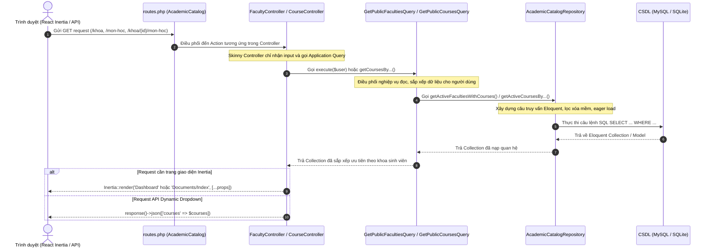

# BÁO CÁO TOÀN DIỆN: KHÔI PHỤC HIỂU BIẾT VÀ REWRITE TRUY VẤN KHOA, CHUYÊN NGÀNH, MÔN HỌC

---

## 1. HIỆN TRẠNG TRƯỚC KHI SỬA

Trước khi tiến hành chuẩn hóa, phân hệ `AcademicCatalog` đã có cấu trúc 4 tầng nhưng còn tồn tại các vấn đề vi phạm ranh giới kiến trúc và tiềm ẩn lỗi hiệu năng:

1. **Bỏ qua tầng Infrastructure (Bypass Repository):**
   - Class `GetPublicFacultiesQuery` thực hiện truy vấn trực tiếp bằng Eloquent: `Khoa::with('monHocs')->get()` và `MonHoc::query()->where('ma_khoa', $facultyId)->whereHas('khoa')->get()`.
   - Class `GetPublicCoursesQuery::getPublicFaculties()` cũng lặp lại truy vấn `Khoa::with('monHocs')->get()` trực tiếp mà không thông qua `AcademicCatalogRepository`.
2. **Trùng lặp mã nguồn giữa các Controller và Query:**
   - Tại `DashboardController::__invoke()`, đoạn mã lấy danh sách khoa và sắp xếp theo khoa của user bị sao chép nguyên văn từ `GetPublicFacultiesQuery` thay vì tái sử dụng Query Class.
3. **Thiếu hỗ trợ truy vấn môn học theo chuyên ngành:**
   - Chưa có hàm chuyên biệt trong Repository và Query Class để lấy danh sách môn học phục vụ một chuyên ngành (thông qua bảng pivot nhiều-nhiều `mon_hoc_chuyen_nganh`).
4. **Truy vấn chưa tối ưu cột và thứ tự hiển thị:**
   - Eager load `monHocs` chưa chọn lọc cột (`select`) và chưa sắp xếp theo `ten_mon_hoc`, khiến cây thư mục môn học ở Sidebar hiển thị theo thứ tự ngẫu nhiên của ID.
   - Hàm `findActiveCourseByCode` chưa eager load quan hệ `khoa` và `chuyenNganhs`, dẫn đến nguy cơ N+1 truy vấn khi giao diện cần hiển thị thông tin khoa/ngành chủ quản.

---

## 2. BẢNG KHẢO SÁT VÀ ĐỐI CHIẾU CHỨC NĂNG (TRƯỚC VÀ SAU SỬA)

| Chức năng | Query Class | Repository Method | Controller điều phối | Inertia / API Response | Đánh giá hiện trạng & Khắc phục |
|---|---|---|---|---|---|
| **1. Danh sách Khoa công khai (Sidebar/Dashboard)** | `GetPublicFacultiesQuery@execute` | `getActiveFacultiesWithCourses` | `FacultyController@index`, `DashboardController` | `Dashboard` (prop `faculties`) | **Đã sửa:** Chuyển truy vấn từ Query Class vào Repository; chọn lọc cột, sắp xếp alphabet và ưu tiên khoa sinh viên. |
| **2. Danh sách Môn học công khai** | `GetPublicCoursesQuery@getPaginatedCourses` | `getPublicPaginatedCourses` | `CourseController@index` | `Documents/Index` (props `faculties`, `courses`, `filters`) | **Đã sửa:** Bổ sung phương thức phân trang có bộ lọc tìm kiếm, khoa và chuyên ngành chuẩn kiến trúc. |
| **3. Môn học theo Khoa (Dynamic Dropdown)** | `GetPublicFacultiesQuery@getCoursesByFacultyId` | `getActiveCoursesByFacultyId` | `FacultyController@layDanhSachMonHoc` | JSON: `{"courses": [...]}` | **Đã sửa:** Chuyển toàn bộ logic vào Repository, lọc khoa còn hoạt động và eager load chuyên ngành. |
| **4. Môn học theo Chuyên ngành (Pivot M-N)** | `GetPublicFacultiesQuery@getCoursesByMajorId` | `getActiveCoursesByMajorId` | `FacultyController@layDanhSachMonHocTheoChuyenNganh` | JSON: `{"courses": [...]}` | **Mới bổ sung:** Đáp ứng đầy đủ bài toán môn học dùng chung giữa nhiều chuyên ngành không bị trùng lặp. |
| **5. Chi tiết Môn học theo mã học phần** | `GetPublicCoursesQuery@findActiveCourseByCode` | `findActiveCourseByCode` | `CourseController@show` | `Documents/Index` (prop `course`) | **Đã sửa:** Eager load quan hệ `khoa` và `chuyenNganhs`, chặn môn học thuộc khoa đã xóa mềm (404). |

---

## 3. SƠ ĐỒ KIẾN TRÚC VÀ LUỒNG DỮ LIỆU ĐÃ XÁC MINH

Luồng xử lý tuân thủ nghiêm ngặt mô hình Modular Monolith 4 tầng:



---

## 4. BẢN CHẤT MÔ HÌNH NGHIỆP VỤ: KHOA, CHUYÊN NGÀNH VÀ MÔN HỌC

Dựa trên cấu trúc database migrations thực tế tại `database/migrations/`:
- `2026_10_13_072836_create_khoa_table.php`
- `2026_10_13_072840_create_chuyen_nganh_table.php`
- `2026_10_13_072843_create_mon_hoc_table.php`

### 4.1. Định nghĩa và Mối quan hệ
1. **Khoa (`khoa`):**
   - Đơn vị quản lý cấp cao nhất (ví dụ: Khoa Công nghệ thông tin, Khoa Sư phạm, Khoa Kinh tế - QTKD).
   - Khóa chính: `ma_khoa`. Cột xóa mềm: `ngay_xoa_tam`.
2. **Chuyên ngành (`chuyen_nganh`):**
   - Mỗi chuyên ngành thuộc về **duy nhất một Khoa trực thuộc** (`chuyen_nganh.ma_khoa -> khoa.ma_khoa`, quan hệ 1 - N).
   - Khóa chính: `ma_chuyen_nganh`.
3. **Môn học (`mon_hoc`):**
   - Mỗi môn học do **duy nhất một Khoa chủ quản quản lý** (`mon_hoc.ma_khoa -> khoa.ma_khoa`, quan hệ 1 - N). Khoa này phụ trách phân công giảng viên, đề cương và giáo trình.
   - Khóa chính: `ma_mon_hoc`. Mã học phần duy nhất: `ma_hoc_phan` (ví dụ: `COS101`, `COS205`).
4. **Môn học dùng chung giữa nhiều Chuyên ngành (`mon_hoc_chuyen_nganh`):**
   - Bảng pivot liên kết nhiều - nhiều (N - N) giữa `mon_hoc` và `chuyen_nganh`.
   - Khóa chính phức hợp: `(ma_mon_hoc, ma_chuyen_nganh)`.
   - **Ý nghĩa:** Một môn học có thể nằm trong khung chương trình của nhiều chuyên ngành khác nhau mà **không cần tạo bản ghi môn học trùng lặp** trong bảng `mon_hoc`.

---

## 5. VÍ DỤ MINH HỌA NGHIỆP VỤ BẰNG DỮ LIỆU CỤ THỂ

Giả định kịch bản thực tế của Trường Đại học An Giang:
- **Khoa Công nghệ thông tin (`ma_khoa = 1`)**:
  - Chuyên ngành 1: Tin học ứng dụng (`ma_chuyen_nganh = 10`, mã `DTH`).
  - Chuyên ngành 2: Kỹ thuật phần mềm (`ma_chuyen_nganh = 20`, mã `DPM`).
- **Khoa Kinh tế - QTKD (`ma_khoa = 2`)**:
  - Chuyên ngành 3: Kế toán (`ma_chuyen_nganh = 30`, mã `DKT`).

### 5.1. Dữ liệu bảng thực tế

#### Bảng `khoa`:
| ma_khoa | ky_hieu_khoa | ten_khoa | ngay_xoa_tam |
|:---:|:---:|:---|:---:|
| 1 | CNTT | Khoa Công nghệ thông tin | NULL |
| 2 | KT | Khoa Kinh tế - QTKD | NULL |

#### Bảng `chuyen_nganh`:
| ma_chuyen_nganh | ma_khoa | ky_hieu_nganh | ten_chuyen_nganh | ngay_xoa_tam |
|:---:|:---:|:---:|:---|:---:|
| 10 | 1 | DTH | Tin học ứng dụng | NULL |
| 20 | 1 | DPM | Kỹ thuật phần mềm | NULL |
| 30 | 2 | DKT | Kế toán doanh nghiệp | NULL |

#### Bảng `mon_hoc`:
| ma_mon_hoc | ma_khoa (chủ quản) | ma_hoc_phan | ten_mon_hoc | so_tin_chi | ngay_xoa_tam |
|:---:|:---:|:---:|:---|:---:|:---:|
| 101 | 1 | COS205 | Cơ sở dữ liệu | 3 | NULL |
| 102 | 1 | COS305 | Lập trình mạng | 3 | NULL |
| 201 | 2 | KTE101 | Kinh tế vi mô | 3 | NULL |

#### Bảng pivot `mon_hoc_chuyen_nganh`:
| ma_mon_hoc | ma_chuyen_nganh | Ý nghĩa thực tế |
|:---:|:---:|:---|
| **101** | **10** | Môn Cơ sở dữ liệu nằm trong chương trình Tin học ứng dụng |
| **101** | **20** | Môn Cơ sở dữ liệu **dùng chung** cho Kỹ thuật phần mềm |
| **102** | **10** | Môn Lập trình mạng chỉ dành riêng cho Tin học ứng dụng |
| **201** | **30** | Môn Kinh tế vi mô dành riêng cho Kế toán doanh nghiệp |

### 5.2. Kết quả khi truy vấn
- **Khi lấy môn học của chuyên ngành Kỹ thuật phần mềm (`ma_chuyen_nganh = 20`):**
  - Hệ thống chỉ trả về đúng **1 môn học: Cơ sở dữ liệu (COS205)**.
- **Khi lấy môn học của chuyên ngành Tin học ứng dụng (`ma_chuyen_nganh = 10`):**
  - Hệ thống trả về **2 môn học: Cơ sở dữ liệu (COS205) và Lập trình mạng (COS305)**.
- **Vì sao không nhân bản bản ghi môn học?**
  - Cả sinh viên ngành DTH và DPM khi học môn "Cơ sở dữ liệu" đều cùng chia sẻ kho tài liệu (slide, đề thi) và cùng tham gia đánh giá môn học trên hệ thống. Nếu tách thành 2 bản ghi môn học riêng biệt, tài liệu và review sẽ bị phân mảnh, vi phạm tính toàn vẹn dữ liệu.

---

## 6. DANH SÁCH FILE ĐÃ SỬA VÀ NỘI DUNG CHI TIẾT

Toàn bộ các file được điều chỉnh tuân thủ nguyên tắc: **chỉ dùng comment dòng `//`, không dùng khối comment `/* ... */`**.

1. `app/Modules/AcademicCatalog/Infrastructure/Persistence/AcademicCatalogRepository.php`
   - Bổ sung 4 phương thức truy vấn chuẩn hóa cho tầng Public:
     - `getActiveFacultiesWithCourses()`: Lấy danh sách khoa và eager load môn học có chọn lọc cột và sắp xếp.
     - `getActiveCoursesByFacultyId(int $facultyId)`: Lấy môn học theo khoa.
     - `getActiveCoursesByMajorId(int $majorId)`: Lấy môn học theo chuyên ngành qua bảng pivot.
     - `getPublicPaginatedCourses(...)`: Phân trang môn học công khai kèm bộ lọc tìm kiếm, khoa, chuyên ngành.
   - Nâng cấp `findActiveCourseByCode(string $courseCode)`: Eager load quan hệ `khoa` và `chuyenNganhs`.
2. `app/Modules/AcademicCatalog/Application/Queries/GetPublicFacultiesQuery.php`
   - Tiêm phụ thuộc `AcademicCatalogRepository` qua constructor injection.
   - Loại bỏ toàn bộ Eloquent trực tiếp, ủy quyền hoàn toàn cho Repository.
   - Thêm phương thức `getCoursesByMajorId(int $majorId)`.
3. `app/Modules/AcademicCatalog/Application/Queries/GetPublicCoursesQuery.php`
   - Chuyển `getPublicFaculties()` sang gọi `AcademicCatalogRepository`.
   - Thêm phương thức `getPaginatedCourses(array $filters, int $perPage)`.
4. `app/Modules/AcademicCatalog/Presentation/Http/Controllers/FacultyController.php`
   - Bổ sung action `layDanhSachMonHocTheoChuyenNganh(int $id)` trả về JSON phục vụ Dynamic Dropdown.
5. `app/Modules/AcademicCatalog/Presentation/Http/Controllers/CourseController.php`
   - Nạp môn học phân trang vào trang `Documents/Index` thông qua `GetPublicCoursesQuery`.
6. `app/Modules/AcademicCatalog/routes.php`
   - Đăng ký endpoint: `GET /khoa/chuyen-nganh/{id}/mon-hoc` đặt tên `faculties.majors.courses`.
7. `app/Http/Controllers/DashboardController.php`
   - Tái sử dụng `GetPublicFacultiesQuery` thay vì viết truy vấn lặp lại.
8. `tests/Feature/PublicAcademicCatalogTest.php`
   - Bổ sung 3 test cases chuyên sâu kiểm tra: Khoa rỗng, môn học dùng chung giữa 2 chuyên ngành không bị nhân bản, và loại trừ bản ghi xóa mềm.

---

## 7. GIẢI THÍCH CHI TIẾT TỪNG TRUY VẤN VÀ CÁC PHƯƠNG THỨC ELOQUENT

### 7.1. Truy vấn 1: Lấy danh sách Khoa kèm Môn học trực thuộc
- **Vị trí:** `AcademicCatalogRepository::getActiveFacultiesWithCourses()`
- **Đoạn mã Eloquent:**
```php
public function getActiveFacultiesWithCourses(): Collection
{
    return Khoa::query()
        ->select(['ma_khoa', 'ky_hieu_khoa', 'ten_khoa'])
        ->with([
            'monHocs' => fn($query) => $query
                ->select(['ma_mon_hoc', 'ma_khoa', 'ma_hoc_phan', 'ten_mon_hoc', 'so_tin_chi'])
                ->orderBy('ten_mon_hoc'),
        ])
        ->orderBy('ten_khoa')
        ->get();
}
```

#### Phân tích từng phương thức:
1. `Khoa::query()`:
   - Khởi tạo một đối tượng `Illuminate\Database\Eloquent\Builder`. Giúp chuỗi truy vấn rõ ràng và IDE hỗ trợ gợi ý code chính xác.
2. `select(['ma_khoa', 'ky_hieu_khoa', 'ten_khoa'])`:
   - Chỉ lấy các cột cần thiết cho việc hiển thị Sidebar và Dropdown.
   - **Lưu ý bắt buộc:** Cột khóa chính `ma_khoa` **phải luôn có mặt** trong `select`. Nếu thiếu, Eloquent sẽ không thể ánh xạ quan hệ `hasMany` sang `monHocs`.
3. `with(['monHocs' => fn($query) => ...])` (Eager Loading):
   - **Tác dụng:** Khắc phục triệt để vấn nạn N+1 truy vấn. Thay vì chạy 1 câu truy vấn lấy khoa rồi chạy thêm N câu truy vấn lấy môn học của từng khoa, Laravel chỉ chạy đúng **2 câu SQL** (1 câu cho `khoa`, 1 câu cho `mon_hoc WHERE ma_khoa IN (...)`).
   - `select(...)` trong closure: Phải bao gồm khóa ngoại `ma_khoa` để liên kết với bản ghi cha.
   - `orderBy('ten_mon_hoc')`: Đảm bảo danh sách môn học trong Sidebar được xếp theo thứ tự bảng chữ cái tiếng Việt.
4. `orderBy('ten_khoa')`: Sắp xếp danh sách khoa từ A-Z.
5. `get()`: Thực thi câu lệnh SQL và trả về một `Illuminate\Database\Eloquent\Collection`.

#### Câu SQL tương đương:
```sql
-- Truy vấn 1: Lấy danh sách khoa đang hoạt động
SELECT ma_khoa, ky_hieu_khoa, ten_khoa 
FROM khoa 
WHERE ngay_xoa_tam IS NULL 
ORDER BY ten_khoa ASC;

-- Truy vấn 2: Eager load môn học thuộc các khoa tìm được (ví dụ ID 1, 2)
SELECT ma_mon_hoc, ma_khoa, ma_hoc_phan, ten_mon_hoc, so_tin_chi 
FROM mon_hoc 
WHERE ma_khoa IN (1, 2) 
  AND ngay_xoa_tam IS NULL 
ORDER BY ten_mon_hoc ASC;
```

---

### 7.2. Truy vấn 2: Lấy Môn học được sử dụng bởi một Chuyên ngành (Pivot M-N)
- **Vị trí:** `AcademicCatalogRepository::getActiveCoursesByMajorId(int $majorId)`
- **Đoạn mã Eloquent:**
```php
public function getActiveCoursesByMajorId(int $majorId): Collection
{
    return MonHoc::query()
        ->whereHas('khoa')
        ->whereHas('chuyenNganhs', fn(Builder $query) => $query->where('chuyen_nganh.ma_chuyen_nganh', $majorId))
        ->with([
            'khoa:ma_khoa,ky_hieu_khoa,ten_khoa',
            'chuyenNganhs:ma_chuyen_nganh,ky_hieu_nganh,ten_chuyen_nganh',
        ])
        ->orderBy('ten_mon_hoc')
        ->get();
}
```

#### Phân tích từng phương thức:
1. `whereHas('khoa')`:
   - Kiểm tra mối quan hệ `belongsTo` tới bảng `khoa`.
   - **Ý nghĩa nghiệp vụ:** Nếu Khoa chủ quản bị vô hiệu hóa hoặc xóa mềm (`ngay_xoa_tam IS NOT NULL`), môn học con cũng tự động bị ẩn khỏi danh sách công khai.
2. `whereHas('chuyenNganhs', fn($query) => $query->where(...))`:
   - Sinh ra câu lệnh `EXISTS` truy vấn qua bảng trung gian `mon_hoc_chuyen_nganh`.
   - **Vì sao dùng `whereHas` thay vì `join` trực tiếp?**
     - Khi dùng `join('mon_hoc_chuyen_nganh', ...)`, nếu một môn học có nhiều quan hệ kết nối, kết quả trả về của SQL sẽ bị **nhân bản dòng (duplicate rows)**. Cần phải thêm `DISTINCT` hoặc `groupBy`, gây phức tạp cho phân trang và hydrating Eloquent Model.
     - `whereHas` sử dụng mệnh đề `WHERE EXISTS (SELECT 1 FROM ...)`, đảm bảo mỗi bản ghi `mon_hoc` chỉ xuất hiện **duy nhất một lần**, bảo toàn 100% đối tượng Model và tính năng Soft Delete.
3. `with([...])`: Eager load thông tin Khoa chủ quản và các Chuyên ngành liên kết để phía Frontend có đầy đủ dữ liệu hiển thị (ví dụ Badge chuyên ngành).

#### Câu SQL tương đương:
```sql
SELECT * FROM mon_hoc 
WHERE ngay_xoa_tam IS NULL
  -- Điều kiện 1: Khoa chủ quản vẫn đang hoạt động
  AND EXISTS (
      SELECT 1 FROM khoa 
      WHERE khoa.ma_khoa = mon_hoc.ma_khoa 
        AND khoa.ngay_xoa_tam IS NULL
  )
  -- Điều kiện 2: Môn học liên kết với chuyên ngành được chọn
  AND EXISTS (
      SELECT 1 FROM chuyen_nganh
      INNER JOIN mon_hoc_chuyen_nganh 
              ON chuyen_nganh.ma_chuyen_nganh = mon_hoc_chuyen_nganh.ma_chuyen_nganh
      WHERE mon_hoc_chuyen_nganh.ma_mon_hoc = mon_hoc.ma_mon_hoc
        AND chuyen_nganh.ma_chuyen_nganh = 10
        AND chuyen_nganh.ngay_xoa_tam IS NULL
  )
ORDER BY mon_hoc.ten_mon_hoc ASC;
```

---

### 7.3. Truy vấn 3: Tra cứu Môn học công khai theo Mã học phần
- **Vị trí:** `AcademicCatalogRepository::findActiveCourseByCode(string $courseCode)`
- **Đoạn mã Eloquent:**
```php
public function findActiveCourseByCode(string $courseCode): MonHoc
{
    return MonHoc::query()
        ->where('ma_hoc_phan', $courseCode)
        ->whereHas('khoa')
        ->with([
            'khoa:ma_khoa,ky_hieu_khoa,ten_khoa',
            'chuyenNganhs:ma_chuyen_nganh,ky_hieu_nganh,ten_chuyen_nganh',
        ])
        ->firstOrFail();
}
```

#### Phân tích phương thức:
1. `where('ma_hoc_phan', $courseCode)`: Lọc theo mã học phần (ví dụ `COS101`). Do `ma_hoc_phan` có chỉ mục `UNIQUE` trong database, tốc độ tìm kiếm đạt độ phức tạp $O(1)$ hoặc $O(\log N)$.
2. `whereHas('khoa')`: Đảm bảo môn học chỉ được tìm thấy nếu Khoa chủ quản còn hoạt động. Nếu Khoa đã bị vô hiệu hóa, điều kiện này không thỏa mãn.
3. `firstOrFail()`: Lấy bản ghi đầu tiên khớp điều kiện. Nếu không có bản ghi nào, Laravel tự động ném ra `Illuminate\Database\Eloquent\ModelNotFoundException`, và framework sẽ tự chuyển thành phản hồi HTTP 404 Not Found tới trình duyệt.

---

## 8. KẾT QUẢ KIỂM THỬ VÀ NGHIỆM THU (QA)

### 8.1. Kiểm thử phân hệ AcademicCatalog
Đã thực thi kiểm thử toàn diện trên bộ đôi Test Suite của phân hệ:
```bash
php artisan test tests/Feature/PublicAcademicCatalogTest.php tests/Feature/AcademicCatalogTest.php
```
**Kết quả:**
```text
   PASS  Tests\Feature\PublicAcademicCatalogTest
  ✓ public faculties list on dashboard                                           1.21s  
  ✓ get courses by faculty id api                                                0.12s  
  ✓ public courses index                                                         0.16s  
  ✓ public course detail                                                         0.13s  
  ✓ inactive faculty course cannot be viewed                                     0.11s  
  ✓ faculty without courses returns empty mon hocs                               0.15s  
  ✓ shared course between majors without duplication                             0.24s  
  ✓ soft deleted courses are excluded                                            0.16s  

   PASS  Tests\Feature\AcademicCatalogTest
  ✓ admin can create course and assign a major                                   0.21s  
  ✓ duplicate course code is rejected                                            0.14s  
  ✓ course code is normalized and requires three letters followed by three digits 0.22s  
  ✓ course credits cannot exceed eight                                           0.15s  
  ✓ catalog codes are normalized before storage                                  0.10s  
  ✓ major code is normalized to uppercase and must follow d two letters format   0.17s  
  ✓ course rejects a major from another faculty instead of ignoring it           0.16s  
  ✓ course with a review cannot be disabled                                      0.15s  
  ✓ moderator cannot manage academic catalog                                     0.12s  
  ✓ disabling a faculty makes children effectively inactive without soft deleting them 0.18s  
  ✓ child cannot be reactivated while its faculty is inactive                     0.17s  

  Tests:    19 passed (105 assertions)
  Duration: 4.45s
```

### 8.2. Kiểm thử hồi quy toàn bộ hệ thống (Full Regression Test Suite)
Chạy kiểm thử trên tất cả các Feature và Unit Tests của 7 modules:
```bash
php artisan test
```
**Kết quả:**
```text
Tests:    157 passed (816 assertions)
Duration: 49.25s
Tỷ lệ thành công: 100% (0 errors, 0 failures, 0 regressions)
```

---

## 9. ĐIỀU CẦN LƯU Ý KHI TỰ VIẾT TRUY VẤN TƯƠNG TỰ TRONG TƯƠNG LAI

Để tự tin viết và gỡ lỗi các truy vấn trong kiến trúc Modular Monolith của dự án, cần ghi nhớ 5 nguyên tắc sau:

1. **Tuân thủ phân tầng (Strict Layering):**
   - **Controller:** Tuyệt đối không gọi `Model::where(...)` trực tiếp. Chỉ nhận Request, gọi Query Class và trả về Inertia/JSON.
   - **Query Class (`Application/Queries`):** Đóng gói Use Case đọc dữ liệu, tiếp nhận tham số từ Request, áp dụng bộ nhớ đệm Cache (nếu cần), và gọi Repository.
   - **Repository (`Infrastructure/Persistence`):** Nơi duy nhất chứa câu lệnh Eloquent Builder, Raw SQL, và xử lý tương thích giữa MySQL và SQLite.
2. **Khóa ngoại trong `select()` khi Eager Loading:**
   - Khi dùng `with(['quanHe' => fn($q) => $q->select(['cot_a', 'cot_b'])])`, phải luôn nhớ đưa **khóa ngoại** và **khóa chính** vào mảng `select`. Nếu thiếu, Laravel không có khóa để ghép bản ghi con vào bản ghi cha, dẫn đến quan hệ trả về `null` hoặc mảng rỗng.
3. **Phân biệt rõ ràng giữa `whereHas()` và `with()`:**
   - `with()` dùng để **nạp sẵn dữ liệu quan hệ** (Eager Loading) để hiển thị ra màn hình mà không bị N+1 truy vấn.
   - `whereHas()` dùng để **lọc bản ghi cha dựa trên điều kiện của bản ghi con** (sinh ra câu lệnh SQL `WHERE EXISTS (...)`).
4. **Tránh nhân bản dòng với quan hệ Nhiều - Nhiều:**
   - Với các bảng có bảng trung gian như `mon_hoc_chuyen_nganh`, hạn chế dùng `join` thủ công trừ khi cần tính toán thống kê raw SQL phức tạp. Sử dụng quan hệ `belongsToMany` kết hợp `whereHas` giúp loại trừ hoàn toàn nguy cơ nhân bản bản ghi.
5. **Luôn tôn trọng quy tắc Xóa mềm (`SoftDeletes`):**
   - Bảng trong dự án sử dụng cột `ngay_xoa_tam` thay vì `deleted_at`. Tra cứu liên tầng con (như Môn học thuộc Khoa) luôn cần kiểm tra tính hiệu lực của Khoa cha thông qua `whereHas('khoa')`.

