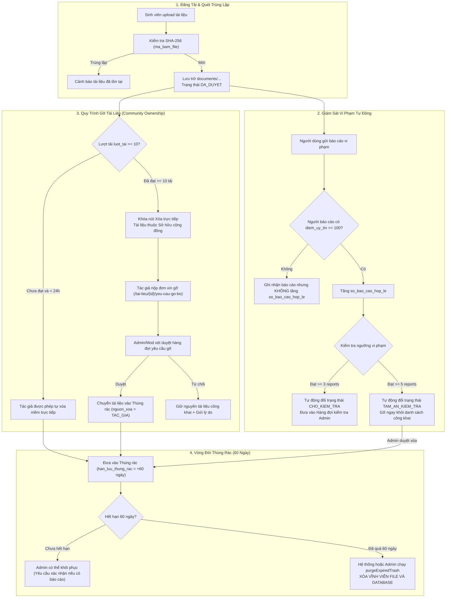

# TÀI LIỆU KỸ THUẬT & ĐẶC TẢ NGHIỆP VỤ PHÂN HỆ QUẢN TRỊ (ADMIN & MODERATOR)
## Căn cứ kiến trúc và hướng dẫn tích hợp dành cho Phân hệ Sinh viên & Cựu sinh viên
### Dự án: AGU Academic Hub (ĐHQG-HCM / Trường Đại học An Giang)

---

| Thông Tin Tài Liệu | Chi Tiết |
| :--- | :--- |
| **Dự án** | AGU Academic Hub (Cổng Học Thuật và Chia Sẻ Tri Thức Sinh Viên) |
| **Kiến trúc** | Modular Monolith (Laravel 11 + Inertia.js React 18 + Vite + Tailwind CSS) |
| **Phân hệ hoàn thiện** | `QUAN_TRI_VIEN` (Admin), `KIEM_DUYET_VIEN` (Moderator), `System Engine` |
| **Phân hệ thụ hưởng** | `SINH_VIEN` (Sinh viên hiện hành), `CUU_SINH_VIEN` (Cựu sinh viên) |
| **Mục đích** | Đặc tả 100% các tính năng, luồng nghiệp vụ, API routes, data contracts, cơ chế bảo mật và ranh giới phân quyền đã xây dựng ở phía Quản trị, làm căn cứ nền tảng để đội ngũ phát triển phía Sinh viên & Cựu sinh viên tích hợp chuẩn xác, đồng bộ và không xung đột. |
| **Phiên bản & Thời điểm** | Tháng 11/2026 — Đã loại bỏ hoàn toàn luồng nộp ảnh thẻ KYC đối với sinh viên đang học. |

---

## MỤC LỤC TỔNG QUAN

1. [Nguyên Tắc Cốt Lõi & Ranh Giới Định Danh Hệ Thống](#1-nguyên-tắc-cốt-lõi--ranh-giới-định-danh-hệ-thống)
2. [Ma Trận Phân Quyền RBAC & Middleware Bảo Vệ Route](#2-ma-trận-phân-quyền-rbac--middleware-bảo-vệ-route)
3. [Đặc Tả Chi Tiết 14 Nhóm Nghiệp Vụ Quản Trị & Điểm Chạm Sinh Viên](#3-đặc-tả-chi-tiết-14-nhóm-nghiệp-vụ-quản-trị--điểm-chạm-sinh-viên)
   - [Nghiệp vụ 1: Quản trị danh mục Khoa, Chuyên ngành và Môn học](#nghiệp-vụ-1-quản-trị-danh-mục-khoa-chuyên-ngành-và-môn-học)
   - [Nghiệp vụ 2: Quản trị tài khoản, phân quyền và xử lý vi phạm lũy tiến](#nghiệp-vụ-2-quản-trị-tài-khoản-phân-quyền-và-xử-lý-vi-phạm-lũy-tiến)
   - [Nghiệp vụ 3: Dữ liệu sinh viên nạp trước & Kích hoạt đổi mật khẩu lần đầu](#nghiệp-vụ-3-dữ-liệu-sinh-viên-nạp-trước--kích-hoạt-đổi-mật-khẩu-lần-đầu)
   - [Nghiệp vụ 4: Hàng đợi xét duyệt KYC Cựu sinh viên & Xem trước Signed URL](#nghiệp-vụ-4-hàng-đợi-xét-duyệt-kyc-cựu-sinh-viên--xem-trước-signed-url)
   - [Nghiệp vụ 5: Hàng đợi tiếp nhận và xử lý báo cáo vi phạm tài liệu](#nghiệp-vụ-5-hàng-đợi-tiếp-nhận-và-xử-lý-báo-cáo-vi-phạm-tài-liệu)
   - [Nghiệp vụ 6: Cơ chế tự động giám sát và chuyển trạng thái tài liệu nguy cơ cao](#nghiệp-vụ-6-cơ-chế-tự-động-giám-sát-và-chuyển-trạng-thái-tài-liệu-nguy-cơ-cao)
   - [Nghiệp vụ 7: Xử lý yêu cầu gỡ tài liệu thuộc quyền Sở hữu Cộng đồng](#nghiệp-vụ-7-xử-lý-yêu-cầu-gỡ-tài-liệu-thuộc-quyền-sở-hữu-cộng-đồng)
   - [Nghiệp vụ 8: Quản lý Thùng rác 60 ngày, Khôi phục và Xóa vĩnh viễn](#nghiệp-vụ-8-quản-lý-thùng-rác-60-ngày-khôi-phục-và-xóa-vĩnh-viễn)
   - [Nghiệp vụ 9: Quản lý và giám sát dung lượng lưu trữ (Storage Management)](#nghiệp-vụ-9-quản-lý-và-giám-sát-dung-lượng-lưu-trữ-storage-management)
   - [Nghiệp vụ 10: Dashboard tổng quan vận hành hệ thống (Admin Dashboard)](#nghiệp-vụ-10-dashboard-tổng-quan-vận-hành-hệ-thống-admin-dashboard)
   - [Nghiệp vụ 11: Nhật ký kiểm toán nghiệp vụ bất biến (Immutable Audit Logs)](#nghiệp-vụ-11-nhật-ký-kiểm-toán-nghiệp-vụ-bất-biến-immutable-audit-logs)
   - [Nghiệp vụ 12: Hệ thống Thông báo Nghiệp vụ Thời gian thực (Notifications)](#nghiệp-vụ-12-hệ-thống-thông-báo-nghiệp-vụ-thời-gian-thực-notifications)
   - [Nghiệp vụ 13: Đồng bộ trạng thái, chuẩn hóa URL và bảo vệ an toàn biên](#nghiệp-vụ-13-đồng-bộ-trạng-thái-chuẩn-hóa-url-và-bảo-vệ-an-toàn-biên)
   - [Nghiệp vụ 14: Báo cáo đánh giá môn học, giảng viên và bộ lọc từ cấm tự động](#nghiệp-vụ-14-báo-cáo-đánh-giá-môn-học-giảng-viên-và-bộ-lọc-từ-cấm-tự-động)
4. [Sơ Đồ Luồng Dữ Liệu Tích Hợp (Data Flow Diagrams)](#4-sơ-đồ-luồng-dữ-liệu-tích-hợp-data-flow-diagrams)
5. [Bảng Tra Cứu Enums, Status Codes & Data Contracts Dùng Chung](#5-bảng-tra-cứu-enums-status-codes--data-contracts-dùng-chung)
6. [Checklist Dành Cho Kỹ Sư Phát Triển Phân Hệ Sinh Viên & Cựu Sinh Viên](#6-checklist-dành-cho-kỹ-sư-phát-triển-phân-hệ-sinh-viên--cựu-sinh-viên)

---

## 1. NGUYÊN TẮC CỐT LÕI & RANH GIỚI ĐỊNH DANH HỆ THỐNG

Trước khi triển khai bất kỳ giao diện hay API nào phía Sinh viên và Cựu sinh viên, toàn bộ đội ngũ kỹ thuật phải tuân thủ nghiêm ngặt **3 nguyên tắc bất di bất dịch** sau:

### 1.1. Tách biệt hoàn toàn hai luồng định danh (Zero-KYC cho Sinh viên đang học)
- **Sinh viên đang học (`SINH_VIEN`):** 
  - Tài khoản được đối soát từ nguồn dữ liệu sinh viên thô do nhà trường cấp nạp sẵn vào bảng `danh_sach_sinh_vien_raw`.
  - Sinh viên **KHÔNG ĐƯỢC TỰ ĐĂNG KÝ** qua form `/dang-ky` (hệ thống chặn đuôi email `@student.agu.edu.vn`).
  - Sinh viên **TUYỆT ĐỐI KHÔNG PHẢI NỘP ẢNH THẺ, KHÔNG QUA HÀNG ĐỢI KYC THỦ CÔNG**.
  - Kích hoạt duy nhất bằng hành động: **Đổi mật khẩu lần đầu** tại `/mat-khau-lan-dau`.
- **Cựu sinh viên (`CUU_SINH_VIEN`):**
  - Không có trong danh sách sinh viên hiện hành.
  - Phải nộp hồ sơ KYC tại `/cuu-sinh-vien/dang-ky` kèm minh chứng tốt nghiệp (bằng, giấy chứng nhận).
  - Ảnh minh chứng được bảo vệ trong thư mục nhạy cảm (`private/kyc/`), chỉ xem qua **Temporary Signed URL (30 phút)**.
  - Phải được Admin hoặc Moderator duyệt trên hàng đợi KYC mới được phép đăng nhập.

### 1.2. Tính tự động cấp phát tài nguyên khi kích hoạt
- Bất kể người dùng là Sinh viên (kích hoạt qua đổi mật khẩu) hay Cựu sinh viên (kích hoạt qua duyệt KYC), khi tài khoản chuyển sang trạng thái `DANG_HOAT_DONG`, hệ thống Backend **tự động khởi tạo Ví Điểm (`ViDiem`) với 100 điểm khả dụng ban đầu (`diem_kha_dung = 100`)**.
- Phía Frontend chỉ việc hiển thị số dư 100 điểm trên giao diện ví `/vi-diem`, không cần gọi thêm API khởi tạo ví.

### 1.3. Tính bất biến và truy vết dữ liệu (Audit Trail)
- Mọi thao tác xóa tài liệu đều là **Xóa mềm (Soft Delete)** kèm thời hạn lưu trữ thùng rác 60 ngày.
- Mọi tác vụ quản trị, thay đổi quyền, khóa/mở khóa tài khoản, xử lý báo cáo, khôi phục hay xóa vĩnh viễn đều được ghi nhật ký kiểm toán vào bảng `nhat_ky_kiem_toan`. Bảng này có tính chất **BẤT BIẾN (IMMUTABLE)** — Backend sẽ ném `DomainException` nếu có bất kỳ lệnh `update` hoặc `delete` nào can thiệp vào log.

---

## 2. MA TRẬN PHÂN QUYỀN RBAC & MIDDLEWARE BẢO VỆ ROUTE

Hệ thống phân quyền được kiểm soát chặt chẽ ở cấp độ Middleware Laravel (`RoleMiddleware`), ngăn ngừa triệt để tình trạng chỉ ẩn menu ở Frontend nhưng hở Route ở Backend.

### 2.1. Phân cấp vai trò người dùng (`VaiTroNguoiDung`)
1. **`QUAN_TRI_VIEN` (Administrator):** Toàn quyền quản trị hệ thống, bao gồm phân quyền, nạp dữ liệu sinh viên raw, cấu hình hệ thống, quản lý danh mục học thuật, khôi phục tài liệu, xóa vĩnh viễn file và quản lý dung lượng.
   - Cấp bậc (`CapQuanTri`): `TOI_CAO` (Super Admin - tối thiểu 1 người trong hệ thống, không thể bị hạ cấp hay xóa) và `THUONG` (Admin thông thường).
2. **`KIEM_DUYET_VIEN` (Moderator):** Nhân sự kiểm duyệt nội dung học thuật, xử lý hàng đợi báo cáo vi phạm tài liệu/đánh giá, thẩm định hồ sơ Alumni KYC, xét duyệt yêu cầu gỡ tài liệu, xem thùng rác (nhưng **không** có quyền khôi phục hay xóa vĩnh viễn).
3. **`SINH_VIEN` (Student):** Sinh viên AGU đang học, được tra cứu tài liệu, đóng góp bài giảng/đề thi, đánh giá môn học, tạo/nhận nhiệm vụ săn thưởng (Bounty Wishlist), báo cáo vi phạm.
4. **`CUU_SINH_VIEN` (Alumni):** Cựu sinh viên đã tốt nghiệp, quyền hạn tương đương sinh viên trong việc tra cứu, chia sẻ tài liệu và tham gia tương tác cộng đồng.

### 2.2. Ma trận phân quyền các nhóm Route chức năng

| Nhóm Chức Năng | Route Name Prefix / URI | Sinh viên / Cựu SV | Kiểm duyệt viên (Mod) | Quản trị viên (Admin) | Ghi Chú Kỹ Thuật |
| :--- | :--- | :---: | :---: | :---: | :--- |
| **Bảng điều khiển Admin** | `admin.dashboard` (`/quan-tri`) | ❌ (403) | ✅ (200) | ✅ (200) | Thống kê số liệu vận hành |
| **Quản trị người dùng & RBAC**| `admin.users.*` (`/quan-tri/nguoi-dung`) | ❌ (403) | ❌ (403) | ✅ (200) | Xem chi tiết, khóa, đổi role, ghi vi phạm |
| **Nạp dữ liệu sinh viên Raw** | `admin.raw-students.*` (`/quan-tri/sinh-vien-raw`)| ❌ (403) | ❌ (403) | ✅ (200) | Import danh sách, kiểm tra trùng lặp |
| **Hàng đợi duyệt Alumni KYC** | `admin.kyc.*` (`/quan-tri/duyet-kyc`) | ❌ (403) | ✅ (200) | ✅ (200) | Xem Signed URL, duyệt/từ chối KYC |
| **Xem trước minh chứng KYC** | `kyc.preview` (`/kyc/xem-anh/{id}`) | ❌ (403) | ✅ (Signed URL) | ✅ (Signed URL) | URL có chữ ký bảo mật 30 phút |
| **Quản trị Khoa/Ngành/Môn** | `admin.catalog.*` (`/quan-tri/danh-muc`) | ❌ (403) | ❌ (403) | ✅ (200) | Thêm, sửa, vô hiệu hóa danh mục |
| **Hàng đợi Báo cáo thống nhất**| `admin.review-reports.*` (`/quan-tri/bao-cao-danh-gia`)| ❌ (403) | ✅ (200) | ✅ (200) | Hàng đợi gom Báo cáo Môn/GV/Tài liệu |
| **Chi tiết & Xử lý báo cáo TL** | `admin.reports.*` (`/quan-tri/bao-cao-tai-lieu`) | ❌ (403) | ✅ (200) | ✅ (200) | Bác bỏ, tạm ẩn, xóa mềm tài liệu |
| **Tài liệu chờ kiểm tra nguy cơ**| `admin.documents.review-queue` | ❌ (403) | ✅ (200) | ✅ (200) | Tài liệu bị tự động gắn cờ do >= 3 report |
| **Yêu cầu gỡ tài liệu cộng đồng**| `admin.documents.removal-requests.*` | ❌ (403) | ✅ (200) | ✅ (200) | Xét duyệt đơn xin gỡ tài liệu >= 10 tải |
| **Xem danh sách Thùng rác** | `admin.documents.deleted` | ❌ (403) | ✅ (200) | ✅ (200) | Xem tài liệu đã bị xóa mềm |
| **Khôi phục tài liệu Thùng rác**| `admin.documents.restore` | ❌ (403) | ❌ (403) | ✅ (200) | Bắt buộc xác nhận nếu có báo cáo vi phạm |
| **Xóa vĩnh viễn tài liệu** | `admin.documents.permanent-delete` | ❌ (403) | ❌ (403) | ✅ (200) | Xóa sạch file vật lý và bản ghi CSDL |
| **Quản trị Lưu trữ & Dung lượng**| `admin.storage.*` (`/quan-tri/luu-tru`) | ❌ (403) | ❌ (403) | ✅ (200) | Dọn dẹp rác quá hạn 60 ngày, phân tích |
| **Nhật ký kiểm toán (Audit Log)**| `admin.audit-logs.*` (`/quan-tri/nhat-ky-kiem-toan`)| ❌ (403) | ❌ (403) | ✅ (200) | Xem lịch sử thao tác hệ thống bất biến |
| **Cấu hình hệ thống** | `admin.settings.*` (`/quan-tri/cau-hinh`) | ❌ (403) | ❌ (403) | ✅ (200) | Tùy chỉnh thông số vận hành |

---

## 3. ĐẶC TẢ CHI TIẾT 14 NHÓM NGHIỆP VỤ QUẢN TRỊ & ĐIỂM CHẠM SINH VIÊN

---

### Nghiệp vụ 1: Quản trị danh mục Khoa, Chuyên ngành và Môn học
- **Phân hệ phụ trách:** `AcademicCatalog`
- **Route & Controller:**
  - `GET /quan-tri/danh-muc` (`admin.catalog.index`) -> `AcademicCatalogController@index`
  - `POST /quan-tri/danh-muc/khoa` (`admin.catalog.faculties.store`)
  - `PUT /quan-tri/danh-muc/khoa/{maKhoa}` (`admin.catalog.faculties.update`)
  - `PUT /quan-tri/danh-muc/khoa/{maKhoa}/trang-thai` (`admin.catalog.faculties.toggle`)
  - `POST /quan-tri/danh-muc/chuyen-nganh` (`admin.catalog.majors.store`)
  - `PUT /quan-tri/danh-muc/chuyen-nganh/{maChuyenNganh}` (`admin.catalog.majors.update`)
  - `PUT /quan-tri/danh-muc/chuyen-nganh/{maChuyenNganh}/trang-thai` (`admin.catalog.majors.toggle`)
  - `POST /quan-tri/danh-muc/mon-hoc` (`admin.catalog.courses.store`)
  - `PUT /quan-tri/danh-muc/mon-hoc/{maMonHoc}` (`admin.catalog.courses.update`)
  - `PUT /quan-tri/danh-muc/mon-hoc/{maMonHoc}/trang-thai` (`admin.catalog.courses.toggle`)
- **Quy tắc ràng buộc toàn vẹn (Business Rules):**
  - **Mã học phần (`ma_hoc_phan`):** Phải tuân theo định dạng chuẩn hóa **3 chữ cái in hoa + 3 chữ số** (Regex: `/^[A-Z]{3}[0-9]{3}$/`, ví dụ: `COS101`, `ENG202`). Hệ thống tự động `trim` và `strtoupper`. Chặn trùng mã học phần trên toàn hệ thống.
  - **Ký hiệu Khoa & Chuyên ngành:** Ký hiệu khoa viết hoa (ví dụ: `CNTT`, `KTCN`). Ký hiệu chuyên ngành bắt đầu bằng chữ `D` + 2 chữ cái in hoa (ví dụ: `DTH`, `DMK`).
  - **Số tín chỉ:** Bắt buộc từ 1 đến 8 tín chỉ ($1 \le \text{so\_tin\_chi} \le 8$).
  - **Ràng buộc Chuyên ngành - Khoa:** Khi tạo/sửa môn học, các chuyên ngành được gán (`ma_chuyen_nganh[]`) **bắt buộc phải trực thuộc Khoa** quản lý môn học đó. Hệ thống sẽ từ chối nếu gán chuyên ngành thuộc khoa khác.
  - **Khóa an toàn dữ liệu:** Không thể vô hiệu hóa (`toggle`) hoặc xóa môn học nếu môn học đó đang có **tài liệu (`tai_lieu`)**, **bài đánh giá (`danh_gia_mon_hoc`)**, hoặc **yêu cầu tìm tài liệu (`yeu_cau_tai_lieu`)**.
  - **Tính kế thừa trạng thái Khoa - Con:** Khi một Khoa bị vô hiệu hóa (`trang_thai = false`), tất cả các chuyên ngành con và môn học con sẽ tự động rơi vào trạng thái ngầm vô hiệu hóa (`effectively inactive`). Không thể bật kích hoạt chuyên ngành/môn học con nếu Khoa cha đang tắt.
- **Điểm chạm dành cho Dev Sinh viên & Cựu sinh viên:**
  - Khi render cây danh mục môn học (`FacultyCourseTree.jsx`) hoặc dropdown chọn môn học khi đăng tải tài liệu (`Documents/Create.jsx`), **chỉ load các môn học có `trang_thai = true` và Khoa trực thuộc có `trang_thai = true`**.
  - Route tra cứu công khai cho Sinh viên:
    - `GET /khoa` (`faculties.index`): Danh sách khoa.
    - `GET /khoa/{id}/mon-hoc` (`faculties.courses`): Danh sách môn học thuộc khoa.
    - `GET /khoa/chuyen-nganh/{id}/mon-hoc` (`faculties.majors.courses`): Môn học theo chuyên ngành.
    - `GET /mon-hoc/{course_code}` (`courses.show`): Chi tiết môn học, đề cương, tài liệu và review.

---

### Nghiệp vụ 2: Quản trị tài khoản, phân quyền và xử lý vi phạm lũy tiến
- **Phân hệ phụ trách:** `Administration`
- **Route & Controller:**
  - `GET /quan-tri/nguoi-dung` (`admin.users.index`) -> `AdminUserController@index`
  - `GET /quan-tri/nguoi-dung/{id}` (`admin.users.show`) -> `AdminUserController@show`
  - `PUT /quan-tri/nguoi-dung/{id}/trang-thai` (`admin.users.status`) -> `AdminUserController@toggleStatus`
  - `PUT /quan-tri/nguoi-dung/{id}/phan-quyen` (`admin.users.permissions`) -> `AdminUserController@updatePermissions`
  - `POST /quan-tri/nguoi-dung/{id}/vi-pham` (`admin.users.violations`) -> `AdminUserController@recordViolation`
- **Cơ chế hoạt động & Xử lý vi phạm lũy tiến:**
  - **Bảo vệ tài khoản quản trị:** Admin không thể tự khóa chính mình, không thể tự hạ quyền của mình. Hệ thống bảo vệ tuyệt đối không cho phép hạ quyền Super Admin cuối cùng (`CapQuanTri::TOI_CAO`).
  - **Lịch sử truy vết:** Mọi lần đổi trạng thái hoặc phân quyền đều được lưu vào `lich_su_trang_thai_nguoi_dung` và `lich_su_phan_quyen_nguoi_dung`, ghi rõ ai thực hiện, lúc nào và lý do.
  - **Xử lý vi phạm lũy tiến (Progressive Penalty System):**
    - Khi Admin ghi nhận vi phạm qua `POST /quan-tri/nguoi-dung/{id}/vi-pham`:
      - **Vi phạm lần 1:** `so_lan_vi_pham = 1`, `muc_canh_bao = 'CANH_BAO'`, tài khoản vẫn ở `DANG_HOAT_DONG`.
      - **Vi phạm từ lần 2 trở lên:** `so_lan_vi_pham >= 2`, `muc_canh_bao = 'TAM_KHOA'`, hệ thống **tự động chuyển trạng thái tài khoản thành `TAM_KHOA`**, cập nhật `ly_do_khoa` bằng nội dung vi phạm vừa ghi nhận.
- **Điểm chạm dành cho Dev Sinh viên & Cựu sinh viên:**
  - **Chặn truy cập tài khoản bị khóa:** Sinh viên khi bị khóa tài khoản (`trang_thai == 'TAM_KHOA'` hoặc `'KHOA_VINH_VIEN'`), khi gửi request sẽ bị Middleware chặn và hiển thị màn hình thông báo khóa tài khoản, kèm prop `ly_do_khoa` để người dùng biết nguyên nhân.
  - **Hồ sơ cá nhân (`Profile/Edit.jsx`):** Cần hiển thị huy hiệu trạng thái tài khoản (`DANG_HOAT_DONG`), điểm uy tín (`diem_uy_tin`), và cảnh báo số lần vi phạm (`so_lan_vi_pham`, `muc_canh_bao`) để sinh viên tự điều chỉnh hành vi.

---

### Nghiệp vụ 3: Dữ liệu sinh viên nạp trước & Kích hoạt đổi mật khẩu lần đầu
- **Phân hệ phụ trách:** `Administration` & `Identity`
- **Route & Controller:**
  - Admin: `GET /quan-tri/sinh-vien-raw` (`admin.raw-students.index`) -> `AdminRawStudentController@index`
  - Admin: `POST /quan-tri/sinh-vien-raw/nap` (`admin.raw-students.import`) -> `AdminRawStudentController@import`
  - Sinh viên: `GET /mat-khau-lan-dau` (`password.change`) -> `FirstTimePasswordController@hienThiFormDoiMatKhau`
  - Sinh viên: `POST /mat-khau-lan-dau` (`password.change.update`) -> `FirstTimePasswordController@capNhatMatKhau`
- **Data Contract Bảng `danh_sach_sinh_vien_raw`:**
  - `mssv` (string, unique, format chuẩn sinh viên AGU: `DTHxxxxxx`, `DPMxxxxxx`,...).
  - `ho_ten` (string, họ và tên sinh viên).
  - `email_sv` (string, unique, định dạng `@student.agu.edu.vn`).
  - `ma_khoa` (foreign key nullable -> `khoa.ma_khoa`).
  - `mat_khau_mac_dinh` (string băm `Hash::make`, trường cấp ban đầu, ví dụ: `Agu@123456`).
  - `da_kich_hoat` (boolean, mặc định `false`, chuyển thành `true` ngay khi đổi pass lần đầu).
  - `thoi_diem_kich_hoat` (timestamp nullable).
- **Luồng Kích Hoạt Sinh Viên Đang Học Chuẩn Xác:**
  1. Sinh viên vào trang đăng nhập `/dang-nhap`, nhập MSSV (hoặc email sinh viên) và mật khẩu mặc định nhà trường cấp.
  2. Backend kiểm tra tài khoản. Do mới đăng nhập lần đầu từ bảng raw, tài khoản `nguoi_dung` được tạo với `vai_tro = SINH_VIEN`, `trang_thai = CHUA_XAC_THUC`.
  3. Hệ thống gửi thông báo `FirstTimePasswordChangeRequiredNotification`.
  4. Middleware `EnsurePasswordChanged` phát hiện `trang_thai == CHUA_XAC_THUC` và bắt buộc chuyển hướng đến giao diện `/mat-khau-lan-dau`. Mọi trang khác đều bị chặn lại.
  5. Sinh viên nhập mật khẩu mới và xác nhận mật khẩu tại form `Auth/FirstTimeChangePassword.jsx`.
  6. Action `ChangeFirstTimePasswordAction` thực thi:
     - Đổi mật khẩu người dùng thành mật khẩu mới.
     - Cập nhật `nguoi_dung.trang_thai = DANG_HOAT_DONG`.
     - Cập nhật `danh_sach_sinh_vien_raw.da_kich_hoat = true` và `thoi_diem_kich_hoat = now()`.
     - **Tự động cấp ví điểm ban đầu với 100 điểm khả dụng (`diem_kha_dung = 100`)**.
     - Bắn thông báo `StudentAccountActivatedNotification`.
     - Chuyển hướng thành công vào Bảng điều khiển sinh viên `/trang-chu` (`dashboard`).
- **Lưu ý đặc biệt quan trọng:**
  - Form đăng ký thông thường `/dang-ky` đã được thêm bộ lọc chặn triệt để: Nếu người dùng nhập email có đuôi `@student.agu.edu.vn`, hệ thống sẽ trả lỗi: *"Email sinh viên đã được cấp tài khoản định danh sẵn. Vui lòng đăng nhập bằng MSSV và mật khẩu mặc định của trường."*

---

### Nghiệp vụ 4: Hàng đợi xét duyệt KYC Cựu sinh viên & Xem trước Signed URL
- **Phân hệ phụ trách:** `Identity` & `Moderation`
- **Route & Controller:**
  - Cựu sinh viên nộp hồ sơ: `GET /cuu-sinh-vien/dang-ky` (`alumni.register`)
  - Cựu sinh viên submit: `POST /cuu-sinh-vien/dang-ky` (`alumni.register.store`)
  - Hàng đợi KYC Admin/Mod: `GET /quan-tri/duyet-kyc` (`admin.kyc.index`) -> `KycController@hangDoiKyc`
  - Phê duyệt KYC: `PUT /quan-tri/duyet-kyc/{id}/duyet` (`admin.kyc.approve`) -> `KycController@pheDuyetHoSo`
  - Từ chối KYC: `PUT /quan-tri/duyet-kyc/{id}/tu-choi` (`admin.kyc.reject`) -> `KycController@tuChoiHoSo`
  - Xem trước minh chứng: `GET /kyc/xem-anh/{id}` (`kyc.preview`) -> `KycController@xemTruocMinhChung` (Bảo vệ bởi middleware `signed`).
- **Data Contract Bảng `yeu_cau_xac_thuc`:**
  - `ma_yeu_cau_xac_thuc` (PK).
  - `ma_nguoi_dung` (FK -> `nguoi_dung.ma_nguoi_dung`).
  - `loai_xac_thuc`: Enum `CUU_SINH_VIEN`.
  - `trang_thai`: Enum `CHO_DUYET`, `DA_DUYET`, `TU_CHOI`.
  - `mssv`: Mã số sinh viên cũ khi còn theo học tại AGU.
  - `nam_tot_nghiep`: Năm tốt nghiệp (integer).
  - `loai_minh_chung`: `BANG_TOT_NGHIEP`, `GIAY_XAC_NHAN_TOT_NGHIEP`, `THE_SINH_VIEN_CU`.
  - `duong_dan_minh_chung`: Lưu trữ tại disk riêng tư `private/kyc/...`.
  - `nguoi_duyet`: FK -> `nguoi_dung.ma_nguoi_dung` (Admin hoặc Moderator xử lý).
  - `ly_do_tu_choi`: Nội dung lý do bắt buộc khi từ chối hồ sơ.
- **Quy trình hoạt động:**
  - **Đăng ký:** Cựu SV nộp thông tin. Backend kiểm tra MSSV: Nếu MSSV nằm trong `danh_sach_sinh_vien_raw` (sinh viên đang học), hệ thống sẽ **bác bỏ ngay** với thông báo: *"MSSV này thuộc sinh viên đang học, không được đăng ký diện cựu sinh viên"*.
  - **Lưu trữ PII an toàn:** Ảnh minh chứng tốt nghiệp là dữ liệu định danh cá nhân nhạy cảm, tuyệt đối không lưu ở thư mục public. Được lưu ở disk private. Khi Admin/Mod cần thẩm duyệt, hệ thống phát sinh **Temporary Signed URL thời hạn 30 phút**.
  - **Phê duyệt:** Khi bấm Duyệt:
    - Hồ sơ chuyển `DA_DUYET`, ghi nhận `nguoi_duyet` và `thoi_gian_duyet`.
    - Tài khoản chuyển `trang_thai = DANG_HOAT_DONG`.
    - Tự động cấp ví điểm ban đầu 100 điểm (`ViDiem`).
    - Gửi thông báo `AlumniKycDecisionNotification` báo cựu SV đã được phê duyệt và được phép đăng nhập.
  - **Từ chối:** Khi bấm Từ chối, bắt buộc nhập `ly_do_tu_choi`. Hồ sơ chuyển `TU_CHOI`. Gửi notification kèm lý do cụ thể đến email/tài khoản cựu sinh viên.
- **Điểm chạm dành cho Dev Cựu sinh viên:**
  - Màn hình đăng nhập: Nếu cựu SV chưa được duyệt (`CHUA_XAC_THUC`), hiển thị thông báo thân thiện: *"Hồ sơ xác thực cựu sinh viên của bạn đang được Ban Quản trị xét duyệt. Vui lòng kiểm tra email hoặc quay lại sau."*
  - Màn hình đăng ký cựu sinh viên (`Auth/AlumniRegister.jsx`): Cần có preview ảnh upload, hỗ trợ xoay phóng to thu nhỏ ảnh trước khi submit.

---

### Nghiệp vụ 5: Hàng đợi tiếp nhận và xử lý báo cáo vi phạm tài liệu
- **Phân hệ phụ trách:** `Moderation`
- **Route & Controller:**
  - Sinh viên gửi báo cáo: `POST /bao-cao/tai-lieu` (`reports.document.store`) -> `DocumentReportController@store`
  - Danh sách báo cáo Admin/Mod: `GET /quan-tri/bao-cao-tai-lieu/{id}` (`admin.reports.show`) -> `DocumentModerationController@showReport`
  - Giải quyết báo cáo: `PUT /quan-tri/bao-cao-tai-lieu/{id}/giai-quyet` (`admin.reports.resolve`) -> `DocumentModerationController@resolveReport`
  - Lưu trữ báo cáo: `DELETE /quan-tri/bao-cao-tai-lieu/{id}` (`admin.reports.archive`) -> `DocumentModerationController@archiveReport`
- **Data Contract Bảng `bao_cao_vi_pham`:**
  - `ma_bao_cao` (PK).
  - `ma_tai_lieu` (FK -> `tai_lieu.ma_tai_lieu`).
  - `ma_nguoi_bao_cao` (FK -> `nguoi_dung.ma_nguoi_dung`).
  - `ly_do`: `BAN_QUYEN`, `SAI_NOI_DUNG`, `SPAM`, `MA_DOC`, `KHAC`.
  - `chi_tiet_loi`: Mô tả chi tiết hành vi vi phạm.
  - `trang_thai_xu_ly`: `CHO_XU_LY`, `DA_XU_LY`, `BAC_BO`.
  - `nguoi_xu_ly`: FK -> `nguoi_dung.ma_nguoi_dung`.
  - `ghi_chu_xu_ly`: Nội dung giải trình của kiểm duyệt viên.
- **Thao tác giải quyết báo cáo (`resolveReport`):**
  - **`DISMISS` (Bác bỏ):** Báo cáo sai sự thật. Cập nhật `trang_thai_xu_ly = BAC_BO`, tài liệu vẫn giữ nguyên trạng thái công khai.
  - **`HIDE` (Tạm ẩn):** Tạm thời ẩn tài liệu để xác minh (`tai_lieu.trang_thai = TAM_AN_KIEM_TRA`).
  - **`DELETE` (Xóa mềm):** Tài liệu vi phạm bản quyền/nội dung độc hại. Xóa mềm tài liệu (`tai_lieu.delete()`), đưa vào Thùng rác 60 ngày. Báo cáo chuyển `DA_XU_LY`. Gửi thông báo đến cả người đăng tài liệu và người báo cáo.

---

### Nghiệp vụ 6: Cơ chế tự động giám sát và chuyển trạng thái tài liệu nguy cơ cao
- **Phân hệ phụ trách:** `Moderation` (Domain Service `DocumentReportRecalculator` & `DocumentReportService`)
- **Route Hàng Đợi Kiểm Tra Riêng (Risk Review Queue):**
  - `GET /quan-tri/tai-lieu/cho-kiem-tra` (`admin.documents.review-queue`) -> `DocumentModerationController@reviewQueue`
  - `GET /quan-tri/tai-lieu/{id}/kiem-tra` (`admin.documents.review-detail`) -> `DocumentModerationController@reviewDocument`
  - `GET /quan-tri/tai-lieu/{id}/xem-tep` (`admin.documents.preview`) -> `DocumentModerationController@previewDocument`
  - `PUT /quan-tri/tai-lieu/{id}/quyet-dinh` (`admin.documents.decide`) -> `DocumentModerationController@decideDocument`
- **Quy tắc tính toán tự động & Ngưỡng kích hoạt:**
  - **Lọc trùng lặp báo cáo:** Mỗi tài khoản sinh viên chỉ được gửi tối đa 1 báo cáo trên 1 tài liệu. Cố tình gửi lần 2 sẽ bị từ chối (`ValidationException`).
  - **Xác định uy tín người báo cáo:** Chỉ tài khoản có `diem_uy_tin >= 100` mới được tính là báo cáo hợp lệ và tăng trường `so_bao_cao_hop_le` trên bảng `tai_lieu`.
  - **Ngưỡng 1 — Chờ kiểm tra (`>= 3` báo cáo hợp lệ):**
    - Trạng thái tài liệu tự động chuyển sang `CHO_KIEM_TRA`.
    - Lý do cập nhật: *"Tự động chuyển chờ kiểm tra do nhận 3 báo cáo hợp lệ"*.
    - Bắn thông báo `DocumentReviewRequiredNotification` đến toàn bộ Moderator và Admin.
    - Tài liệu được đưa vào Hàng đợi kiểm tra nguy cơ cao (`admin.documents.review-queue`).
  - **Ngưỡng 2 — Tự động ẩn khẩn cấp (`>= 5` báo cáo hợp lệ):**
    - Trạng thái tài liệu tự động chuyển sang `TAM_AN_KIEM_TRA`.
    - Tài liệu bị **gỡ khỏi danh sách công khai ngay lập tức** để ngăn ngừa phát tán nội dung độc hại.
- **Quyết định của Quản trị viên trong Hàng đợi kiểm tra (`decideDocument`):**
  - `APPROVE` (Xác nhận hợp lệ): Tài liệu trong sạch -> Khôi phục về `DA_DUYET`.
  - `HIDE` (Duy trì tạm ẩn): Giữ ở `TAM_AN_KIEM_TRA` chờ làm việc với khoa.
  - `SOFT_DELETE` (Xác nhận vi phạm): Xóa mềm tài liệu đưa vào Thùng rác.

---

### Nghiệp vụ 7: Xử lý yêu cầu gỡ tài liệu thuộc quyền Sở hữu Cộng đồng
- **Phân hệ phụ trách:** `Documents` & `Moderation`
- **Route & Controller:**
  - Tác giả gửi đơn: `POST /tai-lieu/{id}/yeu-cau-go-bo` (`documents.request-removal`) -> `DocumentController@requestRemoval`
  - Hàng đợi Admin/Mod: `GET /quan-tri/yeu-cau-go-tai-lieu` (`admin.documents.removal-requests.index`) -> `DocumentRemovalRequestController@index`
  - Chi tiết đơn: `GET /quan-tri/yeu-cau-go-tai-lieu/{id}` (`admin.documents.removal-requests.show`) -> `DocumentRemovalRequestController@show`
  - Phê duyệt / Từ chối: `PUT /quan-tri/yeu-cau-go-tai-lieu/{id}/quyet-dinh` (`admin.documents.removal-requests.decide`) -> `DocumentRemovalRequestController@decide`
- **Triết lý nghiệp vụ "Community Ownership" (Sở hữu cộng đồng):**
  - Tài liệu học thuật một khi đã đạt **từ 10 lượt tải trở lên (`luot_tai >= 10`)** được coi là tài sản học thuật có giá trị cho cộng đồng sinh viên AGU.
  - Tác giả **KHÔNG ĐƯỢC PHÉP TỰ Ý XÓA TRỰC TIẾP**. Nút "Xóa" trên trang cá nhân sẽ bị vô hiệu hóa hoặc chuyển thành nút **"Gửi yêu cầu xin gỡ tài liệu"**.
  - (Quyền xóa trực tiếp chỉ áp dụng nếu tài liệu tải lên chưa quá 24h và có `luot_tai == 0`).
- **Luồng xét duyệt yêu cầu gỡ:**
  1. Tác giả nhập lý do xin gỡ (ví dụ: tài liệu có thông tin cá nhân sai sót, đề cương thay đổi,...).
  2. Tạo bản ghi `yeu_cau_go_bo_tai_lieu` trạng thái `CHO_XU_LY`. Bắn notification `DocumentRemovalRequestSubmittedNotification` cho Admin/Mod.
  3. Moderator/Admin xem xét:
     - **Chấp thuận (`APPROVE`):** Tài liệu tự động chuyển sang xóa mềm (`nguon_xoa = TAC_GIA`, lưu `ly_do_xoa`), ghi nhận vào `lich_su_thung_rac`.
     - **Từ chối (`REJECT`):** Bắt buộc nhập lý do từ chối. Giữ nguyên tài liệu phục vụ cộng đồng.
  4. Gửi thông báo `DocumentRemovalRequestResolvedNotification` cho tác giả kèm lý do quyết định.

---

### Nghiệp vụ 8: Quản lý Thùng rác 60 ngày, Khôi phục và Xóa vĩnh viễn
- **Phân hệ phụ trách:** `Moderation` & `Documents`
- **Route & Controller:**
  - Xem danh sách thùng rác (Admin + Mod): `GET /quan-tri/tai-lieu/da-xoa` (`admin.documents.deleted`) -> `DocumentModerationController@deletedDocuments`
  - Khôi phục tài liệu (Chỉ Admin): `POST /quan-tri/tai-lieu/{id}/khoi-phuc` (`admin.documents.restore`) -> `DocumentModerationController@restoreDocument`
  - Xóa vĩnh viễn (Chỉ Admin): `DELETE /quan-tri/tai-lieu/{id}/xoa-vinh-vien` (`admin.documents.permanent-delete`) -> `DocumentModerationController@permanentlyDeleteDocument`
- **Quy định vòng đời Thùng rác (Trash Lifecycle):**
  - Khi tài liệu bị xóa mềm: Hệ thống tự động tính ngày hết hạn lưu trữ: `han_luu_thung_rac = now() + 60 days`.
  - Phân loại rõ nguồn xóa (`nguon_xoa`): `TAC_GIA` (tác giả tự xóa hoặc xin gỡ), `MODERATOR` (kiểm duyệt viên xóa), `ADMIN` (quản trị viên xóa).
  - Lưu trữ lịch sử tại bảng `lich_su_thung_rac` với các hành động: `SOFT_DELETE`, `RESTORE`, `PERMANENT_DELETE`.
- **Ràng buộc khi khôi phục tài liệu (`restoreDocument`):**
  - **Chỉ Quản trị viên (`QUAN_TRI_VIEN`)** mới có quyền khôi phục. Kiểm duyệt viên bị chặn `403 Forbidden`.
  - **Cảnh báo vi phạm:** Nếu tài liệu đang có báo cáo vi phạm (`BaoCaoViPham`) ở trạng thái `CHO_XU_LY`, Admin **bắt buộc phải truyền flag xác nhận `confirm_violation: true`**. Nếu không có flag này, hệ thống sẽ từ chối khôi phục để ngăn chặn việc phục hồi nhầm tài liệu độc hại.
  - Sau khi khôi phục, tài liệu được đưa về trạng thái `CHO_KIEM_TRA` để rà soát lại trước khi mở công khai.

---

### Nghiệp vụ 9: Quản lý và giám sát dung lượng lưu trữ (Storage Management)
- **Phân hệ phụ trách:** `Administration`
- **Route & Controller:**
  - Dashboard dung lượng: `GET /quan-tri/luu-tru` (`admin.storage.index`) -> `AdminStorageController@index`
  - Dọn dẹp rác tự động: `POST /quan-tri/luu-tru/don-dep-thung-rac` (`admin.storage.purge-expired-trash`) -> `AdminStorageController@purgeExpiredTrash`
- **Các thông số phân tích chuyên sâu:**
  - **Tổng dung lượng sử dụng:** Chia tách thành 3 phân vùng: Tài liệu đang hoạt động (`documents/`), Tài liệu trong thùng rác, và Minh chứng Alumni KYC nhạy cảm (`private/kyc/`).
  - **Phân bổ đa chiều:** Thống kê dung lượng theo từng Khoa, từng Môn học, từng Phân loại tài liệu (`GIAO_TRINH`, `DE_THI`, `BAI_GIANG`, `SLIDE`,...), và Top thành viên tải lên nhiều dung lượng nhất.
  - **Phát hiện file lớn bất thường:** Hỗ trợ bộ lọc `large_file_threshold_mb` (mặc định cảnh báo các file $\ge 20$ MB).
  - **Phát hiện file trùng lặp nội dung (Duplicate Detection):** Dựa trên mã băm `ma_bam_file` (SHA-256). Nhóm các file có cùng mã băm để phát hiện sinh viên tải trùng tài liệu lên nhiều môn học khác nhau, tính toán dung lượng lãng phí có thể giải phóng.
  - **Dọn dẹp rác tự động (`purgeExpiredTrash`):** Tự động quét và xóa sạch hoàn toàn file vật lý trên đĩa đối với các tài liệu đã nằm trong thùng rác quá 60 ngày (`han_luu_thung_rac < now()`), ghi vết kiểm toán nguồn `SYSTEM_PURGE`.

---

### Nghiệp vụ 10: Dashboard tổng quan vận hành hệ thống (Admin Dashboard)
- **Phân hệ phụ trách:** `Administration`
- **Route & Controller:** `GET /quan-tri` (`admin.dashboard`) -> `AdminDashboardController`
- **Quyền truy cập:** Dành cho cả `KIEM_DUYET_VIEN` và `QUAN_TRI_VIEN`.
- **Cấu trúc Dữ liệu Trả Về (`stats` prop):**
  ```json
  {
    "stats": {
      "totalUsers": 1250,
      "activeStudents": 980,
      "pendingRawStudents": 220,
      "pendingKyc": 15,
      "approvedKyc": 45,
      "rejectedKyc": 5,
      "activeAccounts": 1200,
      "lockedAccounts": 12,
      "pendingReports": 8,
      "pendingReviewReports": 4,
      "documentsToReview": 3,
      "pendingRemovalRequests": 2,
      "trashDocumentsCount": 27,
      "totalFaculties": 8,
      "totalMajors": 24,
      "totalCourses": 312,
      "totalDocuments": 1850,
      "totalDownloads": 14200,
      "storage": {
        "usedMb": 4520.5,
        "totalAllocatedMb": 20480.0,
        "percentage": 22.07
      },
      "actionableAlerts": [
        { "type": "KYC_PENDING", "count": 15, "url": "/quan-tri/duyet-kyc" },
        { "type": "HIGH_RISK_DOCUMENTS", "count": 3, "url": "/quan-tri/tai-lieu/cho-kiem-tra" },
        { "type": "UNRESOLVED_REPORTS", "count": 8, "url": "/quan-tri/bao-cao-danh-gia" },
        { "type": "REMOVAL_REQUESTS", "count": 2, "url": "/quan-tri/yeu-cau-go-tai-lieu" }
      ]
    }
  }
  ```

---

### Nghiệp vụ 11: Nhật ký kiểm toán nghiệp vụ bất biến (Immutable Audit Logs)
- **Phân hệ phụ trách:** `Administration`
- **Route & Controller:**
  - `GET /quan-tri/nhat-ky-kiem-toan` (`admin.audit-logs.index`) -> `AdminAuditLogController@index`
  - `GET /quan-tri/nhat-ky-kiem-toan/{id}` (`admin.audit-logs.show`) -> `AdminAuditLogController@show`
- **Quyền truy cập:** **CHỈ DÀNH RIÊNG CHO QUẢN TRỊ VIÊN**. Kiểm duyệt viên và Sinh viên bị chặn `403`.
- **Nguyên tắc kỹ thuật Bất Biến (Immutability):**
  - Model `App\Models\NhatKyKiemToan` chặn các phương thức ghi đè:
    ```php
    public static function boot() {
        parent::boot();
        static::updating(fn() => throw new \DomainException('Audit logs are immutable.'));
        static::deleting(fn() => throw new \DomainException('Audit logs cannot be deleted.'));
    }
    ```
- **Danh mục hành động kiểm toán (`HanhDongKiemToan`):**
  - Đăng nhập/Đăng xuất Admin (`DANG_NHAP_ADMIN`, `DANG_XUAT_ADMIN`).
  - Nạp dữ liệu sinh viên raw (`NAP_SINH_VIEN_RAW`, `CAP_NHAT_SINH_VIEN_RAW`, `XOA_SINH_VIEN_RAW`).
  - Duyệt/Từ chối KYC (`DUYET_KYC`, `TU_CHOI_KYC`).
  - Khóa/Mở khóa tài khoản, xử phạt (`KHOA_TAI_KHOAN`, `MO_KHOA_TAI_KHOAN`, `GHI_NHAN_VI_PHAM`).
  - Phân quyền người dùng (`PHAN_QUYEN_NGUOI_DUNG`).
  - Xử lý báo cáo vi phạm (`XU_LY_BAO_CAO`, `XU_LY_BAO_CAO_DANH_GIA`).
  - Thao tác tài liệu (`AN_TAI_LIEU`, `KHOI_PHUC_TAI_LIEU`, `XOA_MEM_TAI_LIEU`, `XOA_VINH_VIEN_TAI_LIEU`).
  - Danh mục học thuật (`THEM_DANH_MUC`, `SUA_DANH_MUC`, `TOGGLE_DANH_MUC`).

---

### Nghiệp vụ 12: Hệ thống Thông báo Nghiệp vụ Thời gian thực (Notifications)
- **Kiến trúc:** Lưu trữ vào bảng `thong_bao` (Database Notifications), cấu trúc JSON trong cột `du_lieu`.

#### A. Nhóm thông báo gửi cho Admin & Moderator:
1. `NewAlumniKycNotification`: Bắn khi có Cựu SV nộp hồ sơ KYC mới.
2. `NewViolationReportNotification`: Bắn khi có báo cáo tài liệu vi phạm mới.
3. `NewReviewViolationReportNotification`: Bắn khi có bài review bị sinh viên báo cáo vi phạm.
4. `DocumentReviewRequiredNotification`: Bắn khi tài liệu đạt $\ge 3$ báo cáo hợp lệ, tự động chuyển chờ kiểm tra.
5. `DocumentRemovalRequestSubmittedNotification`: Bắn khi tác giả gửi đơn xin gỡ tài liệu sở hữu cộng đồng.
6. `StudentRosterImportedNotification`: Bắn khi Admin nạp danh sách sinh viên raw thành công.
7. `StudentRosterImportWarningNotification`: Cảnh báo khi nạp sinh viên raw có lỗi hoặc trùng MSSV.
8. `DocumentsExpiringInTrashNotification`: Bắn định kỳ khi có tài liệu trong thùng rác sắp hết hạn 60 ngày.

#### B. Nhóm thông báo gửi cho Sinh viên đang học:
1. `FirstTimePasswordChangeRequiredNotification`: Nhắc nhở đổi mật khẩu lần đầu ngay khi đăng nhập bằng mật khẩu mặc định.
2. `StudentAccountActivatedNotification`: Chúc mừng kích hoạt tài khoản thành công kèm thông báo cộng 100 điểm thưởng.
3. `DocumentRemovalRequestResolvedNotification`: Thông báo kết quả đơn xin gỡ tài liệu (Được duyệt hoặc Bị từ chối kèm lý do).
4. `ReviewReportResolvedNotification`: Thông báo kết quả khi bài review bị tạm ẩn hoặc xóa do vi phạm.

#### C. Nhóm thông báo gửi cho Cựu sinh viên:
1. `AlumniKycReceivedNotification`: Xác nhận hệ thống đã tiếp nhận hồ sơ KYC, đang chờ Admin xét duyệt.
2. `AlumniKycDecisionNotification`: Thông báo kết quả xét duyệt:
   - Nếu Duyệt: Chúc mừng đã kích hoạt, tặng 100 điểm vào ví, thông báo **được phép đăng nhập bình thường**.
   - Nếu Từ chối: Thông báo lý do từ chối cụ thể để cựu SV chuẩn bị lại minh chứng.

#### D. API Xử lý thông báo phía Sinh viên & Cựu sinh viên:
- `GET /thong-bao` (`notifications.index`): Lấy danh sách thông báo phân trang của người dùng hiện tại.
- `POST /thong-bao/{id}/doc` (`notifications.read`): Đánh dấu 1 thông báo đã đọc.
- `POST /thong-bao/doc-tat-ca` (`notifications.read-all`): Đánh dấu tất cả thông báo đã đọc.

---

### Nghiệp vụ 13: Đồng bộ trạng thái, chuẩn hóa URL và bảo vệ an toàn biên
- **Chuẩn hóa URL chuyển hướng tương thích ngược (Backward Compatibility):**
  - `/quan-tri/trang-thai` -> Chuyển hướng 301 về `/quan-tri/nguoi-dung` (`admin.users.index`).
  - `/quan-tri/kyc` -> Chuyển hướng 301 về `/quan-tri/duyet-kyc` (`admin.kyc.index`).
  - `/quan-tri/bao-cao` -> Chuyển hướng 301 về Hàng đợi thống nhất `/quan-tri/bao-cao-danh-gia?type=TAI_LIEU`.
  - `/quan-tri/bao-cao/{id}` -> Chuyển hướng 301 về `/quan-tri/bao-cao-tai-lieu/{id}`.
- **Đồng bộ tên Enum trên toàn hệ thống:**
  - Trạng thái người dùng: `TrangThaiNguoiDung` (`CHUA_XAC_THUC`, `DANG_HOAT_DONG`, `TAM_KHOA`, `KHOA_VINH_VIEN`).
  - Trạng thái tài liệu: `TrangThaiTaiLieu` (`CHO_DUYET`, `DA_DUYET`, `CHO_KIEM_TRA`, `TAM_AN_KIEM_TRA`, `TU_CHOI`).
  - Trạng thái đánh giá: `TrangThaiDanhGiaMonHoc` (`CHO_DUYET`, `DA_DUYET`, `TAM_AN`, `TU_CHOI`).
  - Trạng thái báo cáo: `TrangThaiBaoCao` (`CHO_XU_LY`, `DA_XU_LY`, `BAC_BO`).
  - Trạng thái xác thực KYC: `TrangThaiXacThuc` (`CHO_DUYET`, `DA_DUYET`, `TU_CHOI`).
  - Trạng thái yêu cầu gỡ: `TrangThaiYeuCauGoBo` (`CHO_XU_LY`, `DA_DUYET`, `TU_CHOI`).

---

### Nghiệp vụ 14: Báo cáo đánh giá môn học, giảng viên và bộ lọc từ cấm tự động
- **Phân hệ phụ trách:** `Reviews` & `Moderation`
- **Route & Controller:**
  - Gửi bài đánh giá (SV): `POST /mon-hoc/{ma_hoc_phan}/danh-gia` (`courses.reviews.store`) -> `CourseReviewController@store`
  - Sinh viên gửi báo cáo review: `POST /danh-gia/{ma_danh_gia}/bao-cao` (`reviews.report`) -> `CourseReviewController@baoCaoViPham`
  - Hàng đợi Báo cáo thống nhất (Admin/Mod): `GET /quan-tri/bao-cao-danh-gia` (`admin.review-reports.index`) -> `ReviewModerationController@index`
  - Chi tiết báo cáo review: `GET /quan-tri/bao-cao-danh-gia/{id}` (`admin.review-reports.show`) -> `ReviewModerationController@show`
  - Xử lý báo cáo review: `PUT /quan-tri/bao-cao-danh-gia/{id}/giai-quyet` (`admin.review-reports.resolve`) -> `ReviewModerationController@resolve`
  - Lưu trữ báo cáo review: `DELETE /quan-tri/bao-cao-danh-gia/{id}` (`admin.review-reports.archive`) -> `ReviewModerationController@archive`
- **1. Bộ Lọc Từ Cấm Tự Động (`ProfanityFilterEvaluator`):**
  - **Cơ chế hoạt động:** Chạy tự động tại tầng Domain Service ngay khi sinh viên bấm gửi bài đánh giá.
  - **Khả năng nhận diện:** Quét từ điển từ tục tĩu, xúc phạm tiếng Việt, các biến thể teencode, leetspeak (thay ký tự số như `0` thay `o`, `3` thay `e`, `vcl`, `dkm`,...).
  - **Ứng xử hệ thống:** Nếu văn bản chứa từ cấm, request bị chặn ngay lập tức, trả lỗi validation: *"Nội dung đánh giá chứa từ ngữ không phù hợp với tiêu chuẩn văn hóa học đường."* Bài viết không được lưu vào cơ sở dữ liệu.
- **2. Báo Cáo Vi Phạm Đa Đối Tượng (Môn Học & Giảng Viên):**
  - Khi sinh viên bấm "Báo cáo" một bài review vi phạm (`POST /danh-gia/{ma_danh_gia}/bao-cao`), form hỗ trợ phân loại:
    - `loai_doi_tuong`: `MON_HOC` hoặc `GIANG_VIEN`.
    - `ten_giang_vien`: Tên giảng viên bị nhắm tới (bắt buộc khi `loai_doi_tuong == 'GIANG_VIEN'`).
    - `ly_do`: `BOI_NHO`, `NGON_TU_KICH_DONG`, `SPAM`, `SAI_SU_THAT`, `KHAC`.
    - `chi_tiet`: Mô tả vi phạm.
  - Tạo bản ghi `bao_cao_danh_gia` trạng thái `CHO_XU_LY`. Gửi thông báo thời gian thực `NewReviewViolationReportNotification` đến toàn bộ Admin & Moderator.
- **3. Hàng Đợi Báo Cáo Thống Nhất (`admin.review-reports.index`):**
  - Giao diện quản trị tập trung hiển thị chung cả 3 loại báo cáo vi phạm của hệ thống:
    - Báo cáo đánh giá Môn học (`type = MON_HOC`).
    - Báo cáo đánh giá Giảng viên (`type = GIANG_VIEN`).
    - Báo cáo Tài liệu vi phạm (`type = TAI_LIEU`).
  - Thống kê thời gian thực: `stats.course_count`, `stats.lecturer_count`, `stats.document_count`, `stats.total`.
- **4. Quy trình xử lý của Moderator & Admin (`resolve`):**
  - Xem chi tiết báo cáo và thông tin tác giả bài review (kể cả khi review để cờ ẩn danh `an_danh: true`, nhân sự quản trị vẫn thấy rõ MSSV, họ tên tác giả thực tế để xử lý kỷ luật).
  - **`HIDE` (Tạm ẩn):** Chuyển review sang `trang_thai = TAM_AN`. Review biến mất khỏi trang chi tiết môn học của sinh viên. Cập nhật báo cáo `DA_XU_LY`. Gửi thông báo đến cả người báo cáo và tác giả.
  - **`DELETE` (Xóa mềm):** Chuyển review sang `trang_thai = TU_CHOI` và xóa mềm (`softDelete`).
  - **`DISMISS` (Bác bỏ):** Báo cáo sai sự thật. Cập nhật báo cáo `BAC_BO`, giữ nguyên review ở trạng thái công khai `DA_DUYET`.
  - **Xóa mềm trực tiếp tại trang môn học:** Khi Admin/Mod đang duyệt trang môn học công khai `/mon-hoc/{ma}/danh-gia`, nếu phát hiện review phản cảm, có thể bấm nút Xóa nhanh để chuyển review vào thùng rác ngay lập tức mà không cần chờ báo cáo.

---

## 4. SƠ ĐỒ LUỒNG DỮ LIỆU TÍCH HỢP (DATA FLOW DIAGRAMS)

### 4.1. Sơ đồ Luồng Kích hoạt Tài khoản Sinh viên vs Cựu sinh viên

```mermaid
flowchart TD
    subgraph SinhVienHienHanh ["Sinh Viên Đang Học (Data Nạp Sẵn)"]
        A1["Nhà trường nạp dữ liệu"] --> B1["Bảng danh_sach_sinh_vien_raw<br>(da_kich_hoat = false)"]
        B1 --> C1["Sinh viên đăng nhập lần đầu<br>(MSSV + Mật khẩu mặc định)"]
        C1 --> D1{"Kiểm tra tài khoản"}
        D1 -->|CHUA_XAC_THUC| E1["Bắt buộc chuyển hướng đến<br>/mat-khau-lan-dau"]
        E1 --> F1["Sinh viên nhập mật khẩu mới"]
        F1 --> G1["Cập nhật nguoi_dung.trang_thai = DANG_HOAT_DONG<br>danh_sach_sinh_vien_raw.da_kich_hoat = true"]
        G1 --> H1["Tự động khởi tạo ViDiem = 100 điểm"]
        H1 --> I1["Chuyển hướng vào /trang-chu (Dashboard)"]
    end

    subgraph CuuSinhVienKYC ["Cựu Sinh Viên (Đăng Ký Mới Ngoài Raw)"]
        A2["Cựu sinh viên vào form<br>/cuu-sinh-vien/dang-ky"] --> B2{"Kiểm tra MSSV trong bảng raw?"}
        B2 -->|Có trong Raw| C2["BÁC BỎ NGAY<br>Sinh viên đang học không được nộp KYC"]
        B2 -->|Không có trong Raw| D2["Upload ảnh minh chứng tốt nghiệp<br>(Lưu vào private/kyc/)"]
        D2 --> E2["Tạo yeu_cau_xac_thuc (CHO_DUYET)<br>Tài khoản nguoi_dung (CHUA_XAC_THUC)"]
        E2 --> F2["Admin/Mod vào Hàng đợi KYC<br>Xem ảnh qua Signed URL (30 phút)"]
        F2 --> G2{"Quyết định thẩm duyệt"}
        G2 -->|Từ chối| H2["Cập nhật TU_CHOI + Lý do bắt buộc<br>Gửi AlumniKycDecisionNotification"]
        G2 -->|Phê duyệt| I2["Cập nhật DA_DUYET<br>Tài khoản sang DANG_HOAT_DONG"]
        I2 --> J2["Tự động khởi tạo ViDiem = 100 điểm"]
        J2 --> K2["Gửi thông báo cựu SV được phép đăng nhập"]
    end
```



---

### 4.2. Sơ đồ Vòng đời Tài liệu, Ngưỡng Báo cáo & Quyền Sở hữu Cộng đồng



---

## 5. BẢNG TRA CỨU ENUMS, STATUS CODES & DATA CONTRACTS DÙNG CHUNG

Đội ngũ phát triển Frontend và Backend phía Sinh viên cần sử dụng chính xác các hằng số Enum dưới đây, tránh hard-code chuỗi sai chính tả:

### 5.1. Vai trò người dùng (`App\Enums\VaiTroNguoiDung`)
- `SINH_VIEN`: Sinh viên đang học.
- `CUU_SINH_VIEN`: Cựu sinh viên.
- `KIEM_DUYET_VIEN`: Kiểm duyệt viên.
- `QUAN_TRI_VIEN`: Quản trị viên hệ thống.

### 5.2. Trạng thái người dùng (`App\Enums\TrangThaiNguoiDung`)
- `CHUA_XAC_THUC`: Tài khoản mới khởi tạo (chưa đổi mật khẩu lần đầu hoặc chưa duyệt KYC).
- `DANG_HOAT_DONG`: Tài khoản đang hoạt động bình thường.
- `TAM_KHOA`: Tài khoản bị tạm khóa do vi phạm hoặc do Admin thao tác.
- `KHOA_VINH_VIEN`: Tài khoản bị cấm vĩnh viễn khỏi hệ thống.

### 5.3. Trạng thái tài liệu (`App\Enums\TrangThaiTaiLieu`)
- `CHO_DUYET`: Tài liệu mới tải lên chờ duyệt (nếu cấu hình yêu cầu duyệt trước).
- `DA_DUYET`: Tài liệu hợp lệ, hiển thị công khai cho sinh viên xem và tải.
- `CHO_KIEM_TRA`: Tài liệu đạt ngưỡng 3 báo cáo vi phạm, chuyển vào hàng đợi kiểm tra.
- `TAM_AN_KIEM_TRA`: Tài liệu đạt ngưỡng 5 báo cáo, tạm ẩn hoàn toàn khỏi sinh viên.
- `TU_CHOI`: Tài liệu bị từ chối duyệt hoặc bị xóa do vi phạm bản quyền/nội dung.

### 5.4. Trạng thái đánh giá môn học (`App\Enums\TrangThaiDanhGiaMonHoc`)
- `CHO_DUYET`: Đánh giá chờ duyệt.
- `DA_DUYET`: Đánh giá hiển thị công khai trên trang môn học.
- `TAM_AN`: Đánh giá bị tạm ẩn do có báo cáo vi phạm hoặc Moderator thao tác.
- `TU_CHOI`: Đánh giá bị xóa mềm khỏi hệ thống.

### 5.5. Trạng thái xử lý báo cáo vi phạm (`App\Enums\TrangThaiBaoCao`)
- `CHO_XU_LY`: Báo cáo mới gửi từ sinh viên.
- `DA_XU_LY`: Moderator/Admin đã xử lý (Tạm ẩn hoặc Xóa tài liệu/review).
- `BAC_BO`: Báo cáo bị bác bỏ do không có căn cứ vi phạm.

### 5.6. Trạng thái xác thực KYC (`App\Enums\TrangThaiXacThuc`)
- `CHO_DUYET`: Hồ sơ cựu sinh viên đang chờ Admin/Mod thẩm duyệt.
- `DA_DUYET`: Hồ sơ đã được duyệt, tài khoản được kích hoạt.
- `TU_CHOI`: Hồ sơ bị từ chối (bắt buộc kèm `ly_do_tu_choi`).

### 5.7. Trạng thái yêu cầu gỡ tài liệu (`App\Enums\TrangThaiYeuCauGoBo`)
- `CHO_XU_LY`: Tác giả đã nộp đơn xin gỡ tài liệu sở hữu cộng đồng.
- `DA_DUYET`: Đơn được duyệt, tài liệu được đưa vào thùng rác.
- `TU_CHOI`: Đơn bị từ chối, tài liệu tiếp tục được lưu hành.

---

## 6. CHECKLIST DÀNH CHO KỸ SƯ PHÁT TRIỂN PHÂN HỆ SINH VIÊN & CỰU SINH VIÊN

Khi tiến hành code các trang bên phía Sinh viên và Cựu sinh viên, đồng nghiệp hãy đối chiếu theo danh sách kiểm tra này để đảm bảo ăn khớp 100% với Backend Quản trị:

- [ ] **Màn hình Đăng nhập (`Auth/Login.jsx`):**
  - Chấp nhận đăng nhập bằng cả **MSSV** hoặc **Email**.
  - Bắt lỗi tài khoản `CHUA_XAC_THUC`:
    - Nếu là diện Sinh viên -> Backend tự redirect sang `/mat-khau-lan-dau`.
    - Nếu là diện Cựu sinh viên -> Hiển thị alert: *"Hồ sơ KYC của bạn đang chờ phê duyệt"*.
  - Bắt lỗi tài khoản bị khóa (`TAM_KHOA` / `KHOA_VINH_VIEN`) -> Hiển thị lý do khóa từ backend `ly_do_khoa`.

- [ ] **Màn hình Đổi mật khẩu lần đầu (`Auth/FirstTimeChangePassword.jsx`):**
  - Bắt buộc kiểm tra độ mạnh mật khẩu (tối thiểu 8 ký tự, có chữ hoa, chữ thường, số/ký tự đặc biệt).
  - Submit form qua `POST /mat-khau-lan-dau` (`password.change.update`).
  - Sau khi thành công, redirect sang `/trang-chu` và tài khoản đã tự động có 100 điểm ví.

- [ ] **Màn hình Đăng ký Cựu sinh viên (`Auth/AlumniRegister.jsx`):**
  - Form gồm: MSSV cũ, Năm tốt nghiệp, Khoa (dropdown từ API faculties), Email cá nhân, Mật khẩu, Loại minh chứng (`BANG_TOT_NGHIEP`,...), Ảnh minh chứng (hỗ trợ JPG, PNG, PDF tối đa 10MB).
  - Kiểm tra giao diện: Người dùng có thể zoom, xoay ảnh xem trước trước khi upload.
  - Submit qua `POST /cuu-sinh-vien/dang-ky` (`alumni.register.store`).

- [ ] **Màn hình Chi tiết Môn học & Review (`Reviews/CourseReviews.jsx`):**
  - Nhập review: Kiểm tra trước tại client hoặc để backend `ProfanityFilterEvaluator` chặn từ cấm.
  - Nút **"Báo cáo" bài review vi phạm**:
    - Mở Modal báo cáo cho phép chọn: Báo cáo bài viết nói chung (`MON_HOC`), hoặc Báo cáo xúc phạm giảng viên (`GIANG_VIEN` kèm input Họ tên giảng viên).
    - Chọn lý do: `BOI_NHO`, `NGON_TU_KICH_DONG`, `SPAM`,...
    - Submit qua `POST /danh-gia/{ma_danh_gia}/bao-cao`.
  - Hiển thị bài review: **Chỉ hiển thị các review có `trang_thai == 'DA_DUYET'`**. Tuyệt đối không render các bài có trạng thái `TAM_AN` hoặc `TU_CHOI` (đã bị xóa mềm).

- [ ] **Màn hình Chi tiết Tài liệu (`Documents/Show.jsx`):**
  - Hiển thị nút **"Báo cáo vi phạm tài liệu"** -> Mở modal gửi tới `POST /bao-cao/tai-lieu`.
  - Nút **"Xóa tài liệu"** của tác giả:
    - Nếu `luot_tai == 0` và đăng chưa quá 24h -> Cho phép gọi `DELETE /tai-lieu/{id}` để tự xóa mềm.
    - Nếu `luot_tai >= 10` -> Thay thế nút "Xóa" bằng nút **"Gửi yêu cầu gỡ tài liệu"** -> Mở Modal nhập lý do và submit `POST /tai-lieu/{id}/yeu-cau-go-bo`.

- [ ] **Màn hình Ví Điểm Sinh Viên (`Wallet/Index.jsx`):**
  - Đọc `diem_kha_dung` từ bảng `vi_diem`.
  - Hiển thị lịch sử giao dịch điểm từ bảng `giao_dich_diem` (bao gồm giao dịch thưởng ban đầu +100 điểm loại `DANG_KY_MOI` / `KYC_THANH_CONG`).

- [ ] **Dropdown & Trang Thông Báo (`Notifications/Index.jsx`):**
  - Kết nối với `GET /thong-bao`, đọc trường `data.title`, `data.message`, `data.action_url`.
  - Bấm đọc gọi `POST /thong-bao/{id}/doc`.
  - Nút "Đọc tất cả" gọi `POST /thong-bao/doc-tat-ca`.

---

> [!TIP]
> **Khuyến nghị kiểm thử tích hợp:** Đội ngũ phát triển có thể tham khảo trực tiếp các Feature Tests đã vượt qua 100% assertions tại `tests/Feature/`:
> - `StudentAlumniIntegrationWorkflowTest.php`: Kiểm thử luồng tích hợp E2E của Sinh viên và Cựu sinh viên.
> - `IdentityKycComprehensiveTest.php` & `KycQueueTest.php`: Kiểm thử trọn vẹn luồng đăng ký KYC cựu sinh viên và đổi mật khẩu lần đầu của sinh viên.
> - `ReviewModerationWorkflowTest.php`: Kiểm thử báo cáo đánh giá môn học, giảng viên và hàng đợi xử lý.
> - `DocumentRemovalRequestTest.php` & `DocumentReportMonitoringTest.php`: Kiểm thử quy trình gỡ tài liệu sở hữu cộng đồng và tự động ẩn tài liệu khi bị nhiều báo cáo.
> - `AdminRouteAuthorizationTest.php`: Ma trận phân quyền RBAC và bảo vệ ranh giới hệ thống.

---
*Tài liệu được biên soạn và chuẩn hóa toàn diện phục vụ dự án AGU Academic Hub.*

