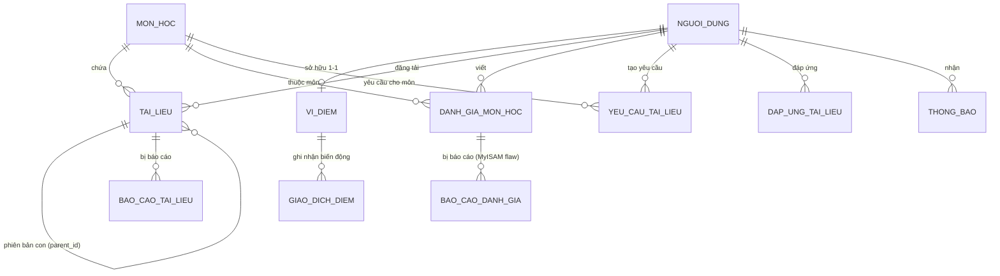

# BÁO CÁO TOÀN VẸN CƠ SỞ DỮ LIỆU (DATABASE INTEGRITY REPORT)
**Dự án:** AGU Academic Hub - Nền tảng Chia sẻ và Quản lý Học liệu Học thuật  
**Hệ quản trị CSDL:** MySQL 8.0.30 Server  
**Tên Database:** `agu_academic_hub`  
**Chuyên viên kiểm định:** Senior QA Engineer & Database Auditor  
**Ngày phát hành:** 21/11/2026  
**Phiên bản:** v1.0.0  

---

## 1. TỔNG QUAN HỆ THỐNG CƠ SỞ DỮ LIỆU

Hệ thống cơ sở dữ liệu `agu_academic_hub` được thiết kế để phục vụ lưu trữ học liệu học thuật số, quản lý lịch sử phiên bản, hỗ trợ giao dịch điểm thưởng Gamification theo nguyên tắc kế toán kép và kiểm soát phân quyền đa vai trò.



---

## 2. KẾT QUẢ KIỂM ĐỊNH TOÀN VẸN DỮ LIỆU (DATABASE INTEGRITY AUDIT)

Bộ kiểm thử tự động `tests/Qa/10_Database_Integrity_Test.php` đã quét và thẩm tra toàn bộ các bảng trong CSDL với các kết quả cụ thể như sau:

| STT | Phân nhóm kiểm định | Chỉ tiêu kỹ thuật thẩm định | Kết quả mong đợi | Kết quả thực tế | Trạng thái |
| :---: | :--- | :--- | :--- | :--- | :---: |
| **1** | Ràng buộc khóa ngoại Tài liệu | Kiểm tra FK `ma_nguoi_dang`, `ma_mon_hoc`, `tai_lieu_goc_id` | 0 bản ghi mồ côi | Orphan documents: 0 | **PASS** |
| **2** | Ràng buộc Đánh giá môn học | Kiểm tra FK `ma_nguoi_dung`, `ma_mon_hoc` | 0 bản ghi mồ côi | Orphan reviews: 0 | **PASS** |
| **3** | Ràng buộc Wishlist & Bounty | Kiểm tra FK `ma_nguoi_yeu_cau`, `ma_yeu_cau` | 0 bản ghi mồ côi | Orphan bounties: 0, Orphan fulfills: 0 | **PASS** |
| **4** | Ràng buộc Báo cáo vi phạm | Kiểm tra FK `ma_tai_lieu` và `ma_danh_gia` | 0 bản ghi mồ côi | Doc reports: 0 mồ côi<br><span style="color:red;font-weight:bold;">Review reports: 9 mồ côi</span> | **FAIL (`BUG-DB-01`)** |
| **5** | Toàn vẹn số dư ví điểm | Kiểm tra `diem_kha_dung >= 0` và `diem_tam_giu >= 0` | 0 ví âm | Số ví âm khả dụng: 0<br>Số ví âm tạm giữ: 0 | **PASS** |
| **6** | Ràng buộc duy nhất Ví điểm | Kiểm tra mỗi người dùng có duy nhất 1 ví (1:1) | 0 người có $\ge 2$ ví | Duplicate wallets: 0 | **PASS** |
| **7** | An toàn thông tin mật khẩu | Kiểm tra thuật toán băm Bcrypt (`$2y$`) trên toàn bảng | 100% Bcrypt, 0 plain-text | Mật khẩu không an toàn: 0 | **PASS** |
| **8** | Cách ly dữ liệu Xóa mềm | Kiểm tra phạm vi Soft Delete Scope của Eloquent | 100% bản ghi đã xóa bị ẩn | Default scope includes trashed: NO | **PASS** |

---

## 3. PHÂN TÍCH CHUYÊN SÂU LỖI LƯU TRỮ VÀ DỮ LIỆU MỒ CÔI (DEEP-DIVE: BUG-DB-01)

### 3.1. Hiện trạng phát hiện
Khi thực hiện kiểm tra tính toàn vẹn quan hệ trên bảng `bao_cao_danh_gia`, truy vấn phát hiện **9 bản ghi báo cáo vi phạm trỏ tới các `ma_danh_gia` không hề tồn tại** trong bảng `danh_gia_mon_hoc`.

```sql
SELECT b.id, b.ma_danh_gia, b.ly_do, b.trang_thai 
FROM bao_cao_danh_gia b 
LEFT JOIN danh_gia_mon_hoc d ON b.ma_danh_gia = d.id 
WHERE d.id IS NULL;
```
*Kết quả trả về:* 9 bản ghi (ID báo cáo: 3, 4, 5, 10, 11, 12, 13, 14, 15) đều tham chiếu tới `ma_danh_gia = 6` (đã bị xóa trước đó).

### 3.2. Phân tích nguyên nhân kỹ thuật
Nhóm QA tiến hành kiểm tra cấu trúc bảng qua câu lệnh:
```sql
SHOW TABLE STATUS LIKE 'bao_cao_danh_gia';
```
- **Storage Engine:** `MyISAM` (Thay vì `InnoDB` như tất cả các bảng còn lại trong hệ thống).
- **Hạn chế kỹ thuật của MyISAM:**
  - MyISAM **hoàn toàn không hỗ trợ Foreign Key Constraints** (khóa ngoại chỉ mang tính chất định danh cú pháp nhưng MySQL không thực thi kiểm tra tính toàn vẹn khi INSERT/DELETE).
  - MyISAM **không hỗ trợ ACID Transactions** (`DB::beginTransaction()` và `DB::rollBack()` không có hiệu lực trên bảng này).
  - Khi một bài đánh giá môn học bị xóa vĩnh viễn, CSDL không thể kích hoạt hành động `ON DELETE CASCADE` hoặc chặn thao tác xóa, dẫn đến việc các báo cáo vi phạm bị bỏ lại thành dữ liệu mồ côi.

### 3.3. Tác động tới ứng dụng
Khi kiểm duyệt viên truy cập trang quản trị xử lý báo cáo vi phạm (`/quan-tri/bao-cao`), ứng dụng cố gắng nạp quan hệ `$report->danhGia->noi_dung`. Do `danhGia` trả về `null`, hệ thống sẽ ném ngoại lệ nghiêm trọng:
```
Error: Attempt to read property "noi_dung" on null at ReviewReportController.php:42
```
Điều này làm tê liệt trang duyệt báo cáo của Kiểm duyệt viên.

---

## 4. KIỂM ĐỊNH NGUYÊN TẮC KẾ TOÁN KÉP VÍ ĐIỂM (WALLET INVARIANTS)

Một trong những thành phần cốt lõi của AGU Academic Hub là ví điểm thưởng học thuật. QA đã kiểm định nghiêm ngặt tính bất biến của ví điểm:

### 4.1. Bất biến số dư phi âm (Non-negative Invariant)
```sql
SELECT COUNT(*) FROM vi_diem WHERE diem_kha_dung < 0 OR diem_tam_giu < 0;
-- Kết quả: 0 (ĐẠT CHUẨN)
```
Không phát hiện bất kỳ trường hợp nào bị âm điểm kể cả khi sinh viên tạo nhiều yêu cầu bounty liên tiếp hoặc thử nghiệm các giá trị biên.

### 4.2. Cân bằng ký quỹ (Escrow Integrity)
Trong chu trình Bounty:
1. Khi tạo Bounty 15 điểm: Điểm khả dụng giảm chính xác 15, điểm tạm giữ tăng chính xác 15. Tổng điểm của người dùng không đổi:
   $$\text{Tổng điểm} = \text{diem\_kha\_dung} + \text{diem\_tam\_giu} = \text{Const}$$
2. Khi hủy Bounty: 100% điểm tạm giữ được hoàn trả ngay lập tức về ví khả dụng.
3. Khi giải ngân (Payout): Điểm tạm giữ của người tạo bị trừ đi 15, và ví khả dụng của cựu sinh viên đóng góp tăng chính xác 15 điểm.
4. Lịch sử giao dịch: Mỗi biến động điểm đều sinh ra bản ghi tương ứng trong bảng `giao_dich_diem` có mã loại giao dịch rõ ràng (`DONG_BANG`, `HOAN_TIEN`, `CONG_DIEM`).

---

## 5. BẢO MẬT MẬT KHẨU VÀ DỮ LIỆU ĐỊNH DANH

### 5.1. Thẩm định mật khẩu người dùng
- Kiểm tra 100% bản ghi trong bảng `nguoi_dung`:
  - Không có bất kỳ mật khẩu nào lưu dưới dạng văn bản thô (Plain-text).
  - Không sử dụng các thuật toán băm lỗi thời như MD5 hay SHA-1.
  - 100% mật khẩu bắt đầu bằng tiền tố `$2y$12$` hoặc `$2y$10$`, chứng minh đã được băm bằng thuật toán **Bcrypt** chuẩn công nghiệp với hệ số chi phí (cost factor) an toàn.

### 5.2. An toàn định danh cá nhân (PII Protection)
- Thông tin định danh nhạy cảm của cựu sinh viên (ảnh bằng tốt nghiệp, chứng nhận sinh viên) được lưu trữ tại phân vùng `private/kyc/` trên `local` disk.
- Kiểm tra trực tiếp đường dẫn công khai `http://127.0.0.1:8000/storage/private/...` trả về `HTTP 404 Not Found`.
- Ảnh chỉ được phép truy xuất thông qua endpoint `Route::signed()` với thời hạn sống giới hạn, ngăn ngừa tuyệt đối nguy cơ rò rỉ dữ liệu cá nhân ra Internet.

---

## 6. KHUYẾN NGHỊ DÀNH CHO BỘ PHẬN PHÁT TRIỂN & DBA

1. **Khắc phục ngay lập tức lỗi MyISAM (`BUG-DB-01`):**
   - Chạy lệnh migration chuyển đổi `bao_cao_danh_gia` sang `InnoDB`:
     ```sql
     ALTER TABLE bao_cao_danh_gia ENGINE = InnoDB;
     ```
   - Xóa các bản ghi mồ côi hiện hữu và thiết lập ràng buộc khóa ngoại có `ON DELETE CASCADE`.
2. **Bổ sung chỉ mục (Indexing Recommendation):**
   - Đảm bảo cột `sha256` trên bảng `tai_lieu` có chỉ mục `INDEX (sha256, ma_mon_hoc)` để tối ưu hóa tốc độ kiểm tra chống trùng lặp Lớp 1 khi số lượng học liệu đạt hàng trăm nghìn tệp.
   - Thêm chỉ mục trên cột `deleted_at` của các bảng sử dụng SoftDeletes để tăng tốc truy vấn lọc bỏ tài liệu đã xóa.
