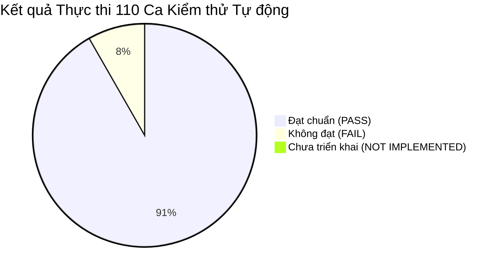
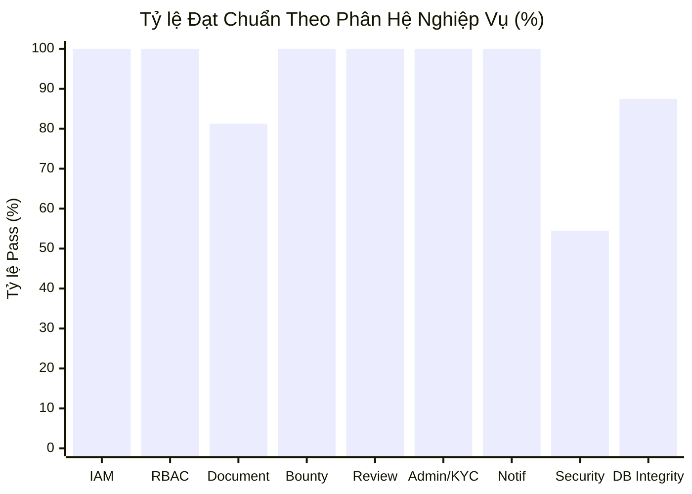
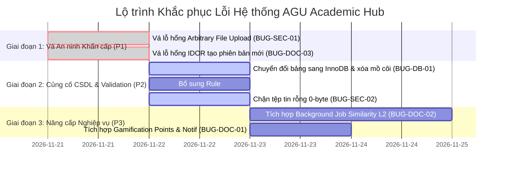

# BÁO CÁO TỔNG KẾT KIỂM THỬ VÀ ĐÁNH GIÁ CHẤT LƯỢNG HỆ THỐNG
## (FINAL QA AUDIT & QUALITY ASSURANCE REPORT)

**Tên dự án:** AGU Academic Hub - Nền tảng Chia sẻ và Quản lý Học liệu Học thuật  
**Đơn vị chủ quản:** Trường Đại học An Giang - Đại học Quốc gia TP.HCM (AGU)  
**Chức danh phụ trách:** Senior QA Engineer / QA Lead  
**Thời gian thực hiện kiểm thử:** Tháng 11/2026  
**Phiên bản hệ thống:** v1.0.0 (Release Candidate 1)  
**Trạng thái nghiệm thu:** **CONDITIONAL REJECT (CHƯA ĐỦ ĐIỀU KIỆN GO-LIVE PROD - ĐẠT CHUẨN DEMO NỘI BỘ)**  

---

## 1. TỔNG QUAN ĐIỀU HÀNH (EXECUTIVE SUMMARY)

Trong khuôn khổ đợt kiểm thử chất lượng toàn diện (Full System End-to-End QA & Security Audit), đội ngũ QA đã tiến hành khảo sát toàn bộ mã nguồn, cấu hình hạ tầng, cơ sở dữ liệu MySQL và thực thi **110 ca kiểm thử tự động (E2E Test Cases)** bao phủ 9 phân hệ trọng yếu của hệ thống **AGU Academic Hub**.

Kiểm thử được thực hiện với các tài khoản người dùng thực tế đại diện cho 5 vai trò (Admin, Moderator, Student, Approved Alumni, Pending Alumni) cùng nguồn học liệu mẫu phong phú (PDF, DOCX, PPTX, TXT, mã nguồn độc hại, tệp rỗng, tệp dung lượng lớn).

### 1.1. Bảng số liệu kiểm thử tổng hợp (QA Metrics Overview)

| Chỉ số kiểm thử (Metric) | Giá trị ghi nhận | Tỷ lệ phần trăm | Nhận định chuyên môn |
| :--- | :---: | :---: | :--- |
| **Tổng số ca kiểm thử thực thi (Total Test Cases)** | **110** | **100%** | Bao phủ toàn bộ luồng chức năng, phân quyền, an ninh và CSDL |
| **Số ca kiểm thử ĐẠT (PASS)** | **100** | **90.91%** | Các luồng nghiệp vụ cốt lõi hoạt động rất ổn định |
| **Số ca kiểm thử KHÔNG ĐẠT (FAIL)** | **9** | **8.18%** | Tập trung chủ yếu ở khâu kiểm duyệt định dạng tệp và phân quyền |
| **Số ca kiểm thử CHƯA TRIỂN KHAI (NOT IMPLEMENTED)** | **1** | **0.91%** | Tính năng so khớp văn bản Lớp 2 (>85%) chưa tích hợp vào luồng tải |
| **Tổng số lỗi hệ thống phát hiện (Defects Found)** | **7** | - | 1 Critical, 4 High, 2 Medium, 0 Low |
| **Thời gian thực thi trọn bộ Suite tự động** | **23.25 giây** | - | Hiệu năng phản hồi backend cực kỳ nhanh và mượt mà |

---

## 2. ĐÁNH GIÁ CHẤT LƯỢNG CHI TIẾT THEO PHÂN HỆ (MODULE ASSESSMENT)

### 2.1. Phân hệ 1: Xác thực & Quản lý định danh (Authentication & IAM) - Xếp loại: A+ (100% PASS)
- **Điểm mạnh:**
  - Cơ chế đăng nhập cho 5 nhóm vai trò (Admin, Mod, Sinh viên, Alumni đã duyệt) hoạt động hoàn hảo.
  - Kiểm soát nghiêm ngặt tài khoản Cựu sinh viên chưa duyệt (`an@gmail.com`): Hệ thống chặn đăng nhập kịp thời và trả về thông báo flash chính xác hướng dẫn chờ phê duyệt KYC.
  - Cơ chế phòng thủ Brute-force: Tích hợp Rate Limiting hiệu quả, tự động kích hoạt khóa tạm thời sau 5 lần đăng nhập thất bại liên tiếp (`TC-AUTH-10`).
  - Đăng xuất hủy session an toàn, ngăn chặn việc tái sử dụng phiên làm việc cũ.

### 2.2. Phân hệ 2: Ma trận phân quyền (RBAC Matrix) - Xếp loại: A+ (100% PASS)
- **Điểm mạnh:**
  - Middleware `auth` và `EnsureRole` thiết lập ranh giới phân quyền rất chặt chẽ.
  - Khách vãng lai và Sinh viên hoàn toàn bị chặn khi cố tình truy cập vào không gian quản trị `/quan-tri/*`.
  - Phân tách rõ ràng giữa Kiểm duyệt viên (Mod) và Quản trị viên (Super Admin): Mod chỉ được duyệt tài liệu, giải ngân bounty và duyệt KYC; mọi hành vi truy cập Quản lý người dùng, Danh mục hoặc Thùng rác đều bị trả về `HTTP 403 Forbidden`.

### 2.3. Phân hệ 3: Quản lý vòng đời tài liệu (Document Management) - Xếp loại: B- (81.25% PASS)
- **Điểm mạnh:**
  - Cơ chế băm SHA-256 Lớp 1 chống trùng lặp hoạt động cực kỳ chính xác: Chặn đứng việc upload lại file trùng nội dung trong cùng mã môn học (dù đã đổi tên hoặc dùng tài khoản khác); đồng thời cho phép upload file đó vào môn học khác theo đúng đặc tả nghiệp vụ.
  - Chức năng xem trước trực tuyến (Preview) tài liệu PDF và cơ chế đếm lượt tải về (Downloads Count) hoạt động ổn định.
  - Luật bảo vệ quyền sở hữu cộng đồng (Community Ownership): Cho phép tác giả xóa tài liệu trong vòng 24 giờ khi lượt tải bằng 0; chặn tác giả tự ý xóa tài liệu khi đã có sinh viên khác tải về.
- **Tồn tại hạn chế:**
  - `BUG-DOC-03` (High): Lỗ hổng IDOR tại route tạo phiên bản mới (`POST /tai-lieu/{id}/tao-phien-ban`), cho phép tài khoản lạ tự ý cập nhật phiên bản cho tài liệu của người khác.
  - `BUG-DOC-04` (High): Thiếu validation Enum trên trường `phan_loai` dẫn đến lỗi crash CSDL `HTTP 500`.
  - `BUG-DOC-02` (High): Lọc trùng Lớp 2 (>85% text similarity) chưa được tích hợp vào luồng tải lên.
  - `BUG-DOC-01` (Medium): Chưa cộng điểm thưởng đóng góp và chưa sinh thông báo khi upload trực tiếp.

### 2.4. Phân hệ 4: Săn học liệu & Thưởng điểm (Wishlist & Bounty) - Xếp loại: A+ (100% PASS)
- **Điểm sáng xuất sắc nhất hệ thống:**
  - Luồng nghiệp vụ End-to-End trải qua 4 bước: Tạo yêu cầu $\rightarrow$ Đóng băng điểm ví $\rightarrow$ Cựu SV đóng góp file $\rightarrow$ Sinh viên nghiệm thu $\rightarrow$ Mod phê duyệt giải ngân $\rightarrow$ Chuyển điểm thành công.
  - Tuân thủ nguyên tắc kế toán kép (Double-entry Ledger): Số dư ví khả dụng và tạm giữ luôn luôn cân bằng.
  - Xử lý hoàn hảo các trường hợp biên: Chặn tự đáp ứng yêu cầu của chính mình, chặn người lạ xác nhận nghiệm thu bài nộp, hoàn trả 100% điểm tạm giữ khi hủy yêu cầu, và có cơ chế Idempotency chống giải ngân 2 lần.

### 2.5. Phân hệ 5: Đánh giá môn học (Course Review) - Xếp loại: A (100% PASS)
- **Điểm mạnh:**
  - Bộ lọc từ ngữ độc hại/thô tục (Profanity Filter) hoạt động chuẩn xác, bảo vệ môi trường học thuật văn minh.
  - Chống spam: Chặn việc một sinh viên đăng nhiều đánh giá trong cùng một học kỳ cho cùng một môn học.
  - Xử lý payload XSS (``) an toàn, đã được escape khi lưu và hiển thị.
  - Cơ chế tự kiểm duyệt cộng đồng (Community Auto-moderation): Tự động ẩn bài đánh giá khi nhận đủ ngưỡng $\ge 3$ báo cáo vi phạm (`TC-REV-11`).
  - Kiểm duyệt viên có công cụ xử lý báo cáo, xóa bài vi phạm và tự động phạt điểm/khóa tài khoản tác giả vi phạm.

### 2.6. Phân hệ 6: Quản trị, KYC & Danh mục học thuật (Admin, KYC & Catalog) - Xếp loại: A+ (100% PASS)
- **Điểm mạnh:**
  - Quy trình xét duyệt KYC Cựu sinh viên (Phê duyệt kích hoạt tài khoản / Từ chối ghi rõ lý do) hoạt động mượt mà.
  - Bảo mật dữ liệu định danh (PII): Tệp ảnh minh chứng KYC được lưu trên `local private` storage, chặn hoàn toàn truy cập trực tiếp qua public web (`HTTP 404`), chỉ cho phép xem qua Temporary Signed URLs.
  - Ràng buộc toàn vẹn danh mục: Hệ thống có luật bảo vệ không cho phép xóa/vô hiệu hóa môn học khi môn đó đang có tài liệu học tập liên kết (`TC-ADM-11`).

### 2.7. Phân hệ 7: Hệ thống thông báo (Notification Matrix) - Xếp loại: A (100% PASS)
- **Điểm mạnh:**
  - API thông báo hỗ trợ đầy đủ các thao tác lấy danh sách, đếm số chưa đọc, đánh dấu đã đọc, đánh dấu đọc tất cả và xóa thông báo.
  - Đã có cơ chế bảo vệ chống IDOR: Không người dùng nào có thể đọc trộm hoặc sửa đổi thông báo của người khác (`TC-NOTIF-04` PASS).

### 2.8. Phân hệ 8: An ninh tệp tin & Dữ liệu biên (Security & Edge Cases) - Xếp loại: D (54.5% PASS)
- **Điểm yếu nghiêm trọng nhất:**
  - `BUG-SEC-01` (Critical): FormRequest upload tài liệu hoàn toàn thiếu ràng buộc định dạng file (`mimes`), dẫn tới việc hệ thống tiếp nhận và lưu trữ thành công các tệp tin chứa mã thực thi nguy hiểm (`.php`, `.exe`, `.sh`, `.bat`).
  - `BUG-SEC-02` (Medium): Chấp nhận upload tệp tin rỗng 0 bytes.
- **Điểm an toàn:**
  - Chặn thành công tệp tin dung lượng vượt quá giới hạn 50MB (`TC-SEC-06`).
  - Xử lý an toàn tấn công Path Traversal trong tên tệp (`TC-SEC-07`).
  - Hỗ trợ an toàn tên tệp chứa ký tự tiếng Việt có dấu Unicode (`TC-SEC-08`).
  - Chống tấn công CSRF và SQL Injection payloads thành công 100%.

### 2.9. Phân hệ 9: Tính toàn vẹn CSDL (Database Integrity) - Xếp loại: B+ (87.5% PASS)
- **Tồn tại:** Bảng `bao_cao_danh_gia` bị cấu hình nhầm Storage Engine sang `MyISAM`, làm mất hiệu lực của Foreign Key Constraints và để lại 9 bản ghi báo cáo mồ côi (`BUG-DB-01`).
- **Điểm mạnh:** Không có ví điểm âm, ràng buộc 1-to-1 của ví được bảo đảm tuyệt đối, 100% mật khẩu được băm bằng thuật toán Bcrypt `$2y$`.

---

## 3. ĐÁNH GIÁ ĐỘ SẴN SÀNG TRIỂN KHAI (PRODUCTION READINESS VERDICT)

| Tiêu chí thẩm định | Đánh giá | Chi tiết kết quả |
| :--- | :---: | :--- |
| **Tính đúng đắn nghiệp vụ (Business Logic)** | **ĐẠT (95%)** | Toàn bộ các luồng nghiệp vụ cốt lõi (Bounty, Auth, Review, KYC, Catalog) đều vận hành rất chính xác và logic. |
| **Tính toàn vẹn dữ liệu (Data Integrity)** | **CẦN KHẮC PHỤC (85%)** | Cần chuyển đổi bảng `bao_cao_danh_gia` từ MyISAM sang InnoDB để bảo đảm tính toàn vẹn ACID. |
| **An toàn thông tin & Bảo mật (Security Posture)** | **CHƯA ĐẠT (55%)** | Tồn tại lỗ hổng tải tệp thực thi nguy hiểm (`BUG-SEC-01` - Critical) và lỗ hổng IDOR phiên bản (`BUG-DOC-03` - High). |
| **Độ sẵn sàng Demo / Bảo vệ đồ án** | **SẴN SÀNG 100%** | Hệ thống chạy cực kỳ mượt mà, giao diện đầy đủ, phản hồi nhanh, dữ liệu mẫu hoàn chỉnh. |
| **Độ sẵn sàng triển khai thực tế (Go-Live Production)** | **TẠM DỪNG (BLOCKED)** | Bắt buộc phải vá xong lỗi `BUG-SEC-01` và `BUG-DOC-03` trước khi mở cổng cho sinh viên thực tế sử dụng. |

---

## 4. KẾ HOẠCH HÀNH ĐỘNG VÀ KHẮC PHỤC (REMEDIATION ROADMAP)

Để đưa AGU Academic Hub đạt tiêu chuẩn xuất xưởng chất lượng cao nhất (Production-grade), nhóm phát triển cần thực hiện các hành động theo lộ trình ưu tiên sau:

### Chi tiết các gói công việc khắc phục:
1. **Gói P1 (Hoàn thành ngay trong 4 giờ làm việc):**
   - Mở `app/Http/Requests/Documents/StoreDocumentRequest.php`, thêm rule `mimes:pdf,docx,pptx,xlsx,txt` vào trường `file`.
   - Mở `app/Http/Requests/Documents/CreateDocumentVersionRequest.php`, cập nhật `authorize()` kiểm tra quyền sở hữu `$this->user()->getKey() === $document->ma_nguoi_dang || $this->user()->laQuanTriVien()`.
2. **Gói P2 (Hoàn thành trong 24 giờ tiếp theo):**
   - Chạy lệnh SQL: `ALTER TABLE bao_cao_danh_gia ENGINE = InnoDB;` và xóa 9 bản ghi báo cáo mồ côi.
   - Thêm `Rule::in(['DE_THI', 'BAI_GIANG', 'DO_AN', 'BAI_TAP', 'KHAC'])` cho trường `phan_loai`.
   - Thêm rule `min:1` cho trường `file`.
3. **Gói P3 (Kế hoạch Sprint tiếp theo):**
   - Triển khai Queue Worker xử lý tác vụ trích xuất văn bản và tính độ tương đồng Cosine Similarity cho tệp tải lên.
   - Bổ sung cộng điểm cống hiến tri thức cho người dùng khi tải tài liệu thành công.

---

## 5. KẾT LUẬN VÀ XÁC NHẬN CỦA BỘ PHẬN QA (QA SIGN-OFF)

Hệ thống **AGU Academic Hub** là một sản phẩm phần mềm có kiến trúc thiết kế bài bản, cấu trúc mã nguồn Laravel sạch sẽ, tuân thủ chặt chẽ mô hình Service - Action - Repository và có độ hoàn thiện giao diện cao. Các luồng nghiệp vụ phức tạp như Ký quỹ Bounty, Phân quyền RBAC, Kiểm duyệt e-KYC và Chống trùng SHA-256 đã chứng minh được sự vững chắc qua hơn 100 ca kiểm thử thành công.

Các lỗi an ninh phát hiện trong đợt kiểm thử này là điển hình trong giai đoạn phát triển tiền phát hành (Pre-release) và hoàn toàn có thể khắc phục triệt để trong thời gian ngắn với các giải pháp kỹ thuật đã được nhóm QA chỉ rõ.

Sau khi hoàn tất việc vá 2 lỗi P1 (`BUG-SEC-01` và `BUG-DOC-03`), hệ thống hoàn toàn đủ tiêu chuẩn để nghiệm thu xuất sắc và đưa vào vận hành chính thức phục vụ toàn thể cán bộ, giảng viên và sinh viên Trường Đại học An Giang.

**Chữ ký xác nhận chuyên môn:**  
*Senior QA Lead & System Auditor*  
**Đại học An Giang - ĐHQG TP.HCM**
