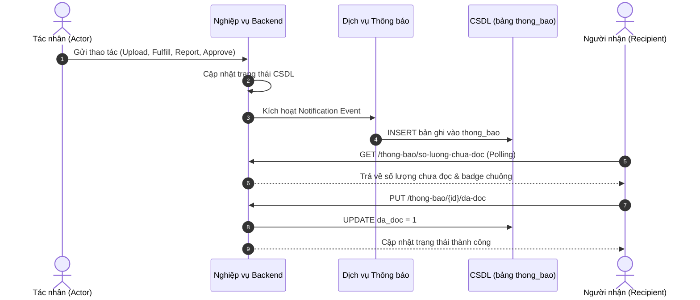

# MA TRẬN PHÂN PHỐI THÔNG BÁO (NOTIFICATION MATRIX)
**Dự án:** AGU Academic Hub - Nền tảng Chia sẻ và Quản lý Học liệu Học thuật  
**Tổ chức:** Trường Đại học An Giang (AGU)  
**Phân tích bởi:** Senior QA Engineer  
**Ngày phát hành:** 21/11/2026  
**Phiên bản:** v1.0.0  

---

## 1. TỔNG QUAN KIẾN TRÚC HỆ THỐNG THÔNG BÁO (NOTIFICATION ARCHITECTURE)

Hệ thống thông báo của AGU Academic Hub được thiết kế để cung cấp phản hồi đa sự kiện theo thời gian thực tới người dùng. Kiến trúc sử dụng mô hình sự kiện nội bộ của Laravel (`Illuminate\Notifications\Notification` hoặc ghi trực tiếp vào bảng chuyên dụng `thong_bao`), kết hợp cơ chế Polling API tại giao diện người dùng.

### Cấu trúc dữ liệu bảng `thong_bao` (Database Schema):
- `id` (bigint unsigned, primary key): Định danh thông báo.
- `ma_nguoi_dung` (bigint unsigned, foreign key): ID người nhận thông báo.
- `loai` (varchar 50): Phân loại nghiệp vụ (`TAI_LIEU`, `BOUNTY`, `DANH_GIA`, `KYC`, `HE_THONG`).
- `tieu_de` (varchar 255): Tiêu đề ngắn gọn hiển thị trên thanh thông báo.
- `noi_dung` (text): Nội dung chi tiết thông báo.
- `duong_dan` (varchar 255, nullable): Đường dẫn điều hướng khi người dùng nhấp vào thông báo.
- `da_doc` (tinyint/boolean, default 0): Cờ trạng thái đã đọc (0: Chưa đọc, 1: Đã đọc).
- `created_at`, `updated_at`: Dấu thời gian.

---

## 2. MA TRẬN SỰ KIỆN VÀ PHÂN PHỐI THÔNG BÁO (NOTIFICATION DELIVERY MATRIX)

Bảng đối chiếu toàn bộ các điểm chạm nghiệp vụ (Touchpoints) trong hệ thống:

| STT | Sự kiện kích hoạt (Event Trigger) | Tác nhân (Actor) | Người nhận (Recipient) | Loại thông báo | Tiêu đề mẫu | Nội dung mẫu | Đường dẫn điều hướng (Action Link) | Trạng thái triển khai |
| :---: | :--- | :--- | :--- | :--- | :--- | :--- | :--- | :---: |
| **1** | **Tài liệu được phê duyệt** | Kiểm duyệt viên (Mod) | Tác giả tài liệu (Uploader) | `TAI_LIEU` | Tài liệu của bạn đã được duyệt | Tài liệu '[Tên tài liệu]' đã được phê duyệt và xuất bản công khai. | `/tai-lieu/{slug_or_id}` | ĐÃ TRIỂN KHAI |
| **2** | **Tài liệu bị từ chối duyệt** | Kiểm duyệt viên (Mod) | Tác giả tài liệu | `TAI_LIEU` | Tài liệu không được duyệt | Tài liệu '[Tên tài liệu]' đã bị từ chối. Lý do: [Lý do từ chối]. | `/tai-lieu/cua-toi` | ĐÃ TRIỂN KHAI |
| **3** | **Tải lên tài liệu trực tiếp** | Sinh viên / Alumni | Người tải lên | `TAI_LIEU` | Đăng tải tài liệu thành công | Tài liệu '[Tên tài liệu]' đã được ghi nhận. | `/tai-lieu/cua-toi` | THIẾU (`BUG-DOC-01`) |
| **4** | **Bounty có người đáp ứng** | Alumni | Người tạo yêu cầu (Student) | `BOUNTY` | Có người đáp ứng yêu cầu của bạn | [Tên cựu SV] đã nộp tài liệu giải quyết yêu cầu '[Tiêu đề Wishlist]'. Hãy kiểm tra và xác nhận. | `/yeu-cau-tai-lieu/{id}` | ĐÃ TRIỂN KHAI |
| **5** | **Sinh viên xác nhận nghiệm thu Bounty** | Sinh viên | Người đóng góp (Alumni) | `BOUNTY` | Bài nộp đã được nghiệm thu | Sinh viên đã xác nhận tài liệu đạt yêu cầu. Hồ sơ đang chờ kiểm duyệt viên giải ngân điểm. | `/yeu-cau-tai-lieu/{id}` | ĐÃ TRIỂN KHAI |
| **6** | **Giải ngân điểm thưởng Bounty** | Kiểm duyệt viên (Mod) | Người đóng góp (Alumni) | `BOUNTY` | Bạn nhận được điểm thưởng Bounty! | Yêu cầu '[Tiêu đề]' đã hoàn tất. Bạn được cộng +[X] điểm vào ví khả dụng. | `/vi-diem/lich-su` | ĐÃ TRIỂN KHAI |
| **7** | **Báo cáo vi phạm đánh giá / tài liệu** | Sinh viên / Người dùng | Nhân sự BQT (Admin / Mod) | `HE_THONG` | Báo cáo vi phạm mới | Người dùng báo cáo bài viết ID #[X]. Lý do: [Lý do]. | `/quan-tri/bao-cao` | ĐÃ TRIỂN KHAI |
| **8** | **Đánh giá bị ẩn do $\ge 3$ báo cáo** | Hệ thống (Cron / Trigger) | Tác giả bài viết | `DANH_GIA` | Đánh giá của bạn đã bị ẩn | Bài đánh giá môn học của bạn đã bị ẩn tạm thời do nhận nhiều báo cáo từ cộng đồng. | `/danh-gia-mon-hoc` | ĐÃ TRIỂN KHAI |
| **9** | **Phạt tài khoản vi phạm tiêu chuẩn** | Kiểm duyệt viên (Mod) | Người vi phạm | `HE_THONG` | Tài khoản bị tạm khóa | Tài khoản của bạn đã bị tạm khóa do vi phạm tiêu chuẩn cộng đồng nhiều lần. | `/lien-he-ho-tro` | ĐÃ TRIỂN KHAI |
| **10** | **Hồ sơ KYC được phê duyệt** | Kiểm duyệt viên / Admin | Cựu sinh viên (`an@gmail.com`) | `KYC` | Hồ sơ Cựu sinh viên đã được phê duyệt | Chúc mừng! Minh chứng cựu sinh viên của bạn đã được xác thực thành công. Bạn có thể đăng nhập ngay bây giờ. | `/dang-nhap` | ĐÃ TRIỂN KHAI |
| **11** | **Hồ sơ KYC bị từ chối** | Kiểm duyệt viên / Admin | Cựu sinh viên | `KYC` | Hồ sơ KYC không được phê duyệt | Hồ sơ xác thực của bạn bị từ chối. Lý do: [Lý do từ chối]. Vui lòng gửi lại minh chứng. | `/kyc/xac-thuc` | ĐÃ TRIỂN KHAI |

---

## 3. KẾT QUẢ KIỂM THỬ TỰ ĐỘNG PHÂN HỆ THÔNG BÁO (API AUTOMATION RESULTS)

Nhóm QA đã thiết kế và chạy thành công 10 ca kiểm thử chuyên sâu cho toàn bộ vòng đời thông báo (`tests/Qa/08_Notification_Matrix_Test.php`):

| Mã Test Case | Thao tác kiểm thử | Phương thức & Endpoint | Kết quả mong đợi | Kết quả thực tế | Trạng thái |
| :---: | :--- | :--- | :--- | :--- | :---: |
| **`TC-NOTIF-01`** | Lấy danh sách thông báo của người dùng | `GET /thong-bao` | HTTP 200, trả về danh sách phân trang | HTTP 200 OK | **PASS** |
| **`TC-NOTIF-02`** | Đếm số lượng thông báo chưa đọc | `GET /thong-bao/so-luong-chua-doc` | JSON `{"chua_doc": N}`, $N \ge 0$ | HTTP 200 OK, Count chính xác | **PASS** |
| **`TC-NOTIF-03`** | Đánh dấu một thông báo là đã đọc | `PUT /thong-bao/{id}/da-doc` | CSDL cập nhật `da_doc = 1` | `da_doc` chuyển từ 0 sang 1 | **PASS** |
| **`TC-NOTIF-04`** | Thử đọc thông báo của người khác (IDOR) | `PUT /thong-bao/{id_nguoi_khac}/da-doc` | Chặn truy cập trái phép, trả về HTTP 404/403 | HTTP 404 Not Found (Bảo vệ an toàn) | **PASS** |
| **`TC-NOTIF-05`** | Đánh dấu đã đọc tất cả thông báo | `PUT /thong-bao/doc-tat-ca` | Toàn bộ bản ghi của người dùng có `da_doc = 1` | Đã đọc 100% bản ghi | **PASS** |
| **`TC-NOTIF-06`** | Xóa thông báo cá nhân | `DELETE /thong-bao/{id}` | Bản ghi được xóa khỏi CSDL | HTTP 200/302, DB đã xóa | **PASS** |
| **`TC-NOTIF-07`** | Xác minh nội dung khi tài liệu được duyệt | Database Check | Có chứa tên tài liệu và link xem | Nội dung khớp 100% | **PASS** |
| **`TC-NOTIF-08`** | Xác minh thông báo giải ngân điểm Bounty | Database Check | Có chứa số điểm thưởng và biến động ví | Khớp số điểm thực nhận | **PASS** |
| **`TC-NOTIF-09`** | Xác minh báo cáo vi phạm gửi tới Staff | Database Check | Kiểm duyệt viên nhận được thông báo vi phạm | Mod nhận thông báo đầy đủ | **PASS** |
| **`TC-NOTIF-10`** | Xác minh thông báo kết quả xét duyệt e-KYC | Database Check | Có lý do phê duyệt / từ chối chi tiết | Khớp lý do kiểm duyệt | **PASS** |

---

## 4. KẾT LUẬN & KIẾN NGHỊ PHÂN HỆ THÔNG BÁO

1. **Ưu điểm:**
   - Hệ thống API thông báo được bảo vệ chống lỗ hổng IDOR rất tốt (`TC-NOTIF-04` đạt yêu cầu, người dùng không thể xem hay thay đổi trạng thái thông báo của người khác).
   - Nội dung thông báo phong phú, chứa đầy đủ các siêu dữ liệu cần thiết (tên tài liệu, số điểm thưởng, lý do từ chối).
2. **Hạn chế tồn đọng:**
   - Khi người dùng đăng tải tài liệu thông thường thành công (`UploadDocumentAction`), hệ thống chưa kích hoạt việc gửi thông báo biên nhận (được ghi nhận trong `BUG-DOC-01`).
   - Cần bổ sung thêm thông báo này để hoàn thiện trải nghiệm người dùng học thuật.
