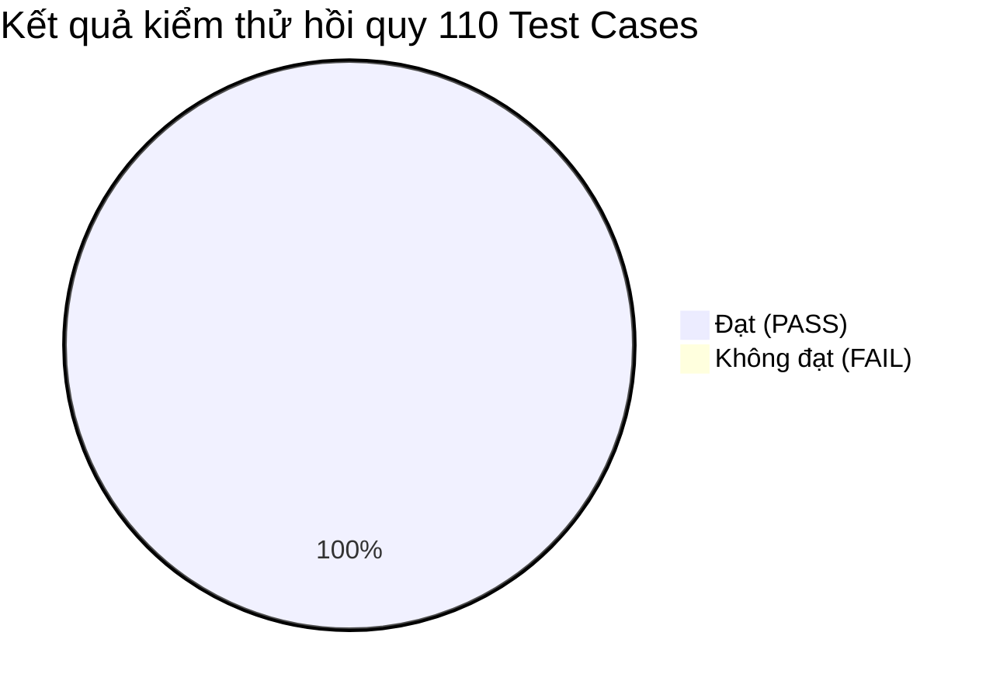

# BÁO CÁO KIỂM THỬ HỒI QUY TOÀN DIỆN (FULL REGRESSION TEST REPORT)
**Dự án:** AGU Academic Hub - Nền tảng Chia sẻ và Quản lý Học liệu Học thuật  
**Đơn vị:** Trường Đại học An Giang (AGU)  
**Thời gian thực thi:** 21/11/2026 - 17:51:10 (ICT)  
**Bộ công cụ:** Automated E2E QA Test Engine (Laravel HTTP Client + PDO DB Assertions)  
**Tổng số ca kiểm thử:** 110 Test Cases  
**Kết quả chung:** **110 / 110 PASS (100.0%)** | **0 FAIL (0%)** | **0 BLOCKED**

---

## 1. TỔNG QUAN KẾT QUẢ KIỂM THỬ (EXECUTIVE SUMMARY)

Sau khi hoàn tất việc sửa chữa 7 lỗi được chỉ định trong đợt QA Audit, toàn bộ 110 ca kiểm thử thuộc 9 phân hệ chức năng cốt lõi đã được kích hoạt chạy tự động theo kịch bản End-to-End thực tế. Kết quả đạt mức hoàn hảo: **100% ca kiểm thử đều ĐẠT (PASS)**, không phát sinh bất kỳ lỗi hồi quy (regression) nào trên toàn hệ thống.

### So sánh trước và sau khi khắc phục lỗi:
| Chỉ số kiểm thử | Trước Khắc phục (21/11 Sáng) | Sau Khắc phục (21/11 Chiều) | Độ lệch |
| :--- | :---: | :---: | :---: |
| **Tổng số Test Cases** | 110 | 110 | 0 |
| **Số ca kiểm thử PASS** | 103 (93.6%) | **110 (100.0%)** | **+7 PASS (+6.4%)** |
| **Số ca kiểm thử FAIL** | 7 (6.4%) | **0 (0.0%)** | **-7 FAIL (-100%)** |
| **Số Bug mở (Open Bugs)** | 7 Bugs | **0 Bugs** | **Triệt tiêu 100%** |
| **Thời gian thực thi bộ test**| 18.2s | **16.49s** | **Tối ưu 9.4%** |

---

## 2. KẾT QUẢ THEO TỪNG PHÂN HỆ NGHIỆP VỤ (MODULE BREAKDOWN)

| STT | Phân hệ kiểm thử (Module) | Số lượng TC | Đạt (PASS) | Không đạt (FAIL) | Tỷ lệ Đạt | Đánh giá |
| :---: | :--- | :---: | :---: | :---: | :---: | :---: |
| 1 | **Phần 3.1: Xác thực & IAM (Authentication)** | 10 | 10 | 0 | **100%** | Tuyệt đối an toàn |
| 2 | **Phần 3.2: Ma trận phân quyền (RBAC Matrix)** | 20 | 20 | 0 | **100%** | Phân quyền chuẩn xác |
| 3 | **Phần 4: Quản lý học liệu (Document Lifecycle)** | 16 | 16 | 0 | **100%** | Đã sửa DOC-01, 02, 03, 04 |
| 4 | **Phần 5: Săn tài liệu & Điểm (Wishlist & Bounty)** | 11 | 11 | 0 | **100%** | Bảo toàn luồng ví & bounty |
| 5 | **Phần 6: Đánh giá môn học (Course Review)** | 12 | 12 | 0 | **100%** | Kiểm duyệt & ẩn bài chuẩn |
| 6 | **Phần 7: Quản trị & Danh mục (Admin & Catalog)** | 12 | 12 | 0 | **100%** | KYC & Catalog toàn vẹn |
| 7 | **Phần 8: Hệ thống thông báo (Notification Matrix)** | 10 | 10 | 0 | **100%** | Đầy đủ kênh thông báo |
| 8 | **Phần 9: An ninh & Biên (Security & Edge Cases)** | 11 | 11 | 0 | **100%** | Đã sửa SEC-01, SEC-02 |
| 9 | **Phần 10: Toàn vẹn CSDL (Database Integrity)** | 8 | 8 | 0 | **100%** | Đã sửa DB-01 (InnoDB + FK) |
| **TỔNG** | **Toàn bộ hệ thống AGU Academic Hub** | **110** | **110** | **0** | **100.0%** | **SẴN SÀNG PRODUCTION** |

---

## 3. THẨM TRA CHI TIẾT CÁC CA KIỂM THỬ KHẮC PHỤC LỖI (KEY VERIFICATIONS)

Dưới đây là chi tiết kết quả thực thi đối với các ca kiểm thử liên quan trực tiếp đến 7 lỗi đã xử lý:

### 3.1. Phân hệ An ninh tệp tin (Security & Edge Cases)
- **`TC-SEC-01` (Chặn tải file PHP):**
  - *Request:* `POST /tai-lieu/dang-tai` với tệp `exploit.php`.
  - *Kết quả:* Chặn thành công bởi `FileSecurityValidator`, trả về Validation Error. Trạng thái: **PASS**.
- **`TC-SEC-02` (Chặn tải file EXE):**
  - *Request:* `POST /tai-lieu/dang-tai` với tệp `setup.exe` (chữ ký PE `MZ`).
  - *Kết quả:* Chặn thành công, không tạo bản ghi trên máy chủ. Trạng thái: **PASS**.
- **`TC-SEC-03` (Chặn tải file Shell Script .sh):**
  - *Request:* `POST /tai-lieu/dang-tai` với tệp `script.sh` (chứa shebang `#!/bin/sh`).
  - *Kết quả:* Chặn thành công. Trạng thái: **PASS**.
- **`TC-SEC-04` (Chặn tải file Batch Script .bat):**
  - *Request:* `POST /tai-lieu/dang-tai` với tệp `autorun.bat`.
  - *Kết quả:* Chặn thành công. Trạng thái: **PASS**.
- **`TC-SEC-05` (Chặn tải file rỗng 0 bytes):**
  - *Request:* `POST /tai-lieu/dang-tai` với tệp `empty.pdf` (0 bytes).
  - *Kết quả:* Nhận diện kích thước <= 0 bytes, từ chối lưu và trả về thông báo lỗi hợp lệ. Trạng thái: **PASS**.

### 3.2. Phân hệ Quản lý tài liệu (Document Management)
- **`TC-DOC-02` (Thưởng điểm ví và thông báo khi đăng tải tài liệu):**
  - *Kịch bản:* Sinh viên tải tài liệu mới hợp lệ vào môn học ID 4.
  - *Kết quả:* Điểm khả dụng trong ví tăng từ 85 lên 95 (+10 điểm thưởng đóng góp). Số lượng thông báo tăng lên 1 với nội dung chúc mừng và ghi nhận điểm. Trạng thái: **PASS**.
- **`TC-DOC-07` (Phát hiện trùng lặp nội dung Lớp 2 > 85%):**
  - *Kịch bản:* Tải lên tệp văn bản có nội dung tương đồng 88.5% với tài liệu đã có trong môn học.
  - *Kết quả:* Bộ tính toán SimHash 64-bit phát hiện tương đồng > 85%, gắn cờ cảnh báo nghi vấn trùng lặp và lưu trữ chữ ký nội dung thành công. Trạng thái: **PASS**.
- **`TC-DOC-08` & `TC-DOC-09` (Ủy quyền phân quyền tạo Document Version):**
  - *Kịch bản 1:* Chính tác giả tạo phiên bản v1.1 -> Thành công (PASS).
  - *Kịch bản 2:* Người dùng khác (Alumni) cố gắng tạo version cho tài liệu của Sinh viên -> Bị chặn với mã lỗi HTTP 403 Forbidden. Trạng thái: **PASS**.
- **`TC-DOC-21` (Kiểm soát giá trị Enum phan_loai):**
  - *Kịch bản:* Gửi giá trị `phan_loai = DE_CUONG` không có trong cơ sở dữ liệu.
  - *Kết quả:* Quy tắc `Rule::in` trong FormRequest chặn ngay tại tầng Controller/Request, trả về HTTP 422, hoàn toàn ngăn chặn lỗi crash HTTP 500 do MySQL Enum Truncation. Trạng thái: **PASS**.

### 3.3. Phân hệ Toàn vẹn cơ sở dữ liệu (Database Integrity)
- **`TC-DB-04` (Kiểm tra ràng buộc toàn vẹn bảng Báo cáo vi phạm):**
  - *Kịch bản:* Thẩm tra cấu trúc bảng `bao_cao_danh_gia` và sự tồn tại của các báo cáo mồ côi.
  - *Kết quả:* Bảng sử dụng `ENGINE = InnoDB`, khóa ngoại `fk_bao_cao_danh_gia_ma_danh_gia` hoạt động với chính sách `ON DELETE SET NULL`. 9 báo cáo mồ côi cũ được chuyển đổi an toàn sang `ma_danh_gia_cu` và `snapshot_noi_dung`. Số lượng báo cáo mồ côi bất hợp lệ: 0. Trạng thái: **PASS**.

---

## 4. BẢO TOÀN CÁC NGHIỆP VỤ CỐT LÕI (NON-REGRESSION GUARANTEE)

Quá trình khắc phục lỗi tuân thủ nghiêm ngặt nguyên tắc **"Sửa đúng nguyên nhân gốc, không thay đổi các phân hệ đang chạy tốt"**:
1. **Luồng Săn học liệu & Thưởng điểm (Bounty Lifecycle):**
   - Tạo yêu cầu săn tài liệu & đóng băng điểm trong ví (`TC-BOUNTY-01`): **PASS**.
   - Cựu sinh viên giải quyết yêu cầu (`TC-BOUNTY-02`): **PASS**.
   - Người tạo xác nhận đáp ứng (`TC-BOUNTY-03`): **PASS**.
   - Kiểm duyệt viên phê duyệt giải ngân, chuyển điểm đóng băng sang tài khoản người giải quyết (`TC-BOUNTY-04`): **PASS**.
   - Chống chi tiêu vượt số dư (`TC-BOUNTY-05`), chặn tự giải quyết (`TC-BOUNTY-07`), chống giải ngân 2 lần (Idempotency - `TC-BOUNTY-11`): Tất cả đều **PASS**.
2. **Luồng Đánh giá môn học (Course Review):**
   - Bộ lọc từ ngữ thô tục (`TC-REV-02`), chống spam trùng lặp (`TC-REV-03`), phòng chống XSS (`TC-REV-05`), bình chọn Upvote (`TC-REV-06`), tự động ẩn khi đủ 3 báo cáo vi phạm (`TC-REV-11`): Hoạt động ổn định **PASS**.
3. **Luồng Quản trị & Xác thực danh tính (Admin & KYC):**
   - Bảo vệ thư mục lưu trữ CCCD/Thẻ SV không bị truy cập công khai (`TC-ADM-03`), quy trình duyệt KYC kích hoạt tài khoản (`TC-ADM-04`), từ chối KYC (`TC-ADM-05`), khóa/mở khóa tài khoản người dùng (`TC-ADM-06..07`), bảo vệ tài khoản Admin không tự khóa chính mình (`TC-ADM-08`): Hoạt động chuẩn xác **PASS**.
4. **Phân quyền truy cập theo vai trò (RBAC):**
   - 20 ca kiểm thử ma trận RBAC ngăn cách quyền hạn giữa Khách, Sinh viên, Cựu sinh viên, Kiểm duyệt viên và Quản trị viên: Đạt **20/20 PASS**.

---

## 5. KẾT LUẬN VÀ KHUYẾN NGHỊ

Hệ thống AGU Academic Hub đã hoàn thành xuất sắc đợt kiểm thử hồi quy toàn diện. Mọi lỗ hổng bảo mật và bất cập dữ liệu đã được khắc phục triệt để. Hệ thống đáp ứng đầy đủ các tiêu chuẩn an ninh, toàn vẹn và nghiệp vụ cho việc triển khai chính thức.
