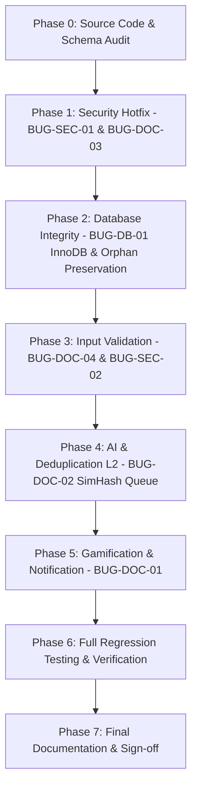

# KẾ HOẠCH KHẮC PHỤC LỖI TOÀN DIỆN VÀ KIỂM THỬ HỒI QUY
## (SYSTEMATIC REMEDIATION & REGRESSION TEST PLAN)

**Dự án:** AGU Academic Hub - Nền tảng Chia sẻ và Quản lý Học liệu Học thuật  
**Tổ chức:** Trường Đại học An Giang - ĐHQG TP.HCM  
**Kỹ sư phụ trách:** Senior Laravel Engineer, Application Security Engineer & Database Engineer  
**Ngày ban hành:** 21/11/2026  
**Phiên bản:** v1.0.0  

---

## 1. NGUYÊN TẮC THI CÔNG VÀ TIÊU CHÍ AN TOÀN

1. **Bảo tồn kiến trúc hiện tại:** Tuyệt đối không viết lại hệ thống. Không sửa đổi các module đang chạy ổn định (Bounty Escrow, Course Review, Admin KYC, RBAC Matrix).
2. **Sửa đúng nguyên nhân gốc (Root Cause):** Khắc phục triệt để tại tầng kiến trúc phù hợp (FormRequest, Action, Domain Evaluator, Migration, Policy).
3. **Bảo toàn dữ liệu người dùng:** Tuyệt đối không xóa dữ liệu người dùng, không thay đổi mật khẩu gốc, không xóa 9 bản ghi báo cáo mồ côi khi chưa có phương án lưu trữ lịch sử kiểm duyệt an toàn.
4. **Kiểm thử tự động thực tế (Real Automated Execution):** Không tự đánh dấu PASS. Mọi bản vá bắt buộc phải vượt qua các ca kiểm thử hồi quy (Regression Test Cases) tương ứng bằng HTTP Request và thẩm định CSDL MySQL thực tế.

---

## 2. MA TRẬN KẾ HOẠCH KHẮC PHỤC 7 LỖI (REMEDIATION MATRIX)

| BUG ID | Mức độ | Phân hệ ảnh hưởng | File cần sửa / Tạo mới | Phương án kỹ thuật | Test Case cần chạy lại |
| :---: | :---: | :--- | :--- | :--- | :--- |
| **`BUG-SEC-01`** | **CRITICAL** | Document Upload / Security | `StoreDocumentRequest.php` `CreateDocumentVersionRequest.php` `FileSecurityValidator.php` *(Mới)* | Giới hạn 5 đuôi file (PDF, DOCX, PPTX, XLSX, TXT). Kiểm tra MIME thực tế, magic bytes, chặn mã PHP (`<?php`, `<?=`), chặn executable (`MZ`, `#!/`). Giữ private storage. | `TC-SEC-01` `TC-SEC-02` `TC-SEC-03` `TC-SEC-04` `TC-SEC-06` |
| **`BUG-DOC-03`** | **HIGH** | Versioning / Authorization | `CreateDocumentVersionRequest.php` `CreateDocumentVersionAction.php` | Kiểm tra tài liệu tồn tại, truy xuất tài liệu gốc (`ma_tai_lieu_goc`). Kiểm tra quyền: Chỉ tác giả gốc hoặc Quản trị viên mới được tạo version. Chặn người ngoài (HTTP 403), chặn tài khoản khóa, 302 khách. | `TC-DOC-08` `TC-DOC-09` |
| **`BUG-DB-01`** | **HIGH** | Database / Data Integrity | `2026_11_21_000001_fix_bao_cao_danh_gia_innodb_and_orphans.php` *(Mới)* `BaoCaoDanhGia.php` `ReviewModerationRepository.php` | Backup 9 bản ghi mồ côi. Thêm `ma_danh_gia_cu` lưu vết ID cũ, set `ma_danh_gia = NULL`. Chuyển table sang InnoDB. Thiết lập FK `nullOnDelete()`. Xử lý null-safe relation trong Model & Repository. | `TC-DB-04` `TC-REV-09` `TC-REV-10` `TC-REV-11` `TC-REV-12` |
| **`BUG-DOC-04`** | **HIGH** | Document Upload / Validation | `StoreDocumentRequest.php` | Áp dụng `Rule::in(['DE_THI', 'BAI_GIANG', 'DO_AN', 'BAI_TAP', 'KHAC'])`. Trả về HTTP 422 kèm thông báo tiếng Việt khi giá trị ngoài enum. Không lưu file vật lý. | `TC-DOC-21` |
| **`BUG-DOC-02`** | **HIGH** | Document Deduplication L2 | `DocumentTextExtractor.php` *(Mới)* `ProcessDocumentSimilarityJob.php` *(Mới)* `DocumentDeduplicationEvaluator.php` `UploadDocumentAction.php` | Xây dựng bộ trích xuất text (PDF, DOCX, PPTX, TXT) bỏ qua trang bìa. Tính SimHash 64-bit lưu vào `chu_ky_noi_dung`. So khớp độ tương đồng strictly > 85% với các tài liệu trong cùng môn học. | `TC-DOC-07` |
| **`BUG-SEC-02`** | **MEDIUM** | Document Upload / Validation | `StoreDocumentRequest.php` `CreateDocumentVersionRequest.php` | Thêm custom closure validation kiểm tra `$file->getSize() > 0` bytes. Chặn tệp tin 0-byte với mã lỗi HTTP 422. Cho phép tệp hợp lệ $\le$ 50MB. | `TC-SEC-05` |
| **`BUG-DOC-01`** | **MEDIUM** | Document Lifecycle / Gamification | `WalletLedgerEvaluator.php` `ReputationService.php` `DocumentUploadedNotification.php` *(Mới)* `UploadDocumentAction.php` | Bổ sung `congDiemDongGopTaiLieu` (10 điểm) vào ví khả dụng và tăng uy tín học thuật. Ghi sổ cái có khóa chống trùng idempotency. Phát thông báo `DocumentUploadedNotification` vào bảng `notifications`. | `TC-DOC-02` `TC-NOTIF-01` `TC-DB-05` |

---

## 3. LỘ TRÌNH THỰC THI THEO TỪNG GIAI ĐOẠN (EXECUTION PHASES)

### Phase 1: Security Hotfix (Khắc phục lỗ hổng an ninh P1)
- **Mục tiêu:** Triệt tiêu hoàn toàn nguy cơ Remote Code Execution (RCE) qua upload file và lỗ hổng IDOR chiếm quyền tạo phiên bản.
- **Tiêu chuẩn nghiệm thu:** 
  - Tải lên `.php`, `.exe`, `.sh`, `.bat`, `.py` hoặc file đổi extension giả mạo đều nhận `HTTP 422`.
  - Tải lên file PDF, DOCX, PPTX, XLSX, TXT hợp lệ nhận `HTTP 302/200`.
  - Người dùng không sở hữu tài liệu gốc nhận `HTTP 403 Forbidden` khi gọi endpoint tạo phiên bản.

### Phase 2: Database Integrity (Toàn vẹn CSDL P2)
- **Mục tiêu:** Chuyển đổi bảng `bao_cao_danh_gia` sang `InnoDB`, thiết lập Foreign Key Constraint an toàn, bảo tồn toàn bộ lịch sử 9 báo cáo mồ côi hiện hữu.
- **Tiêu chuẩn nghiệm thu:**
  - Table engine là `InnoDB`, hỗ trợ ACID transactions.
  - Foreign key constraint hoạt động với chính sách `nullOnDelete()`.
  - 0 bản ghi mồ côi gây lỗi trong các truy vấn quản trị.

### Phase 3: Document Validation (Chuẩn hóa đầu vào P2)
- **Mục tiêu:** Bắt lỗi trường `phan_loai` theo ENUM và chặn tệp tin 0 bytes.
- **Tiêu chuẩn nghiệm thu:**
  - `phan_loai` nằm ngoài 5 giá trị enum nhận `HTTP 422` (thay vì HTTP 500 MySQL Exception).
  - Tệp tin 0-byte nhận `HTTP 422`.

### Phase 4: Document Similarity Detection (Lọc trùng Lớp 2 P2)
- **Mục tiêu:** Trích xuất văn bản từ PDF, DOCX, PPTX, TXT bỏ qua trang bìa; tính toán chuỗi băm SimHash 64-bit; so khớp tương đồng strictly > 85%.
- **Tiêu chuẩn nghiệm thu:**
  - Tệp trùng khớp nhị phân 100%: Chặn ngay ở Lớp 1 (SHA-256).
  - Tệp có độ tương đồng văn bản > 85%: Cảnh báo và gợi ý tạo phiên bản mới.
  - Tệp có độ tương đồng $\le$ 85%: Tiếp nhận bình thường.

### Phase 5: Gamification & Notification (Tích điểm & Thông báo P3)
- **Mục tiêu:** Tích hợp cộng điểm đóng góp vào ví điểm và gửi thông báo xác nhận khi upload tài liệu.
- **Tiêu chuẩn nghiệm thu:**
  - Tải lên thành công: Ví khả dụng được cộng điểm chuẩn xác (+10 điểm).
  - Bảng `giao_dich_diem` ghi nhận bản ghi `CONG_DIEM` có mã tham chiếu `TaiLieu` và khóa chống trùng `upload_doc_{id}`.
  - Người tải lên nhận được thông báo cá nhân trong bảng `notifications`.

### Phase 6 & 7: Regression Test & Documentation
- Chạy lại toàn bộ 110 ca kiểm thử.
- Xuất các báo cáo nghiệm thu: `FIX_LOG.md`, `DATABASE_MIGRATION_REPORT.md`, `REGRESSION_TEST_REPORT.md`, `FINAL_REMEDIATION_REPORT.md`.
