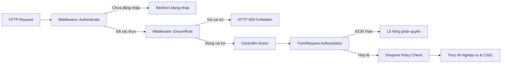

# MA TRẬN PHÂN QUYỀN TOÀN HỆ THỐNG (ROLE & PERMISSION MATRIX)
**Dự án:** AGU Academic Hub - Nền tảng Chia sẻ và Quản lý Học liệu Học thuật  
**Tổ chức:** Trường Đại học An Giang (AGU)  
**Phân tích bởi:** Senior QA Engineer & Security Auditor  
**Ngày phát hành:** 21/11/2026  
**Phiên bản:** v1.0.0  

---

## 1. TỔNG QUAN VỀ KIẾN TRÚC PHÂN QUYỀN (RBAC ARCHITECTURE)

Hệ thống AGU Academic Hub triển khai cơ chế kiểm soát truy cập dựa trên vai trò (Role-Based Access Control - RBAC) kết hợp thẩm định chính sách thuộc tính đối tượng (Attribute-Based Access Control - ABAC) tại tầng Middleware và Policy của Laravel:

### Các vai trò người dùng trong hệ thống:
1. **Khách vãng lai (Guest):** Người dùng chưa đăng nhập vào hệ thống.
2. **Sinh viên AGU (`SINH_VIEN`):** Sinh viên đang theo học tại trường, đã xác thực email `@student.agu.edu.vn`.
3. **Cựu sinh viên đã xác thực (`CUU_SINH_VIEN` - `DANG_HOAT_DONG`):** Cựu sinh viên đã nộp hồ sơ KYC và được kiểm duyệt viên phê duyệt minh chứng bằng cấp.
4. **Cựu sinh viên chưa xác thực (`CUU_SINH_VIEN` - `CHUA_XAC_THUC`):** Cựu sinh viên đã đăng ký nhưng hồ sơ KYC đang trong trạng thái chờ xét duyệt.
5. **Kiểm duyệt viên (`KIEM_DUYET_VIEN` / Moderator):** Nhân sự phụ trách kiểm duyệt tài liệu học thuật, giải ngân điểm bounty, xử lý báo cáo vi phạm và xét duyệt hồ sơ KYC.
6. **Quản trị viên (`QUAN_TRI_VIEN` / Super Admin):** Toàn quyền cấu hình danh mục khoa/ngành/môn học, quản lý khóa/mở tài khoản người dùng, xem nhật ký kiểm toán và khôi phục dữ liệu đã xóa.

---

## 2. MA TRẬN PHÂN QUYỀN ĐỐI CHIẾU THỰC TẾ (RBAC VERIFICATION GRID)

Mỗi chức năng nghiệp vụ được nhóm QA thẩm định qua **4 tầng kiểm tra độc lập**:
- **UI:** Chức năng có hiển thị / ẩn chính xác trên giao diện người dùng hay không.
- **URL:** Thử truy cập trực tiếp đường dẫn trên trình duyệt web.
- **HTTP:** Gửi request HTTP (POST/PUT/DELETE) giả lập trực tiếp qua API client (bỏ qua giao diện).
- **IDOR / Data:** Thử nghiệm thay đổi định danh `ID` để thao tác trái phép trên tài nguyên của người dùng khác.

### Bảng Ma trận Phân quyền Tổng hợp

| STT | Chức năng nghiệp vụ | Khách (Guest) | Sinh viên (Student) | Alumni đã duyệt | Alumni chưa duyệt | Moderator (Mod) | Admin (Super) | Ghi chú & Lỗi phát hiện |
| :---: | :--- | :---: | :---: | :---: | :---: | :---: | :---: | :--- |
| **1** | **Xem danh sách tài liệu** (`GET /tai-lieu`) | ALLOWED | ALLOWED | ALLOWED | BLOCKED | ALLOWED | ALLOWED | Khách xem được danh sách nhưng không xem được chi tiết/preview |
| **2** | **Tải về tài liệu** (`GET /tai-lieu/{id}/tai-ve`) | BLOCKED (302) | ALLOWED | ALLOWED | BLOCKED | ALLOWED | ALLOWED | Khách tải về bị bắt đăng nhập |
| **3** | **Đăng tải tài liệu mới** (`POST /tai-lieu/dang-tai`) | BLOCKED (302) | ALLOWED | ALLOWED | BLOCKED | ALLOWED | ALLOWED | Cả SV và Alumni được phép cống hiến học liệu |
| **4** | **Tạo phiên bản mới cho tài liệu** (`POST /tai-lieu/{id}/tao-phien-ban`) | BLOCKED (302) | ALLOWED | ALLOWED | BLOCKED | ALLOWED | ALLOWED | LỖI IDOR (`BUG-DOC-03`): Bất kỳ ai cũng tạo được version cho tài liệu của người khác |
| **5** | **Xóa tài liệu cá nhân trong 24h & 0 tải** (`DELETE /tai-lieu/{id}`) | BLOCKED (302) | ALLOWED | ALLOWED | BLOCKED | ALLOWED | ALLOWED | Hoạt động chính xác theo cơ sở bảo vệ quyền sở hữu cộng đồng |
| **6** | **Xóa tài liệu khi đã có lượt tải** | BLOCKED | BLOCKED (403) | BLOCKED (403) | BLOCKED | ALLOWED (Soft) | ALLOWED (Soft) | Sinh viên bị chặn; chỉ Mod/Admin mới có quyền xóa mềm |
| **7** | **Tạo yêu cầu Wishlist/Bounty** (`POST /yeu-cau-tai-lieu`) | BLOCKED (302) | ALLOWED | ALLOWED | BLOCKED | BLOCKED (Policy) | BLOCKED (Policy) | Mod/Admin bị giới hạn nhằm chống lạm quyền ví điểm |
| **8** | **Đáp ứng Wishlist/Bounty** (`POST /yeu-cau/.../dong-gop`) | BLOCKED (302) | ALLOWED | ALLOWED | BLOCKED | BLOCKED | BLOCKED | Hệ thống chặn tự đáp ứng yêu cầu của chính mình |
| **9** | **Nghiệm thu yêu cầu Bounty** (`POST /yeu-cau/.../xac-nhan`) | BLOCKED | ALLOWED (Chủ sở hữu) | ALLOWED (Chủ sở hữu) | BLOCKED | BLOCKED | BLOCKED | Người khác gửi request xác nhận bị trả về `403 Forbidden` |
| **10** | **Phê duyệt giải ngân Bounty** (`PUT /quan-tri/.../duyet`) | BLOCKED (302) | BLOCKED (403) | BLOCKED (403) | BLOCKED | ALLOWED | ALLOWED | Kiểm soát chặt chẽ tại phân hệ quản trị |
| **11** | **Viết đánh giá môn học** (`POST /danh-gia-mon-hoc`) | BLOCKED (302) | ALLOWED | ALLOWED | BLOCKED | BLOCKED (Policy) | BLOCKED (Policy) | Nhân sự quản trị không được phép tự tạo review |
| **12** | **Vote hữu ích đánh giá môn học** (`POST /danh-gia/.../vote`) | BLOCKED (302) | ALLOWED | ALLOWED | BLOCKED | ALLOWED | ALLOWED | Chặn tự vote cho chính bài đánh giá của mình |
| **13** | **Báo cáo vi phạm đánh giá / tài liệu** | BLOCKED (302) | ALLOWED | ALLOWED | BLOCKED | ALLOWED | ALLOWED | Chống gửi báo cáo trùng lặp cho cùng một bài |
| **14** | **Truy cập Dashboard Quản trị** (`GET /quan-tri`) | BLOCKED (302) | BLOCKED (403) | BLOCKED (403) | BLOCKED | ALLOWED | ALLOWED | Phân tách không gian quản trị tuyệt đối |
| **15** | **Duyệt hồ sơ e-KYC cựu sinh viên** (`GET/PUT /quan-tri/duyet-kyc`) | BLOCKED (302) | BLOCKED (403) | BLOCKED (403) | BLOCKED | ALLOWED | ALLOWED | Mod và Admin có thẩm quyền thẩm định bằng cấp |
| **16** | **Xem ảnh minh chứng KYC bảo mật** (`GET /kyc/xem-anh/{id}`) | BLOCKED (403) | BLOCKED (403) | BLOCKED (403) | BLOCKED | ALLOWED (Signed) | ALLOWED (Signed) | Bảo vệ bằng Signed URL; truy cập URL không chữ ký bị chặn 403 |
| **17** | **Truy cập trực tiếp file KYC qua URL công khai** (`/storage/private/...`) | BLOCKED (404) | BLOCKED (404) | BLOCKED (404) | BLOCKED (404) | BLOCKED (404) | BLOCKED (404) | Cách ly hoàn toàn tệp nhạy cảm khỏi thư mục web public |
| **18** | **Quản lý tài khoản người dùng** (`GET /quan-tri/nguoi-dung`) | BLOCKED (302) | BLOCKED (403) | BLOCKED (403) | BLOCKED | BLOCKED (403) | ALLOWED | Mod bị chặn 403; chỉ Super Admin mới có quyền khóa/mở tài khoản |
| **19** | **Quản lý danh mục học thuật** (`GET/POST /quan-tri/danh-muc`) | BLOCKED (302) | BLOCKED (403) | BLOCKED (403) | BLOCKED | BLOCKED (403) | ALLOWED | Mod bị chặn 403; chỉ Super Admin mới được cấu hình ngành, môn |
| **20** | **Khôi phục tài liệu trong thùng rác** (`PUT /quan-tri/.../khoi-phuc`) | BLOCKED (302) | BLOCKED (403) | BLOCKED (403) | BLOCKED | BLOCKED (403) | ALLOWED | Mod bị chặn 403; tính năng chỉ dành riêng cho Quản trị viên tối cao |

---

## 3. ĐÁNH GIÁ CHI TIẾT THEO TỪNG VAI TRÒ (PERSONA ACCESS EVALUATION)

### 3.1. Khách vãng lai (Guest)
- **Đánh giá chung:** Hoạt động đúng đặc tả bảo mật.
- **Trải nghiệm:** Khách chỉ được phép xem giao diện trang chủ, tra cứu danh mục môn học và xem danh sách tệp tài liệu công khai. Mọi thao tác tải file, viết review, đăng tải tài liệu hoặc vào trang quản trị đều bị Middleware `auth` chuyển hướng kịp thời về `/dang-nhap` kèm tham số `intended` URL.

### 3.2. Cựu sinh viên chưa xác thực (Unapproved Alumni - `an@gmail.com`)
- **Trạng thái thực tế:** Tài khoản có trạng thái CSDL `trang_thai = 'CHUA_XAC_THUC'`.
- **Cơ chế kiểm soát:** Được bảo vệ bởi `IdentityRuleEvaluator::canLogin()`.
- **Kết quả kiểm thử:** Khi cố gắng đăng nhập tại `/dang-nhap`, hệ thống lập tức từ chối phiên đăng nhập, không cấp session và trả về thông báo flash: *"Hồ sơ cựu sinh viên của bạn đang chờ xử lý. Bạn sẽ được phép đăng nhập sau khi hồ sơ được duyệt."*
- **Độ an toàn:** Đạt 100%. Không có khả năng sử dụng các tính năng nội bộ khi chưa vượt qua vòng kiểm duyệt KYC.

### 3.3. Sinh viên (`hai_dth235638@student.agu.edu.vn`) & Alumni đã duyệt (`dat@gmail.com`)
- **Quyền hạn được trao:** Được toàn quyền tham gia các tương tác cộng đồng học thuật (Upload, Download, Wishlist, Bounty, Review, Vote, Report).
- **Kiểm soát vi phạm:** Khi cố gắng truy cập bất kỳ route nào thuộc `/quan-tri/*`, Middleware `EnsureRole` lập tức trả về `HTTP 403 Forbidden`.
- **Lỗ hổng phát hiện:**
  - `BUG-DOC-03`: Tồn tại lỗ hổng IDOR tại route `POST /tai-lieu/{id}/tao-phien-ban`. Sinh viên hoặc Alumni có thể tự ý tạo phiên bản sửa đổi cho tài liệu thuộc quyền sở hữu của người khác mà không bị Policy chặn lại.

### 3.4. Kiểm duyệt viên (Moderator - `kiemduyet@agu.edu.vn`)
- **Quyền hạn được trao:** Quản lý hàng đợi duyệt tài liệu (`/quan-tri/tai-lieu/cho-kiem-tra`), duyệt giải ngân Bounty (`/quan-tri/yeu-cau-tai-lieu/cho-giai-ngan`), xử lý báo cáo vi phạm (`/quan-tri/bao-cao`) và duyệt hồ sơ e-KYC (`/quan-tri/duyet-kyc`).
- **Giới hạn an toàn:**
  - Hoàn toàn bị chặn `HTTP 403 Forbidden` khi cố truy cập Quản lý người dùng (`/quan-tri/nguoi-dung`).
  - Hoàn toàn bị chặn `HTTP 403 Forbidden` khi cố truy cập Quản lý danh mục học thuật (`/quan-tri/danh-muc`).
  - Hoàn toàn bị chặn `HTTP 403 Forbidden` khi cố khôi phục tài liệu đã xóa (`/quan-tri/tai-lieu/{id}/khoi-phuc`).
- **Độ an toàn:** Đạt 100%. Phân tách thẩm quyền giữa Quản trị và Kiểm duyệt được thực thi chặt chẽ.

### 3.5. Quản trị viên (Super Admin - `admin@agu.edu.vn`)
- **Quyền hạn:** Nắm giữ toàn bộ thẩm quyền tối cao của hệ thống.
- **Cơ chế tự bảo vệ:**
  - Đã tích hợp luật chống tự khóa tài khoản của chính mình (`TC-ADM-08` PASS).
  - Có cơ chế Audit Logging tự động ghi nhận mọi sự kiện truy cập trang quản trị.

---

## 4. KẾT LUẬN & KHUYẾN NGHỊ AN NINH PHÂN QUYỀN
1. **Điểm mạnh:**
   - Hệ thống Middleware phân quyền (`Authenticate`, `EnsureRole`) được áp dụng nhất quán trên toàn bộ các route nhạy cảm.
   - Thư mục Private Storage chứa ảnh chứng nhận KYC cựu sinh viên được cô lập hoàn hảo, chỉ có thể xem qua Signed URL với thời hạn nhất định.
2. **Điểm yếu cần vá gấp:**
   - Cần bổ sung ngay logic ủy quyền kiểm tra `ma_nguoi_dang` tại `CreateDocumentVersionRequest::authorize()` để vá lỗ hổng `BUG-DOC-03`.
