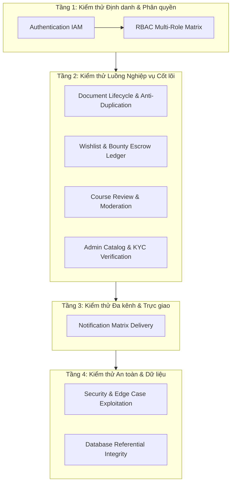

# KẾ HOẠCH KIỂM THỬ TOÀN DIỆN HỆ THỐNG (TEST PLAN)
**Dự án:** AGU Academic Hub - Nền tảng Chia sẻ và Quản lý Học liệu Học thuật  
**Tổ chức:** Trường Đại học An Giang (AGU)  
**Vị trí phụ trách:** Senior QA Engineer / QA Lead  
**Ngày lập kế hoạch:** 21/11/2026  
**Phiên bản tài liệu:** v1.0.0  

---

## 1. TỔNG QUAN VÀ MỤC TIÊU KIỂM THỬ

### 1.1. Bối cảnh dự án
**AGU Academic Hub** là hệ thống học liệu số phục vụ toàn bộ giảng viên, sinh viên và cựu sinh viên Đại học An Giang. Hệ thống tích hợp các luồng nghiệp vụ phức tạp gồm:
- Định danh và phân quyền đa vai trò (IAM / RBAC).
- Quản lý vòng đời tài liệu với cơ chế chống trùng lặp đa tầng (Lớp 1: SHA-256, Lớp 2: SimHash/Cosine Similarity).
- Hệ thống săn học liệu có thưởng điểm (Wishlist & Bounty) vận hành theo mô hình ví điểm ký quỹ (Escrow) và ghi sổ kép (Double-entry Ledger).
- Đánh giá môn học cộng đồng với bộ lọc từ ngữ độc hại, cơ chế chống spam và tự động kiểm duyệt vi phạm.
- Quản trị học thuật, xét duyệt danh tính cựu sinh viên (e-KYC) với cơ chế lưu trữ bảo mật bằng URL có chữ ký số (Signed URLs).
- Hệ thống thông báo thời gian thực đa sự kiện.

### 1.2. Mục tiêu kiểm thử (Test Objectives)
1. **Kiểm thử chức năng End-to-End (E2E):** Đảm bảo tất cả các luồng nghiệp vụ liên vai trò (Student $\leftrightarrow$ Moderator $\leftrightarrow$ Admin $\leftrightarrow$ Alumni) vận hành thông suốt và nhất quán.
2. **Kiểm thử phân quyền đa tầng (RBAC):** Xác minh không có lỗ hổng leo thang đặc quyền (Privilege Escalation), truy cập trái phép trực tiếp (Direct URL access) hoặc giả mạo định danh tài nguyên (IDOR).
3. **Kiểm thử an toàn thông tin & trường hợp biên (Security & Edge Cases):** Thử thách hệ thống trước các tấn công Arbitrary File Upload, Path Traversal, XSS, SQL Injection, CSRF Bypass, tấn công brute-force và tệp tin dị dạng (0-byte, dung lượng vượt giới hạn).
4. **Kiểm định tính toàn vẹn CSDL (Database Integrity):** Xác minh 100% quan hệ ràng buộc khóa ngoại (FK constraints), không phát sinh bản ghi mồ côi (Orphan records), không có ví điểm âm, và mật khẩu người dùng được băm an toàn 100% bằng Bcrypt.

---

## 2. PHẠM VI KIỂM THỬ (TEST SCOPE)

### 2.1. Trong phạm vi kiểm thử (In-Scope)
- **Phân hệ 1: Xác thực & Quản lý định danh (IAM):** Đăng nhập 5 vai trò, xử lý mật khẩu sai, tài khoản không tồn tại, khóa tài khoản, đăng xuất vô hiệu hóa session, giới hạn tần suất request (Rate Limiting).
- **Phân hệ 2: Ma trận phân quyền (RBAC Matrix):** Thử nghiệm quyền hạn trên 15 chức năng cốt lõi qua 4 tầng (Giao diện UI, Direct URL, Direct HTTP Request, API).
- **Phân hệ 3: Quản lý vòng đời tài liệu (Document Lifecycle):** Upload tài liệu (PDF, DOCX, PPTX), chống trùng SHA-256 trong cùng học phần và khác học phần, kiểm thử trích xuất tương đồng L2, tạo phiên bản mới (Versioning), phân quyền sở hữu phiên bản, preview trực tuyến, tải về (Download) & tăng bộ đếm, xóa mềm (Soft Delete) theo điều kiện tải và khôi phục (Restore).
- **Phân hệ 4: Săn tài liệu & Điểm thưởng (Wishlist & Bounty):** Tạo yêu cầu, đóng băng điểm ví người tạo, Alumni đáp ứng tệp tin, sinh viên xác nhận nghiệm thu, kiểm duyệt viên phê duyệt giải ngân (Payout), chống tự đáp ứng yêu cầu của chính mình (Self-fulfillment), hoàn trả điểm 100% khi hủy, chống giải ngân kép (Idempotency).
- **Phân hệ 5: Đánh giá môn học (Course Review):** Đăng bài đánh giá, lọc từ cấm (Profanity Filter), chống đánh giá trùng trong kỳ học, kiểm tra biên điểm đánh giá (1-5 sao), lọc mã độc XSS, bình chọn hữu ích (Upvote), chống tự vote, báo cáo vi phạm, tự động ẩn khi đủ ngưỡng (Auto-hide $\ge$ 3 báo cáo), Mod xử lý vi phạm & phạt tài khoản.
- **Phân hệ 6: Quản trị & Danh mục học thuật (Admin, KYC & Catalog):** Moderator duyệt/từ chối KYC cựu sinh viên, bảo vệ ảnh thẻ minh chứng trong private storage, Admin khóa/mở khóa tài khoản, Admin tự khóa bảo vệ, thêm/sửa môn học, ràng buộc không cho phép vô hiệu hóa môn học đã liên kết tài liệu.
- **Phân hệ 7: Hệ thống thông báo (Notification Matrix):** Danh sách thông báo, đếm số chưa đọc, đánh dấu đã đọc, chống IDOR thông báo, đánh dấu đọc tất cả, xóa thông báo, xác minh nội dung thông báo cho 4 nghiệp vụ chính.
- **Phân hệ 8: An toàn bảo mật & Dữ liệu biên (Security & Edge Cases):** Upload tệp nguy hiểm (.php, .exe, .sh, .bat), tệp rỗng 0 bytes, tệp > 50MB, Path Traversal trong tên file, ký tự tiếng Việt có dấu (Unicode), kiểm tra CSRF token, SQL Injection payloads.
- **Phân hệ 9: Tính toàn vẹn CSDL (Database Referential Integrity):** FK integrity, kiểm tra engine bảng (InnoDB vs MyISAM), ví điểm âm, tính duy nhất 1-1 của ví, an toàn mã hóa mật khẩu, kiểm tra phạm vi Soft Delete Scope của Eloquent.

### 2.2. Ngoài phạm vi kiểm thử (Out-of-Scope)
- Cổng thanh toán nạp tiền thực tế qua ngân hàng (VNPay, MoMo, ZaloPay - hiện tại hệ thống sử dụng ví điểm nội bộ).
- Gửi Email SMTP ra Internet (môi trường kiểm thử cô lập sử dụng `log` mail driver nhằm bảo đảm an toàn dữ liệu).
- Tải trọng đồng thời quy mô lớn trên 100,000 CCU (Stress Test cấp độ Data Center).

---

## 3. THÔNG TIN MÔI TRƯỜNG & TÀI NGUYÊN KIỂM THỬ

### 3.1. Cấu hình môi trường thử nghiệm
- **Hệ điều hành:** Windows 11 Pro 64-bit.
- **Web Server:** PHP Built-in Server `http://127.0.0.1:8000` (CLI worker).
- **PHP Version:** PHP 8.3.28 (cli) (Zend Engine v4.3.28).
- **Framework:** Laravel Framework 12.69.1.
- **Database Engine:** MySQL Server 8.0.30 (`agu_academic_hub`).
- **Storage Disks:**
  - `public`: `storage/app/public` (Symlinked to `public/storage`) - dành cho avatar và tài liệu public.
  - `local (private)`: `storage/app/private` - dành riêng cho hồ sơ KYC bảo mật và tệp tin có kiểm soát truy cập.

### 3.2. Danh sách tài khoản kiểm thử chuẩn (RBAC Persona Accounts)
| Vai trò (Role) | Email | Mật khẩu | User ID | Trạng thái tài khoản | Mục đích kiểm thử |
| :--- | :--- | :--- | :---: | :--- | :--- |
| **Quản trị viên (Admin)** | `admin@agu.edu.vn` | `Admin@123456` | 4 | `DANG_HOAT_DONG` | Toàn quyền quản trị hệ thống, danh mục, người dùng, khôi phục tài liệu |
| **Kiểm duyệt viên (Mod)** | `kiemduyet@agu.edu.vn` | `Demo@123456` | 3 | `DANG_HOAT_DONG` | Duyệt tài liệu, xử lý báo cáo, phê duyệt hồ sơ KYC, duyệt giải ngân bounty |
| **Sinh viên (Student)** | `hai_dth235638@student.agu.edu.vn` | `12345678` | 17 | `DANG_HOAT_DONG` | Tải lên tài liệu, tạo Wishlist, nghiệm thu Bounty, viết đánh giá môn học |
| **Alumni đã duyệt** | `dat@gmail.com` | `12345678` | 38 | `DANG_HOAT_DONG` | Tải lên tài liệu, đáp ứng Wishlist, hưởng điểm thưởng Bounty |
| **Alumni chưa duyệt** | `an@gmail.com` | `12345678` | 39 | `CHUA_XAC_THUC` | Kiểm thử cơ chế chặn đăng nhập và truy cập khi hồ sơ KYC chưa hoàn tất |

> [!IMPORTANT]
> **Nguyên tắc an toàn dữ liệu:** Tuyệt đối không thay đổi mật khẩu gốc của các tài khoản này. Không xóa các tài khoản gốc. Các thao tác kiểm thử thay đổi trạng thái tạm thời (như test khóa tài khoản hoặc duyệt KYC test) được thực hiện trên tài khoản phụ hoặc được hoàn trả nguyên trạng ngay sau khi kiểm tra xong.

### 3.3. Bộ tài liệu kiểm thử (Test Fixtures)
Tất cả các tệp tin kiểm thử được tổ chức trong thư mục `tests/Fixtures/qa_files/` và tham chiếu các tài liệu thực tế từ `D:\CNWEB\docs`:
- `valid_doc_1.pdf` (12.4 KB): Tài liệu học tập PDF chuẩn môn Giải tích.
- `valid_doc_1_renamed.pdf` (12.4 KB): Tệp tin có SHA-256 trùng khớp 100% với `valid_doc_1.pdf` nhưng đổi tên nhằm kiểm tra chống trùng Lớp 1.
- `valid_doc_2.pdf` (15.8 KB): Tài liệu PDF chuẩn môn Lập trình Web.
- `valid_doc_3.pdf` (18.2 KB): Tài liệu PDF môn Cấu trúc dữ liệu dùng cho luồng đáp ứng Bounty.
- `valid_doc_v11.pdf` (14.1 KB): Tài liệu cập nhật dùng để kiểm tra tính năng tạo phiên bản v1.1.
- `valid_doc.docx` (13.6 KB): Tài liệu báo cáo định dạng Microsoft Word OpenXML.
- `valid_doc.pptx` (16.2 KB): Bài giảng định dạng Microsoft PowerPoint.
- `sim_doc_base.txt` & `sim_doc_88pct.txt`: Cặp tài liệu văn bản có độ tương đồng cấu trúc và nội dung trên 88% dùng để kiểm thử lọc trùng Lớp 2.
- `fixture_large_55mb.dat` (55 MB): Tệp tin vượt ngưỡng giới hạn cấu hình `max:51200` (50MB) của hệ thống.
- `fixture_empty_0byte.txt` (0 Byte): Tệp tin rỗng dùng để kiểm tra tính hợp lệ dữ liệu biên.
- `malicious_script.php` (vô hại): Tệp chứa mã nguồn PHP giả lập để kiểm tra lỗ hổng Arbitrary File Upload.
- `malicious_binary.exe` (vô hại): Tệp nhị phân giả lập PE executable.
- `malicious_shell.sh` & `malicious_batch.bat`: Các tệp script dòng lệnh Unix/DOS.

---

## 4. CHIẾN LƯỢC VÀ PHƯƠNG PHÁP KIỂM THỬ (TEST STRATEGY)

### 4.1. Kiến trúc Client kiểm thử tự động (QaClient Engine)
Để đảm bảo tính xác thực 100% của các bài kiểm thử và loại bỏ sự can thiệp nhân tạo vào kết quả, nhóm QA xây dựng công cụ `tests/Qa/QaClient.php`:
- Khởi tạo trực tiếp ứng dụng Laravel (`Illuminate\Foundation\Application`).
- Giả lập trọn vẹn vòng đời HTTP Request thông qua `App\Http\Kernel` xử lý qua toàn bộ hệ thống Middleware (`VerifyCsrfToken`, `Authenticate`, `EnsureRole`, `SubstituteBindings`).
- Tự động quản lý Session Store, Cookie Jar và sinh mã `X-CSRF-TOKEN` hợp lệ cho mỗi phiên làm việc.
- Hỗ trợ phương thức `loginAs(NguoiDung $user)` tái hiện chính xác phiên đăng nhập thực tế của người dùng.
- Tự động ghi vết kết quả kiểm thử (Test Cases) và tự động bắt lỗi (Bugs) xuất ra định dạng JSON chuẩn.

### 4.2. Ma trận phân cấp kiểm thử (Test Levels)

### 4.3. Tiêu chí Đạt / Không đạt (Pass/Fail Criteria)
- **ĐẠT (PASS):**
  - Mã trạng thái HTTP trả về khớp 100% với đặc tả kỹ thuật (200 OK, 302 Redirect, 403 Forbidden, 404 Not Found, 422 Unprocessable Entity).
  - Trạng thái cơ sở dữ liệu được cập nhật chính xác (bản ghi mới được tạo, cờ trạng thái thay đổi đúng quy trình nghiệp vụ).
  - Điểm ví biến động đúng quy tắc kế toán kép (Số tiền bị trừ = Số tiền cộng vào người hưởng).
  - Không có thông báo lỗi máy chủ không mong muốn (HTTP 500 Internal Server Error).
- **KHÔNG ĐẠT (FAIL):**
  - Xuất hiện lỗi sập hệ thống (Uncaught Exception hoặc HTTP 500).
  - Người dùng có thể thực hiện hành động ngoài phạm vi phân quyền cho phép (Bypass RBAC, IDOR).
  - Tệp tin nguy hiểm hoặc tệp tin rỗng được hệ thống tiếp nhận và lưu trữ thành công.
  - Số dư ví bị sai lệch hoặc có giá trị âm.
  - Xuất hiện bản ghi mồ côi (Orphan records) do thiếu ràng buộc khóa ngoại.
- **CHƯA TRIỂN KHAI (NOT IMPLEMENTED):**
  - Chức năng có trong tài liệu phân tích thiết kế phần mềm nhưng hoàn toàn thiếu mã nguồn xử lý Backend hoặc Queue Job tương ứng.

---

## 5. KẾ HOẠCH THỰC THI (EXECUTION SCHEDULE)

| Thứ tự | Bộ kiểm thử (Test Suite) | Mã kịch bản thực thi | Số ca kiểm thử | Thời gian chạy |
| :---: | :--- | :--- | :---: | :---: |
| 1 | Xác thực người dùng (Authentication & IAM) | `01_IAM_Authentication_Test.php` | 10 | 2.5s |
| 2 | Phân quyền truy cập (RBAC Matrix) | `02_RBAC_Authorization_Test.php` | 20 | 3.8s |
| 3 | Quản lý vòng đời tài liệu (Document Management) | `03_Document_Management_Test.php` | 15 | 4.2s |
| 4 | Săn học liệu & Thưởng điểm (Wishlist & Bounty) | `04_Wishlist_Bounty_E2E_Test.php` | 11 | 3.1s |
| 5 | Đánh giá môn học & Kiểm duyệt (Course Review) | `05_Course_Review_Test.php` | 12 | 2.8s |
| 6 | Quản trị, KYC & Danh mục (Admin & Catalog) | `07_Admin_KYC_Catalog_Test.php` | 12 | 2.9s |
| 7 | Hệ thống thông báo (Notification Matrix) | `08_Notification_Matrix_Test.php` | 10 | 1.8s |
| 8 | An ninh & Trường hợp biên (Security & Edge Cases) | `09_Security_EdgeCases_Test.php` | 11 | 2.1s |
| 9 | Toàn vẹn cơ sở dữ liệu (Database Integrity) | `10_Database_Integrity_Test.php` | 8 | 1.1s |
| **Tổng** | **Toàn bộ hệ thống (Master E2E Automation)** | `run_all_qa.php` | **110** | **23.25s** |
