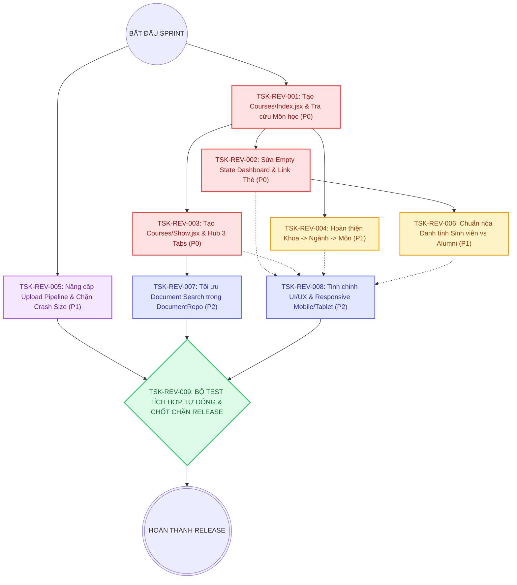

# SƠ ĐỒ PHỤ THUỘC TRIỂN KHAI (IMPLEMENTATION DEPENDENCY GRAPH)
## AGU Academic Hub — Phân Hệ Sinh Viên (`SINH_VIEN`) & Cựu Sinh Viên (`CUU_SINH_VIEN`)
**Thời điểm lập:** 2026-11-06  
**Phiên bản:** 2.0 (Kiến trúc phân rã chuẩn hóa, xác minh luồng thực tế và chống nghẽn phụ thuộc)  
**Tài liệu liên kết:** 
- Kế hoạch triển khai: [`docs/audits/REVISED_IMPLEMENTATION_PLAN.md`](file:///d:/CNWEB/AGU-Academic-Hub/docs/audits/REVISED_IMPLEMENTATION_PLAN.md)
- Ma trận khoảng trống: [`docs/audits/FEATURE_GAP_MATRIX.md`](file:///d:/CNWEB/AGU-Academic-Hub/docs/audits/FEATURE_GAP_MATRIX.md)
- Báo cáo kiểm toán: [`docs/audits/REALITY_AUDIT_REPORT.md`](file:///d:/CNWEB/AGU-Academic-Hub/docs/audits/REALITY_AUDIT_REPORT.md)

---

## 1. TỔNG QUAN LUỒNG THI CÔNG VÀ NGUYÊN TẮC QUẢN LÝ PHỤ THUỘC

Nhằm tránh hiện tượng "chờ đợi dây chuyền" và loại bỏ triệt để việc một task ưu tiên cao bị tắc nghẽn bởi task chưa thực hiện, sơ đồ được thiết kế dựa trên 4 nguyên tắc cốt lõi:

1. **Khóa mỏ neo (Anchor Task):** `TSK-REV-001` (Tạo trang danh mục môn học `Courses/Index.jsx`) là mỏ neo giải phóng toàn bộ các liên kết bị trỏ nhầm từ Dashboard, Khoa và Chi tiết môn học. Đây là task gốc bắt buộc thực hiện đầu tiên.
2. **Luồng thực thi song song (Parallel Execution Tracks):** Sau khi `TSK-REV-001` hoàn thành, hệ thống chia thành 3 luồng công việc độc lập có thể triển khai song song bởi các lập trình viên khác nhau mà không gây xung đột mã nguồn. Task upload `TSK-REV-005` hoàn toàn không phụ thuộc vào `TSK-REV-001` và có thể triển khai ngay lập tức.
3. **Phân định rõ ranh giới nghiệp vụ (Domain Separation):** 
   - Course Search (Tìm kiếm môn học) nằm tại `TSK-REV-001`.
   - Document Search (Tìm kiếm tài liệu) nằm tại `TSK-REV-007`. Hai task này không bị chồng lấn hay phụ thuộc chéo vào nhau.
4. **Chốt chặn chất lượng duy nhất (Unified Quality Gate):** `TSK-REV-009` đóng vai trò là cửa ải nghiệm thu cuối cùng (Release Gate), đảm bảo 100% kiểm thử tích hợp tự động vượt qua trước khi bàn giao.

---

## 2. SƠ ĐỒ MERMAID PHỤ THUỘC (DEPENDENCY FLOWCHART)



---

## 3. MA TRẬN QUẢN LÝ PHỤ THUỘC & ĐIỀU PHỐI THỰC THI

| Task ID | Giai Đoạn | Tên Công Việc | Phụ Thuộc Trực Tiếp (Depends On) | Các Task Bị Chặn Nếu Chưa Làm (Blocks) | Khả Năng Thực Hiện Song Song | Đường Găng (Critical Path) |
| :---: | :---: | :--- | :--- | :--- | :--- | :---: |
| **TSK-REV-001** | **P0** | Tạo trang `Courses/Index.jsx` & Tra cứu môn học | *Không có (Root Task)* | `TSK-REV-002`, `TSK-REV-003`, `TSK-REV-004` | Có thể chạy song song với `TSK-REV-005` | **CÓ (Trục chính)** |
| **TSK-REV-002** | **P0** | Sửa Empty State Dashboard & Gắn link thẻ | `TSK-REV-001` (để link tìm môn hoạt động) | `TSK-REV-006` | Song song với `TSK-REV-003`, `TSK-REV-004` | **CÓ** |
| **TSK-REV-003** | **P0** | Tạo trang `Courses/Show.jsx` & Hub 3 Tabs | `TSK-REV-001` (để breadcrumb/back quay về) | `TSK-REV-007` | Song song với `TSK-REV-002`, `TSK-REV-004` | **CÓ** |
| **TSK-REV-004** | **P1** | Hoàn thiện Khoa $\to$ Ngành $\to$ Môn | `TSK-REV-001` (để `courses.index` nhận `ma_khoa`) | `TSK-REV-008` | Song song với `TSK-REV-002`, `TSK-REV-005` | Không |
| **TSK-REV-005** | **P1** | Nâng cấp Upload Pipeline & Chặn Crash | *Không có (Độc lập)* | `TSK-REV-009` | Hoàn toàn độc lập, làm ngay từ đầu | Không |
| **TSK-REV-006** | **P1** | Chuẩn hóa danh tính Sinh viên vs Alumni | `TSK-REV-002` (Dashboard đã fix empty state) | `TSK-REV-008` | Song song với `TSK-REV-003`, `TSK-REV-007` | Không |
| **TSK-REV-007** | **P2** | Tối ưu hóa tìm kiếm tài liệu `DocumentRepository` | `TSK-REV-003` (để kiểm tra search trong tab môn) | `TSK-REV-009` | Song song với `TSK-REV-004`, `TSK-REV-006` | Không |
| **TSK-REV-008** | **P2** | Tinh chỉnh UI/UX Responsive Mobile/Tablet | `TSK-REV-001`, `TSK-REV-002`, `TSK-REV-003` | `TSK-REV-009` | Triển khai sau khi các trang giao diện hoàn tất | **CÓ** |
| **TSK-REV-009** | **Gate**| Bộ test tích hợp tự động toàn hệ thống | Hoàn thành tất cả các task từ 001 đến 008 | *Release sản phẩm* | Chốt chặn cuối cùng (Sequential Only) | **CÓ (Điểm kết thúc)** |

---

## 4. KẾ HOẠCH PHÂN BỔ THEO 4 SPRINT CHI TIẾT

### SPRINT 1: MỎ NEO NỀN TẢNG & GIẢI TỎA TRẢI NGHIỆM CỐT LÕI (CORE ANCHOR)
- **Mục tiêu Sprint:** Tạo mới `Courses/Index.jsx`, sửa dứt điểm lỗi Dashboard, tạo `Courses/Show.jsx` làm trung tâm kết nối 3 Tabs.
- **Tasks thực hiện:**
  1. `TSK-REV-001`: Xây dựng `Courses/Index.jsx` & Tra cứu môn học (4.0h).
  2. `TSK-REV-002`: Sửa lỗi Empty State vô điều kiện & Gắn link thẻ tài liệu Dashboard (2.5h).
  3. `TSK-REV-003`: Xây dựng `Courses/Show.jsx` & Hub 3 Tabs liên thông (5.0h).
- **Tổng thời gian:** **11.5 Giờ** (~1.5 ngày làm việc).
- **Kết quả đạt được (Deliverables):** Người dùng bấm "Kho môn học" hoặc "Tìm môn học" trên Dashboard thấy đúng danh mục môn học, tìm kiếm được môn học, click vào xem chi tiết học phần với đầy đủ 3 Tabs.

### SPRINT 2: PHÂN CẤP ĐÀO TẠO & BẢO VỆ PIPELINE UPLOAD TỆP (HIERARCHY & HARDENING)
- **Mục tiêu Sprint:** Hoàn thiện xem Chuyên ngành trên trang Khoa; nâng cấp form upload tệp có chọn Chuyên ngành, chặn crash trình duyệt khi file > 50MB, chặn file sai định dạng.
- **Tasks thực hiện:**
  1. `TSK-REV-004`: Hoàn thiện phân cấp Khoa $\to$ Chuyên ngành $\to$ Môn học trên `Faculties/Index.jsx` (3.0h).
  2. `TSK-REV-005`: Nâng cấp Upload Pipeline & Validate an toàn Client/Server (4.5h).
  3. `TSK-REV-006`: Chuẩn hóa danh tính Sinh viên vs Alumni trên Dashboard và Profile (2.0h).
- **Tổng thời gian:** **09.5 Giờ** (~1.2 ngày làm việc).
- **Kết quả đạt được (Deliverables):** Luồng duyệt Khoa $\to$ Ngành $\to$ Môn hoạt động trơn tru. Form đăng tải tài liệu an toàn tuyệt đối, không còn rủi ro đơ tab trình duyệt hoặc file rác trên máy chủ.

### SPRINT 3: TỐI ƯU HÓA TÌM KIẾM TÀI LIỆU & TINH CHỈNH GIAO DIỆN (SEARCH & POLISH)
- **Mục tiêu Sprint:** Nâng cấp tìm kiếm tài liệu trong `DocumentRepository` (hỗ trợ tìm theo mã học phần của môn), tối ưu hóa trải nghiệm responsive trên mobile và tablet.
- **Tasks thực hiện:**
  1. `TSK-REV-007`: Tối ưu hóa tìm kiếm tài liệu trong `DocumentRepository` (2.0h).
  2. `TSK-REV-008`: Tinh chỉnh UI/UX Responsive Mobile/Tablet toàn diện (2.5h).
- **Tổng thời gian:** **04.5 Giờ** (~0.6 ngày làm việc).
- **Kết quả đạt được (Deliverables):** Sinh viên tìm tài liệu bằng mã môn học trên trang Kho tài liệu ra đúng kết quả. Toàn bộ các trang mới hiển thị sắc nét, co giãn linh hoạt trên mọi kích thước màn hình.

### SPRINT 4: KIỂM THỬ TÍCH HỢP TOÀN BỘ LUỒNG & CHỐT CHẶN RELEASE (RELEASE GATE)
- **Mục tiêu Sprint:** Viết bộ test `tests/Feature/RevisedRealityWorkflowTest.php`, chạy kiểm thử toàn hệ thống đạt 100% PASS, kiểm tra Vite build sạch sẽ.
- **Tasks thực hiện:**
  1. `TSK-REV-009`: Xây dựng bộ test tích hợp và chốt chặn Release (4.5h).
- **Tổng thời gian:** **04.5 Giờ** (~0.6 ngày làm việc).
- **Kết quả đạt được (Deliverables):** Toàn bộ 171+ test cases backend pass 100%, Vite build production thành công không có cảnh báo. Hệ thống sẵn sàng bàn giao cho người dùng cuối.

---

## 5. PHÂN TÍCH ĐIỂM NGHẼN (BLOCKERS) & CHIẾN LƯỢC HÓA GIẢI

### Điểm nghẽn tiềm tàng 1: `TSK-REV-001` là nút thắt cổ chai của các task giao diện
- **Nguyên nhân:** Nếu chưa có `Courses/Index.jsx`, các liên kết từ Dashboard (`TSK-REV-002`), từ Khoa (`TSK-REV-004`) và breadcrumb từ Chi tiết môn (`TSK-REV-003`) không có đích đến hợp lệ.
- **Chiến lược hóa giải:**
  - `TSK-REV-001` được gán độ ưu tiên cao nhất (`P0`) và thực hiện ngay đầu tiên.
  - Trong lúc `TSK-REV-001` đang được lập trình, lập trình viên thứ 2 có thể bắt tay làm ngay `TSK-REV-005` (Nâng cấp Upload Pipeline) vì task này hoàn toàn độc lập với hệ thống Catalog.

### Điểm nghẽn tiềm tàng 2: Trùng lặp hoặc xung đột giữa Course Search và Document Search
- **Nguyên nhân:** Trước đây task tìm kiếm tài liệu cố tình can thiệp vào `DocumentRepository` để giải quyết tìm kiếm môn học, gây sai lệch trách nhiệm kiến trúc.
- **Chiến lược hóa giải:**
  - Đã tách triệt để: Course Search thuộc về `AcademicCatalogRepository::getPublicPaginatedCourses` trong `TSK-REV-001`.
  - Document Search thuộc về `DocumentRepository::paginatePublicDocuments` trong `TSK-REV-007`. Hai repository này hoạt động trên 2 domain riêng biệt, hoàn toàn không xung đột.

### Điểm nghẽn tiềm tàng 3: Tab Review và Bounty trên `Courses/Show.jsx` có nguy cơ viết lại logic
- **Nguyên nhân:** Lập trình viên có thể vô tình code lại modal đánh giá hoặc query tính điểm ví.
- **Chiến lược hóa giải:**
  - `TSK-REV-003` tái sử dụng 100% các controller và action đã có: gọi `GET /mon-hoc/{course_code}/danh-gia` cho Review và gọi `GET /yeu-cau-tai-lieu?ma_mon_hoc={id}` cho Bounty. Trang chỉ đóng vai trò Presentation Hub.

---

## 6. TIÊU CHÍ VƯỢT QUA CHỐT CHẶN CHẤT LƯỢNG (QUALITY GATE CRITERIA)

Một task chỉ được coi là hoàn thành khi đáp ứng đủ 4 tiêu chí sau:

```
┌────────────────────────────────────────────────────────────────────────┐
│ CHECKLIST VƯỢT CHỐT CHẶN CHẤT LƯỢNG (QUALITY GATE CHECKLIST)           │
├────────────────────────────────────────────────────────────────────────┤
│ [ ] Code Integrity: Tuân thủ kiến trúc Modular Monolith                │
│     (Presentation -> Application -> Domain -> Infrastructure)          │
│ [ ] No Schema Tampering: Không sửa migration khi schema hiện tại đã đủ │
│ [ ] Automated Testing: Toàn bộ test case chỉ định trong task đạt PASS  │
│ [ ] Clean Build: Lệnh `npm run build` không phát sinh chunk lỗi        │
│ [ ] Zero Regression: 171+ test cases backend hiện tại tiếp tục PASS    │
└────────────────────────────────────────────────────────────────────────┘
```

