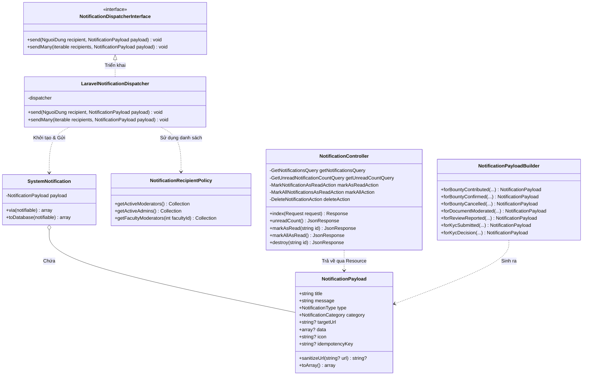
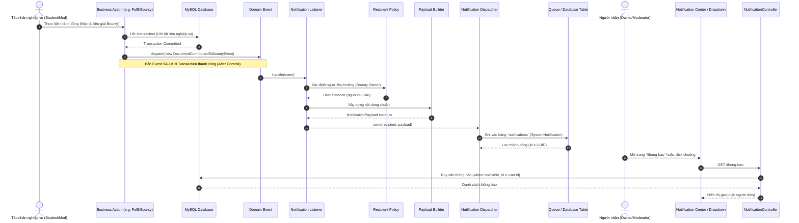

# KIẾN TRÚC HỆ THỐNG THÔNG BÁO DÙNG CHUNG (NOTIFICATION SYSTEM ARCHITECTURE)
## DỰ ÁN: AGU ACADEMIC HUB — MODULE THÔNG BÁO TẬP TRUNG (OOP SHARED NOTIFICATION SYSTEM)

---

## 1. TỔNG QUAN KIẾN TRÚC (EXECUTIVE SUMMARY)

Module Thông báo (Notification Module) của AGU Academic Hub được thiết kế theo mô hình **Kiến trúc phân lớp theo miền (Domain-Driven Design / Clean Layered Architecture)** và **Hướng đối tượng (Object-Oriented Programming - OOP)**.

Hệ thống đóng vai trò là hạ tầng dịch vụ dùng chung (Shared Infrastructure & Application Core), phục vụ thống nhất 4 nhóm tác nhân:
- **Sinh viên (`SINH_VIEN`)**
- **Cựu sinh viên (`CUU_SINH_VIEN`)**
- **Kiểm duyệt viên (`KIEM_DUYET_VIEN`)**
- **Quản trị viên (`ADMIN`)**

### Nguyên tắc cốt lõi:
1. **Phân tách trách nhiệm (Separation of Concerns):** Các module nghiệp vụ (Tài liệu, Bounty, Đánh giá môn học, Kiểm duyệt, KYC, Ví điểm) **tuyệt đối không** tự ý ghi trực tiếp vào cơ sở dữ liệu thông báo hoặc tự phân phối thông báo riêng rẽ. Thay vào đó, các module này chỉ phát sinh các sự kiện miền (Domain Events).
2. **Không biến thông báo thành bản sao trạng thái nghiệp vụ (State Decoupling):** Notification chỉ đóng vai trò là "tín hiệu chỉ mục" (Index signal/pointer) mang thông tin định hướng và liên kết an toàn (`target_url`). Việc kiểm tra quyền thao tác hoặc tính hợp lệ của nghiệp vụ vẫn do Backend Service của module đích đảm nhiệm khi người dùng truy cập.
3. **Phân biệt rạch ròi Thông báo cá nhân (`PERSONAL`) và Mục công việc (`WORK_ITEM`):** Cùng lưu trữ trên cấu trúc chuẩn nhưng tách biệt rõ ràng theo thuộc tính danh mục (`NotificationCategory`), phục vụ việc lọc và phân phối chính xác theo vai trò (RBAC).
4. **Bất đồng bộ và Chống trùng lặp (Asynchronous & Idempotency):** Sử dụng Message Queue để không làm nghẽn giao dịch cơ sở dữ liệu chính, đồng thời hỗ trợ khóa chống trùng lặp (`idempotency_key`) ngăn ngừa việc nhân bản thông báo khi Queue retry hoặc khi tác vụ chạy song song.
5. **Khả năng mở rộng Realtime (Broadcasting Ready):** Thiết kế sẵn sàng cắm thêm Laravel Reverb / WebSockets qua Broadcasting channel mà không phải sửa đổi tầng Application hoặc Domain.

---

## 2. KIẾN TRÚC PHÂN TẦNG (LAYERED ARCHITECTURE)

Module được cấu trúc độc lập trong thư mục `app/Modules/Notifications/` với 4 phân tầng chuẩn:

```
app/Modules/Notifications/
├── Application/
│   ├── Actions/
│   │   ├── DeleteNotificationAction.php
│   │   ├── MarkAllNotificationsAsReadAction.php
│   │   └── MarkNotificationAsReadAction.php
│   ├── Contracts/
│   │   └── NotificationDispatcherInterface.php
│   ├── DTOs/
│   │   └── NotificationPayload.php
│   └── Queries/
│       ├── GetNotificationsQuery.php
│       └── GetUnreadNotificationCountQuery.php
├── Domain/
│   ├── Enums/
│   │   ├── NotificationCategory.php
│   │   └── NotificationType.php
│   ├── Events/
│   │   ├── BountyCancelledEvent.php
│   │   ├── BountyFulfillmentConfirmedEvent.php
│   │   ├── DocumentContributedToBountyEvent.php
│   │   ├── DocumentModeratedEvent.php
│   │   ├── KycDecisionEvent.php
│   │   ├── KycSubmittedEvent.php
│   │   └── ReviewReportedEvent.php
│   └── Services/
│       ├── NotificationPayloadBuilder.php
│       └── NotificationRecipientPolicy.php
├── Infrastructure/
│   ├── Adapters/
│   │   └── LaravelNotificationDispatcher.php
│   ├── Listeners/
│   │   ├── BountyNotificationListener.php
│   │   ├── DocumentModerationNotificationListener.php
│   │   ├── KycNotificationListener.php
│   │   └── ReviewNotificationListener.php
│   └── Notifications/
│       └── SystemNotification.php
├── Presentation/
│   └── Http/
│       ├── Controllers/
│       │   └── NotificationController.php
│       └── Resources/
│           └── NotificationResource.php
├── NotificationsServiceProvider.php
└── routes.php
```

### 2.1. Domain Layer (Lõi nghiệp vụ & Quy tắc miền)
- **`NotificationType`**: Enum định danh 17 loại thông báo nghiệp vụ thuộc toàn hệ thống (Bounties, Documents, Reviews, KYC, System).
- **`NotificationCategory`**: Enum phân loại `PERSONAL` (thông báo cá nhân của người dùng) và `WORK_ITEM` (danh mục công việc kiểm duyệt/vận hành của Mod/Admin).
- **Domain Events**: Các sự kiện bất biến (Immutable Events) đại diện cho một sự thật nghiệp vụ đã xảy ra:
  - `DocumentContributedToBountyEvent`
  - `BountyFulfillmentConfirmedEvent`
  - `BountyCancelledEvent`
  - `DocumentModeratedEvent`
  - `ReviewReportedEvent`
  - `KycSubmittedEvent`
  - `KycDecisionEvent`
- **Domain Services**:
  - `NotificationRecipientPolicy`: Đóng gói toàn bộ logic xác định người nhận theo RBAC (tìm danh sách Moderator đang hoạt động, lọc theo thẩm quyền khoa hoặc chuyên ngành, xác định quyền Admin). Ngăn chặn việc phân tán câu lệnh query người nhận rải rác trong code nghiệp vụ.
  - `NotificationPayloadBuilder`: Chuẩn hóa việc dựng dữ liệu thông báo từ đối tượng nghiệp vụ, đảm bảo thông điệp đồng nhất theo tài liệu đặc tả Use Case.

### 2.2. Application Layer (Điều phối & Thực thi ca sử dụng)
- **Data Transfer Object (`NotificationPayload`)**: Chuẩn hóa dữ liệu đầu vào cho hệ thống thông báo. Chứa logic bảo mật tự động chuẩn hóa URL (chống Open Redirect vulnerability), bắt buộc cung cấp `title`, `message`, `type`, `category`. Hỗ trợ thuộc tính mở rộng `idempotencyKey` và `icon`.
- **Contracts (`NotificationDispatcherInterface`)**: Giao diện trừu tượng định nghĩa các hàm gửi thông báo:
  - `send(NguoiDung $recipient, NotificationPayload $payload): void`
  - `sendMany(iterable $recipients, NotificationPayload $payload): void`
- **Queries**:
  - `GetNotificationsQuery`: Truy vấn danh sách thông báo phân trang, tối ưu eager loading, hỗ trợ lọc theo trạng thái đọc/chưa đọc (`filter = unread|read|all`) và danh mục (`category = PERSONAL|WORK_ITEM`).
  - `GetUnreadNotificationCountQuery`: Đếm nhanh số lượng thông báo chưa đọc phục vụ badge chuông thông báo trên Header / Navigation.
- **Actions**:
  - `MarkNotificationAsReadAction`: Đánh dấu đã đọc cho 1 thông báo cụ thể kèm kiểm tra quyền sở hữu (Strict Tenant / Recipient Ownership Check).
  - `MarkAllNotificationsAsReadAction`: Đánh dấu đã đọc toàn bộ thông báo của người dùng hiện tại chỉ bằng 1 câu lệnh SQL UPDATE duy nhất (`read_at = NOW()`), loại bỏ hoàn toàn lỗi N+1 query.
  - `DeleteNotificationAction`: Xóa vĩnh viễn thông báo sau khi xác thực quyền sở hữu.

### 2.3. Infrastructure Layer (Hạ tầng kỹ thuật & Bộ chuyển đổi)
- **`LaravelNotificationDispatcher`**: Triển khai `NotificationDispatcherInterface`, đóng vai trò là Adapter cầu nối giữa Domain/Application và cơ chế Notification gốc của Laravel. Có cơ chế kiểm tra `idempotencyKey` trong bảng `notifications` trước khi gửi nhằm ngăn ngừa gửi trùng.
- **`SystemNotification`**: Kế thừa `Illuminate\Notifications\Notification`, implement `ShouldQueue`. Lưu trữ dữ liệu vào database channel thông qua phương thức `toDatabase()`. Thiết lập retry và timeout cấu hình sẵn.
- **Listeners**: Lắng nghe các Domain Event trong hệ thống và điều phối việc tạo `NotificationPayload` qua `NotificationPayloadBuilder`, sau đó dùng `NotificationDispatcherInterface` để phát thông báo tới các đối tượng do `NotificationRecipientPolicy` chỉ định.

### 2.4. Presentation Layer (Giao diện & HTTP Delivery)
- **`NotificationController`**: Xử lý các HTTP request từ Client, hỗ trợ cả 2 dạng phản hồi:
  - **Inertia Page**: Trả về trang `Notifications/Index` khi người dùng truy cập trực tiếp từ trình duyệt (`Accept: text/html`).
  - **JSON API**: Trả về JSON khi các component nền như `NotificationDropdown` gọi fetch dữ liệu (`wantsJson()` / `X-Inertia`).
- **`NotificationResource`**: Chuẩn hóa dữ liệu đầu ra cho Frontend, đồng bộ các trường hiển thị (`id`, `title`, `message`, `type`, `category`, `target_url`, `is_read`, `read_at`, `created_at`, `created_at_human`).

---

## 3. NGUYÊN LÝ THIẾT KẾ OOP & SOLID

Hệ thống tuân thủ chặt chẽ 5 nguyên lý SOLID:

1. **S - Single Responsibility Principle (Đơn trách nhiệm):**
   - Mỗi Action chỉ làm một nhiệm vụ duy nhất (`MarkNotificationAsReadAction` chỉ đánh dấu đã đọc, không xóa; `DeleteNotificationAction` chỉ xóa).
   - `NotificationRecipientPolicy` chỉ chịu trách nhiệm tìm người nhận theo phân quyền; không quan tâm đến nội dung hay hình thức gửi thông báo.
2. **O - Open/Closed Principle (Đóng/Mở):**
   - Khi có sự kiện nghiệp vụ mới phát sinh (ví dụ: Module Khảo thí bổ sung sự kiện `ExamSchedulePublishedEvent`), chỉ cần tạo thêm 1 Listener mới và đăng ký trong `NotificationsServiceProvider` mà không cần chỉnh sửa bất kỳ class lõi nào của Notification Module.
3. **L - Liskov Substitution Principle (Thay thế Liskov):**
   - Mọi triển khai của `NotificationDispatcherInterface` (ví dụ: `LaravelNotificationDispatcher` hiện tại hoặc `MockNotificationDispatcher` trong unit test, hay `MultiChannelBroadcastDispatcher` trong tương lai) đều có thể thay thế nhau mà không làm hỏng tầng Application.
4. **I - Interface Segregation Principle (Phân tách giao diện):**
   - Giao diện `NotificationDispatcherInterface` chỉ chứa 2 phương thức cần thiết cho việc phân phối thông báo (`send` và `sendMany`), không ép buộc các phương thức dư thừa.
5. **D - Dependency Inversion Principle (Đảo ngược phụ thuộc):**
   - Các Listener và Action chỉ phụ thuộc vào Interface trừu tượng (`NotificationDispatcherInterface`), không phụ thuộc trực tiếp vào triển khai kỹ thuật cụ thể (`LaravelNotificationDispatcher` hay cơ sở dữ liệu).

---

## 4. SƠ ĐỒ LỚP VÀ SƠ ĐỒ QUAN HỆ (CLASS DIAGRAM)



---

## 5. SƠ ĐỒ LUỒNG PHÂN PHỐI SỰ KIỆN (EVENT-DRIVEN SEQUENCE)

Sơ đồ thể hiện luồng từ khi Module Nghiệp vụ hoàn thành giao dịch (Commit DB) đến khi người dùng nhận và xem thông báo:



---

## 6. CHIẾN LƯỢC DỮ LIỆU VÀ HÀNG ĐỢI (DATABASE & QUEUE STRATEGY)

### 6.1. Tái sử dụng bảng `notifications` chuẩn của Laravel
Hệ thống tận dụng bảng `notifications` hiện có, không tạo thêm bảng dư thừa:
- `id` (char 36 - UUID): Khóa chính độc nhất, không dùng auto-increment ID nhằm chống tấn công quét ID.
- `type` (varchar 255): Tên class hạ tầng (`App\Modules\Notifications\Infrastructure\Notifications\SystemNotification`).
- `notifiable_type` & `notifiable_id`: Quan hệ đa hình (Polymorphic Relation) gắn với `App\Models\NguoiDung`.
- `data` (text / JSON): Lưu trữ payload cấu trúc đầy đủ:
  ```json
  {
    "title": "Có tài liệu mới giải quyết yêu cầu của bạn",
    "message": "Sinh viên Nguyễn Văn B vừa đăng tải một tài liệu mới cho yêu cầu #12.",
    "type": "BOUNTY_NEW_CONTRIBUTION",
    "category": "PERSONAL",
    "target_url": "/courses/10/documents/45",
    "data": {
      "yeu_cau_id": 12,
      "tai_lieu_id": 45
    },
    "idempotency_key": "bounty_contribution_12_45_20261108"
  }
  ```
- `read_at` (timestamp, nullable): Đánh dấu thời điểm đọc thông báo. `NULL` là chưa đọc.
- `created_at` (timestamp): Thời điểm phát sinh thông báo.

### 6.2. Cơ chế chống trùng lặp (Idempotency Key)
Khi có sự cố mạng hoặc Queue Worker tự động retry công việc bị treo, cùng một sự kiện có thể kích hoạt listener nhiều lần.
`LaravelNotificationDispatcher` xử lý bằng cách:
1. Trích xuất `idempotencyKey` từ `NotificationPayload`.
2. Kiểm tra trong cơ sở dữ liệu:
   ```sql
   SELECT EXISTS(
       SELECT 1 FROM notifications 
       WHERE notifiable_type = 'App\\Models\\NguoiDung' 
         AND notifiable_id = :recipientId 
         AND JSON_UNQUOTE(JSON_EXTRACT(data, '$.idempotency_key')) = :idempotencyKey
   );
   ```
3. Nếu đã tồn tại, lập tức bỏ qua và ghi log `debug`, không lưu bản ghi trùng.

### 6.3. Chiến lược Queue & Asynchronous
- Lớp `SystemNotification` cài đặt interface `ShouldQueue`.
- Queue driver mặc định cấu hình là `database` hoặc `redis`.
- Kết nối hàng đợi tách biệt kênh `notifications` để tránh việc xử lý các tác vụ nặng (như convert video, resize ảnh, parse PDF) làm nghẽn tiến trình gửi thông báo.

---

## 7. ĐỊNH HƯỚNG MỞ RỘNG REALTIME (BROADCASTING WITH REVERB)

Hệ thống được thiết kế theo phương châm **Decoupled Broadcasting**, cho phép nâng cấp lên Realtime WebSockets mà **không phá vỡ bất kỳ dòng code nghiệp vụ nào**:

1. **Broadcast Channel Specification:**
   - Kênh cá nhân (Private Channel): `private-App.Models.NguoiDung.{id}`.
   - Kênh nhóm điều hành (Presence/Private Channel): `private-moderators.channel`, `private-admins.channel`.
2. **Kích hoạt trong `SystemNotification`:**
   - Chỉ cần bổ sung `'broadcast'` vào phương thức `via()`:
     ```php
     public function via(object $notifiable): array
     {
         return ['database', 'broadcast'];
     }
     ```
   - Định nghĩa phương thức `toBroadcast($notifiable)` trả về `BroadcastMessage` chứa dữ liệu tương tự `toDatabase()`.
3. **Frontend Listener (Echo):**
   - Khi sẵn sàng, chỉ cần import `laravel-echo` và `pusher-js` vào `NotificationDropdown.jsx`:
     ```javascript
     Echo.private(`App.Models.NguoiDung.${user.id}`)
         .notification((notification) => {
             // Thêm thông báo mới vào đầu danh sách dropdown
             // Tăng unread_count lên 1
         });
     ```

---

## 8. BẢO MẬT VÀ PHÂN QUYỀN (SECURITY & RBAC)

1. **Chống tấn công Open Redirect:**
   - Bất kỳ URL nào truyền vào `NotificationPayload` đều được chuẩn hóa qua hàm `sanitizeUrl()`.
   - Các URL có dấu hiệu dẫn ra trang bên ngoài (bắt đầu bằng `http://`, `https://`, `//`, `javascript:`, v.v.) sẽ bị vô hiệu hóa và tự động thay thế bằng đường dẫn an toàn `/thong-bao`.
2. **Kiểm tra quyền sở hữu nghiêm ngặt (Strict Recipient Ownership):**
   - Mọi hành động thao tác (Đánh dấu đã đọc, Xóa thông báo) đều bắt buộc lọc qua `notifiable_id == Auth::id()`.
   - Nếu người dùng A cố tình gửi ID thông báo của người dùng B để đọc hoặc xóa, hệ thống trả về HTTP `403 Forbidden` hoặc `404 Not Found`.
3. **Cô lập theo vai trò (Role Isolation):**
   - Sinh viên và Cựu sinh viên chỉ nhận thông báo danh mục `PERSONAL` liên quan trực tiếp đến tài liệu, bài đánh giá hoặc ví điểm của mình.
   - Kiểm duyệt viên nhận `WORK_ITEM` về tài liệu chờ duyệt, báo cáo vi phạm đánh giá.
   - Quản trị viên nhận thông báo vận hành cấp cao. Không bao giờ broadcast toàn bộ thông báo hệ thống cho Admin để tránh quá tải thông tin.

