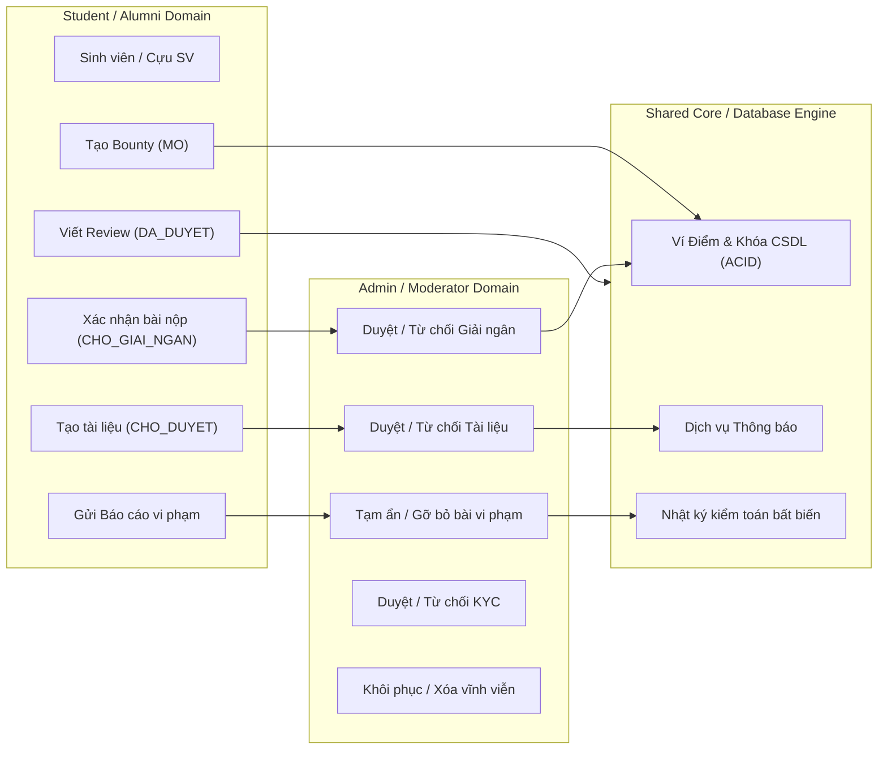

# MA TRẬN PHÂN ĐỊNH TRÁCH NHIỆM LIÊN PHÂN HỆ (RACI)
## AGU Academic Hub — Cross-Module RACI & Data Ownership Matrix
**Phân hệ tham chiếu:** `Student/Alumni` (Nhóm A) | `Admin/Moderator` (Nhóm B) | `Shared / Core Infrastructure` (Hạ tầng dùng chung)  
**Quy ước RACI:**
- **R (Responsible):** Bên trực tiếp triển khai, xử lý nghiệp vụ hoặc vận hành mã nguồn.
- **A (Accountable):** Bên chịu trách nhiệm cao nhất về tính đúng đắn, pháp lý và toàn vẹn dữ liệu. Duy nhất 1 bên Accountable cho mỗi nghiệp vụ.
- **C (Consulted):** Bên được tham vấn ý kiến kỹ thuật hoặc cung cấp dữ liệu đầu vào.
- **I (Informed):** Bên được nhận thông báo (qua Notification / Audit Log / Event) khi trạng thái thay đổi.

---

## 1. BẢNG PHÂN ĐỊNH TRÁCH NHIỆM RACI CHI TIẾT

| Mã NV | Nghiệp vụ cụ thể | Student / Alumni | Admin / Moderator | Shared Core / Infrastructure | Trạng thái Thống nhất | Ghi chú Ranh giới Kiến trúc |
| :---: | :--- | :---: | :---: | :---: | :---: | :--- |
| **RACI-01** | **Nạp dữ liệu thô sinh viên (Raw Students)** | I | **R / A** | C | `RESOLVED` | Thuộc độc quyền của Admin (`CapQuanTri::TOI_CAO` hoặc `THUONG`). Sinh viên không được can thiệp. |
| **RACI-02** | **Kích hoạt đổi mật khẩu lần đầu** | **R** | I | **A** | `RESOLVED` | Sinh viên tự thao tác; Hạ tầng Identity chịu trách nhiệm kiểm tra độ mạnh và gán ví 100 điểm. |
| **RACI-03** | **Đăng ký hồ sơ xét duyệt KYC Cựu SV** | **R** | A | C | `RESOLVED` | Cựu sinh viên điền form và upload bằng tốt nghiệp; lưu trữ tại disk private. |
| **RACI-04** | **Thẩm định & Quyết định hồ sơ KYC** | I | **R / A** | C | `RESOLVED` | Mod hoặc Admin xem qua Signed URL 30 phút, ra quyết định duyệt hoặc từ chối kèm lý do. |
| **RACI-05** | **Quản lý danh mục Khoa, Ngành, Môn học** | I | **R / A** | C | `RESOLVED` | Thuộc thẩm quyền của Admin (`AcademicCatalogController`). Student chỉ có quyền đọc công khai. |
| **RACI-06** | **Đăng tải tài liệu học tập mới** | **R** | A | C | `RESOLVED` | Sinh viên đăng tải; tài liệu lập tức vào trạng thái `CHO_DUYET` và được bảo vệ bản quyền. |
| **RACI-07** | **Thẩm định & Duyệt tài liệu mới (`CHO_DUYET`)** | I | **R / A** | C | `RESOLVED` | Kiểm duyệt viên thẩm tra nội dung, duyệt sang `DA_DUYET` hoặc từ chối kèm lý do. |
| **RACI-08** | **Tạo yêu cầu tìm tài liệu (Bounty Wishlist)** | **R / A** | I | C | `RESOLVED` | Sinh viên A đóng băng điểm khả dụng để tạo thưởng; Backend khóa hàng CSDL chống số dư âm. |
| **RACI-09** | **Đóng góp tài liệu giải quyết Bounty** | **R** | I | A | `RESOLVED` | Sinh viên B nộp tài liệu (Method A hoặc B); tài liệu phải trải qua kiểm duyệt trước khi nghiệm thu. |
| **RACI-10** | **Xác nhận bài nộp Bounty (Bước 1)** | **R / A** | I | C | `RESOLVED` | Sinh viên A là người duy nhất có quyền xác nhận bài nộp đạt yêu cầu để chuyển sang chờ giải ngân. |
| **RACI-11** | **Duyệt & Giải ngân điểm Bounty (Bước 2)** | I | **R / A** | C | `UNRESOLVED (GAP-HIGH-01)` | Hiện Controller nằm ở `app/Modules/Bounties`. Cần thống nhất chính thức bên nào sở hữu Controller này. |
| **RACI-12** | **Thu hồi điểm Clawback khi tài liệu bị gỡ vi phạm** | I | **R** | **A** | `RESOLVED` | Kích hoạt tự động từ `BountySubmissionModerationSynchronizer`; Engine ví khóa CSDL và thu hồi điểm. |
| **RACI-13** | **Tác giả tự xóa mềm tài liệu (< 24h & 0 tải)** | **R / A** | I | C | `RESOLVED` | Tác giả tự xóa mềm đưa vào thùng rác; hệ thống tự ghi nhận `nguon_xoa = TAC_GIA`. |
| **RACI-14** | **Yêu cầu gỡ tài liệu sở hữu cộng đồng** | **R** | **A** | C | `UNRESOLVED (GAP-CRIT-02)` | Cần mở rộng phạm vi nộp đơn cho cả vùng 1-9 lượt tải và quá 24h để giải quyết bế tắc (Deadlock). |
| **RACI-15** | **Khôi phục tài liệu & Xóa vĩnh viễn khỏi đĩa** | I | **R / A** | C | `RESOLVED` | Quyền hạn tối cao dành riêng cho Quản trị viên (`QUAN_TRI_VIEN`). Kiểm duyệt viên bị chặn 403. |
| **RACI-16** | **Đăng đánh giá môn học & Lọc từ cấm** | **R** | I | **A** | `RESOLVED` | Đánh giá môn học theo cơ chế HẬU KIỂM; Engine từ cấm tự động duyệt `DA_DUYET` nếu văn bản sạch. |
| **RACI-17** | **Báo cáo vi phạm (Tài liệu / Đánh giá)** | **R** | **A** | C | `RESOLVED` | Người dùng phát hiện vi phạm gửi báo cáo; Moderator tiếp nhận trên Hàng đợi thống nhất. |
| **RACI-18** | **Hạ tầng Thông báo trung tâm (Notifications)** | C | C | **R / A** | `UNRESOLVED (GAP-HIGH-02)` | Cần quy tụ việc tạo thông báo từ Moderation và Bounties về Shared Notification Service để chuẩn hóa. |

---

## 2. QUYỀN SỞ HỮU DỮ LIỆU & QUYỀN THAY ĐỔI TRẠNG THÁI (DATA OWNERSHIP & STATE MUTATION)

### 2.1. Phân định quyền thay đổi trạng thái (State Mutation Boundaries)

| Thực thể dữ liệu | Bảng CSDL | Thuộc tính trạng thái | Quyền hạn của Student / Alumni | Quyền hạn của Admin / Moderator |
| :--- | :--- | :--- | :--- | :--- |
| **Tài liệu học thuật** | `tai_lieu` | `trang_thai` | Được khởi tạo `CHO_DUYET`. Được chuyển `XOA_MEM` (nếu < 24h & 0 tải). **Không** được tự chuyển sang `DA_DUYET`. | Có toàn quyền chuyển sang `DA_DUYET`, `TU_CHOI`, `CHO_KIEM_TRA`, `TAM_AN_KIEM_TRA`, `XOA_MEM`, `FORCE_DELETE`. |
| **Yêu cầu săn thưởng** | `yeu_cau_tai_lieu` | `trang_thai` | Được tạo `MO`. Được hủy `DA_HUY` (khi chưa chọn bài). Được chuyển `CHO_GIAI_NGAN` (khi bấm xác nhận). | Có toàn quyền chuyển sang `DA_HOAN_THANH` (duyệt giải ngân), mở lại `MO` (từ chối), hoặc `DA_HUY` (clawback). |
| **Bài đóng góp Bounty** | `dap_ung_yeu_cau_tai_lieu` | `trang_thai` | Được tạo `CHO_DUYET`. Requester được chuyển sang `NGUOI_YEU_CAU_XAC_NHAN`. | Có toàn quyền duyệt sang `CHAP_NHAN` (giải ngân) hoặc `TU_CHOI` (từ chối giải ngân / clawback). |
| **Đánh giá môn học** | `danh_gia_mon_hoc` | `trang_thai` | Được tạo `DA_DUYET` (nếu sạch từ cấm). Được sửa/xóa bài của chính mình. | Có toàn quyền chuyển `TAM_AN` hoặc `TU_CHOI` (gỡ bỏ do vi phạm). |
| **Báo cáo vi phạm** | `bao_cao_vi_pham` / `bao_cao_danh_gia` | `trang_thai` | Được tạo với trạng thái `CHO_XU_LY`. Không được phép chỉnh sửa sau khi gửi. | Có toàn quyền chuyển sang `DA_XU_LY` hoặc `BAC_BO`, và xóa mềm lưu trữ. |
| **Hồ sơ KYC Cựu SV** | `yeu_cau_xac_thuc` | `trang_thai` | Được tạo `CHO_DUYET`. Không được tự duyệt. | Có toàn quyền chuyển sang `DA_DUYET` hoặc `TU_CHOI`. |
| **Ví điểm cá nhân** | `vi_diem` | `diem_kha_dung`, `diem_tam_giu` | Không có API cập nhật trực tiếp. Điểm chỉ biến động thông qua Domain Action (tạo Bounty, hủy, hoàn điểm). | Admin không được tự ý cộng/trừ điểm thủ công. Mọi biến động đều phải thông qua giao dịch nghiệp vụ có truy vết. |

---

## 3. CÁC ĐIỂM CHƯA THỐNG NHẤT CẦN LÃNH ĐẠO HAI NHÓM CHỐT (UNRESOLVED RESPONSIBILITIES)

1. **Vị trí của `AdminBountyPayoutController`:**
   - *Hiện trạng:* Nằm trong phân hệ `Bounties` (do Student phụ trách).
   - *Đề xuất của Architect:* Bàn giao Controller và view `PayoutQueue.jsx`, `PayoutDetail.jsx` sang module `Moderation` (do Moderator phụ trách) để đảm bảo tính đóng gói sạch sẽ. Hoặc chốt nguyên tắc: Student module cung cấp API nội bộ, Moderator module gọi qua Service.
2. **Quy chuẩn thông báo nghiệp vụ:**
   - *Hiện trạng:* Moderation tự bắn `BountyPayoutClawbackRefundNotification`, Bounties tự bắn `BountyPayoutApprovedNotification`.
   - *Đề xuất của Architect:* Chuyển giao toàn bộ việc đăng ký và phân phối thông báo về `App\Modules\Notifications\Domain\Services\NotificationService`.

