# TÀI LIỆU KỸ THUẬT & ĐẶC TẢ NGHIỆP VỤ PHÂN HỆ QUẢN TRỊ (ADMIN & MODERATOR)
## Căn cứ kiến trúc và hướng dẫn tích hợp dành cho Phân hệ Sinh viên & Cựu sinh viên
### Dự án: AGU Academic Hub (ĐHQG-HCM / Trường Đại học An Giang)

---

| Thông Tin Tài Liệu | Chi Tiết |
| :--- | :--- |
| **Dự án** | AGU Academic Hub (Cổng Học Thuật và Chia Sẻ Tri Thức Sinh Viên) |
| **Kiến trúc** | Modular Monolith (Laravel 11 + Inertia.js React 18 + Vite + Tailwind CSS) |
| **Phân hệ hoàn thiện** | `QUAN_TRI_VIEN` (Admin), `KIEM_DUYET_VIEN` (Moderator), `System Engine` |
| **Phân hệ thụ hưởng** | `SINH_VIEN` (Sinh viên hiện hành), `CUU_SINH_VIEN` (Cựu sinh viên) |
| **Mục đích** | Đặc tả 100% các tính năng, luồng nghiệp vụ, API routes, data contracts, cơ chế bảo mật và ranh giới phân quyền đã xây dựng ở phía Quản trị & Kiểm duyệt; làm căn cứ kỹ thuật chuẩn mực để đội ngũ phát triển phía Sinh viên & Cựu sinh viên tích hợp chính xác, đồng bộ và không xung đột. |
| **Phiên bản & Thời điểm** | Tháng 11/2026 — Hoàn thiện toàn diện 16 nhóm nghiệp vụ Quản trị & Kiểm duyệt (bao gồm Hàng đợi duyệt tài liệu mới, Phạt điểm uy tín lũy tiến, Thao tác hàng loạt, Hàng đợi giải ngân Bounty và Cơ chế thu hồi điểm Clawback khi vi phạm bản quyền). |

---

## MỤC LỤC TỔNG QUAN

1. [Nguyên Tắc Cốt Lõi & Ranh Giới Định Danh Hệ Thống](#1-nguyên-tắc-cốt-lõi--ranh-giới-định-danh-hệ-thống)
2. [Ma Trận Phân Quyền RBAC & Middleware Bảo Vệ Route](#2-ma-trận-phân-quyền-rbac--middleware-bảo-vệ-route)
3. [Đặc Tả Chi Tiết 16 Nhóm Nghiệp Vụ Quản Trị & Điểm Chạm Sinh Viên](#3-đặc-tả-chi-tiết-16-nhóm-nghiệp-vụ-quản-trị--điểm-chạm-sinh-viên)
   - [Nghiệp vụ 1: Quản trị danh mục Khoa, Chuyên ngành và Môn học](#nghiệp-vụ-1-quản-trị-danh-mục-khoa-chuyên-ngành-và-môn-học)
   - [Nghiệp vụ 2: Quản trị tài khoản, phân quyền và xử lý vi phạm lũy tiến](#nghiệp-vụ-2-quản-trị-tài-khoản-phân-quyền-và-xử-lý-vi-phạm-lũy-tiến)
   - [Nghiệp vụ 3: Dữ liệu sinh viên nạp trước & Kích hoạt đổi mật khẩu lần đầu](#nghiệp-vụ-3-dữ-liệu-sinh-viên-nạp-trước--kích-hoạt-đổi-mật-khẩu-lần-đầu)
   - [Nghiệp vụ 4: Hàng đợi xét duyệt KYC Cựu sinh viên, Xem trước Signed URL & Duyệt hàng loạt](#nghiệp-vụ-4-hàng-đợi-xét-duyệt-kyc-cựu-sinh-viên-xem-trước-signed-url--duyệt-hàng-loạt)
   - [Nghiệp vụ 5: Hàng đợi Báo cáo vi phạm, Chế tài tự động & Thao tác hàng loạt](#nghiệp-vụ-5-hàng-đợi-báo-cáo-vi-phạm-chế-tài-tự-động--thao-tác-hàng-loạt)
   - [Nghiệp vụ 6: Hàng đợi thẩm định tài liệu (Review Queue), Phê duyệt tài liệu mới & Duyệt hàng loạt](#nghiệp-vụ-6-hàng-đợi-thẩm-định-tài-liệu-review-queue-phê-duyệt-tài-liệu-mới--duyệt-hàng-loạt)
   - [Nghiệp vụ 7: Xử lý yêu cầu gỡ tài liệu thuộc quyền Sở hữu Cộng đồng](#nghiệp-vụ-7-xử-lý-yêu-cầu-gỡ-tài-liệu-thuộc-quyền-sở-hữu-cộng-đồng)
   - [Nghiệp vụ 8: Quản lý Thùng rác 60 ngày, Khôi phục và Xóa vĩnh viễn](#nghiệp-vụ-8-quản-lý-thùng-rác-60-ngày-khôi-phục-và-xóa-vĩnh-viễn)
   - [Nghiệp vụ 9: Quản lý và giám sát dung lượng lưu trữ (Storage Management)](#nghiệp-vụ-9-quản-lý-và-giám-sát-dung-lượng-lưu-trữ-storage-management)
   - [Nghiệp vụ 10: Dashboard tổng quan vận hành hệ thống (Admin Dashboard)](#nghiệp-vụ-10-dashboard-tổng-quan-vận-hành-hệ-thống-admin-dashboard)
   - [Nghiệp vụ 11: Nhật ký kiểm toán nghiệp vụ bất biến (Immutable Audit Logs)](#nghiệp-vụ-11-nhật-ký-kiểm-toán-nghiệp-vụ-bất-biến-immutable-audit-logs)
   - [Nghiệp vụ 12: Hệ thống Thông báo Nghiệp vụ Thời gian thực (Notifications)](#nghiệp-vụ-12-hệ-thống-thông-báo-nghiệp-vụ-thời-gian-thực-notifications)
   - [Nghiệp vụ 13: Đồng bộ trạng thái, chuẩn hóa URL và bảo vệ an toàn biên](#nghiệp-vụ-13-đồng-bộ-trạng-thái-chuẩn-hóa-url-và-bảo-vệ-an-toàn-biên)
   - [Nghiệp vụ 14: Báo cáo đánh giá môn học, giảng viên và bộ lọc từ cấm tự động](#nghiệp-vụ-14-báo-cáo-đánh-giá-môn-học-giảng-viên-và-bộ-lọc-từ-cấm-tự-động)
   - [Nghiệp vụ 15: Hàng đợi Giải ngân Bounty & Quy trình Thu hồi Điểm (Clawback) khi Vi phạm Bản quyền](#nghiệp-vụ-15-hàng-đợi-giải-ngân-bounty--quy-trình-thu-hồi-điểm-clawback-khi-vi-phạm-bản-quyền)
   - [Nghiệp vụ 16: Tính năng Thao tác Hàng loạt (Bulk Actions) cho Ban Quản trị & Kiểm duyệt](#nghiệp-vụ-16-tính-năng-thao-tác-hàng-loạt-bulk-actions-cho-ban-quản-trị--kiểm-duyệt)
4. [Sơ Đồ Luồng Dữ Liệu Tích Hợp (Data Flow Diagrams)](#4-sơ-đồ-luồng-dữ-liệu-tích-hợp-data-flow-diagrams)
5. [Bảng Tra Cứu Enums, Status Codes & Data Contracts Dùng Chung](#5-bảng-tra-cứu-enums-status-codes--data-contracts-dùng-chung)
6. [Checklist Dành Cho Kỹ Sư Phát Triển Phân Hệ Sinh Viên & Cựu Sinh Viên](#6-checklist-dành-cho-kỹ-sư-phát-triển-phân-hệ-sinh-viên--cựu-sinh-viên)

---

## 1. NGUYÊN TẮC CỐT LÕI & RANH GIỚI ĐỊNH DANH HỆ THỐNG

Trước khi triển khai bất kỳ giao diện hay API nào phía Sinh viên và Cựu sinh viên, toàn bộ đội ngũ kỹ thuật phải tuân thủ nghiêm ngặt **4 nguyên tắc bất di bất dịch** sau:

### 1.1. Tách biệt hoàn toàn hai luồng định danh (Zero-KYC cho Sinh viên đang học)
- **Sinh viên đang học (`SINH_VIEN`):** 
  - Tài khoản được đối soát từ nguồn dữ liệu sinh viên thô do nhà trường cấp nạp sẵn vào bảng `danh_sach_sinh_vien_raw`.
  - Sinh viên **KHÔNG ĐƯỢC TỰ ĐĂNG KÝ** qua form `/dang-ky` (hệ thống chặn đuôi email `@student.agu.edu.vn`).
  - Sinh viên **TUYỆT ĐỐI KHÔNG PHẢI NỘP ẢNH THẺ, KHÔNG QUA HÀNG ĐỢI KYC THỦ CÔNG**.
  - Kích hoạt duy nhất bằng hành động: **Đổi mật khẩu lần đầu** tại `/mat-khau-lan-dau`.
- **Cựu sinh viên (`CUU_SINH_VIEN`):**
  - Không có trong danh sách sinh viên hiện hành.
  - Phải nộp hồ sơ KYC tại `/cuu-sinh-vien/dang-ky` kèm minh chứng tốt nghiệp (bằng, giấy chứng nhận).
  - Ảnh minh chứng được bảo vệ trong thư mục nhạy cảm (`private/kyc/`), chỉ xem qua **Temporary Signed URL (30 phút)**.
  - Phải được Admin hoặc Moderator duyệt trên hàng đợi KYC mới được phép đăng nhập.

### 1.2. Tính tự động cấp phát tài nguyên khi kích hoạt
- Bất kể người dùng là Sinh viên (kích hoạt qua đổi mật khẩu) hay Cựu sinh viên (kích hoạt qua duyệt KYC), khi tài khoản chuyển sang trạng thái `DANG_HOAT_DONG`, hệ thống Backend **tự động khởi tạo Ví Điểm (`ViDiem`) với 100 điểm khả dụng ban đầu (`diem_kha_dung = 100`)**.
- Phía Frontend chỉ việc hiển thị số dư 100 điểm trên giao diện ví `/vi-diem`, không cần gọi thêm API khởi tạo ví.

### 1.3. Tính bảo đảm toàn vẹn tài chính & Điểm thưởng (Financial Integrity)
- Mọi biến động điểm (đóng băng, giải ngân, hoàn tiền, thu hồi) đều phải thực thi qua `ReputationEvaluator` với cơ chế khóa hàng CSDL (`lockForUpdate`).
- Trường `diem_kha_dung` trong bảng `vi_diem` có ràng buộc kiểm tra toàn vẹn CSDL (`CHECK (diem_kha_dung >= 0)`), ngăn ngừa triệt để tình trạng số dư âm khi thu hồi điểm.

### 1.4. Tính bất biến và truy vết dữ liệu (Audit Trail)
- Mọi thao tác xóa tài liệu đều là **Xóa mềm (Soft Delete)** kèm thời hạn lưu trữ thùng rác 60 ngày.
- Mọi tác vụ quản trị, thay đổi quyền, khóa/mở khóa tài khoản, xử lý báo cáo, khôi phục, xóa vĩnh viễn, duyệt giải ngân hay thu hồi điểm đều được ghi nhật ký kiểm toán vào bảng `nhat_ky_kiem_toan`. Bảng này có tính chất **BẤT BIẾN (IMMUTABLE)** — Backend sẽ ném `DomainException` nếu có bất kỳ lệnh `update` hoặc `delete` nào can thiệp vào log.

---

## 2. MA TRẬN PHÂN QUYỀN RBAC & MIDDLEWARE BẢO VỆ ROUTE

Hệ thống phân quyền được kiểm soát chặt chẽ ở cấp độ Middleware Laravel (`RoleMiddleware`), ngăn ngừa triệt để tình trạng chỉ ẩn menu ở Frontend nhưng hở Route ở Backend.

### 2.1. Phân cấp vai trò người dùng (`VaiTroNguoiDung`)
1. **`QUAN_TRI_VIEN` (Administrator):** Toàn quyền quản trị hệ thống, bao gồm phân quyền, nạp dữ liệu sinh viên raw, cấu hình hệ thống, quản lý danh mục học thuật, khôi phục tài liệu, xóa vĩnh viễn file và quản lý dung lượng.
   - Cấp bậc (`CapQuanTri`): `TOI_CAO` (Super Admin - tối thiểu 1 người trong hệ thống, không thể bị hạ cấp hay xóa) và `THUONG` (Admin thông thường).
2. **`KIEM_DUYET_VIEN` (Moderator):** Nhân sự kiểm duyệt nội dung học thuật, xử lý hàng đợi báo cáo vi phạm tài liệu/đánh giá, thẩm định hồ sơ Alumni KYC, xét duyệt giải ngân Bounty, duyệt tài liệu mới nộp, xét duyệt yêu cầu gỡ tài liệu, xem thùng rác (nhưng **không** có quyền khôi phục hay xóa vĩnh viễn).
3. **`SINH_VIEN` (Student):** Sinh viên AGU đang học, được tra cứu tài liệu, đóng góp bài giảng/đề thi, đánh giá môn học, tạo/nhận nhiệm vụ săn thưởng (Bounty Wishlist), báo cáo vi phạm.
4. **`CUU_SINH_VIEN` (Alumni):** Cựu sinh viên đã tốt nghiệp, quyền hạn tương đương sinh viên trong việc tra cứu, chia sẻ tài liệu và tham gia tương tác cộng đồng.

### 2.2. Ma trận phân quyền các nhóm Route chức năng

| Nhóm Chức Năng | Route Name Prefix / URI | Sinh viên / Cựu SV | Kiểm duyệt viên (Mod) | Quản trị viên (Admin) | Ghi Chú Kỹ Thuật |
| :--- | :--- | :---: | :---: | :---: | :--- |
| **Bảng điều khiển Admin** | `admin.dashboard` (`/quan-tri`) | ❌ (403) | ✅ (200) | ✅ (200) | Thống kê số liệu vận hành |
| **Quản trị người dùng & RBAC**| `admin.users.*` (`/quan-tri/nguoi-dung`) | ❌ (403) | ❌ (403) | ✅ (200) | Xem chi tiết, khóa, đổi role, ghi vi phạm |
| **Nạp dữ liệu sinh viên Raw** | `admin.raw-students.*` (`/quan-tri/sinh-vien-raw`)| ❌ (403) | ❌ (403) | ✅ (200) | Import danh sách, kiểm tra trùng lặp |
| **Hàng đợi duyệt Alumni KYC** | `admin.kyc.*` (`/quan-tri/duyet-kyc`) | ❌ (403) | ✅ (200) | ✅ (200) | Xem Signed URL, duyệt/từ chối KYC |
| **Duyệt hàng loạt KYC** | `admin.kyc.bulk-approve` (`POST /quan-tri/kyc/phe-duyet-hang-loat`) | ❌ (403) | ✅ (200) | ✅ (200) | Duyệt kích hoạt hàng loạt hồ sơ KYC |
| **Xem trước minh chứng KYC** | `kyc.preview` (`/kyc/xem-anh/{id}`) | ❌ (403) | ✅ (Signed URL) | ✅ (Signed URL) | URL có chữ ký bảo mật 30 phút |
| **Quản trị Khoa/Ngành/Môn** | `admin.catalog.*` (`/quan-tri/danh-muc`) | ❌ (403) | ❌ (403) | ✅ (200) | Thêm, sửa, vô hiệu hóa danh mục |
| **Hàng đợi Báo cáo thống nhất**| `admin.review-reports.*` (`/quan-tri/bao-cao-danh-gia`)| ❌ (403) | ✅ (200) | ✅ (200) | Hàng đợi gom Báo cáo Môn/GV/Tài liệu |
| **Bác bỏ hàng loạt báo cáo** | `admin.reports.bulk-dismiss` (`POST /quan-tri/bao-cao/bac-bo-hang-loat`) | ❌ (403) | ✅ (200) | ✅ (200) | Bác bỏ hàng loạt báo cáo vi phạm |
| **Lưu trữ hàng loạt báo cáo**| `admin.reports.bulk-archive` (`POST /quan-tri/bao-cao/luu-tru-hang-loat`) | ❌ (403) | ✅ (200) | ✅ (200) | Xóa mềm dọn sạch hàng đợi báo cáo |
| **Chi tiết & Xử lý báo cáo TL** | `admin.reports.*` (`/quan-tri/bao-cao-tai-lieu`) | ❌ (403) | ✅ (200) | ✅ (200) | Bác bỏ, tạm ẩn, xóa mềm tài liệu |
| **Tài liệu chờ kiểm tra & Duyệt mới**| `admin.documents.review-queue` | ❌ (403) | ✅ (200) | ✅ (200) | 4 Tabs: Tất cả, Chờ duyệt mới, Bị báo cáo, Tạm ẩn |
| **Duyệt tài liệu mới đơn lẻ** | `admin.documents.approve` (`PUT /quan-tri/tai-lieu/{id}/duyet`) | ❌ (403) | ✅ (200) | ✅ (200) | Phê duyệt công khai tài liệu CHO_DUYET |
| **Từ chối tài liệu mới đơn lẻ**| `admin.documents.reject` (`PUT /quan-tri/tai-lieu/{id}/tu-choi`) | ❌ (403) | ✅ (200) | ✅ (200) | Từ chối tài liệu mới kèm lý do |
| **Duyệt hàng loạt tài liệu mới**| `admin.documents.bulk-approve` (`POST /quan-tri/tai-lieu/duyet-hang-loat`) | ❌ (403) | ✅ (200) | ✅ (200) | Duyệt hàng loạt tài liệu mới CHO_DUYET |
| **Hàng đợi giải ngân Bounty** | `admin.bounties.payout-queue` (`GET /quan-tri/yeu-cau-tai-lieu/cho-giai-ngan`) | ❌ (403) | ✅ (200) | ✅ (200) | Danh sách yêu cầu chờ duyệt giải ngân điểm |
| **Chi tiết giải ngân Bounty** | `admin.bounties.payout-detail` (`GET /quan-tri/yeu-cau-tai-lieu/cho-giai-ngan/{id}`) | ❌ (403) | ✅ (200) | ✅ (200) | Đối soát tài liệu nộp, người yêu cầu, người nộp |
| **Duyệt giải ngân Bounty** | `admin.bounties.approve-payout` (`PUT /quan-tri/yeu-cau-tai-lieu/cho-giai-ngan/{id}/duyet`) | ❌ (403) | ✅ (200) | ✅ (200) | Chuyển điểm vào ví SV B, hoàn thành yêu cầu |
| **Từ chối giải ngân Bounty** | `admin.bounties.reject-payout` (`PUT /quan-tri/yeu-cau-tai-lieu/cho-giai-ngan/{id}/tu-choi`) | ❌ (403) | ✅ (200) | ✅ (200) | Từ chối bài nộp, mở lại yêu cầu MO |
| **Yêu cầu gỡ tài liệu cộng đồng**| `admin.documents.removal-requests.*` | ❌ (403) | ✅ (200) | ✅ (200) | Xét duyệt đơn xin gỡ tài liệu >= 10 tải |
| **Xem danh sách Thùng rác** | `admin.documents.deleted` | ❌ (403) | ✅ (200) | ✅ (200) | Xem tài liệu đã bị xóa mềm |
| **Khôi phục tài liệu Thùng rác**| `admin.documents.restore` | ❌ (403) | ❌ (403) | ✅ (200) | Bắt buộc xác nhận nếu có báo cáo vi phạm |
| **Xóa vĩnh viễn tài liệu** | `admin.documents.permanent-delete` | ❌ (403) | ❌ (403) | ✅ (200) | Xóa sạch file vật lý và bản ghi CSDL |
| **Quản trị Lưu trữ & Dung lượng**| `admin.storage.*` (`/quan-tri/luu-tru`) | ❌ (403) | ❌ (403) | ✅ (200) | Dọn dẹp rác quá hạn 60 ngày, phân tích |
| **Nhật ký kiểm toán (Audit Log)**| `admin.audit-logs.*` (`/quan-tri/nhat-ky-kiem-toan`)| ❌ (403) | ❌ (403) | ✅ (200) | Xem lịch sử thao tác hệ thống bất biến |
| **Cấu hình hệ thống** | `admin.settings.*` (`/quan-tri/cau-hinh`) | ❌ (403) | ❌ (403) | ✅ (200) | Tùy chỉnh thông số vận hành |

---

## 3. ĐẶC TẢ CHI TIẾT 16 NHÓM NGHIỆP VỤ QUẢN TRỊ & ĐIỂM CHẠM SINH VIÊN

---

### Nghiệp vụ 1: Quản trị danh mục Khoa, Chuyên ngành và Môn học
- **Phân hệ phụ trách:** `AcademicCatalog`
- **Route & Controller:**
  - `GET /quan-tri/danh-muc` (`admin.catalog.index`) -> `AcademicCatalogController@index`
  - `POST /quan-tri/danh-muc/khoa` (`admin.catalog.faculties.store`)
  - `PUT /quan-tri/danh-muc/khoa/{maKhoa}` (`admin.catalog.faculties.update`)
  - `PUT /quan-tri/danh-muc/khoa/{maKhoa}/trang-thai` (`admin.catalog.faculties.toggle`)
  - `POST /quan-tri/danh-muc/chuyen-nganh` (`admin.catalog.majors.store`)
  - `PUT /quan-tri/danh-muc/chuyen-nganh/{maChuyenNganh}` (`admin.catalog.majors.update`)
  - `PUT /quan-tri/danh-muc/chuyen-nganh/{maChuyenNganh}/trang-thai` (`admin.catalog.majors.toggle`)
  - `POST /quan-tri/danh-muc/mon-hoc` (`admin.catalog.courses.store`)
  - `PUT /quan-tri/danh-muc/mon-hoc/{maMonHoc}` (`admin.catalog.courses.update`)
  - `PUT /quan-tri/danh-muc/mon-hoc/{maMonHoc}/trang-thai` (`admin.catalog.courses.toggle`)
- **Quy tắc ràng buộc toàn vẹn (Business Rules):**
  - **Mã học phần (`ma_hoc_phan`):** Định dạng chuẩn hóa **3 chữ cái in hoa + 3 chữ số** (Regex: `/^[A-Z]{3}[0-9]{3}$/`, ví dụ: `COS101`, `ENG202`). Hệ thống tự động `trim` và `strtoupper`. Chặn trùng mã học phần trên toàn hệ thống.
  - **Ký hiệu Khoa & Chuyên ngành:** Ký hiệu khoa viết hoa (ví dụ: `CNTT`, `KTCN`). Ký hiệu chuyên ngành bắt đầu bằng chữ `D` + 2 chữ cái in hoa (ví dụ: `DTH`, `DMK`).
  - **Số tín chỉ:** Bắt buộc từ 1 đến 8 tín chỉ ($1 \le \text{so\_tin\_chi} \le 8$).
  - **Ràng buộc Chuyên ngành - Khoa:** Khi tạo/sửa môn học, các chuyên ngành được gán (`ma_chuyen_nganh[]`) **bắt buộc phải trực thuộc Khoa** quản lý môn học đó.
  - **Khóa an toàn dữ liệu:** Không thể vô hiệu hóa (`toggle`) hoặc xóa môn học nếu môn học đó đang có tài liệu (`tai_lieu`), bài đánh giá (`danh_gia_mon_hoc`), hoặc yêu cầu tìm tài liệu (`yeu_cau_tai_lieu`).
  - **Tính kế thừa trạng thái Khoa - Con:** Khi một Khoa bị vô hiệu hóa (`trang_thai = false`), tất cả các chuyên ngành con và môn học con sẽ tự động rơi vào trạng thái ngầm vô hiệu hóa (`effectively inactive`).
- **Điểm chạm dành cho Dev Sinh viên & Cựu sinh viên:**
  - Khi render cây danh mục môn học (`FacultyCourseTree.jsx`) hoặc dropdown chọn môn học khi đăng tải tài liệu (`Documents/Create.jsx`), **chỉ load các môn học có `trang_thai = true` và Khoa trực thuộc có `trang_thai = true`**.
  - Route tra cứu công khai cho Sinh viên:
    - `GET /khoa` (`faculties.index`): Danh sách khoa.
    - `GET /khoa/{id}/mon-hoc` (`faculties.courses`): Danh sách môn học thuộc khoa.
    - `GET /khoa/chuyen-nganh/{id}/mon-hoc` (`faculties.majors.courses`): Môn học theo chuyên ngành.
    - `GET /mon-hoc/{course_code}` (`courses.show`): Chi tiết môn học, đề cương, tài liệu và review.

---

### Nghiệp vụ 2: Quản trị tài khoản, phân quyền và xử lý vi phạm lũy tiến
- **Phân hệ phụ trách:** `Administration`
- **Route & Controller:**
  - `GET /quan-tri/nguoi-dung` (`admin.users.index`) -> `AdminUserController@index`
  - `GET /quan-tri/nguoi-dung/{id}` (`admin.users.show`) -> `AdminUserController@show`
  - `PUT /quan-tri/nguoi-dung/{id}/trang-thai` (`admin.users.status`) -> `AdminUserController@toggleStatus`
  - `PUT /quan-tri/nguoi-dung/{id}/phan-quyen` (`admin.users.permissions`) -> `AdminUserController@updatePermissions`
  - `POST /quan-tri/nguoi-dung/{id}/vi-pham` (`admin.users.violations`) -> `AdminUserController@recordViolation`
- **Cơ chế hoạt động & Xử lý vi phạm lũy tiến:**
  - **Bảo vệ tài khoản quản trị:** Admin không thể tự khóa chính mình, không thể tự hạ quyền của mình. Hệ thống bảo vệ tuyệt đối không cho phép hạ quyền Super Admin cuối cùng (`CapQuanTri::TOI_CAO`).
  - **Lịch sử truy vết:** Mọi lần đổi trạng thái hoặc phân quyền đều được lưu vào `lich_su_trang_thai_nguoi_dung` và `lich_su_phan_quyen_nguoi_dung`, ghi rõ ai thực hiện, lúc nào và lý do.
  - **Xử lý vi phạm lũy tiến (Progressive Penalty System):**
    - Khi ghi nhận vi phạm qua `POST /quan-tri/nguoi-dung/{id}/vi-pham` hoặc tự động từ `UserViolationPenaltyEvaluator`:
      - **Vi phạm lần 1:** `so_lan_vi_pham = 1`, `muc_canh_bao = 'CANH_BAO'`, tài khoản vẫn ở `DANG_HOAT_DONG`.
      - **Vi phạm từ lần 2 trở lên:** `so_lan_vi_pham >= 2`, `muc_canh_bao = 'TAM_KHOA'`, hệ thống **tự động chuyển trạng thái tài khoản thành `TAM_KHOA`**, cập nhật `ly_do_khoa` bằng nội dung vi phạm vừa ghi nhận.
- **Điểm chạm dành cho Dev Sinh viên & Cựu sinh viên:**
  - **Chặn truy cập tài khoản bị khóa:** Sinh viên khi bị khóa tài khoản (`trang_thai == 'TAM_KHOA'` hoặc `'KHOA_VINH_VIEN'`), khi gửi request sẽ bị Middleware chặn và hiển thị màn hình thông báo khóa tài khoản, kèm prop `ly_do_khoa` để người dùng biết nguyên nhân.
  - **Hồ sơ cá nhân (`Profile/Edit.jsx`):** Cần hiển thị huy hiệu trạng thái tài khoản (`DANG_HOAT_DONG`), điểm uy tín (`diem_uy_tin`), và cảnh báo số lần vi phạm (`so_lan_vi_pham`, `muc_canh_bao`) để sinh viên tự điều chỉnh hành vi.

---

### Nghiệp vụ 3: Dữ liệu sinh viên nạp trước & Kích hoạt đổi mật khẩu lần đầu
- **Phân hệ phụ trách:** `Administration` & `Identity`
- **Route & Controller:**
  - Admin: `GET /quan-tri/sinh-vien-raw` (`admin.raw-students.index`) -> `AdminRawStudentController@index`
  - Admin: `POST /quan-tri/sinh-vien-raw/nap` (`admin.raw-students.import`) -> `AdminRawStudentController@import`
  - Sinh viên: `GET /mat-khau-lan-dau` (`password.change`) -> `FirstTimePasswordController@hienThiFormDoiMatKhau`
  - Sinh viên: `POST /mat-khau-lan-dau` (`password.change.update`) -> `FirstTimePasswordController@capNhatMatKhau`
- **Data Contract Bảng `danh_sach_sinh_vien_raw`:**
  - `mssv` (string, unique, format chuẩn sinh viên AGU: `DTHxxxxxx`, `DPMxxxxxx`,...).
  - `ho_ten` (string, họ và tên sinh viên).
  - `email_sv` (string, unique, định dạng `@student.agu.edu.vn`).
  - `ma_khoa` (foreign key nullable -> `khoa.ma_khoa`).
  - `mat_khau_mac_dinh` (string băm `Hash::make`, trường cấp ban đầu, ví dụ: `Agu@123456`).
  - `da_kich_hoat` (boolean, mặc định `false`, chuyển thành `true` ngay khi đổi pass lần đầu).
  - `thoi_diem_kich_hoat` (timestamp nullable).
- **Luồng Kích Hoạt Sinh Viên Đang Học Chuẩn Xác:**
  1. Sinh viên vào trang đăng nhập `/dang-nhap`, nhập MSSV (hoặc email sinh viên) và mật khẩu mặc định nhà trường cấp.
  2. Backend kiểm tra tài khoản. Do mới đăng nhập lần đầu từ bảng raw, tài khoản `nguoi_dung` được tạo với `vai_tro = SINH_VIEN`, `trang_thai = CHUA_XAC_THUC`.
  3. Hệ thống gửi thông báo `FirstTimePasswordChangeRequiredNotification`.
  4. Middleware `EnsurePasswordChanged` phát hiện `trang_thai == CHUA_XAC_THUC` và bắt buộc chuyển hướng đến giao diện `/mat-khau-lan-dau`. Mọi trang khác đều bị chặn lại.
  5. Sinh viên nhập mật khẩu mới và xác nhận mật khẩu tại form `Auth/FirstTimeChangePassword.jsx`.
  6. Action `ChangeFirstTimePasswordAction` thực thi:
     - Đổi mật khẩu người dùng thành mật khẩu mới.
     - Cập nhật `nguoi_dung.trang_thai = DANG_HOAT_DONG`.
     - Cập nhật `danh_sach_sinh_vien_raw.da_kich_hoat = true` và `thoi_diem_kich_hoat = now()`.
     - **Tự động cấp ví điểm ban đầu với 100 điểm khả dụng (`diem_kha_dung = 100`)**.
     - Bắn thông báo `StudentAccountActivatedNotification`.
     - Chuyển hướng thành công vào Bảng điều khiển sinh viên `/trang-chu` (`dashboard`).
- **Lưu ý đặc biệt quan trọng:**
  - Form đăng ký thông thường `/dang-ky` chặn triệt để: Nếu nhập email có đuôi `@student.agu.edu.vn`, hệ thống trả lỗi: *"Email sinh viên đã được cấp tài khoản định danh sẵn. Vui lòng đăng nhập bằng MSSV và mật khẩu mặc định của trường."*

---

### Nghiệp vụ 4: Hàng đợi xét duyệt KYC Cựu sinh viên, Xem trước Signed URL & Duyệt hàng loạt
- **Phân hệ phụ trách:** `Identity` & `Moderation`
- **Route & Controller:**
  - Cựu sinh viên nộp hồ sơ: `GET /cuu-sinh-vien/dang-ky` (`alumni.register`)
  - Cựu sinh viên submit: `POST /cuu-sinh-vien/dang-ky` (`alumni.register.store`)
  - Hàng đợi KYC Admin/Mod: `GET /quan-tri/duyet-kyc` (`admin.kyc.index`) -> `KycController@hangDoiKyc`
  - Phê duyệt KYC đơn lẻ: `PUT /quan-tri/duyet-kyc/{id}/duyet` (`admin.kyc.approve`) -> `KycController@pheDuyetHoSo`
  - Từ chối KYC đơn lẻ: `PUT /quan-tri/duyet-kyc/{id}/tu-choi` (`admin.kyc.reject`) -> `KycController@tuChoiHoSo`
  - **Phê duyệt hàng loạt KYC:** `POST /quan-tri/kyc/phe-duyet-hang-loat` (`admin.kyc.bulk-approve`) -> `KycController@pheDuyetHangLoat`
  - Xem trước minh chứng: `GET /kyc/xem-anh/{id}` (`kyc.preview`) -> `KycController@xemTruocMinhChung` (Bảo vệ bởi middleware `signed`).
- **Data Contract Bảng `yeu_cau_xac_thuc`:**
  - `ma_yeu_cau_xac_thuc` (PK).
  - `ma_nguoi_dung` (FK -> `nguoi_dung.ma_nguoi_dung`).
  - `loai_xac_thuc`: Enum `CUU_SINH_VIEN`.
  - `trang_thai`: Enum `CHO_DUYET`, `DA_DUYET`, `TU_CHOI`.
  - `mssv`: Mã số sinh viên cũ khi còn theo học tại AGU.
  - `nam_tot_nghiep`: Năm tốt nghiệp (integer).
  - `loai_minh_chung`: `BANG_TOT_NGHIEP`, `GIAY_XAC_NHAN_TOT_NGHIEP`, `THE_SINH_VIEN_CU`.
  - `duong_dan_minh_chung`: Lưu trữ tại disk riêng tư `private/kyc/...`.
  - `nguoi_duyet`: FK -> `nguoi_dung.ma_nguoi_dung` (Admin hoặc Moderator xử lý).
  - `ly_do_tu_choi`: Nội dung lý do bắt buộc khi từ chối hồ sơ.
- **Quy trình hoạt động & Thao tác hàng loạt:**
  - **Đăng ký:** Cựu SV nộp thông tin. Nếu MSSV nằm trong `danh_sach_sinh_vien_raw` (sinh viên đang học), hệ thống sẽ **bác bỏ ngay** với thông báo: *"MSSV này thuộc sinh viên đang học, không được đăng ký diện cựu sinh viên"*.
  - **Lưu trữ PII an toàn:** Ảnh minh chứng tốt nghiệp được lưu ở disk private. Khi Admin/Mod cần thẩm duyệt, hệ thống phát sinh **Temporary Signed URL thời hạn 30 phút**.
  - **Phê duyệt đơn lẻ & Hàng loạt:** Khi bấm Duyệt (hoặc chọn nhiều dòng và bấm "Duyệt hàng loạt"):
    - Hồ sơ chuyển `DA_DUYET`, ghi nhận `nguoi_duyet` và `thoi_gian_duyet`.
    - Tài khoản chuyển `trang_thai = DANG_HOAT_DONG`.
    - Tự động khởi tạo ví điểm ban đầu với 100 điểm (`ViDiem`).
    - Gửi thông báo `AlumniKycDecisionNotification` báo cựu SV đã được phê duyệt và được phép đăng nhập.
    - Ghi nhận nhật ký kiểm toán `HanhDongKiemToan::DUYET_KYC`.
  - **Từ chối:** Bắt buộc nhập `ly_do_tu_choi`. Hồ sơ chuyển `TU_CHOI`. Gửi notification kèm lý do cụ thể đến tài khoản cựu sinh viên.

---

### Nghiệp vụ 5: Hàng đợi Báo cáo vi phạm, Chế tài tự động & Thao tác hàng loạt
- **Phân hệ phụ trách:** `Moderation`
- **Route & Controller:**
  - Sinh viên gửi báo cáo tài liệu: `POST /bao-cao/tai-lieu` (`reports.document.store`) -> `DocumentReportController@store`
  - Hàng đợi Báo cáo thống nhất: `GET /quan-tri/bao-cao-danh-gia` (`admin.review-reports.index`) -> `ReviewModerationController@index`
  - Xem chi tiết báo cáo tài liệu: `GET /quan-tri/bao-cao-tai-lieu/{id}` (`admin.reports.show`) -> `DocumentModerationController@showReport`
  - Giải quyết báo cáo tài liệu: `PUT /quan-tri/bao-cao-tai-lieu/{id}/giai-quyet` (`admin.reports.resolve`) -> `DocumentModerationController@resolveReport`
  - Lưu trữ báo cáo tài liệu: `DELETE /quan-tri/bao-cao-tai-lieu/{id}` (`admin.reports.archive`) -> `DocumentModerationController@archiveReport`
  - **Bác bỏ hàng loạt báo cáo:** `POST /quan-tri/bao-cao/bac-bo-hang-loat` (`admin.reports.bulk-dismiss`) -> `ReviewModerationController@bulkDismiss`
  - **Lưu trữ hàng loạt báo cáo:** `POST /quan-tri/bao-cao/luu-tru-hang-loat` (`admin.reports.bulk-archive`) -> `ReviewModerationController@bulkArchive`
- **Cơ chế Tự Động Phạt Điểm Uy Tín & Ghi Nhận Vi Phạm (`UserViolationPenaltyEvaluator`):**
  - Khi Moderator hoặc Admin chọn hành động **`DELETE` (xóa mềm tài liệu vi phạm)**:
    - Hệ thống **tự động trừ 20 điểm uy tín (`diem_uy_tin -= 20`)** của tác giả tài liệu (đảm bảo không âm).
    - Tăng số lần vi phạm **`so_lan_vi_pham += 1`**.
    - Nếu `so_lan_vi_pham >= 2`, hệ thống **tự động chuyển tài khoản tác giả sang `TAM_KHOA`**.
    - Bắn thông báo chế tài `UserViolationSanctionedNotification` đến người vi phạm.
    - Ghi nhật ký kiểm toán `HanhDongKiemToan::GHI_NHAN_VI_PHAM`.
  - Tự động kích hoạt đồng bộ từ chối hoặc thu hồi giải ngân Bounty liên kết (`BountySubmissionModerationSynchronizer`).
- **Thao tác hàng loạt trên giao diện `ReviewReports/Index.jsx`:**
  - Moderator/Admin có thể tick chọn nhiều báo cáo (cả Đánh giá Môn học, Giảng viên và Tài liệu).
  - Nút **"Bác bỏ các báo cáo ({count})"**: Mở modal nhập lý do chung và chuyển tất cả báo cáo đã chọn sang `BAC_BO`.
  - Nút **"Lưu trữ đã chọn ({count})"**: Xóa mềm hàng loạt các báo cáo đã xử lý/bác bỏ để dọn sạch hàng đợi.

---

### Nghiệp vụ 6: Hàng đợi thẩm định tài liệu (Review Queue), Phê duyệt tài liệu mới & Duyệt hàng loạt
- **Phân hệ phụ trách:** `Moderation`
- **Route & Controller:**
  - Danh sách hàng đợi thẩm định: `GET /quan-tri/tai-lieu/cho-kiem-tra` (`admin.documents.review-queue`) -> `DocumentModerationController@reviewQueue`
  - Xem chi tiết thẩm định: `GET /quan-tri/tai-lieu/{id}/kiem-tra` (`admin.documents.review-detail`) -> `DocumentModerationController@reviewDocument`
  - Mở xem trực tiếp tệp: `GET /quan-tri/tai-lieu/{id}/xem-tep` (`admin.documents.preview`) -> `DocumentModerationController@previewDocument`
  - **Phê duyệt tài liệu mới đơn lẻ:** `PUT /quan-tri/tai-lieu/{id}/duyet` (`admin.documents.approve`) -> `DocumentModerationController@approveNewDocument`
  - **Từ chối tài liệu mới đơn lẻ:** `PUT /quan-tri/tai-lieu/{id}/tu-choi` (`admin.documents.reject`) -> `DocumentModerationController@rejectNewDocument`
  - **Duyệt hàng loạt tài liệu mới:** `POST /quan-tri/tai-lieu/duyet-hang-loat` (`admin.documents.bulk-approve`) -> `DocumentModerationController@bulkApproveNewDocuments`
  - Xử lý tài liệu bị báo cáo: `PUT /quan-tri/tai-lieu/{id}/quyet-dinh` (`admin.documents.decide`) -> `DocumentModerationController@decideDocument`
- **Cấu trúc 4 Tabs Lọc Trạng Thái trên Giao diện `ReviewQueue.jsx`:**
  1. **Tab `all` (Tất cả cần duyệt):** Tổng hợp toàn bộ tài liệu cần Ban kiểm duyệt can thiệp.
  2. **Tab `CHO_DUYET` (Tài liệu mới chờ duyệt):** Danh sách tài liệu mới tải lên qua luồng giải quyết Bounty (Method B) hoặc các tài liệu cần thẩm định nội dung trước khi xuất bản.
  3. **Tab `CHO_KIEM_TRA` (Bị báo cáo $\ge 3$ lần):** Tài liệu bị người dùng báo cáo đạt ngưỡng thẩm tra.
  4. **Tab `TAM_AN_KIEM_TRA` (Tự động tạm ẩn $\ge 5$ lần):** Tài liệu nguy cơ cao bị hệ thống tạm ẩn khẩn cấp.
- **Quy trình Phê duyệt & Từ chối Tài liệu Mới (`CHO_DUYET`):**
  - **Phê duyệt (`approveNewDocument` & `bulkApproveNewDocuments`):**
    - Chuyển `tai_lieu.trang_thai = DA_DUYET`.
    - Ghi nhận `ly_do_trang_thai = "Đã duyệt bởi {actor} lúc {time}"`.
    - Bắn thông báo `DocumentApprovedNotification` cho tác giả.
    - Ghi nhật ký kiểm toán `HanhDongKiemToan::DUYET_TAI_LIEU`.
    - Tài liệu lập tức sẵn sàng để người tạo Bounty (SV A) xem và bấm xác nhận bài nộp.
  - **Từ chối (`rejectNewDocument`):**
    - Bắt buộc nhập lý do (tối thiểu 10 ký tự).
    - Chuyển `tai_lieu.trang_thai = TU_CHOI`.
    - Bắn thông báo `DocumentRejectedNotification` kèm lý do cụ thể gửi cho tác giả.
    - Tự động đồng bộ từ chối bài nộp Bounty liên kết nếu có.
    - Ghi nhật ký kiểm toán `HanhDongKiemToan::TU_CHOI_TAI_LIEU`.

---

### Nghiệp vụ 7: Xử lý yêu cầu gỡ tài liệu thuộc quyền Sở hữu Cộng đồng
- **Phân hệ phụ trách:** `Documents` & `Moderation`
- **Route & Controller:**
  - Tác giả gửi đơn: `POST /tai-lieu/{id}/yeu-cau-go-bo` (`documents.request-removal`) -> `DocumentController@requestRemoval`
  - Hàng đợi Admin/Mod: `GET /quan-tri/yeu-cau-go-tai-lieu` (`admin.documents.removal-requests.index`) -> `DocumentRemovalRequestController@index`
  - Chi tiết đơn: `GET /quan-tri/yeu-cau-go-tai-lieu/{id}` (`admin.documents.removal-requests.show`) -> `DocumentRemovalRequestController@show`
  - Phê duyệt / Từ chối: `PUT /quan-tri/yeu-cau-go-tai-lieu/{id}/quyet-dinh` (`admin.documents.removal-requests.decide`) -> `DocumentRemovalRequestController@decide`
- **Triết lý nghiệp vụ "Community Ownership" (Sở hữu cộng đồng):**
  - Tài liệu đã đạt **từ 10 lượt tải trở lên (`luot_tai >= 10`)** là tài sản học thuật cộng đồng. Tác giả không thể tự xóa mà phải nộp đơn xin gỡ.
- **Luồng xét duyệt & Đồng bộ Bounty:**
  - **Chấp thuận (`APPROVE`):** Xóa mềm tài liệu đưa vào thùng rác (`nguon_xoa = TAC_GIA`). **Tự động kích hoạt `BountySubmissionModerationSynchronizer`** để thu hồi điểm Bounty (nếu tài liệu này trước đó đã được giải ngân Bounty) hoặc từ chối bài nộp đang chờ.
  - **Từ chối (`REJECT`):** Bắt buộc nhập lý do từ chối. Giữ nguyên tài liệu công khai.

---

### Nghiệp vụ 8: Quản lý Thùng rác 60 ngày, Khôi phục và Xóa vĩnh viễn
- **Phân hệ phụ trách:** `Moderation` & `Documents`
- **Route & Controller:**
  - Xem thùng rác (Admin + Mod): `GET /quan-tri/tai-lieu/da-xoa` (`admin.documents.deleted`) -> `DocumentModerationController@deletedDocuments`
  - Khôi phục tài liệu (Chỉ Admin): `POST /quan-tri/tai-lieu/{id}/khoi-phuc` (`admin.documents.restore`) -> `DocumentModerationController@restoreDocument`
  - Xóa vĩnh viễn (Chỉ Admin): `DELETE /quan-tri/tai-lieu/{id}/xoa-vinh-vien` (`admin.documents.permanent-delete`) -> `DocumentModerationController@permanentlyDeleteDocument`
- **Ràng buộc bảo mật & Toàn vẹn:**
  - Chỉ Admin mới có quyền khôi phục hoặc xóa vĩnh viễn. Mod bị chặn 403.
  - Khi khôi phục tài liệu đang có báo cáo vi phạm `CHO_XU_LY`, Admin bắt buộc phải truyền flag `confirm_violation: true`.
  - Khi xóa vĩnh viễn: Tệp vật lý trên đĩa bị xóa sạch, dòng CSDL bị xóa cứng (`forceDelete()`).

---

### Nghiệp vụ 9: Quản lý và giám sát dung lượng lưu trữ (Storage Management)
- **Phân hệ phụ trách:** `Administration`
- **Route & Controller:**
  - Dashboard dung lượng: `GET /quan-tri/luu-tru` (`admin.storage.index`) -> `AdminStorageController@index`
  - Dọn dẹp rác tự động: `POST /quan-tri/luu-tru/don-dep-thung-rac` (`admin.storage.purge-expired-trash`) -> `AdminStorageController@purgeExpiredTrash`
- **Tính năng nổi bật:**
  - Thống kê dung lượng 3 phân vùng (`documents/`, thùng rác, và `private/kyc/`).
  - Phát hiện file trùng lặp qua mã băm SHA-256 (`ma_bam_file`).
  - Cảnh báo file lớn bất thường ($\ge 20$ MB).
  - Tự động xóa sạch hoàn toàn các tài liệu trong thùng rác đã quá 60 ngày (`han_luu_thung_rac < now()`).

---

### Nghiệp vụ 10: Dashboard tổng quan vận hành hệ thống (Admin Dashboard)
- **Phân hệ phụ trách:** `Administration`
- **Route & Controller:** `GET /quan-tri` (`admin.dashboard`) -> `AdminDashboardController`
- **Quyền truy cập:** Dành cho cả `KIEM_DUYET_VIEN` và `QUAN_TRI_VIEN`.
- **Thống kê thời gian thực & Cảnh báo tác vụ:**
  - Cung cấp số liệu tổng quan về Users, KYC, Tài liệu, Môn học, Dung lượng.
  - Mảng `actionableAlerts` cung cấp danh sách việc cần làm ngay: số hồ sơ KYC chờ duyệt, tài liệu nguy cơ cao, báo cáo vi phạm chưa xử lý, đơn xin gỡ tài liệu.

---

### Nghiệp vụ 11: Nhật ký kiểm toán nghiệp vụ bất biến (Immutable Audit Logs)
- **Phân hệ phụ trách:** `Administration`
- **Route & Controller:**
  - `GET /quan-tri/nhat-ky-kiem-toan` (`admin.audit-logs.index`) -> `AdminAuditLogController@index`
  - `GET /quan-tri/nhat-ky-kiem-toan/{id}` (`admin.audit-logs.show`) -> `AdminAuditLogController@show`
- **Quyền truy cập:** **CHỈ DÀNH RIÊNG CHO QUẢN TRỊ VIÊN**.
- **Tính chất bất biến:** Model `NhatKyKiemToan` ném ngoại lệ nếu có bất kỳ lệnh sửa hoặc xóa nào can thiệp vào log. Ghi nhận chi tiết: `ma_nguoi_thuc_hien`, `hanh_dong`, `loai_doi_tuong`, `ma_doi_tuong`, `du_lieu_cu`, `du_lieu_moi`, `dia_chi_ip`, `user_agent`.

---

### Nghiệp vụ 12: Hệ thống Thông báo Nghiệp vụ Thời gian thực (Notifications)
- **Kiến trúc:** Lưu trữ vào bảng `thong_bao` (Database Notifications), đọc qua API `GET /thong-bao`.
- **Các thông báo nghiệp vụ cốt lõi:**
  - Duyệt/Từ chối KYC: `AlumniKycDecisionNotification`.
  - Phê duyệt tài liệu mới: `DocumentApprovedNotification`.
  - Từ chối tài liệu mới: `DocumentRejectedNotification`.
  - Chế tài xử phạt vi phạm: `UserViolationSanctionedNotification`.
  - Duyệt giải ngân Bounty: `BountyPayoutApprovedNotification`.
  - Từ chối giải ngân Bounty: `BountyPayoutRejectedNotification`.
  - Hủy bài nộp Bounty: `BountySubmissionCancelledNotification`.
  - **Hoàn trả đền bù Bounty do gỡ tài liệu:** `BountyPayoutClawbackRefundNotification`.
  - **Thu hồi điểm thưởng Bounty do vi phạm:** `BountyPayoutClawedBackNotification`.
  - Kết quả xử lý đơn xin gỡ: `DocumentRemovalRequestResolvedNotification`.
  - Kết quả xử lý báo cáo review: `ReviewReportResolvedNotification`.

---

### Nghiệp vụ 13: Đồng bộ trạng thái, chuẩn hóa URL và bảo vệ an toàn biên
- **Chuẩn hóa URL chuyển hướng tương thích ngược (Backward Compatibility):**
  - `/quan-tri/trang-thai` -> Chuyển hướng 301 về `/quan-tri/nguoi-dung` (`admin.users.index`).
  - `/quan-tri/kyc` -> Chuyển hướng 301 về `/quan-tri/duyet-kyc` (`admin.kyc.index`).
  - `/quan-tri/bao-cao` -> Chuyển hướng 301 về Hàng đợi thống nhất `/quan-tri/bao-cao-danh-gia?type=TAI_LIEU`.
  - `/quan-tri/bao-cao/{id}` -> Chuyển hướng 301 về `/quan-tri/bao-cao-tai-lieu/{id}`.

---

### Nghiệp vụ 14: Báo cáo đánh giá môn học, giảng viên và bộ lọc từ cấm tự động
- **Phân hệ phụ trách:** `Reviews` & `Moderation`
- **Route & Controller:**
  - Gửi bài đánh giá (SV): `POST /mon-hoc/{ma_hoc_phan}/danh-gia` (`courses.reviews.store`) -> `CourseReviewController@store`
  - Sinh viên gửi báo cáo review: `POST /danh-gia/{ma_danh_gia}/bao-cao` (`reviews.report`) -> `CourseReviewController@baoCaoViPham`
  - Hàng đợi Báo cáo thống nhất (Admin/Mod): `GET /quan-tri/bao-cao-danh-gia` (`admin.review-reports.index`) -> `ReviewModerationController@index`
  - Chi tiết báo cáo review: `GET /quan-tri/bao-cao-danh-gia/{id}` (`admin.review-reports.show`) -> `ReviewModerationController@show`
  - Xử lý báo cáo review: `PUT /quan-tri/bao-cao-danh-gia/{id}/giai-quyet` (`admin.review-reports.resolve`) -> `ReviewModerationController@resolve`
  - Lưu trữ báo cáo review: `DELETE /quan-tri/bao-cao-danh-gia/{id}` (`admin.review-reports.archive`) -> `ReviewModerationController@archive`
- **Xử lý Đánh giá Giảng viên độc lập & Chế tài vi phạm:**
  - Cho phép người dùng báo cáo đánh giá giảng viên độc lập (không bắt buộc gắn môn học hay `ma_danh_gia`). `ResolveReviewReportAction` xử lý mượt mà không bị lỗi `ModelNotFoundException`.
  - Khi Moderator/Admin xác nhận vi phạm và xóa review (`action = DELETE`): Tự động trừ **10 điểm uy tín (`diem_uy_tin -= 10`)** của tác giả và tăng số lần vi phạm `so_lan_vi_pham += 1`.

---

### Nghiệp vụ 15: Hàng đợi Giải ngân Bounty & Quy trình Thu hồi Điểm (Clawback) khi Vi phạm Bản quyền
- **Phân hệ phụ trách:** `Bounties` & `Moderation`
- **Route & Controller:**
  - Hàng đợi chờ giải ngân: `GET /quan-tri/yeu-cau-tai-lieu/cho-giai-ngan` (`admin.bounties.payout-queue`) -> `AdminBountyPayoutController@index`
  - Chi tiết giải ngân: `GET /quan-tri/yeu-cau-tai-lieu/cho-giai-ngan/{ma_yeu_cau}` (`admin.bounties.payout-detail`) -> `AdminBountyPayoutController@show`
  - Phê duyệt giải ngân: `PUT /quan-tri/yeu-cau-tai-lieu/cho-giai-ngan/{ma_yeu_cau}/duyet` (`admin.bounties.approve-payout`) -> `AdminBountyPayoutController@approve`
  - Từ chối giải ngân: `PUT /quan-tri/yeu-cau-tai-lieu/cho-giai-ngan/{ma_yeu_cau}/tu-choi` (`admin.bounties.reject-payout`) -> `AdminBountyPayoutController@reject`
- **1. Quy trình Phê duyệt & Từ chối Giải ngân (Payout Workflow):**
  - **Tạo yêu cầu (SV A):** Treo thưởng $X$ điểm -> Điểm khả dụng bị trừ $X$, chuyển sang tạm giữ (`diem_tam_giu += X`). Yêu cầu ở trạng thái `MO`.
  - **Nộp tài liệu (SV B):** Nộp tài liệu có sẵn hoặc upload mới -> Tạo `dap_ung_yeu_cau_tai_lieu` trạng thái `CHO_DUYET`.
  - **Xác nhận (SV A):** SV A xem tài liệu và bấm "Xác nhận đúng tài liệu cần tìm" -> Bài nộp chuyển `NGUOI_YEU_CAU_XAC_NHAN`, yêu cầu chuyển **`CHO_GIAI_NGAN`**.
  - **Admin/Mod Phê duyệt giải ngân (`approvePayout`):**
    - Điểm tạm giữ của SV A bị giải phóng (`diem_tam_giu -= X`).
    - Điểm khả dụng của SV B được cộng (`diem_kha_dung += X`).
    - Điểm uy tín của SV B tăng (`diem_uy_tin += X`).
    - Bài nộp chuyển `CHAP_NHAN`. Yêu cầu chuyển `DA_HOAN_THANH`.
    - Gửi thông báo `BountyPayoutApprovedNotification` cho SV B.
  - **Admin/Mod Từ chối giải ngân (`rejectPayout`):**
    - Bài nộp chuyển `TU_CHOI` kèm lý do. Yêu cầu chuyển lại `MO` để người khác tiếp tục đóng góp.
- **2. Quy trình Thu hồi Điểm (Clawback) khi Tài liệu bị Gỡ do Vi phạm Bản quyền:**
  - **Kịch bản:** SV B đã nhận $X$ điểm thưởng và yêu cầu đã đóng `DA_HOAN_THANH`. Sau đó tài liệu bị khiếu nại bản quyền/đạo văn và bị gỡ bỏ bởi Moderator hoặc Admin.
  - **Cơ chế thu hồi tự động (`ReputationEvaluator::thuHoiDiemBounty`):**
    1. **Thu hồi điểm ví SV B:** Khóa ví SV B, thu hồi tối đa điểm khả dụng đang có (`$diemThuHoi = min($viDongGop->diem_kha_dung, $diemThuong)`), không để số dư bị âm (tuân thủ ràng buộc CHECK của CSDL).
    2. **Thu hồi điểm uy tín SV B:** Trừ lại điểm uy tín học thuật đã cộng cho SV B (`diem_uy_tin -= $diemThuong`).
    3. **Hoàn trả đền bù 100% cho SV A:** Khóa ví SV A, cộng đủ $X$ điểm vào ví khả dụng (`diem_kha_dung += X`) để đền bù vì SV A đã nhận phải tài liệu vi phạm.
    4. **Ghi nhận lịch sử giao dịch:** Ghi nhận 2 bản ghi `GiaoDichDiem`: `SU_DUNG` (thu hồi từ SV B) và `HOAN_TRA` (đền bù cho SV A).
    5. **Cập nhật trạng thái:** Bài nộp chuyển `TU_CHOI` (ghi rõ lý do thu hồi), Yêu cầu chuyển `DA_HUY` (vì SV A đã nhận lại toàn bộ điểm vào ví khả dụng).
    6. **Thông báo & Kiểm toán:**
       - Bắn `BountyPayoutClawbackRefundNotification` cho SV A.
       - Bắn `BountyPayoutClawedBackNotification` cho SV B.
       - Ghi nhật ký kiểm toán `HanhDongKiemToan::THU_HOI_GIAI_NGAN_BOUNTY`.
  - **Tự động áp dụng trên cả 4 luồng thao tác của Moderator và Admin:**
    - Xử lý Báo cáo vi phạm tài liệu (`ResolveViolationReportAction`).
    - Xử lý Hàng đợi thẩm định tài liệu nguy cơ cao (`DecideDocumentReviewAction`).
    - Xét duyệt yêu cầu gỡ tài liệu từ tác giả gốc (`DecideRemovalRequestAction`).
    - Xóa vĩnh viễn tài liệu khỏi hệ thống (`PermanentlyDeleteDocumentAction`).

---

### Nghiệp vụ 16: Tính năng Thao tác Hàng loạt (Bulk Actions) cho Ban Quản trị & Kiểm duyệt
- **Phân hệ phụ trách:** `Identity` & `Moderation`
- **Các API Thao tác hàng loạt đã cung cấp:**
  1. `POST /quan-tri/kyc/phe-duyet-hang-loat` (`admin.kyc.bulk-approve`):
     - Payload: `{ ids: [1, 2, 3] }` (danh sách `ma_yeu_cau_xac_thuc`).
     - Tự động kích hoạt toàn bộ tài khoản cựu SV hợp lệ, cấp ví 100 điểm, gửi notification và ghi audit log.
  2. `POST /quan-tri/tai-lieu/duyet-hang-loat` (`admin.documents.bulk-approve`):
     - Payload: `{ ids: [10, 11, 12] }` (danh sách `ma_tai_lieu` ở trạng thái `CHO_DUYET`).
     - Phê duyệt công khai hàng loạt tài liệu mới, thông báo cho tác giả và ghi audit log.
  3. `POST /quan-tri/bao-cao/bac-bo-hang-loat` (`admin.reports.bulk-dismiss`):
     - Payload: `{ reports: [{ id: 1, type: "MON_HOC" }, { id: 2, type: "TAI_LIEU" }], resolution_reason: "..." }`.
     - Bác bỏ hàng loạt báo cáo không vi phạm tiêu chuẩn cộng đồng.
  4. `POST /quan-tri/bao-cao/luu-tru-hang-loat` (`admin.reports.bulk-archive`):
     - Payload: `{ reports: [{ id: 1, type: "MON_HOC" }, { id: 2, type: "TAI_LIEU" }] }`.
     - Xóa mềm lưu trữ hàng loạt báo cáo đã xử lý/bác bỏ để dọn sạch hàng đợi.

---

## 4. SƠ ĐỒ LUỒNG DỮ LIỆU TÍCH HỢP (DATA FLOW DIAGRAMS)

### 4.1. Sơ đồ Luồng Kích hoạt Tài khoản Sinh viên vs Cựu sinh viên

```mermaid
flowchart TD
    subgraph SinhVienHienHanh ["Sinh Viên Đang Học (Data Nạp Sẵn)"]
        A1["Nhà trường nạp dữ liệu"] --> B1["Bảng danh_sach_sinh_vien_raw<br>(da_kich_hoat = false)"]
        B1 --> C1["Sinh viên đăng nhập lần đầu<br>(MSSV + Mật khẩu mặc định)"]
        C1 --> D1{"Kiểm tra tài khoản"}
        D1 -->|CHUA_XAC_THUC| E1["Bắt buộc chuyển hướng đến<br>/mat-khau-lan-dau"]
        E1 --> F1["Sinh viên nhập mật khẩu mới"]
        F1 --> G1["Cập nhật nguoi_dung.trang_thai = DANG_HOAT_DONG<br>danh_sach_sinh_vien_raw.da_kich_hoat = true"]
        G1 --> H1["Tự động khởi tạo ViDiem = 100 điểm"]
        H1 --> I1["Chuyển hướng vào /trang-chu (Dashboard)"]
    end

    subgraph CuuSinhVienKYC ["Cựu Sinh Viên (Đăng Ký Mới Ngoài Raw)"]
        A2["Cựu sinh viên vào form<br>/cuu-sinh-vien/dang-ky"] --> B2{"Kiểm tra MSSV trong bảng raw?"}
        B2 -->|Có trong Raw| C2["BÁC BỎ NGAY<br>Sinh viên đang học không được nộp KYC"]
        B2 -->|Không có trong Raw| D2["Upload ảnh minh chứng tốt nghiệp<br>(Lưu vào private/kyc/)"]
        D2 --> E2["Tạo yeu_cau_xac_thuc (CHO_DUYET)<br>Tài khoản nguoi_dung (CHUA_XAC_THUC)"]
        E2 --> F2["Admin/Mod vào Hàng đợi KYC<br>Xem ảnh qua Signed URL (30 phút)"]
        F2 --> G2{"Quyết định thẩm duyệt"}
        G2 -->|Từ chối| H2["Cập nhật TU_CHOI + Lý do bắt buộc<br>Gửi AlumniKycDecisionNotification"]
        G2 -->|Phê duyệt đơn lẻ / Hàng loạt| I2["Cập nhật DA_DUYET<br>Tài khoản sang DANG_HOAT_DONG"]
        I2 --> J2["Tự động khởi tạo ViDiem = 100 điểm"]
        J2 --> K2["Gửi thông báo cựu SV được phép đăng nhập"]
    end
```



---

### 4.2. Sơ đồ Vòng đời Săn thưởng Bounty, Giải ngân & Thu hồi Điểm (Clawback)

```mermaid
flowchart TD
    subgraph TaoVaDongGopBounty ["1. Tạo Yêu Cầu & Đóng Góp Tài Liệu"]
        B1["SV A tạo yêu cầu tìm tài liệu (treo thưởng X điểm)"] --> B2["ReputationEvaluator: Đóng băng X điểm<br>(diem_kha_dung -= X, diem_tam_giu += X)"]
        B2 --> B3["Yêu cầu ở trạng thái MO"]
        B3 --> B4["SV B nộp tài liệu giải quyết yêu cầu"]
        B4 --> B5{"Tài liệu SV B nộp là file mới?"}
        B5 -->|Có (Method B)| B6["Tài liệu ở trạng thái CHO_DUYET<br>Admin/Mod duyệt sang DA_DUYET"]
        B5 -->|Không (Đã có)| B7["Tài liệu sẵn sàng"]
        B6 --> B8["Bài nộp ở trạng thái CHO_DUYET"]
        B7 --> B8
    end

    subgraph XacNhanVaGiaiNgan ["2. Xác Nhận & Duyệt Giải Ngân (Admin / Mod)"]
        B8 --> C1["SV A xem bài nộp & bấm Xác nhận đúng tài liệu"]
        C1 --> C2["Bài nộp: NGUOI_YEU_CAU_XAC_NHAN<br>Yêu cầu: CHO_GIAI_NGAN"]
        C2 --> C3["Admin/Mod kiểm tra Hàng đợi Giải ngân (/cho-giai-ngan)"]
        C3 --> C4{"Phán quyết giải ngân"}
        C4 -->|Từ chối| C5["Bài nộp sang TU_CHOI<br>Mở lại yêu cầu sang MO để người khác nộp"]
        C4 -->|Phê duyệt| C6["ReputationEvaluator: Giải phóng tạm giữ SV A<br>Cộng X điểm vào ví SV B<br>Cộng X điểm uy tín cho SV B"]
        C6 --> C7["Bài nộp: CHAP_NHAN<br>Yêu cầu: DA_HOAN_THANH"]
    end

    subgraph ViPhamVaClawback ["3. Phát Hiện Vi Phạm Bản Quyền & Thu Hồi Điểm (Clawback)"]
        C7 --> D1["Tác giả gốc khiếu nại bản quyền sau đó"]
        D1 --> D2["Admin/Mod xác minh vi phạm & Xóa tài liệu"]
        D2 --> D3["Kích hoạt tự động BountySubmissionModerationSynchronizer"]
        D3 --> D4["1. Thu hồi X điểm từ ví SV B (chặn sàn >= 0)<br>2. Trừ X điểm uy tín học thuật của SV B<br>3. Hoàn trả đền bù 100% X điểm vào ví SV A"]
        D4 --> D5["Cập nhật bài nộp sang TU_CHOI (lý do thu hồi)<br>Cập nhật yêu cầu sang DA_HUY"]
        D5 --> D6["Ghi 2 giao dịch GiaoDichDiem (SU_DUNG & HOAN_TRA)<br>Ghi Audit Log THU_HOI_GIAI_NGAN_BOUNTY"]
        D6 --> D7["Gửi BountyPayoutClawbackRefundNotification cho SV A<br>Gửi BountyPayoutClawedBackNotification cho SV B"]
    end
```

---

## 5. BẢNG TRA CỨU ENUMS, STATUS CODES & DATA CONTRACTS DÙNG CHUNG

Đội ngũ phát triển Frontend và Backend phía Sinh viên cần sử dụng chính xác các hằng số Enum dưới đây:

### 5.1. Vai trò người dùng (`App\Enums\VaiTroNguoiDung`)
- `SINH_VIEN`: Sinh viên đang học.
- `CUU_SINH_VIEN`: Cựu sinh viên.
- `KIEM_DUYET_VIEN`: Kiểm duyệt viên.
- `QUAN_TRI_VIEN`: Quản trị viên hệ thống.

### 5.2. Trạng thái người dùng (`App\Enums\TrangThaiNguoiDung`)
- `CHUA_XAC_THUC`: Tài khoản mới khởi tạo (chưa đổi mật khẩu lần đầu hoặc chưa duyệt KYC).
- `DANG_HOAT_DONG`: Tài khoản đang hoạt động bình thường.
- `TAM_KHOA`: Tài khoản bị tạm khóa do vi phạm hoặc do Admin thao tác.
- `KHOA_VINH_VIEN`: Tài khoản bị cấm vĩnh viễn khỏi hệ thống.

### 5.3. Trạng thái tài liệu (`App\Enums\TrangThaiTaiLieu`)
- `CHO_DUYET`: Tài liệu mới tải lên chờ thẩm duyệt nội dung (nộp cho Bounty hoặc đăng mới).
- `DA_DUYET`: Tài liệu hợp lệ, hiển thị công khai cho sinh viên xem và tải.
- `CHO_KIEM_TRA`: Tài liệu đạt ngưỡng 3 báo cáo vi phạm, chuyển vào hàng đợi kiểm tra.
- `TAM_AN_KIEM_TRA`: Tài liệu đạt ngưỡng 5 báo cáo, tạm ẩn hoàn toàn khỏi sinh viên.
- `TU_CHOI`: Tài liệu bị từ chối duyệt hoặc bị xóa do vi phạm bản quyền/nội dung.

### 5.4. Trạng thái yêu cầu tìm tài liệu Bounty (`App\Enums\TrangThaiYeuCauTaiLieu`)
- `MO`: Yêu cầu đang mở, cho phép sinh viên khác nộp tài liệu đóng góp.
- `CHO_GIAI_NGAN`: Người yêu cầu đã xác nhận bài nộp, đang chờ Admin/Mod duyệt giải ngân điểm.
- `DA_HOAN_THANH`: Điểm thưởng đã được giải ngân thành công cho người đóng góp.
- `DONG`: Yêu cầu đã đóng.
- `DA_HUY`: Yêu cầu đã bị hủy (hoặc bị hủy do tài liệu đã giải ngân bị thu hồi vì vi phạm bản quyền).

### 5.5. Trạng thái bài đóng góp Bounty (`dap_ung_yeu_cau_tai_lieu.trang_thai`)
- `CHO_DUYET`: Bài nộp mới, đang chờ người yêu cầu xem xét.
- `NGUOI_YEU_CAU_XAC_NHAN`: Người yêu cầu đã xác nhận tài liệu đạt yêu cầu.
- `CHAP_NHAN`: Admin/Mod đã duyệt giải ngân điểm thưởng cho bài nộp này.
- `TU_CHOI`: Bài nộp bị từ chối, hoặc bị thu hồi giải ngân do tài liệu bị xóa vi phạm bản quyền.

### 5.6. Phân loại biến động điểm ví (`App\Enums\LoaiGiaoDichDiem`)
- `CONG_DIEM`: Cộng điểm thưởng (đăng ký mới, duyệt KYC, nhận thưởng Bounty).
- `TAM_GIU`: Đóng băng điểm khi tạo yêu cầu tìm tài liệu.
- `GIAI_PHONG`: Giải phóng điểm tạm giữ khi duyệt giải ngân.
- `SU_DUNG`: Trừ điểm ví (sử dụng điểm hoặc thu hồi điểm giải ngân do vi phạm bản quyền).
- `HOAN_TRA`: Hoàn trả điểm khả dụng (hủy yêu cầu hoặc đền bù do tài liệu nhận được bị thu hồi).

### 5.7. Hành động kiểm toán (`App\Modules\Administration\Domain\Enums\HanhDongKiemToan`)
- `DUYET_GIAI_NGAN_BOUNTY`: Duyệt giải ngân điểm Bounty cho người đóng góp.
- `TU_CHOI_GIAI_NGAN_BOUNTY`: Từ chối duyệt giải ngân điểm Bounty.
- `THU_HOI_GIAI_NGAN_BOUNTY`: Thu hồi điểm giải ngân và hoàn tiền đền bù do vi phạm bản quyền.
- `DUYET_TAI_LIEU`: Phê duyệt công khai tài liệu mới (CHO_DUYET -> DA_DUYET).
- `TU_CHOI_TAI_LIEU`: Từ chối duyệt tài liệu mới.
- `XU_LY_BAO_CAO`: Xử lý báo cáo vi phạm tài liệu (Tạm ẩn / Xóa mềm).
- `XU_LY_BAO_CAO_DANH_GIA`: Xử lý báo cáo đánh giá môn học/giảng viên.
- `GHI_NHAN_VI_PHAM`: Ghi nhận vi phạm và áp dụng chế tài điểm uy tín.
- `DUYET_KYC` / `TU_CHOI_KYC`: Phê duyệt hoặc từ chối hồ sơ KYC cựu sinh viên.

---

## 6. CHECKLIST DÀNH CHO KỸ SƯ PHÁT TRIỂN PHÂN HỆ SINH VIÊN & CỰU SINH VIÊN

Khi tiến hành code các trang bên phía Sinh viên và Cựu sinh viên, đồng nghiệp hãy đối chiếu theo danh sách kiểm tra này để đảm bảo ăn khớp 100% với Backend Quản trị:

- [ ] **Màn hình Đăng nhập (`Auth/Login.jsx`):**
  - Chấp nhận đăng nhập bằng cả **MSSV** hoặc **Email**.
  - Bắt lỗi tài khoản `CHUA_XAC_THUC`:
    - Nếu là diện Sinh viên -> Backend tự redirect sang `/mat-khau-lan-dau`.
    - Nếu là diện Cựu sinh viên -> Hiển thị alert: *"Hồ sơ KYC của bạn đang chờ phê duyệt"*.
  - Bắt lỗi tài khoản bị khóa (`TAM_KHOA` / `KHOA_VINH_VIEN`) -> Hiển thị lý do khóa từ backend `ly_do_khoa`.

- [ ] **Màn hình Đổi mật khẩu lần đầu (`Auth/FirstTimeChangePassword.jsx`):**
  - Bắt buộc kiểm tra độ mạnh mật khẩu (tối thiểu 8 ký tự, có chữ hoa, chữ thường, số/ký tự đặc biệt).
  - Submit form qua `POST /mat-khau-lan-dau` (`password.change.update`).
  - Sau khi thành công, redirect sang `/trang-chu` và tài khoản đã tự động có 100 điểm ví.

- [ ] **Màn hình Đăng ký Cựu sinh viên (`Auth/AlumniRegister.jsx`):**
  - Form gồm: MSSV cũ, Năm tốt nghiệp, Khoa (dropdown từ API faculties), Email cá nhân, Mật khẩu, Loại minh chứng (`BANG_TOT_NGHIEP`,...), Ảnh minh chứng (hỗ trợ JPG, PNG, PDF tối đa 10MB).
  - Kiểm tra giao diện: Người dùng có thể zoom, xoay ảnh xem trước trước khi upload.
  - Submit qua `POST /cuu-sinh-vien/dang-ky` (`alumni.register.store`).

- [ ] **Màn hình Săn Thưởng Tài Liệu (`Bounties/Show.jsx` & `Bounties/Index.jsx`):**
  - **Tạo yêu cầu:** Form nhập tiêu đề, môn học, phân loại, điểm thưởng muốn treo ($X$ điểm). Kiểm tra client `$X \le \text{diem\_kha\_dung}`.
  - **Nộp tài liệu cho Bounty:**
    - Method A: Chọn tài liệu đã có của bản thân.
    - Method B: Upload file mới trực tiếp -> File mới tạo ở trạng thái `CHO_DUYET`. Hiển thị thông báo: *"Tài liệu mới đang chờ Ban kiểm duyệt duyệt trước khi người yêu cầu có thể xác nhận"*.
  - **Xác nhận bài nộp (SV A):** Nút "Xác nhận đúng tài liệu" gọi `POST /yeu-cau-tai-lieu/{id}/xac-nhan`. Sau khi xác nhận, hiển thị trạng thái *"Đang chờ Ban Quản trị đối soát và giải ngân điểm thưởng"*.

- [ ] **Màn hình Chi tiết Môn học & Review (`Reviews/CourseReviews.jsx`):**
  - Nhập review: Bộ lọc từ cấm tự động `ProfanityFilterEvaluator` sẽ chặn từ ngữ phản cảm.
  - Nút **"Báo cáo" bài review vi phạm**:
    - Hỗ trợ chọn: Báo cáo bài viết nói chung (`MON_HOC`), hoặc Báo cáo xúc phạm giảng viên (`GIANG_VIEN` kèm input Họ tên giảng viên độc lập).
    - Chọn lý do: `BOI_NHO`, `NGON_TU_KICH_DONG`, `SPAM`,... Submit qua `POST /danh-gia/{ma_danh_gia}/bao-cao`.
  - Hiển thị bài review: **Chỉ hiển thị các review có `trang_thai == 'DA_DUYET'`**.

- [ ] **Màn hình Chi tiết Tài liệu (`Documents/Show.jsx`):**
  - Hiển thị nút **"Báo cáo vi phạm tài liệu"** -> Mở modal gửi tới `POST /bao-cao/tai-lieu`.
  - Nút **"Xóa tài liệu"** của tác giả:
    - Nếu `luot_tai == 0` và đăng chưa quá 24h -> Cho phép gọi `DELETE /tai-lieu/{id}` để tự xóa mềm.
    - Nếu `luot_tai >= 10` -> Thay thế nút "Xóa" bằng nút **"Gửi yêu cầu gỡ tài liệu"** -> Mở Modal nhập lý do và submit `POST /tai-lieu/{id}/yeu-cau-go-bo`.

- [ ] **Màn hình Ví Điểm Sinh Viên (`Wallet/Index.jsx`):**
  - Đọc `diem_kha_dung` và `diem_tam_giu` từ bảng `vi_diem`.
  - Hiển thị lịch sử giao dịch điểm đầy đủ: `CONG_DIEM`, `TAM_GIU`, `GIAI_PHONG`, `SU_DUNG` (thu hồi điểm Clawback), và `HOAN_TRA` (đền bù hoàn điểm).

- [ ] **Dropdown & Trang Thông Báo (`Notifications/Index.jsx`):**
  - Kết nối với `GET /thong-bao`, đọc trường `data.title`, `data.message`, `data.action_url`.
  - Hỗ trợ hiển thị các thông báo đặc biệt:
    - Nhận điểm đền bù Clawback (`BountyPayoutClawbackRefundNotification`).
    - Bị thu hồi điểm Clawback do vi phạm (`BountyPayoutClawedBackNotification`).
    - Bị trừ điểm uy tín & phạt vi phạm (`UserViolationSanctionedNotification`).
  - Bấm đọc gọi `POST /thong-bao/{id}/doc`.
  - Nút "Đọc tất cả" gọi `POST /thong-bao/doc-tat-ca`.

---

> [!TIP]
> **Khuyến nghị kiểm thử tích hợp:** Đội ngũ phát triển có thể tham khảo trực tiếp các Feature Tests đã vượt qua 100% assertions tại `tests/Feature/`:
> - `ModerationBountyClawbackTest.php`: Kiểm thử trọn vẹn luồng thu hồi điểm Bounty (Clawback) và hoàn tiền đền bù cho SV A khi tài liệu bị gỡ bản quyền.
> - `ModerationBulkActionsTest.php`: Kiểm thử toàn bộ 4 luồng thao tác hàng loạt (Bulk KYC, Bulk Documents, Bulk Reports Dismiss & Archive).
> - `ModerationViolationPenaltyTest.php`: Kiểm thử cơ chế tự động trừ điểm uy tín và khóa tài khoản khi xử lý vi phạm.
> - `ModerationBountySubmissionSyncTest.php`: Kiểm thử tự động từ chối bài nộp Bounty khi tài liệu liên kết bị xóa.
> - `StudentAlumniIntegrationWorkflowTest.php`: Kiểm thử luồng tích hợp E2E của Sinh viên và Cựu sinh viên.
> - `IdentityKycComprehensiveTest.php` & `KycQueueTest.php`: Kiểm thử luồng đăng ký KYC cựu sinh viên và đổi mật khẩu lần đầu.
> - `ReviewModerationWorkflowTest.php`: Kiểm thử báo cáo đánh giá môn học, giảng viên và hàng đợi xử lý thống nhất.
> - `AdminRouteAuthorizationTest.php`: Ma trận phân quyền RBAC và bảo vệ ranh giới hệ thống.

---
*Tài liệu được biên soạn và chuẩn hóa toàn diện phục vụ dự án AGU Academic Hub.*
