# ĐẶC TẢ TOÀN DIỆN TÍNH NĂNG, PHÂN QUYỀN, LOGIC NGHIỆP VỤ VÀ LUỒNG NGHIỆP VỤ HỆ THỐNG AGU ACADEMIC HUB
## TÀI LIỆU CĂN CỨ TÁI CẤU TRÚC HỆ THỐNG: CHUYỂN ĐỔI TỪ MODULAR MONOLITH 4 TẦNG SANG MVC (LARAVEL 11 + INERTIA.JS REACT 18)

---

| Thuộc tính | Chi tiết |
| :--- | :--- |
| **Dự án** | **AGU Academic Hub** (Cổng Học Thuật và Nền Tảng Tri Thức Sinh Viên - Trường Đại học An Giang / ĐHQG-HCM) |
| **Vị trí lưu trữ** | `docs/integration/DAC_TA_TOAN_DIEN_TINH_NANG_PHAN_QUYEN_VA_LUONG_NGHIEP_VU.md` |
| **Kiến trúc hiện tại** | Modular Monolith 4 tầng (Presentation, Application, Domain, Infrastructure - 8 Bounded Contexts) |
| **Kiến trúc đích** | Model-View-Controller (MVC) kết hợp Inertia.js v2 và React 18 SPA (Laravel 11.x, PHP 8.2+, MySQL 8.0 InnoDB) |
| **Mục đích tài liệu** | Khóa cứng và mô tả chi tiết 100% các tính năng, vai trò phân quyền (RBAC), logic nghiệp vụ (từ quy tắc vĩ mô đến các ràng buộc nhỏ nhất), máy trạng thái, luồng nghiệp vụ tương tác chéo giữa các phân quyền, cùng bảng đối soát tái cấu trúc giúp quá trình refactoring không làm sai lệch hay mất mát bất kỳ nghiệp vụ nào. |
| **Trạng thái hệ thống** | Đã hoàn thiện và tích hợp 100% các phân hệ (Identity, AcademicCatalog, Documents, Moderation, Reviews, Bounties, Administration, Notifications). |

---

## MỤC LỤC TỔNG QUAN

1. [TỔNG QUAN HỆ THỐNG & MỤC TIÊU TÁI CẤU TRÚC (OVERVIEW & REFACTORING SCOPE)](#1-tổng-quan-hệ-thống--mục-tiêu-tái-cấu-trúc-overview--refactoring-scope)
2. [MA TRẬN ĐỊNH DANH, VAI TRÒ (RBAC) & TRẠNG THÁI TOÀN HỆ THỐNG](#2-ma-trận-định-danh-vai-trò-rbac--trạng-thái-toàn-hệ-thống)
   - 2.1. Phân cấp 5 nhóm tác tử (Actors) & Đặc quyền
   - 2.2. Trạng thái tài khoản người dùng & Máy trạng thái kích hoạt
   - 2.3. Ma trận phân quyền truy cập Route & Middlewares bảo vệ
   - 2.4. Dữ liệu phiên đăng nhập chia sẻ qua `HandleInertiaRequests`
3. [DANH MỤC TÍNH NĂNG & ĐẶC TẢ LOGIC NGHIỆP VỤ CHI TIẾT (8 PHÂN HỆ)](#3-danh-mục-tính-năng--đặc-tả-logic-nghiệp-vụ-chi-tiết-8-phân-hệ)
   - 3.1. Phân hệ 1: Identity (Định danh, Xác thực, KYC & Hồ sơ Cá nhân)
   - 3.2. Phân hệ 2: Academic Catalog (Danh mục Học thuật: Khoa, Ngành, Môn học)
   - 3.3. Phân hệ 3: Documents (Kho Lưu trữ, Chống Trùng lặp & Sở hữu Cộng đồng)
   - 3.4. Phân hệ 4: Moderation (Trung tâm Kiểm duyệt, Xử lý Báo cáo & Chế tài Lũy tiến)
   - 3.5. Phân hệ 5: Reviews (Đánh giá Môn học, Bình chọn & Bộ lọc Từ cấm Leetspeak)
   - 3.6. Phân hệ 6: Bounties (Săn thưởng, Ký quỹ Escrow, Giải ngân 2 bước & Chỉnh sửa Hậu hoàn thành)
   - 3.7. Phân hệ 7: Administration (Quản trị Người dùng, Thùng rác 60 ngày, Giám sát Storage & Audit Logs)
   - 3.8. Phân hệ 8: Notifications (Hệ thống Thông báo Nghiệp vụ Thời gian thực)
4. [VÒNG ĐỜI DỮ LIỆU & CÁC MÁY TRẠNG THÁI (STATE MACHINES)](#4-vòng-đời-dữ-liệu--các-máy-trạng-thái-state-machines)
   - 4.1. Máy trạng thái Tài liệu học thuật (`tai_lieu.trang_thai`)
   - 4.2. Máy trạng thái Yêu cầu Săn thưởng (`yeu_cau_tai_lieu.trang_thai`)
   - 4.3. Máy trạng thái Bài nộp Săn thưởng (`dap_ung_yeu_cau_tai_lieu.trang_thai`)
   - 4.4. Máy trạng thái Yêu cầu Chỉnh sửa Hậu hoàn thành (`yeu_cau_chinh_sua_dong_gop.trang_thai`)
   - 4.5. Máy trạng thái Hồ sơ KYC Cựu sinh viên (`yeu_cau_xac_thuc.trang_thai`)
   - 4.6. Máy trạng thái Báo cáo Vi phạm (`bao_cao_vi_pham` & `bao_cao_danh_gia`)
   - 4.7. Máy trạng thái Yêu cầu Gỡ bỏ Tài liệu Cộng đồng (`yeu_cau_go_bo_tai_lieu`)
5. [MỐI QUAN HỆ & ĐIỂM CHẠM LIÊN PHÂN QUYỀN (CROSS-ROLE WORKFLOW INTERACTIONS)](#5-mối-quan-hệ--điểm-chạm-liên-phân-quyền-cross-role-workflow-interactions)
   - 5.1. Luồng Tam giác Săn thưởng: Sinh viên A (Requester) - Sinh viên B (Contributor) - Ban Kiểm duyệt / Admin
   - 5.2. Luồng Báo cáo Vi phạm, Tự động Tạm ẩn & Xử lý Khiếu nại
   - 5.3. Luồng Thu hồi Điểm (Bounty Clawback) khi Tài liệu bị Gỡ bỏ do Vi phạm Bản quyền
   - 5.4. Luồng Xác thực KYC Cựu sinh viên giữa Cựu SV và Ban Kiểm duyệt
   - 5.5. Ranh giới Quản trị giữa Admin thường và Super Admin
6. [BẢNG TRA CỨU CÁC QUY TẮC NGHIỆP VỤ NHỎ NHẤT (CONSTRAINTS, FORMULAS & EDGE CASES)](#6-bảng-tra-cứu-các-quy-tắc-nghiệp-vụ-nhỏ-nhất-constraints-formulas--edge-cases)
   - 6.1. Hạn mức & Tham số Số học Cấu hình Toàn hệ thống
   - 6.2. Thuật toán Lọc trùng SHA-256 Phân vùng Môn học
   - 6.3. Thuật toán Chuẩn hóa Leetspeak & Từ điển Từ cấm Cache 24h
   - 6.4. Kiến trúc 5 lớp Phòng thủ Chiều sâu Chống Trả thưởng Trùng lặp (Anti-Double Payout)
   - 6.5. Tính Bất biến của Nhật ký Kiểm toán (Immutable Audit Logs)
   - 6.6. Cơ chế Bảo vệ Tài liệu Chưa duyệt AUD-H02 & Signed URL 30 phút
7. [HƯỚNG DẪN TÁI CẤU TRÚC TỪ MODULAR MONOLITH 4 TẦNG SANG MVC](#7-hướng-dẫn-tái-cấu-trúc-từ-modular-monolith-4-tầng-sang-mvc)
   - 7.1. Sơ đồ Cấu trúc Thư mục Đích theo Mô hình MVC
   - 7.2. Ma trận Ánh xạ Thành phần (Components Mapping Matrix)
   - 7.3. Định hướng Chuyển giao Actions, Queries và Evaluators
   - 7.4. Bảo toàn Giao thức Inertia.js Props & Ziggy Routes
   - 7.5. Checklist Thẩm định Kiểm thử An toàn (Safety Verification Checklist)

---

## 1. TỔNG QUAN HỆ THỐNG & MỤC TIÊU TÁI CẤU TRÚC (OVERVIEW & REFACTORING SCOPE)

### 1.1. Sứ mệnh của Nền tảng AGU Academic Hub
**AGU Academic Hub** là nền tảng tri thức học thuật nội bộ dành cho cộng đồng **Trường Đại học An Giang (ĐHQG-HCM)**. Hệ thống kết nối sinh viên đang học, cựu sinh viên, cán bộ kiểm duyệt và ban quản trị nhằm:
1. **Chấm dứt phân mảnh học liệu:** Tập trung tài liệu (slide, đề thi, đề cương, giáo trình, đồ án) gắn trực tiếp với mã môn học chuẩn của trường (ví dụ: `COS101`, `ENG202`).
2. **Triệt tiêu tài liệu rác và file trùng lặp:** Áp dụng thuật toán băm nhị phân SHA-256 chặn đứng tình trạng tải lên trùng lặp tài liệu trong cùng môn học.
3. **Bảo tồn tài sản học thuật cộng đồng (Community Ownership):** Tài liệu có từ 10 lượt tải trở lên trở thành tài sản chung; tác giả không thể tự ý xóa phá hoại dữ liệu.
4. **Môi trường đánh giá môn học văn minh, an toàn:** Đánh giá đa tiêu chí với cơ chế ẩn danh 2 lớp kết hợp bộ lọc bẻ gãy Leetspeak phát hiện ngôn từ thù địch.
5. **Kinh tế học thuật lành mạnh (Peer-to-Peer Bounty):** Cơ chế săn thưởng tài liệu với điểm uy tín, ký quỹ an toàn (Escrow), nghiệm thu 2 lớp và cơ chế thu hồi điểm (Clawback) khi phát hiện gian lận.

### 1.2. Bối cảnh & Mục tiêu Tái cấu trúc sang MVC
- **Hiện trạng:** Hệ thống đang vận hành theo mô hình **Modular Monolith 4 tầng** (`Presentation`, `Application`, `Domain`, `Infrastructure`) phân chia thành 8 module độc lập trong thư mục `app/Modules/`. Mặc dù mô hình này đảm bảo tính đóng gói cao, nhưng đối với quy mô hiện tại của dự án, cấu trúc 4 tầng gây ra sự phân tán file quá mức (Actions, Queries, Evaluators, DTOs, Repositories, Providers riêng cho từng module), làm tăng chi phí bảo trì và độ trễ nhận thức cho lập trình viên mới.
- **Mục tiêu tái cấu trúc:** Tinh gọn hệ thống về chuẩn **Model-View-Controller (MVC)** của Laravel 11 kết hợp với **Inertia.js v2** và **React 18**:
  - Tầng **Model**: Tập trung tại `app/Models/` (Eloquent Models kết hợp Scopes, Accessors/Mutators, và Domain Logic cần thiết).
  - Tầng **View**: Giữ nguyên 100% các trang và component React trong `resources/js/Pages/` và `resources/js/Components/`.
  - Tầng **Controller**: Gom về `app/Http/Controllers/`, áp dụng kiến trúc Controller gọn gàng kết hợp Service Classes (`app/Services/`) cho các nghiệp vụ tài chính/kiểm duyệt phức tạp.
- **Ràng buộc bất biến trong quá trình tái cấu trúc:**
  > [!IMPORTANT]
  > Quá trình chuyển đổi cấu trúc thư mục **TUYỆT ĐỐI KHÔNG ĐƯỢC LÀM THAY ĐỔI** bất kỳ quy tắc nghiệp vụ, điều kiện rẽ nhánh, mã lỗi HTTP, tham số validation, cấu trúc props truyền xuống Inertia, hoặc cơ chế kiểm soát bảo mật nào.

---

## 2. MA TRẬN ĐỊNH DANH, VAI TRÒ (RBAC) & TRẠNG THÁI TOÀN HỆ THỐNG

### 2.1. Phân cấp 5 Nhóm Tác tử (Actors) & Đặc quyền

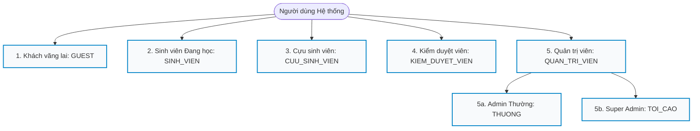

1. **Khách vãng lai (`GUEST`):**
   - Chưa đăng nhập phiên làm việc.
   - Quyền hạn: Xem trang chào mừng (`/`), tra cứu danh mục Khoa (`/khoa`), xem danh sách môn học (`/mon-hoc`), xem đề cương tổng quan môn học.
   - Giới hạn: **Bị chặn 100%** việc xem trước nội dung PDF, tải file, xem chi tiết các bài đánh giá, xem danh sách bài nộp Bounty, bình chọn và đăng tải tài liệu.
2. **Sinh viên đang học (`SINH_VIEN`):**
   - Tài khoản được đối soát tự động từ dữ liệu nhà trường (`danh_sach_sinh_vien_raw`). Không tự đăng ký qua form web.
   - Kích hoạt qua đổi mật khẩu lần đầu. Nhận ngay 100 điểm khả dụng khi kích hoạt.
   - Quyền hạn: Tra cứu tài liệu, xem trước PDF, tải file, đăng tài liệu học tập (tối đa 10 file/ngày), tạo phiên bản mới, bình chọn Upvote tài liệu, đánh giá môn học (ẩn danh/công khai), bình chọn review, tạo yêu cầu tìm tài liệu (Wishlist Bounty), nộp tài liệu giải quyết Bounty (Method A từ kho hoặc Method B upload mới), nghiệm thu bài nộp, gửi yêu cầu chỉnh sửa hậu hoàn thành, báo cáo vi phạm nội dung, gửi đơn xin gỡ tài liệu cộng đồng.
3. **Cựu sinh viên (`CUU_SINH_VIEN`):**
   - Đăng ký tự do qua form KYC riêng (`/cuu-sinh-vien/dang-ky`), tải lên ảnh minh chứng bằng tốt nghiệp.
   - Kích hoạt sau khi được Ban kiểm duyệt thẩm định và phê duyệt hồ sơ KYC. Nhận ngay 100 điểm khả dụng khi kích hoạt.
   - Quyền hạn: Bình đẳng 100% quyền lợi học thuật với sinh viên đang học (`Alumni Parity`): đóng góp tài liệu, nộp bài săn thưởng, tạo yêu cầu Bounty, đánh giá môn học, bình chọn.
4. **Kiểm duyệt viên (`KIEM_DUYET_VIEN`):**
   - Cán bộ Đoàn - Hội, Ban học tập hoặc Giảng viên phụ trách kiểm soát chất lượng nội dung.
   - Quyền hạn: Truy cập Bảng điều khiển quản trị (`/quan-tri`), thẩm định tài liệu mới tải lên (`CHO_DUYET`), thẩm tra tài liệu nguy cơ cao bị báo cáo (`CHO_KIEM_TRA`, `TAM_AN_KIEM_TRA`), duyệt/từ chối hồ sơ KYC cựu sinh viên, xem trước minh chứng KYC qua Signed URL 30 phút, xử lý hàng đợi báo cáo vi phạm tài liệu/đánh giá môn học, xét duyệt yêu cầu gỡ tài liệu cộng đồng, thẩm định và phê duyệt/từ chối giải ngân điểm thưởng Bounty (`CHO_GIAI_NGAN`), xem danh sách Thùng rác (nhưng không có quyền khôi phục hoặc xóa vĩnh viễn).
5. **Quản trị viên (`QUAN_TRI_VIEN`):**
   - **Admin thường (`THUONG`):** Bao gồm toàn bộ quyền của Kiểm duyệt viên + Quản trị danh mục đào tạo (Khoa, Chuyên ngành, Môn học), Quản trị tài khoản sinh viên/cựu sinh viên (khóa/mở khóa, ghi nhận vi phạm thủ công), nạp danh sách sinh viên raw, theo dõi giám sát dung lượng lưu trữ, xem nhật ký kiểm toán. Không được phép phân quyền Admin hoặc sửa đổi tài khoản cán bộ khác.
   - **Super Admin (`TOI_CAO`):** Toàn quyền tối cao trên toàn hệ thống. Quản trị phân quyền Admin/Mod, khôi phục tài liệu từ thùng rác, xóa vĩnh viễn tệp rác quá 60 ngày, dọn dẹp thùng rác khẩn cấp, điều chỉnh cấu hình hệ thống. Hệ thống bảo vệ tuyệt đối: không thể hạ quyền hoặc xóa Super Admin cuối cùng.

---

### 2.2. Trạng Thái Tài Khoản Người Dùng & Máy Trạng Thái Kích Hoạt

Bảng `nguoi_dung` quản lý trạng thái bằng Backed Enum `App\Enums\TrangThaiNguoiDung`:
- `CHUA_XAC_THUC`:
  - **Sinh viên đang học:** Tài khoản vừa được khởi tạo tự động khi đăng nhập lần đầu bằng mật khẩu mặc định. Middleware `EnsurePasswordChanged` bắt buộc chuyển hướng đến `/mat-khau-lan-dau`.
  - **Cựu sinh viên:** Hồ sơ KYC đang nằm trong hàng đợi chờ duyệt. Bị chặn đăng nhập qua `IdentityRuleEvaluator::canLogin()`.
- **`DANG_HOAT_DONG`:** Tài khoản hợp lệ, có đầy đủ quyền hạn truy cập tương ứng với vai trò.
- **`TAM_KHOA`:** Tài khoản bị vô hiệu hóa do vi phạm quy chế hoặc bị Admin khóa thủ công. Bị chặn đăng nhập và bị Middleware chặn request với thông báo lỗi hiển thị kèm `ly_do_khoa`.

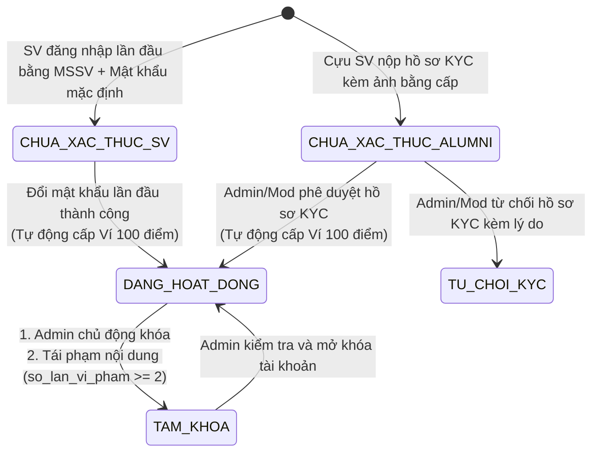

---

### 2.3. Ma Trận Phân Quyền Truy Cập Route & Middlewares Bảo Vệ

Hệ thống thiết lập hàng rào phòng thủ đa lớp tại tầng định tuyến:
1. `auth`: Yêu cầu đã xác thực phiên đăng nhập (Session).
2. `verified`: Yêu cầu đã xác minh tài khoản / email.
3. `role:<roles>`: Kiểm tra vai trò người dùng qua middleware `App\Http\Middleware\CheckRole`.
4. `EnsurePasswordChanged`: Ép buộc sinh viên `CHUA_XAC_THUC` phải đổi mật khẩu lần đầu trước khi truy cập bất kỳ tài nguyên nào khác.
5. `signed`: Kiểm tra chữ ký HMAC-SHA256 trên đường dẫn tạm thời.

| Phân hệ / Nhóm Route | Tên Route / URI Mẫu | Phương thức | Quyền truy cập tối thiểu | Middleware bảo vệ |
| :--- | :--- | :---: | :---: | :--- |
| **Công khai (Public)** | | | | |
| Trang chủ chào đón | `home` (`/`) | GET | Khách / Mọi người | `web` |
| Danh sách Khoa | `faculties.index` (`/khoa`) | GET | Khách / Mọi người | `web` |
| Danh sách Môn học | `courses.index` (`/mon-hoc`) | GET | Khách / Mọi người | `web` |
| Chi tiết Môn học đa tab | `courses.show` (`/mon-hoc/{code}`) | GET | Khách / Mọi người | `web` |
| **Định danh & Xác thực (Auth)** | | | | |
| Đăng nhập | `login` (`/dang-nhap`) | GET/POST | Khách (`guest`) | `guest` |
| Đăng ký Cựu sinh viên | `alumni.register` (`/cuu-sinh-vien/dang-ky`) | GET/POST | Khách (`guest`) | `guest` |
| Đổi mật khẩu lần đầu | `password.change` (`/mat-khau-lan-dau`) | GET/POST | `SINH_VIEN` (`CHUA_XAC_THUC`) | `auth` |
| Hồ sơ cá nhân | `profile.edit` (`/ho-so`) | GET/PATCH | Đã đăng nhập | `auth` |
| Xem trước minh chứng KYC | `kyc.preview` (`/kyc/xem-anh/{id}`) | GET | Mod / Admin | `auth`, `signed` |
| **Học thuật & Tài liệu** | | | | |
| Danh sách tài liệu môn học | `documents.index` (`/tai-lieu`) | GET | Sinh viên / Cựu SV | `auth`, `verified` |
| Đăng tải tài liệu | `documents.create`, `store` (`/tai-lieu/dang-tai`) | GET/POST | Sinh viên / Cựu SV | `auth`, `verified` |
| Kiểm tra trùng lặp SHA-256 | `documents.check-duplicate` | POST | Sinh viên / Cựu SV | `auth`, `verified` |
| Xem trước stream PDF | `documents.preview` (`/tai-lieu/{id}/xem-truoc`) | GET | SV/Cựu SV (Nếu `DA_DUYET`)<br>Tác giả/Mod/Admin (Nếu `CHO_DUYET`) | `auth`, `verified` |
| Tải file tài liệu | `documents.download` (`/tai-lieu/{id}/tai-ve`) | GET | SV/Cựu SV (Nếu `DA_DUYET`)<br>Tác giả/Mod/Admin (Nếu `CHO_DUYET`) | `auth`, `verified` |
| Bình chọn Upvote tài liệu | `documents.upvote` (`/tai-lieu/{id}/binh-chon`) | POST | Sinh viên / Cựu SV | `auth`, `verified` |
| Tạo phiên bản tài liệu mới | `documents.create-version` (`/tai-lieu/{id}/tao-phien-ban`) | POST | Tác giả tài liệu gốc | `auth`, `verified` |
| Xóa mềm tài liệu | `documents.destroy` (`DELETE /tai-lieu/{id}`) | DELETE | Tác giả (trong 24h & lượt tải = 0) | `auth`, `verified` |
| Gửi đơn xin gỡ tài liệu | `documents.request-removal` | POST | Tác giả (lượt tải $\ge 10$) | `auth`, `verified` |
| Báo cáo vi phạm tài liệu | `reports.document.store` (`POST /bao-cao/tai-lieu`) | POST | Sinh viên / Cựu SV | `auth`, `verified` |
| **Đánh giá Môn học (Reviews)** | | | | |
| Đăng bài đánh giá môn | `courses.reviews.store` | POST | Sinh viên / Cựu SV | `auth` |
| Bình chọn Upvote/Downvote | `reviews.vote` (`POST /danh-gia/{id}/vote`) | POST | Sinh viên / Cựu SV | `auth` |
| Báo cáo vi phạm review | `reviews.report` (`POST /danh-gia/{id}/bao-cao`) | POST | Sinh viên / Cựu SV | `auth` |
| **Săn thưởng (Bounties) & Ví điểm** | | | | |
| Tạo yêu cầu tìm tài liệu | `document-requests.store` (`POST /yeu-cau-tai-lieu`) | POST | Sinh viên / Cựu SV | `auth` |
| Nộp tài liệu Bounty (A/B) | `document-requests.fulfill` | POST | Sinh viên / Cựu SV | `auth` |
| Nghiệm thu bài nộp (Bước 1) | `document-requests.confirm` | POST | Người tạo yêu cầu | `auth` |
| Từ chối bài nộp | `document-requests.reject-fulfillment` | POST | Người tạo yêu cầu | `auth` |
| Hủy yêu cầu Bounty | `document-requests.destroy` | DELETE | Người tạo / Admin | `auth` |
| Yêu cầu chỉnh sửa hậu Bounty | `document-requests.corrections.store` | POST | Người tạo Bounty | `auth` |
| Phản hồi yêu cầu chỉnh sửa | `corrections.respond` | POST | Người đóng góp Bounty | `auth` |
| Nộp tài liệu thay thế | `corrections.submit-replacement` | POST | Người đóng góp Bounty | `auth` |
| Nghiệm thu bản thay thế | `corrections.confirm-completion` | POST | Người tạo Bounty | `auth` |
| Xem ví điểm & lịch sử | `wallet.index` (`/vi-diem`) | GET | Sinh viên / Cựu SV | `auth` |
| **Khu vực Quản trị & Kiểm duyệt (Admin Console)** | | | | |
| Admin Dashboard | `admin.dashboard` (`/quan-tri`) | GET | Moderator / Admin | `auth`, `role:KIEM_DUYET_VIEN,QUAN_TRI_VIEN` |
| Hàng đợi duyệt KYC | `admin.kyc.index` (`/quan-tri/duyet-kyc`) | GET | Moderator / Admin | `auth`, `role:KIEM_DUYET_VIEN,QUAN_TRI_VIEN` |
| Duyệt/Từ chối KYC đơn lẻ | `admin.kyc.approve`, `reject` | PUT | Moderator / Admin | `auth`, `role:KIEM_DUYET_VIEN,QUAN_TRI_VIEN` |
| Duyệt hàng loạt KYC | `admin.kyc.bulk-approve` | POST | Moderator / Admin | `auth`, `role:KIEM_DUYET_VIEN,QUAN_TRI_VIEN` |
| Hàng đợi Báo cáo thống nhất | `admin.review-reports.index` | GET | Moderator / Admin | `auth`, `role:KIEM_DUYET_VIEN,QUAN_TRI_VIEN` |
| Bác bỏ hàng loạt báo cáo | `admin.reports.bulk-dismiss` | POST | Moderator / Admin | `auth`, `role:KIEM_DUYET_VIEN,QUAN_TRI_VIEN` |
| Lưu trữ hàng loạt báo cáo | `admin.reports.bulk-archive` | POST | Moderator / Admin | `auth`, `role:KIEM_DUYET_VIEN,QUAN_TRI_VIEN` |
| Hàng đợi Thẩm định tài liệu | `admin.documents.review-queue` | GET | Moderator / Admin | `auth`, `role:KIEM_DUYET_VIEN,QUAN_TRI_VIEN` |
| Duyệt tài liệu mới đơn lẻ | `admin.documents.approve` | PUT | Moderator / Admin | `auth`, `role:KIEM_DUYET_VIEN,QUAN_TRI_VIEN` |
| Từ chối tài liệu mới đơn lẻ | `admin.documents.reject` | PUT | Moderator / Admin | `auth`, `role:KIEM_DUYET_VIEN,QUAN_TRI_VIEN` |
| Duyệt hàng loạt tài liệu mới | `admin.documents.bulk-approve` | POST | Moderator / Admin | `auth`, `role:KIEM_DUYET_VIEN,QUAN_TRI_VIEN` |
| Hàng đợi Payout Bounty | `admin.bounties.payout-queue` | GET | Moderator / Admin | `auth`, `role:KIEM_DUYET_VIEN,QUAN_TRI_VIEN` |
| Duyệt giải ngân Bounty | `admin.bounties.approve-payout` | PUT | Moderator / Admin | `auth`, `role:KIEM_DUYET_VIEN,QUAN_TRI_VIEN` |
| Từ chối giải ngân Bounty | `admin.bounties.reject-payout` | PUT | Moderator / Admin | `auth`, `role:KIEM_DUYET_VIEN,QUAN_TRI_VIEN` |
| Hàng đợi Đơn xin gỡ tài liệu | `admin.documents.removal-requests.index` | GET | Moderator / Admin | `auth`, `role:KIEM_DUYET_VIEN,QUAN_TRI_VIEN` |
| Xem Thùng rác 60 ngày | `admin.documents.deleted` | GET | Moderator / Admin | `auth`, `role:KIEM_DUYET_VIEN,QUAN_TRI_VIEN` |
| Khôi phục tài liệu thùng rác | `admin.documents.restore` | POST | **Chỉ Quản trị viên** | `auth`, `role:QUAN_TRI_VIEN` |
| Xóa vĩnh viễn tài liệu | `admin.documents.permanent-delete` | DELETE | **Chỉ Quản trị viên** | `auth`, `role:QUAN_TRI_VIEN` |
| Quản trị Người dùng & RBAC | `admin.users.*` | GET/PUT/POST | **Chỉ Quản trị viên** | `auth`, `role:QUAN_TRI_VIEN` |
| Nạp dữ liệu sinh viên Raw | `admin.raw-students.*` | GET/POST/PUT/DEL | **Chỉ Quản trị viên** | `auth`, `role:QUAN_TRI_VIEN` |
| Quản trị Danh mục Đào tạo | `admin.catalog.*` | GET/POST/PUT | **Chỉ Quản trị viên** | `auth`, `role:QUAN_TRI_VIEN` |
| Giám sát Storage & Dọn rác | `admin.storage.*` | GET/POST | **Chỉ Quản trị viên** | `auth`, `role:QUAN_TRI_VIEN` |
| Nhật ký kiểm toán (Audit Logs) | `admin.audit-logs.*` | GET | **Chỉ Quản trị viên** | `auth`, `role:QUAN_TRI_VIEN` |
| Cấu hình hệ thống | `admin.settings.*` | GET/PUT | **Chỉ Quản trị viên** | `auth`, `role:QUAN_TRI_VIEN` |

---

### 2.4. Dữ Liệu Phiên Đăng Nhập Chia Sẻ Qua `HandleInertiaRequests`

Trong kiến trúc Inertia.js, file `app/Http/Middleware/HandleInertiaRequests.php` chia sẻ dữ liệu toàn cục xuống **100% các trang React**:
- `auth.user`:
  - `ma_nguoi_dung`, `id`, `ho_ten`, `name`, `email`, `mssv`, `anh_dai_dien`, `diem_uy_tin`, `nam_tot_nghiep`.
  - `vai_tro` (Enum value: `'SINH_VIEN'`, `'CUU_SINH_VIEN'`, `'KIEM_DUYET_VIEN'`, `'QUAN_TRI_VIEN'`).
  - `ten_vai_tro` (Enum label tiếng Việt).
  - `cap_quan_tri` (`'THUONG'`, `'TOI_CAO'`), `ten_cap_quan_tri`.
  - `trang_thai` (`'CHUA_XAC_THUC'`, `'DANG_HOAT_DONG'`, `'TAM_KHOA'`), `ten_trang_thai`.
  - **Cờ quyền nhanh (Helper Flags):**
    - `la_quan_tri` (`$user->laQuanTriVien()`)
    - `la_super_admin` (`$user->laSuperAdmin()`)
    - `la_kiem_duyet` (`$user->laKiemDuyetVien()`)
    - `dang_hoat_dong` (`$user->dangHoatDong()`)
  - `khoa`: `{ ma_khoa, ky_hieu_khoa, ten_khoa }`
  - `vi_diem`: `{ diem_kha_dung, diem_tam_giu }` (Mặc định `0 / 0` nếu chưa có).
- `auth.vai_tro`: Giá trị vai trò chuỗi dùng nhanh.
- `auth.unread_notifications_count`: Số lượng thông báo chưa đọc trong bảng `notifications`.
- `flash`: `{ success, error, warning, info }` phục vụ hiển thị Toast notification.
- `faculties`: Danh sách toàn bộ các Khoa và môn học trực thuộc phục vụ render Sidebar sinh viên.
- `ziggy`: Toàn bộ cây định tuyến từ Backend xuống Frontend qua hàm `route()`.

---

## 3. DANH MỤC TÍNH NĂNG & ĐẶC TẢ LOGIC NGHIỆP VỤ CHI TIẾT (8 PHÂN HỆ)

---

### 3.1. Phân hệ 1: Identity (Định danh, Xác thực, KYC & Hồ sơ Cá nhân)

#### 1. Nguyên tắc Định danh Kép (Zero-KYC cho Sinh viên vs KYC Minh chứng cho Cựu SV)
- **Sinh viên đang học (`SINH_VIEN`):**
  - Không đăng ký tài khoản tự do. Form `/dang-ky` chặn hoàn toàn nếu email có đuôi `@student.agu.edu.vn`.
  - Dữ liệu được nạp trước vào bảng `danh_sach_sinh_vien_raw` bao gồm: `mssv`, `ho_ten`, `email_sv`, `ma_khoa`, `mat_khau_mac_dinh` (đã băm Bcrypt), `da_kich_hoat = false`.
  - Sinh viên đăng nhập bằng MSSV (hoặc email) và mật khẩu mặc định nhà trường cấp.
  - Hệ thống tự động tạo bản ghi trong bảng `nguoi_dung` với trạng thái `CHUA_XAC_THUC`.
  - Middleware `EnsurePasswordChanged` chặn đứng mọi route và bắt buộc đổi mật khẩu tại `/mat-khau-lan-dau`.
  - Khi sinh viên đổi mật khẩu thành công:
    1. Cập nhật mật khẩu mới (`Hash::make`).
    2. Đổi `nguoi_dung.trang_thai = DANG_HOAT_DONG`.
    3. Đánh dấu `danh_sach_sinh_vien_raw.da_kich_hoat = true`, lưu `thoi_diem_kich_hoat = now()`.
    4. **Tự động cấp ví điểm với 100 điểm khả dụng (`diem_kha_dung = 100`, `diem_tam_giu = 0`)**.
    5. Gửi thông báo `StudentAccountActivatedNotification`.
    6. Điều hướng vào Dashboard `/trang-chu`.
- **Cựu sinh viên (`CUU_SINH_VIEN`):**
  - Đăng ký qua `/cuu-sinh-vien/dang-ky`. Điền thông tin: Họ tên, Email, Mật khẩu, MSSV cũ, Năm tốt nghiệp, Khoa đào tạo, và tải lên file ảnh minh chứng bằng tốt nghiệp (`.jpg, .jpeg, .png, .pdf`, tối đa 10MB).
  - **Kiểm tra chống gian lận:** Nếu MSSV nhập vào tồn tại trong bảng `danh_sach_sinh_vien_raw` (sinh viên đang học), hệ thống từ chối ngay lập tức: *"MSSV này thuộc sinh viên đang học, không được đăng ký diện cựu sinh viên"*.
  - File minh chứng được lưu tại thư mục nhạy cảm: `storage/app/private/kyc/` (không symlink ra public).
  - Tạo bản ghi `nguoi_dung` với vai trò `CUU_SINH_VIEN`, trạng thái `CHUA_XAC_THUC`.
  - Tạo bản ghi `yeu_cau_xac_thuc` với trạng thái `CHO_DUYET`.
  - Bị chặn đăng nhập cho đến khi được Ban kiểm duyệt phê duyệt hồ sơ.

#### 2. Thẩm duyệt KYC & Temporary Signed URL 30 Phút
- Ban kiểm duyệt truy cập Hàng đợi KYC tại `/quan-tri/duyet-kyc`.
- **Xem trước ảnh minh chứng PII:** Đường dẫn xem ảnh được ký số thông qua `URL::temporarySignedRoute('kyc.preview', now()->addMinutes(30), ['id' => $id])`. Sau 30 phút, link tự động vô hiệu (HTTP 403). Tuyến đường được bảo vệ đồng thời bởi middleware `signed` và `role:KIEM_DUYET_VIEN,QUAN_TRI_VIEN`.
- **Phê duyệt hồ sơ (Đơn lẻ & Hàng loạt):**
  - Cập nhật `yeu_cau_xac_thuc.trang_thai = DA_DUYET`, lưu `nguoi_duyet`, `thoi_gian_duyet`.
  - Kích hoạt tài khoản `nguoi_dung.trang_thai = DANG_HOAT_DONG`.
  - **Tự động cấp ví điểm ban đầu với 100 điểm khả dụng**.
  - Gửi thông báo `AlumniKycDecisionNotification` báo cựu SV đã được cấp quyền đăng nhập.
  - Ghi nhật ký kiểm toán `HanhDongKiemToan::DUYET_KYC`.
- **Từ chối hồ sơ:** Bắt buộc nhập `ly_do_tu_choi` (tối thiểu 10 ký tự). Cập nhật `yeu_cau_xac_thuc.trang_thai = TU_CHOI`. Gửi notification giải thích rõ lý do để cựu SV biết nguyên nhân.

---

### 3.2. Phân hệ 2: Academic Catalog (Danh mục Học thuật: Khoa, Ngành, Môn học)

#### 1. Cấu trúc Cây Phân cấp & Ràng buộc Dữ liệu
- Cây phân cấp 3 tầng: **Khoa (`Khoa`) $\to$ Chuyên ngành (`ChuyenNganh`) $\to$ Môn học (`MonHoc`)**.
- **Chuẩn hóa Mã học phần (`ma_hoc_phan`):**
  - Bắt buộc theo biểu thức chính quy: `/^[A-Z]{3}[0-9]{3}$/` (3 chữ cái in hoa + 3 chữ số, ví dụ: `COS101`, `ENG202`, `MAT101`).
  - Hệ thống tự động `trim` và chuyển thành in hoa `strtoupper`.
  - Mã học phần là duy nhất trên toàn hệ thống (`unique`).
- **Số tín chỉ (`so_tin_chi`):** Số nguyên hợp lệ từ 1 đến 8 ($1 \le \text{so\_tin\_chi} \le 8$).
- **Ký hiệu Khoa & Chuyên ngành:** Ký hiệu khoa viết hoa (ví dụ: `CNTT`, `KTCN`). Ký hiệu chuyên ngành bắt đầu bằng chữ cái `D` + 2 chữ cái in hoa (ví dụ: `DTH` - Tin học, `DMK` - Marketing).
- **Ràng buộc Môn học - Chuyên ngành:** Khi tạo hoặc chỉnh sửa môn học, các chuyên ngành liên kết (`ma_chuyen_nganh[]`) **bắt buộc phải trực thuộc Khoa** quản lý môn học đó.

#### 2. Kế thừa Trạng thái & Khóa An toàn Dữ liệu
- **Tính kế thừa Khoa - Con:** Khi một Khoa bị vô hiệu hóa (`ngay_xoa_tam != null`), tất cả chuyên ngành và môn học trực thuộc khoa đó sẽ tự động rơi vào trạng thái ngầm vô hiệu hóa (`effectively inactive`).
- **Khóa an toàn chống gỡ bỏ (Data Link Guard):** Không thể vô hiệu hóa (`toggle`) hoặc xóa một môn học nếu môn học đó đang có:
  1. Tài liệu học tập (`tai_lieu`).
  2. Bài đánh giá môn học (`danh_gia_mon_hoc`).
  3. Yêu cầu tìm tài liệu săn thưởng (`yeu_cau_tai_lieu`).
- **Hiển thị giao diện Client:** Dropdown chọn môn học khi đăng tài liệu (`Documents/Create.jsx`) và cây danh mục chỉ truy vấn các môn học đang hoạt động (`trang_thai = true`) và có Khoa cha đang hoạt động.

---

### 3.3. Phân hệ 3: Documents (Kho Lưu trữ, Chống Trùng lặp & Sở hữu Cộng đồng)

#### 1. Quy định Tải lên & Thuật toán Lọc trùng Nhị phân SHA-256
- **Hạn ngạch tải lên (Rate Limiting):** Tối đa **10 lượt tải lên / ngày / tài khoản sinh viên** (`NFR-04`), ngăn chặn hành vi spam tràn bộ nhớ đĩa.
- **Định dạng file cho phép:** `.pdf`, `.docx`, `.pptx`, `.zip`. Kích thước tệp tối đa: **50 MB** (`documents.max_upload_size_mb`).
- **Cơ chế Lọc trùng nhị phân SHA-256 2 lớp:**
  - **Lớp 1 (Pre-check API):** Frontend gọi `POST /tai-lieu/kiem-tra-trung-lap` gửi `ma_mon_hoc` và mã băm SHA-256 tính bằng Web Crypto API trên trình duyệt. Nếu đã có tài liệu trùng hash trong cùng môn học -> trả về `409 Conflict` kèm thông tin tài liệu đã có.
  - **Lớp 2 (Backend Validation):** Tầng Action chạy `hash_file('sha256', $file->getRealPath())` trên tệp tạm `tmp`. Nếu trùng hash trong cùng `ma_mon_hoc` -> chặn ngay lập tức, không di chuyển tệp vào storage.
  - **Phân vùng môn học:** Cùng một file slide nếu thuộc 2 môn khác nhau thì vẫn được chấp nhận; nhưng trong cùng 1 môn học thì chặn hoàn toàn.
- **Lưu trữ an toàn:** Tệp được lưu vào disk `local` tại `storage/app/private/documents/` với tên ngẫu nhiên (UUID). Tuyệt đối không tạo symlink ra `public/`.

#### 2. Quyền Tác giả, Sở hữu Cộng đồng & Phiên bản Mới
- **Xem trước trực tuyến & Tải về:**
  - File PDF được stream qua `Storage::response()`.
  - Tải file (`GET /tai-lieu/{id}/tai-ve`) tự động tăng bộ đếm số lượt tải `luot_tai += 1`.
- **Bình chọn / Thích tài liệu (Upvote):**
  - Lưu vào bảng `binh_chon_tai_lieu` (ràng buộc unique `[ma_tai_lieu, ma_nguoi_dung]`).
  - Tác giả **không thể tự thích** tài liệu của chính mình (HTTP 422).
  - Cơ chế Toggle: Bấm lần 1 tăng `luot_thich += 1`, bấm lần 2 hủy thích `luot_thich -= 1`.
- **Tạo phiên bản mới (`phien_ban`):** Tác giả có thể đăng bản cập nhật (v1.1, v2.0) liên kết với tài liệu gốc qua `ma_tai_lieu_goc`.
- **Quy tắc Tự xóa mềm của Tác giả (`DocumentAuthorRemovalEvaluator`):**
  - Chỉ được tự xóa mềm khi thỏa mãn đồng thời 2 điều kiện: **Trong 24 giờ đầu kể từ khi đăng** VÀ **chưa có ai tải (`luot_tai == 0`)**.
  - Nếu đã có lượt tải hoặc quá 24h: Nút xóa bị khóa.
- **Quy tắc Sở hữu Cộng đồng (Community Ownership):**
  - Khi tài liệu đạt **từ 10 lượt tải trở lên (`luot_tai >= 10`)**, tài liệu trở thành tài sản chung của sinh viên toàn trường. Tác giả không thể tự xóa mà phải gửi đơn xin gỡ (`YeuCauGoBoTaiLieu`) kèm lý do giải trình để Ban kiểm duyệt thẩm định.
  - Khi xóa mềm (bởi tác giả hoặc kiểm duyệt viên): Tài liệu được chuyển vào Thùng rác (`lich_su_thung_rac`), lưu trữ tối thiểu 60 ngày.

---

### 3.4. Phân hệ 4: Moderation (Trung tâm Kiểm duyệt, Xử lý Báo cáo & Chế tài Lũy tiến)

#### 1. Bốn Hàng Đợi Kiểm Duyệt Cốt Lõi
1. **Hàng đợi Thẩm định Tài liệu (`Review Queue` - `/quan-tri/tai-lieu/cho-kiem-tra`):**
   - Tab 1: `all` (Tất cả tài liệu cần can thiệp).
   - Tab 2: `CHO_DUYET` (Tài liệu mới đăng tải cần duyệt sơ bộ trước khi xuất bản).
   - Tab 3: `CHO_KIEM_TRA` (Tài liệu bị báo cáo vi phạm $\ge 3$ lần).
   - Tab 4: `TAM_AN_KIEM_TRA` (Tài liệu nguy cơ cao bị hệ thống tạm ẩn tự động $\ge 5$ lần).
   - Thao tác: Duyệt tài liệu mới đơn lẻ, từ chối kèm lý do, và **Duyệt hàng loạt (`bulk-approve`)**.
2. **Hàng đợi Báo cáo Thống nhất (`Report Queue` - `/quan-tri/bao-cao-danh-gia`):**
   - Gom chung báo cáo Đánh giá Môn học (`MON_HOC`), Đánh giá Giảng viên (`GIANG_VIEN`) và Báo cáo Tài liệu (`TAI_LIEU`).
   - Thao tác: Xem chi tiết bằng chứng, bác bỏ báo cáo (`BAC_BO`), tạm ẩn nội dung, xóa nội dung, và **Bác bỏ hàng loạt (`bulk-dismiss`)**, **Lưu trữ hàng loạt (`bulk-archive`)**.
3. **Hàng đợi Yêu cầu Gỡ Tài liệu Cộng đồng (`Removal Requests` - `/quan-tri/yeu-cau-go-tai-lieu`):**
   - Tiếp nhận giải trình từ tác giả xin rút tài liệu có $\ge 10$ lượt tải. Chấp thuận (`APPROVE`) $\to$ xóa mềm vào thùng rác; Từ chối (`REJECT`) $\to$ giữ nguyên tài liệu công khai.
4. **Hàng đợi Giải ngân Điểm thưởng Bounty (`Payout Queue` - `/quan-tri/yeu-cau-tai-lieu/cho-giai-ngan`):**
   - Tiếp nhận các yêu cầu Bounty đã được người yêu cầu (SV A) nghiệm thu. Admin/Mod thẩm tra file chống gian lận trước khi bấm Duyệt chi điểm.

#### 2. Tự Động Tạm Ẩn Theo Ngưỡng Báo Cáo Hợp Lệ
File `DocumentReportRecalculator.php` tính toán lại mức độ nguy cơ mỗi khi có báo cáo mới:
- **Người báo cáo hợp lệ:** Chỉ đếm các báo cáo từ người dùng có điểm uy tín $\ge 100$ (`config('moderation.trusted_reporter_reputation')`) và trạng thái báo cáo không phải là `BAC_BO`.
- **Ngưỡng kiểm tra (`review_report_threshold = 3`):** Khi `so_bao_cao_hop_le >= 3`, tài liệu tự động chuyển trạng thái `CHO_KIEM_TRA`, ưu tiên đưa lên đầu hàng đợi kiểm tra.
- **Ngưỡng tạm ẩn khẩn cấp (`auto_hide_report_threshold = 5`):** Khi `so_bao_cao_hop_le >= 5`, tài liệu tự động chuyển trạng thái `TAM_AN_KIEM_TRA`, **ngay lập tức biến mất khỏi trang chi tiết môn học và tìm kiếm công khai**, bảo vệ cộng đồng khỏi nội dung độc hại.

#### 3. Chế Tài Xử Phạt Vi Phạm Lũy Tiến (`UserViolationPenaltyEvaluator`)
Khi Ban kiểm duyệt xác nhận vi phạm và ra quyết định xóa nội dung (`action = 'DELETE'`):
- **Đối với Tài liệu vi phạm:**
  1. Trừ **20 điểm uy tín (`diem_uy_tin -= 20`)** của tác giả (sàn tối thiểu bằng 0, không âm).
  2. Tăng số lần vi phạm: **`so_lan_vi_pham += 1`**.
  3. Đánh giá mức độ cảnh báo:
     - Vi phạm lần 1: Gán `muc_canh_bao = 'CANH_BAO'`. Tài khoản vẫn ở `DANG_HOAT_DONG`.
     - Vi phạm từ lần 2 trở lên: Gán `muc_canh_bao = 'TAM_KHOA'`, **tự động chuyển trạng thái tài khoản sang `TAM_KHOA`**, cập nhật `ly_do_khoa`.
  4. Gửi thông báo chế tài `UserViolationSanctionedNotification`.
  5. Ghi nhật ký kiểm toán `HanhDongKiemToan::GHI_NHAN_VI_PHAM`.
- **Đối với Bài đánh giá môn học vi phạm:** Trừ **10 điểm uy tín (`diem_uy_tin -= 10`)** của người viết review, tăng `so_lan_vi_pham += 1` và áp dụng lũy tiến khóa tài khoản tương tự.

---

### 3.5. Phân hệ 5: Reviews (Đánh giá Môn học, Bình chọn & Bộ lọc Từ cấm Leetspeak)

#### 1. Đánh Giá 3 Tiêu Chí & Cơ Chế Ẩn Danh 2 Lớp
- **3 Tiêu chí định lượng (1 đến 5 sao):**
  1. `diem_do_kho`: Mức độ khó của kiến thức và đề thi.
  2. `diem_thuc_tien`: Khả năng ứng dụng thực tế vào đồ án/công việc.
  3. `diem_khoi_luong` (hoặc alias `diem_ap_luc_bai_tap`): Khối lượng bài tập, tiểu luận, thuyết trình.
- **Cơ chế Ẩn danh 2 lớp (Two-Layer Anonymity):**
  - **Lớp 1 (Public UI & API):** Khi người dùng tick chọn `an_danh = true`, tầng Resource (`CourseReviewResource.php`) bóc tách dữ liệu: gán cứng `user.name = "Sinh viên ẩn danh"`, `user.mssv = null`, loại bỏ hoàn toàn `ma_nguoi_dung`. Không có bất kỳ dữ liệu định danh nào lọt xuống React client.
  - **Lớp 2 (Database Audit Trail):** Trường `ma_nguoi_dung` vẫn được lưu tại CSDL MySQL. Khi phát hiện hành vi bôi nhọ, xúc phạm giảng viên nghiêm trọng, Super Admin có thẩm quyền tra cứu định danh để chuyển hội đồng kỷ luật nhà trường.

#### 2. Thuật Toán Bẻ Gãy Leetspeak & Bộ Lọc Từ Cấm
File `ProfanityFilterEvaluator.php` bảo vệ văn hóa học đường qua 4 bước:
1. **Chuẩn hóa Leetspeak:** Chuyển đổi các ký tự số/biểu tượng lách luật về chữ cái: `0` $\to$ `o`, `1` $\to$ `i`, `3` $\to$ `e`, `4` $\to$ `a`, `@` $\to$ `a`, `!` $\to$ `i`.
2. **Triệt tiêu dấu ngắt lách luật:** Bẻ gãy các thủ thuật chèn dấu cách, dấu chấm, gạch dưới xen giữa các chữ cái (ví dụ: `đ.m`, `d m`, `c_o_n_c_a_c`).
3. **Đối soát từ điển Cache:** Đối soát với từ điển từ cấm lưu trong Cache (TTL 24 giờ). Danh sách được nạp linh hoạt từ bảng CSDL hoặc danh sách mặc định 30+ từ thô tục tiếng Việt.
4. **Xử lý:** Chặn form submit ngay tại Form Request Validation nếu phát hiện từ cấm, hoặc thay thế bằng `***` khi hiển thị.

#### 3. Bình Chọn Đánh Giá (Upvote / Downvote)
- Người dùng có thể bình chọn `Upvote (+1)` hoặc `Downvote (-1)` cho từng bài review qua bảng `binh_chon_danh_gia`.
- **Quy tắc độc lập tài chính:** Điểm bình chọn review **chỉ ảnh hưởng đến độ hữu ích của bài đánh giá, TUYỆT ĐỐI KHÔNG cộng/trừ vào ví điểm (`vi_diem`) hay điểm uy tín (`diem_uy_tin`) của người viết review**.

---

### 3.6. Phân hệ 6: Bounties (Săn thưởng, Ký quỹ Escrow, Giải ngân 2 bước & Chỉnh sửa Hậu hoàn thành)

#### 1. Cơ Chế Ký Quỹ Điểm Thưởng (Escrow Holding)
- Khi sinh viên A tạo yêu cầu tìm tài liệu (`CreateBountyRequestAction`), mức thưởng tối thiểu là **10 điểm**.
- Hệ thống áp dụng khóa hàng bi quan `lockForUpdate()` trên ví điểm của SV A:
  - Kiểm tra điều kiện: `diem_kha_dung >= diem_thuong`.
  - Khấu trừ điểm khả dụng: `diem_kha_dung -= diem_thuong`.
  - Đóng băng điểm: `diem_tam_giu += diem_thuong`.
  - Ghi sổ cái `GiaoDichDiem` loại `TAM_GIU` kèm khóa chống trùng `khoa_chong_trung`.
  - Yêu cầu ở trạng thái `MO`.

#### 2. Hai Phương Thức Đóng Góp Tài Liệu
- **Phương thức A (Personal Library):** Chọn tài liệu đã có trong kho cá nhân (`/tai-lieu/cua-toi`).
  - Ràng buộc: Phải là tài liệu chính chủ (`ma_nguoi_dang === user.id`), thuộc cùng môn học với yêu cầu, và bắt buộc đã có trạng thái **`DA_DUYET`**.
- **Phương thức B (Local File Upload):** Nộp file mới trực tiếp từ máy tính.
  - Ràng buộc: Rate limit 10 lượt/ngày, kiểm tra lọc trùng SHA-256.
  - Tạo `TaiLieu` mới ở trạng thái **`CHO_DUYET`** và `DapUngYeuCauTaiLieu` ở trạng thái **`CHO_DUYET`**.
  - **Điểm thưởng vẫn đóng băng, chưa giải ngân.** Tài liệu phải qua Ban kiểm duyệt duyệt sang `DA_DUYET` thì SV A mới có thể nghiệm thu.

#### 3. Quy Trình Nghiệm Thu & Duyệt Giải Ngân 2 Lớp (Two-Step Payout)
1. **Bước 1: Sinh viên A (Người tạo) xác nhận chọn bài nộp (`ConfirmBountyFulfillmentAction`):**
   - Điều kiện: Tài liệu nộp bắt buộc phải có trạng thái `DA_DUYET`.
   - Bài nộp chuyển sang `NGUOI_YEU_CAU_XAC_NHAN`.
   - Yêu cầu chuyển sang **`CHO_GIAI_NGAN`**.
   - **ĐIỂM VẪN NẰM TRONG `diem_tam_giu` CỦA SV A, SV B TUYỆT ĐỐI CHƯA ĐƯỢC CỘNG ĐIỂM.**
   - Bắn thông báo `BountyPayoutApprovalRequiredNotification` cho toàn bộ Admin và Moderator.
2. **Bước 2: Ban Quản trị / Kiểm duyệt thẩm định và quyết định:**
   - **Trường hợp Phê duyệt (`ApproveBountyPayoutAction`):**
     - Khóa hàng bi quan cả 2 ví bằng `lockForUpdate()`.
     - Ví A: `diem_tam_giu -= diem_thuong`.
     - Ví B: `diem_kha_dung += diem_thuong`, SV B: `diem_uy_tin += diem_thuong`.
     - Ghi sổ cái: `GIAI_PHONG` (Ví A) và `CONG_DIEM` (Ví B).
     - Bài nộp chuyển `CHAP_NHAN`, Yêu cầu chuyển `DA_HOAN_THANH`.
     - Gửi thông báo `BountyPayoutApprovedNotification` cho SV B.
   - **Trường hợp Từ chối (`RejectBountyPayoutAction`):**
     - Bắt buộc nhập lý do từ chối (tối thiểu 10 ký tự).
     - **Hoàn trả an toàn cho SV A:** `diem_tam_giu -= diem_thuong`, `diem_kha_dung += diem_thuong` (ghi sổ cái `HOAN_TRA`). SV A không mất điểm.
     - Bài nộp chuyển `TU_CHOI`, lưu `ly_do_tu_choi_giai_ngan`.
     - Yêu cầu tự động quay lại **`MO`** để người khác tiếp tục nộp bài.
     - Gửi notification giải thích lý do cho cả SV A và SV B.

#### 4. Quy Trình Chỉnh Sửa & Bổ Sung Hậu Hoàn Thành (Post-Bounty Correction Workflow)
Khi tài liệu đã hoàn thành Bounty nhưng phát sinh thiếu sót (mờ trang, thiếu source code đính kèm):
- **Tạo yêu cầu sửa (`CreateCorrectionRequestAction`):** Chỉ SV A được tạo, chỉ tạo khi Bounty `DA_HOAN_THANH`, và không có yêu cầu sửa nào khác đang mở. Trạng thái: `CHO_XU_LY`. Không phát sinh giao dịch điểm.
- **Phản hồi yêu cầu (`RespondCorrectionRequestAction`):** SV B có quyền:
  - Chấp thuận (`ACCEPT`) $\to$ Trạng thái chuyển `DANG_XU_LY`.
  - Từ chối (`REJECT`) $\to$ Bắt buộc lý do $\to$ Trạng thái chuyển `TU_CHOI`. Bounty giữ nguyên `DA_HOAN_THANH`.
- **Nộp phiên bản thay thế (`SubmitReplacementDocumentAction`):** SV B tải lên file mới (v2.0, v2.1) lưu vào bảng `lan_nop_tai_lieu_thay_the`. Có thể nộp nhiều lần. File gốc cũ vẫn được bảo tồn.
- **Nghiệm thu hoàn tất (`ConfirmCorrectionCompletionAction`):** SV A chọn phiên bản đạt chuẩn $\to$ Bản đó được đánh dấu `la_phien_ban_duoc_chap_nhan = true`, yêu cầu chỉnh sửa chuyển `HOAN_THANH`, tài liệu hiển thị của Bounty được cập nhật sang bản mới. Không phát sinh điểm ví mới.

---

### 3.7. Phân hệ 7: Administration (Quản trị Người dùng, Thùng rác 60 ngày, Giám sát Storage & Audit Logs)

#### 1. Quản Trị Người Dùng & Nguyên Tắc Bảo Vệ Quản Trị Viên
- Quản trị viên quản lý danh sách tài khoản, xem chi tiết, đổi vai trò, đổi cấp quản trị, khóa/mở khóa tài khoản.
- **Quy tắc bảo vệ phân quyền (`AdminPermissionRuleEvaluator`):**
  1. Không được phép tự khóa tài khoản của chính mình.
  2. Không được phép tự thay đổi vai trò hoặc Khoa của chính mình.
  3. Admin thường không được quyền thao tác trên tài khoản Admin khác hoặc Moderator. Chỉ Super Admin mới có quyền quản lý tài khoản cán bộ.
  4. Chỉ Super Admin mới có quyền phong cấp vai trò `QUAN_TRI_VIEN`.
  5. **Bảo vệ Super Admin cuối cùng:** Tuyệt đối không cho phép hạ quyền hoặc xóa Super Admin nếu trong hệ thống chỉ còn 1 người (`currentSuperAdminCount <= 1`).

#### 2. Nạp Dữ Liệu Sinh Viên Thô (Raw Student Roster)
- Quản trị viên nạp danh sách sinh viên do phòng Đào tạo cấp qua file Excel/CSV hoặc form nhập: `mssv`, `ho_ten`, `email_sv`, `ma_khoa`, `mat_khau_mac_dinh`.
- Hệ thống kiểm tra tính hợp lệ của MSSV, định dạng email `@student.agu.edu.vn`, và kiểm tra trùng lặp trên cả bảng raw lẫn bảng người dùng chính thức.

#### 3. Quản Lý Thùng Rác 60 Ngày & Xóa Vĩnh Viễn
- **Xem Thùng rác (`admin.documents.deleted`):** Cả Moderator và Admin đều xem được danh sách tài liệu bị xóa mềm và lịch sử thùng rác (`lich_su_thung_rac`).
- **Khôi phục tài liệu (`admin.documents.restore`):** **Chỉ Quản trị viên**. Nếu tài liệu có báo cáo vi phạm đang chờ xử lý, Admin bắt buộc phải truyền xác nhận `confirm_violation: true`.
- **Xóa vĩnh viễn (`admin.documents.permanent-delete`):** **Chỉ Quản trị viên** và chỉ được xóa khi tài liệu đã lưu trong thùng rác **đủ 60 ngày** (`han_luu_thung_rac <= now()`). Khi xóa vĩnh viễn: file vật lý trên đĩa bị xóa sạch (`Storage::delete`), dòng CSDL bị xóa cứng (`forceDelete()`), kích hoạt thu hồi điểm Bounty liên kết nếu có.

#### 4. Giám Sát Lưu Trữ & Dọn Rác Tự Động
- Theo dõi dung lượng 3 phân vùng: `documents/` (tài liệu đang hoạt động), Thùng rác, và `private/kyc/` (minh chứng tốt nghiệp).
- Tổng hạn mức mặc định: **10 GB** (`STORAGE_QUOTA_MB = 10240`).
- Ngưỡng cảnh báo vàng: **80%** (`STORAGE_WARNING_THRESHOLD_PERCENT`).
- Ngưỡng nguy cấp đỏ: **90%** (`STORAGE_CRITICAL_THRESHOLD_PERCENT`).
- Phát hiện các tệp có dung lượng lớn bất thường ($\ge 20$ MB) để quản trị viên rà soát.
- **Tác vụ Dọn dẹp Thùng rác (`purgeExpiredTrash`):** Quét và xóa sạch hoàn toàn các tài liệu trong thùng rác đã quá hạn lưu trữ 60 ngày.

#### 5. Nhật Ký Kiểm Toán Nghiệp Vụ Bất Biến (Immutable Audit Logs)
- Lưu tại bảng `nhat_ky_kiem_toan`.
- **Tính chất bất biến (Append-Only):** Model `NhatKyKiemToan.php` ghi đè các hàm lifecycle `booted()`: ném `DomainException` ngay lập tức nếu phát hiện bất kỳ lệnh `update` hoặc `delete` nào. Không một ai (kể cả Super Admin) có thể chỉnh sửa hay xóa vết nhật ký.
- Lưu trữ đầy đủ: Mã người thực hiện, hành động (`HanhDongKiemToan`), loại đối tượng (`LoaiDoiTuongKiemToan`), mã đối tượng, mô tả chi tiết, snapshot dữ liệu cũ (`du_lieu_cu`), snapshot dữ liệu mới (`du_lieu_moi`), địa chỉ IP và User-Agent.

#### 6. Quản Lý Cấu Hình Hệ Thống (`cau_hinh_he_thong`)
Lưu trữ các tham số vận hành dạng Key-Value có ép kiểu tự động (`integer`, `boolean`, `json`, `string`):
1. `documents.trash_retention_days` (Mặc định: 60 ngày).
2. `moderation.auto_hide_report_threshold` (Mặc định: 3 báo cáo).
3. `documents.max_upload_size_mb` (Mặc định: 50 MB).
4. `storage.disk_warning_percent` (Mặc định: 80%).
5. `storage.disk_critical_percent` (Mặc định: 90%).
6. `system.alumni_registration_open` (Mặc định: true).

---

### 3.8. Phân hệ 8: Notifications (Hệ thống Thông báo Nghiệp vụ Thời gian thực)

#### 1. Chuẩn Hóa Tiếng Việt Bảng `notifications`
Bảng `notifications` tại CSDL được thiết kế với các cột thuần Việt:
- `id` (UUID - PK).
- `type` / `loai`: Tên class Notification đầy đủ.
- `notifiable_type`, `notifiable_id`: Quan hệ đa hình với `nguoi_dung`.
- `tieu_de`: Tiêu đề thông báo hiển thị trên chuông.
- `noi_dung`: Nội dung tóm tắt thông báo.
- `du_lieu`: JSON payload chứa `action_url`, `ma_yeu_cau`, `diem_thuong`, v.v.
- `da_doc_luc`: Timestamp đánh dấu thời điểm đọc (`null` là chưa đọc).
- `created_at`, `updated_at`.

#### 2. Phân Loại Danh Mục Thông Báo (Categories)
- **`PERSONAL` (Thông báo cá nhân):** Dành cho sinh viên/cựu sinh viên: Nhận điểm thưởng, bị trừ điểm, kết quả duyệt tài liệu, kết quả KYC, yêu cầu chỉnh sửa tài liệu.
- **`WORK_ITEM` (Thông báo tác vụ xử lý):** Dành cho cán bộ kiểm duyệt/quản trị: Có báo cáo vi phạm mới cần xử lý, có hồ sơ KYC mới nộp, có yêu cầu giải ngân Bounty đang chờ duyệt (`CHO_GIAI_NGAN`).

#### 3. Danh Sách Các Loại Thông Báo Cốt Lõi
| Tên Notification Class | Category | Đối tượng nhận | Kích hoạt khi nào? |
| :--- | :---: | :---: | :--- |
| `FirstTimePasswordChangeRequiredNotification` | PERSONAL | Sinh viên mới | Đăng nhập lần đầu từ bảng raw |
| `StudentAccountActivatedNotification` | PERSONAL | Sinh viên | Đổi mật khẩu lần đầu thành công |
| `AlumniKycDecisionNotification` | PERSONAL | Cựu sinh viên | Ban kiểm duyệt duyệt hoặc từ chối KYC |
| `NewAlumniKycNotification` | WORK_ITEM | Admin & Mod | Có cựu sinh viên nộp hồ sơ KYC mới |
| `DocumentApprovedNotification` | PERSONAL | Tác giả | Tài liệu mới hoặc bài nộp được duyệt |
| `DocumentRejectedNotification` | PERSONAL | Tác giả | Tài liệu bị từ chối duyệt kèm lý do |
| `NewViolationReportNotification` | WORK_ITEM | Admin & Mod | Có báo cáo vi phạm tài liệu mới |
| `NewReviewViolationReportNotification` | WORK_ITEM | Admin & Mod | Có báo cáo vi phạm review mới |
| `UserViolationSanctionedNotification` | PERSONAL | Tác giả vi phạm | Bị trừ điểm uy tín / tạm khóa do vi phạm |
| `BountyPayoutApprovalRequiredNotification` | WORK_ITEM | Admin & Mod | SV A đã bấm xác nhận bài nộp của SV B |
| `BountyPayoutApprovedNotification` | PERSONAL | SV B (Người nộp) | Admin duyệt giải ngân điểm thưởng Bounty |
| `BountyPayoutRejectedNotification` | PERSONAL | SV A & SV B | Admin từ chối giải ngân & hoàn điểm cho SV A |
| `BountySubmissionCancelledNotification` | PERSONAL | SV A | Bài nộp bị hủy do tài liệu bị xóa |
| `BountyPayoutClawedBackNotification` | PERSONAL | SV B (Vi phạm) | Bị thu hồi điểm thưởng do vi phạm bản quyền |
| `BountyPayoutClawbackRefundNotification` | PERSONAL | SV A (Requester) | Được hoàn trả đền bù điểm do tài liệu bị gỡ |
| `DocumentRemovalRequestResolvedNotification` | PERSONAL | Tác giả | Ban kiểm duyệt xử lý đơn xin gỡ tài liệu |
| `ReviewReportResolvedNotification` | PERSONAL | Người báo cáo | Ban kiểm duyệt đã xử lý báo cáo review |

---

## 4. VÒNG ĐỜI DỮ LIỆU & CÁC MÁY TRẠNG THÁI (STATE MACHINES)

---

### 4.1. Máy Trạng Thái Tài Liệu Học Thuật (`tai_lieu.trang_thai`)

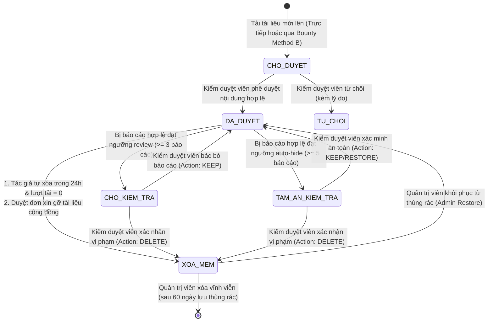

---

### 4.2. Máy Trạng Thái Yêu Cầu Săn Thưởng (`yeu_cau_tai_lieu.trang_thai`)

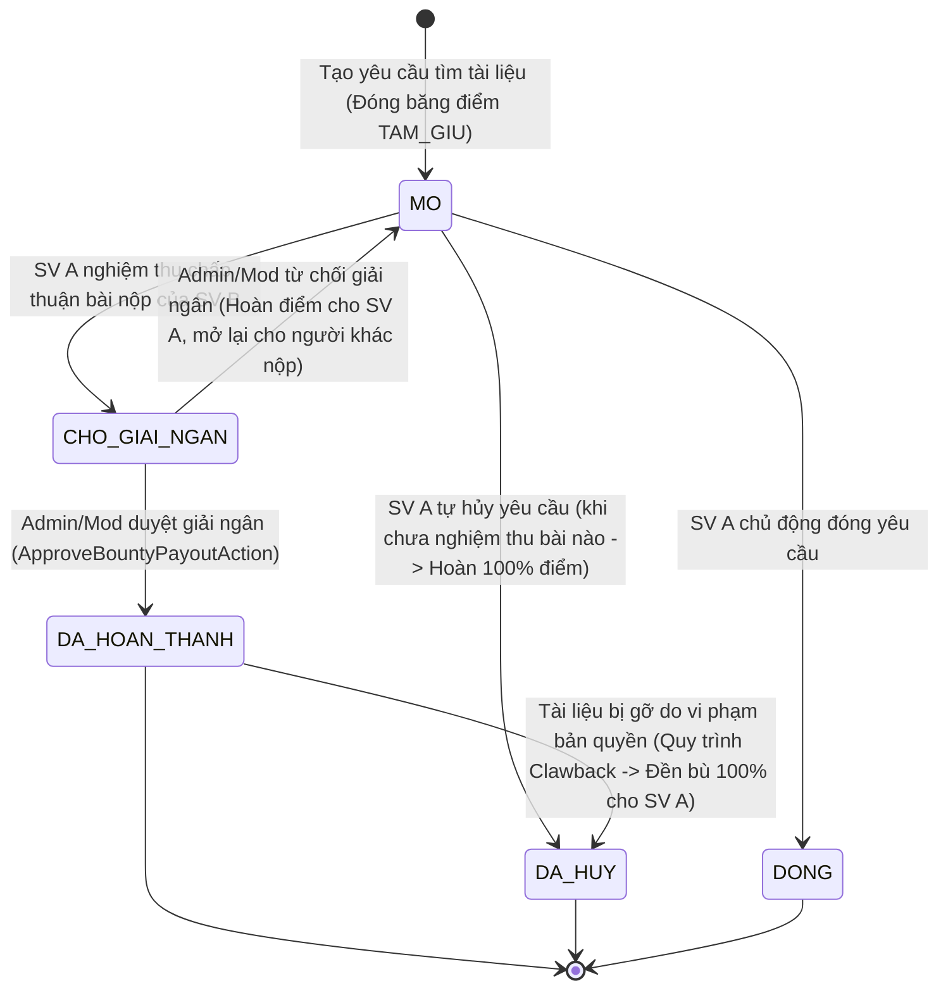

---

### 4.3. Máy Trạng Thái Bài Nộp Săn Thưởng (`dap_ung_yeu_cau_tai_lieu.trang_thai`)

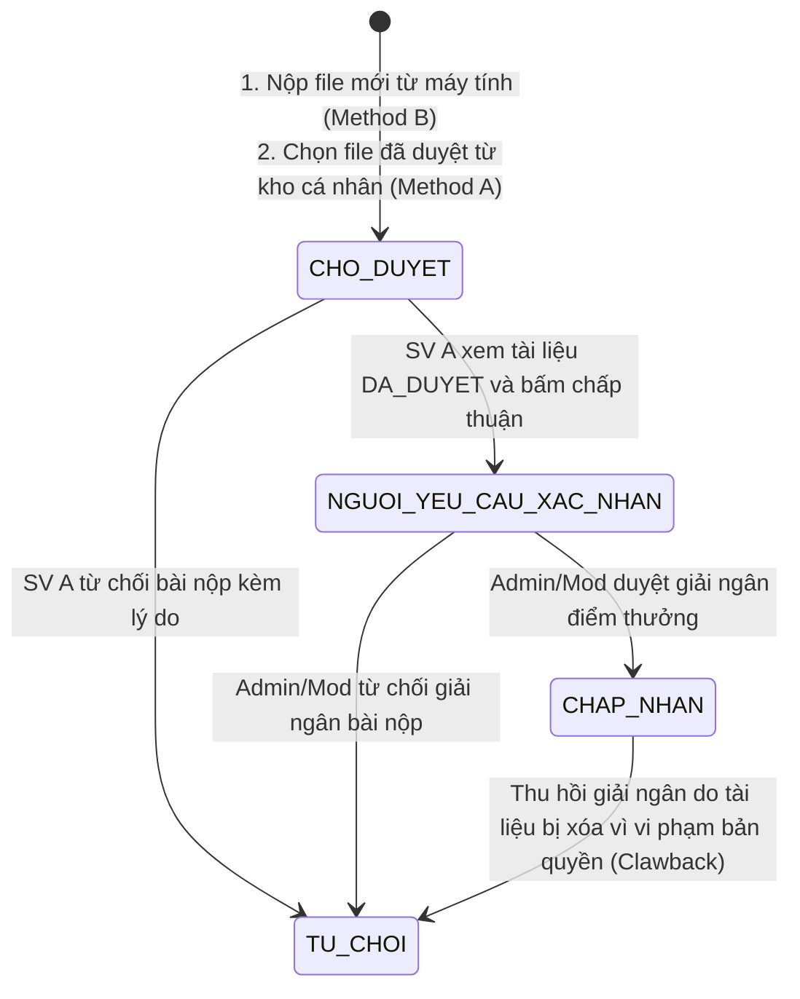

---

### 4.4. Máy Trạng Thái Yêu Cầu Chỉnh Sửa Hậu Hoàn Thành (`yeu_cau_chinh_sua_dong_gop.trang_thai`)

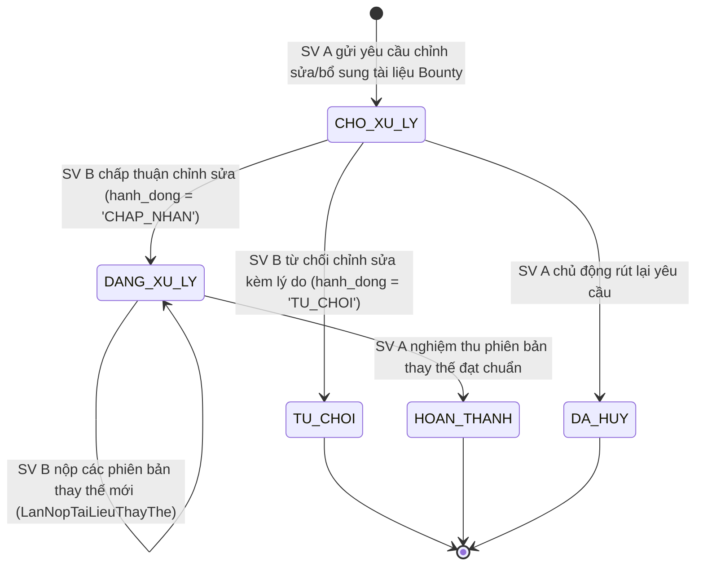

---

### 4.5. Máy Trạng Thái Hồ Sơ KYC Cựu Sinh Viên (`yeu_cau_xac_thuc.trang_thai`)

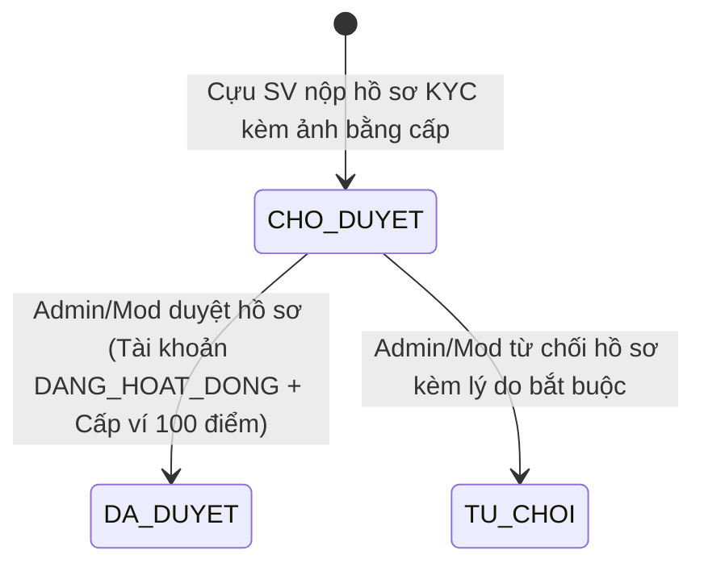

---

### 4.6. Máy Trạng Thái Xử Lý Báo Cáo Vi Phạm (`bao_cao_vi_pham` & `bao_cao_danh_gia`)

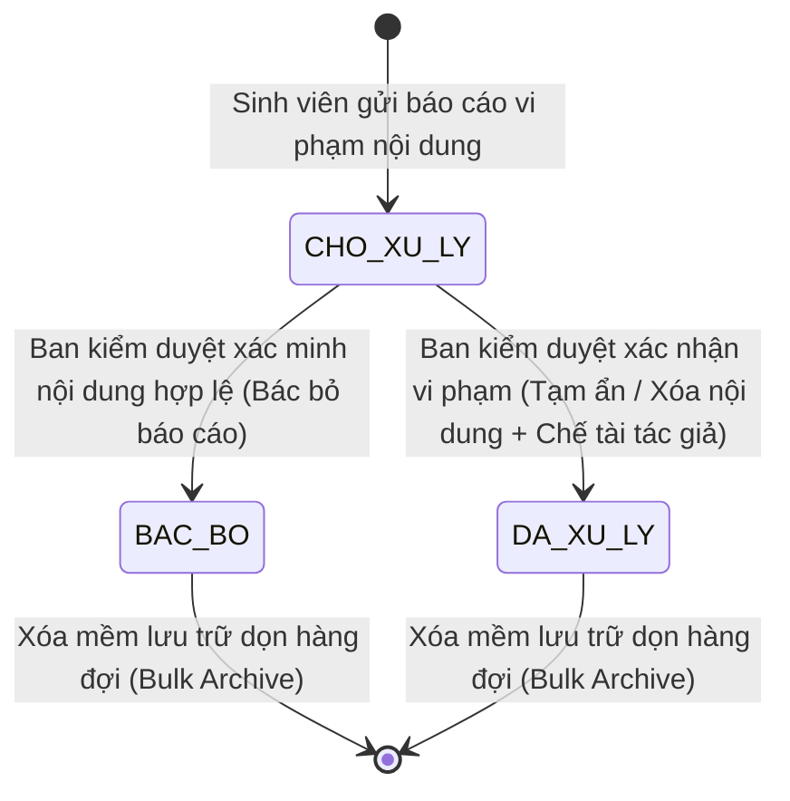

---

### 4.7. Máy Trạng Thái Yêu Cầu Gỡ Bỏ Tài Liệu Cộng Đồng (`yeu_cau_go_bo_tai_lieu`)

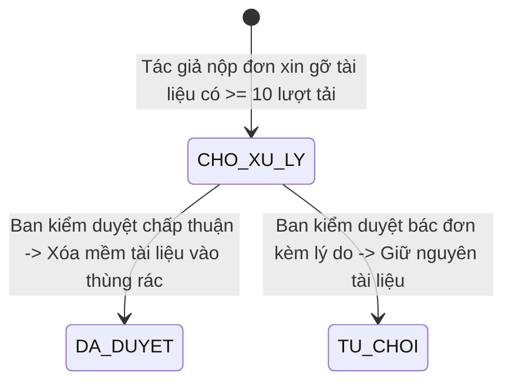

---

## 5. MỐI QUAN HỆ & ĐIỂM CHẠM LIÊN PHÂN QUYỀN (CROSS-ROLE WORKFLOW INTERACTIONS)

Hệ thống AGU Academic Hub không vận hành theo từng khối cô lập mà là một chuỗi tương tác phối hợp chặt chẽ giữa các vai trò người dùng:

---

### 5.1. Luồng Tam Giác Săn Thưởng: Sinh Viên A (Requester) - Sinh Viên B (Contributor) - Ban Kiểm Duyệt / Admin

Đây là luồng nghiệp vụ phức tạp nhất dự án, phối hợp 3 tác tử:

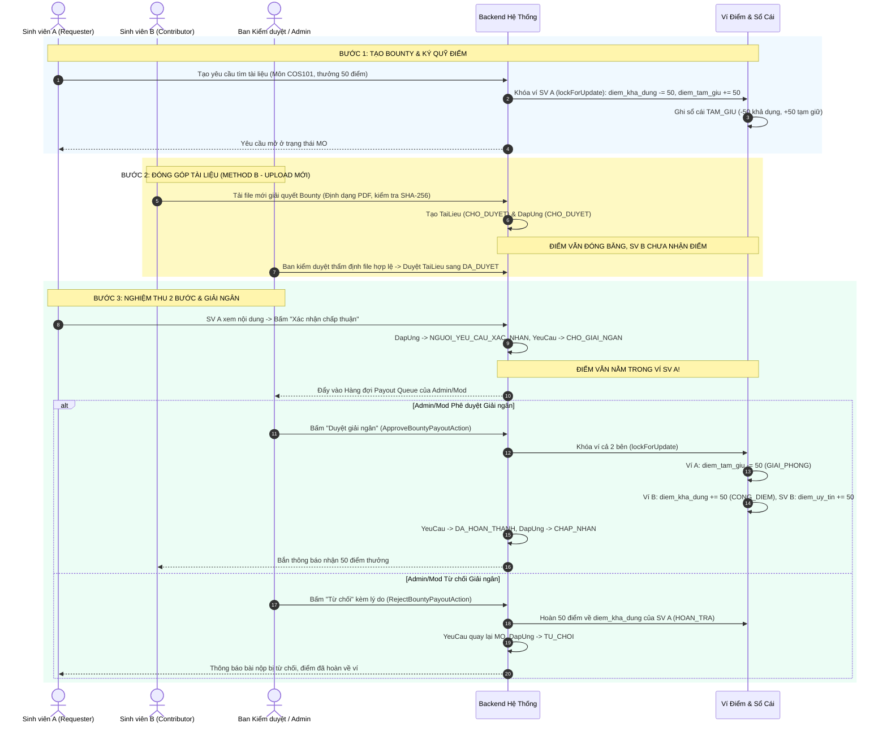

---

### 5.2. Luồng Báo Cáo Vi Phạm, Tự Động Tạm Ẩn & Xử Lý Khiếu Nại

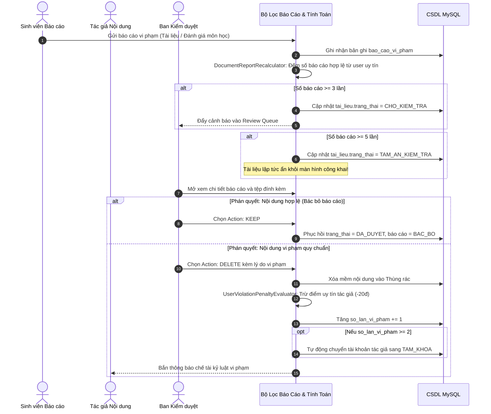

---

### 5.3. Luồng Thu Hồi Điểm (Bounty Clawback) Khi Tài Liệu Bị Gỡ Do Vi Phạm Bản Quyền

Kịch bản: Sinh viên B đã nhận 50 điểm thưởng Bounty từ SV A và yêu cầu đã đóng `DA_HOAN_THANH`. Sau đó, tác giả gốc khiếu nại bản quyền và Ban kiểm duyệt quyết định gỡ tài liệu.

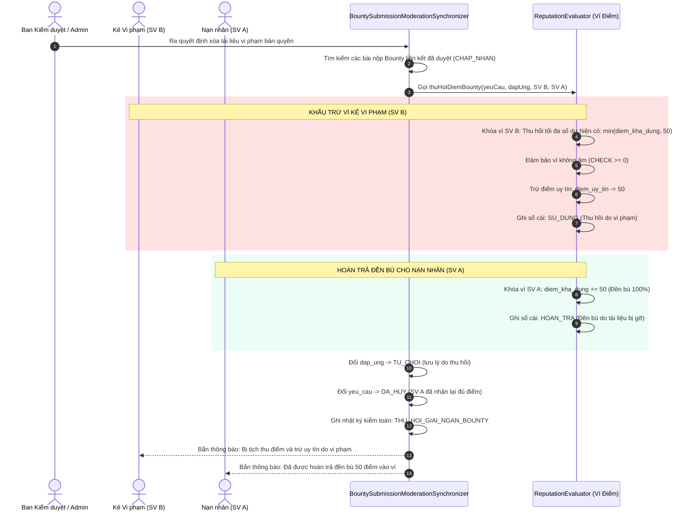

---

### 5.4. Luồng Xác Thực KYC Cựu Sinh Viên Giữa Cựu SV và Ban Kiểm Duyệt

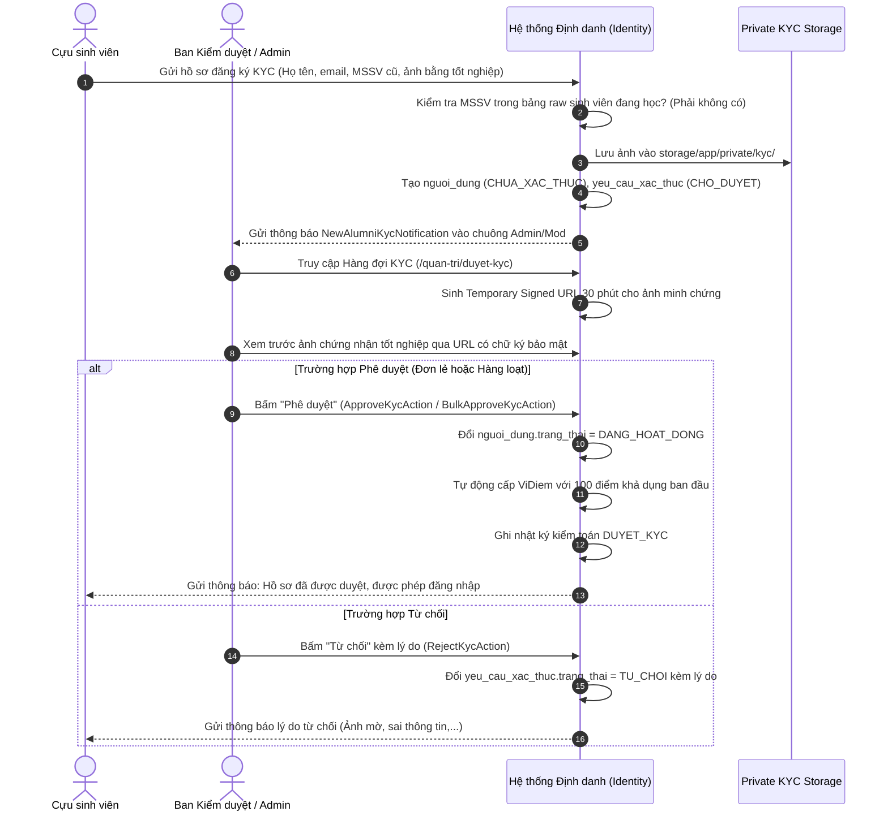

---

### 5.5. Ranh Giới Quản Trị Giữa Admin Thường và Super Admin

```mermaid
graph LR
    subgraph ModRole ["Kiểm duyệt viên (KIEM_DUYET_VIEN)"]
        M1[Thẩm định tài liệu mới]
        M2[Xử lý báo cáo vi phạm]
        M3[Duyệt hồ sơ KYC Cựu SV]
        M4[Duyệt giải ngân Bounty]
        M5[Xét duyệt đơn xin gỡ tài liệu]
        M6[Xem Thùng rác]
    end

    subgraph AdminRole ["Admin Thường (QUAN_TRI_VIEN - THUONG)"]
        A1[Kế thừa 100% quyền Moderator]
        A2[Quản trị danh mục Khoa/Ngành/Môn]
        A3[Quản trị tài khoản Sinh viên/Cựu SV]
        A4[Nạp danh sách sinh viên raw]
        A5[Xem thống kê Storage]
        A6[Xem Nhật ký kiểm toán]
    end

    subgraph SuperAdminRole ["Super Admin (QUAN_TRI_VIEN - TOI_CAO)"]
        S1[Kế thừa 100% quyền Admin Thường]
        S2[Quản trị tài khoản Admin & Mod]
        S3[Khôi phục tài liệu từ Thùng rác]
        S4[Xóa vĩnh viễn tệp rác sau 60 ngày]
        S5[Dọn dẹp khẩn cấp Thùng rác]
        S6[Cập nhật Cấu hình hệ thống]
        S7[Bảo vệ: Không thể bị hạ cấp nếu duy nhất]
    end

    ModRole --> AdminRole
    AdminRole --> SuperAdminRole
```

---

## 6. BẢNG TRA CỨU CÁC QUY TẮC NGHIỆP VỤ NHỎ NHẤT (CONSTRAINTS, FORMULAS & EDGE CASES)

### 6.1. Hạn Mức & Tham Số Số Học Cấu Hình Toàn Hệ Thống

| Tên tham số / Hằng số | Giá trị chuẩn | Vị trí định nghĩa | Ý nghĩa nghiệp vụ & Ràng buộc logic |
| :--- | :---: | :--- | :--- |
| `INITIAL_WALLET_POINTS` | **100 điểm** | `NguoiDung::booted()`, `ReputationEvaluator` | Số điểm khả dụng ban đầu cấp tự động khi tài khoản chuyển sang `DANG_HOAT_DONG` (cả SV đổi pass lần đầu và Cựu SV duyệt KYC). |
| `MIN_BOUNTY_POINTS` | **10 điểm** | `StoreBountyRequest.php` | Mức điểm thưởng tối thiểu sinh viên phải treo khi tạo một yêu cầu tìm tài liệu. |
| `MAX_UPLOAD_PER_DAY` | **10 lượt** | `DocumentController`, `UploadDocumentAction` | Hạn mức tải lên tối đa trong 1 ngày cho mỗi tài khoản sinh viên thường (`NFR-04`). |
| `MAX_FILE_SIZE_MB` | **50 MB** | `config('documents.max_upload_size_mb')` | Dung lượng tối đa cho phép của một tệp tài liệu học thuật (.pdf, .docx, .pptx, .zip). |
| `MAX_KYC_FILE_SIZE_MB` | **10 MB** | `AlumniKycRequest.php` | Dung lượng tối đa cho phép của tệp ảnh minh chứng tốt nghiệp KYC (.jpg, .jpeg, .png, .pdf). |
| `COMMUNITY_OWNERSHIP_THRESHOLD`| **10 lượt tải** | `config('documents.community_ownership_download_threshold')` | Ngưỡng lượt tải biến tài liệu thành sở hữu cộng đồng. Tác giả mất quyền tự xóa, bắt buộc phải gửi đơn xin gỡ. |
| `AUTHOR_SELF_DELETE_HOURS` | **24 giờ** | `DocumentAuthorRemovalEvaluator.php` | Thời hạn tối đa tác giả được phép tự xóa mềm tài liệu của mình (kèm điều kiện `luot_tai == 0`). |
| `REVIEW_REPORT_THRESHOLD` | **3 báo cáo** | `config('moderation.review_report_threshold')` | Số lượng báo cáo hợp lệ từ người uy tín để hệ thống tự động chuyển tài liệu sang `CHO_KIEM_TRA`. |
| `AUTO_HIDE_REPORT_THRESHOLD` | **5 báo cáo** | `config('moderation.auto_hide_report_threshold')` | Số lượng báo cáo hợp lệ để hệ thống tự động chuyển tài liệu sang `TAM_AN_KIEM_TRA` (ẩn khỏi public ngay lập tức). |
| `TRUSTED_REPORTER_REPUTATION` | **100 điểm** | `config('moderation.trusted_reporter_reputation')` | Điểm uy tín tối thiểu của người gửi báo cáo để báo cáo được tính là hợp lệ trong thuật toán tự động tạm ẩn. |
| `DOC_VIOLATION_PENALTY_POINTS` | **20 điểm** | `config('moderation.document_violation_penalty_points')` | Số điểm uy tín bị trừ khi tài liệu của tác giả bị Ban kiểm duyệt xác nhận vi phạm và xóa mềm. |
| `REVIEW_VIOLATION_PENALTY` | **10 điểm** | `config('moderation.review_violation_penalty_points')` | Số điểm uy tín bị trừ khi bài đánh giá môn học của tác giả bị xác nhận vi phạm và xóa. |
| `PROGRESSIVE_LOCK_THRESHOLD` | **$\ge 2$ lần** | `UserViolationPenaltyEvaluator.php` | Số lần vi phạm tích lũy để hệ thống tự động chuyển trạng thái tài khoản tác giả sang `TAM_KHOA`. |
| `TRASH_RETENTION_DAYS` | **60 ngày** | `config('documents.trash_admin_delete_after_days')` | Thời hạn lưu trữ tối thiểu trong thùng rác trước khi Super Admin được phép thực thi xóa vĩnh viễn file vật lý. |
| `TRASH_AUTO_PURGE_DAYS` | **90 ngày** | `config('documents.trash_auto_purge_after_days')` | Thời hạn tối đa trong thùng rác trước khi tiến trình Cron tự động dọn sạch hoàn toàn file. |
| `STORAGE_QUOTA_MB` | **10,240 MB (10GB)** | `config('storage.quota_mb')` | Hạn mức dung lượng ổ đĩa tổng thể cấp phát cho toàn bộ hệ thống lưu trữ học thuật. |
| `STORAGE_WARNING_PERCENT` | **80%** | `config('storage.warning_threshold_percent')` | Ngưỡng phần trăm dung lượng kích hoạt cảnh báo vàng trên Admin Dashboard. |
| `STORAGE_CRITICAL_PERCENT` | **90%** | `config('storage.critical_threshold_percent')` | Ngưỡng phần trăm dung lượng kích hoạt cảnh báo đỏ nguy cấp trên Admin Dashboard. |
| `LARGE_FILE_THRESHOLD_KB` | **20,480 KB (20MB)** | `config('storage.large_file_threshold_kb')` | Ngưỡng kích thước file bị đánh dấu là lớn bất thường trong báo cáo quản trị lưu trữ. |
| `KYC_SIGNED_URL_EXPIRATION` | **30 phút** | `PrivateKycStorage.php`, `KycController` | Thời gian sống tối đa của Temporary Signed URL xem trước minh chứng tốt nghiệp của cựu sinh viên. |
| `RATE_LIMIT_LOGIN` | **5 lần / phút** | `bootstrap/app.php`, `LoginRequest.php` | Giới hạn số lần thử đăng nhập sai tối đa trước khi IP bị khóa tạm thời 60 giây chống Brute-force. |

---

### 6.2. Thuật Toán Lọc Trùng SHA-256 Phân Vùng Môn Học
- Thuật toán thực hiện băm toàn bộ file nhị phân: `$hash = hash_file('sha256', $file->getRealPath())`.
- Câu lệnh truy vấn đối soát:
  ```sql
  SELECT ma_tai_lieu FROM tai_lieu 
  WHERE ma_mon_hoc = :maMonHoc 
    AND ma_bam_file = :hash 
    AND ngay_xoa_tam IS NULL 
  LIMIT 1;
  ```
- **Ràng buộc:** Nếu tìm thấy bản ghi $\to$ ném ngoại lệ `ValidationException` hoặc trả về `409 Conflict`. Tệp tạm trên đĩa của PHP bị hủy ngay lập tức, không tiêu tốn dung lượng ổ đĩa lâu dài.

---

### 6.3. Thuật Toán Chuẩn Hóa Leetspeak & Từ Điển Từ Cấm Cache 24 Giờ
- **Bảng ánh xạ Leetspeak:**
  `['0' => 'o', '1' => 'i', '3' => 'e', '4' => 'a', '@' => 'a', '!' => 'i']`
- **Biên dịch Regex biểu thức chính quy:**
  Mỗi từ thô tục (ví dụ: `đm`) được tách thành từng ký tự Unicode và ghép lại với mẫu ngắt quãng:
  `$pattern = '/(?<=^|[^\p{L}\p{N}])' . implode('[\s\.\_\-\~\*]*', $chars) . '(?=$|[^\p{L}\p{N}])/ui'`
- Mẫu này bắt chính xác cả các biến thể: `đ.m`, `đ_m`, `d m`, `đ---m`, `đ***m`.
- Toàn bộ mảng regex được biên dịch và lưu vào `Cache::remember('system_prohibited_words_patterns', 1440, ...)` giúp tốc độ kiểm tra đạt $O(N)$ trong bộ nhớ RAM.

---

### 6.4. Kiến Trúc 5 Lớp Phòng Thủ Chiều Sâu Chống Trả Thưởng Trùng Lặp (Anti-Double Payout)
1. **Lớp 1: Giao dịch ACID (`DB::transaction()`):** Toàn bộ nghiệp vụ kiểm tra trạng thái, trừ ví, cộng ví, ghi sổ cái bọc trong 1 transaction duy nhất.
2. **Lớp 2: Khóa bi quan theo dòng (`lockForUpdate()`):**
   ```php
   $yeuCau = YeuCauTaiLieu::where('ma_yeu_cau', $maYeuCau)->lockForUpdate()->first();
   ```
   Ngăn chặn 2 request đồng thời từ 2 Moderator cùng duyệt 1 Bounty trong cùng một mili-giây.
3. **Lớp 3: State Guard sau khi nhận Khóa:**
   Kiểm tra lại trạng thái sau khi đã sở hữu lock hàng:
   ```php
   if ($yeuCau->trang_thai !== TrangThaiYeuCauTaiLieu::CHO_GIAI_NGAN) {
       return ['success' => false, 'message' => 'Yêu cầu không ở trạng thái chờ giải ngân hoặc đã được xử lý.'];
   }
   ```
4. **Lớp 4: Khóa chống trùng Idempotency Key (Sổ cái Giao dịch Điểm):**
   Cột `khoa_chong_trung` trong bảng `giao_dich_diem` có ràng buộc `UNIQUE INDEX`. Giá trị khóa: `"giai_ngan_yc_{$id}_nd_{$userId}_nguoi_tao"`. Kể cả lỗi logic vượt qua tầng code, CSDL MySQL vẫn chặn đứng bằng lỗi 1062 Duplicate Entry.
5. **Lớp 5: Phát sự kiện sau Cam kết (`DB::afterCommit()`):**
   Thông báo và email chúc mừng chỉ được gửi đi sau khi CSDL đã commit thành công 100%.

---

### 6.5. Tính Bất Biến Của Nhật Ký Kiểm Toán (Immutable Audit Logs)
- File `app/Models/NhatKyKiemToan.php`:
  ```php
  protected static function booted(): void
  {
      static::updating(function (): never {
          throw new DomainException('Bản ghi nhật ký kiểm toán là bất biến (immutable), không được phép chỉnh sửa.');
      });

      static::deleting(function (): never {
          throw new DomainException('Bản ghi nhật ký kiểm toán là bất biến (immutable), không được phép xóa.');
      });
  }
  ```
- Đảm bảo tính pháp lý học đường: Không ai có thể tẩy xóa dấu vết kiểm toán khi xảy ra sự cố thanh tra dữ liệu.

---

### 6.6. Cơ Chế Bảo Vệ Tài Liệu Chưa Duyệt AUD-H02 & Signed URL 30 Phút
- **Bảo vệ tài liệu `CHO_DUYET` (AUD-H02):**
  - Trong Controller / Query kiểm tra:
    ```php
    $canAccess = ($document->trang_thai === 'DA_DUYET')
        || (Auth::check() && (
            Auth::id() === $document->ma_nguoi_dang
            || Auth::user()->laKiemDuyetVien()
            || Auth::user()->laQuanTriVien()
        ));
    if (!$canAccess) {
        abort(403, 'Bạn không có quyền truy cập tài liệu này.');
    }
    ```
- **Bảo vệ chứng từ nhạy cảm KYC:** Tuyệt đối không sinh URL trực tiếp dạng file public. Bắt buộc sinh URL có chữ ký HMAC-SHA256 thời hạn 30 phút, kiểm tra bởi middleware `signed`.

---

## 7. HƯỚNG DẪN TÁI CẤU TRÚC TỪ MODULAR MONOLITH 4 TẦNG SANG MVC

Mục này là cẩm nang kỹ thuật trực tiếp để các kỹ sư thực hiện việc tái cấu trúc từ mô hình 4 tầng phân tán (`app/Modules/*`) sang mô hình **MVC chuẩn của Laravel** kết hợp **Inertia.js + React**.

---

### 7.1. Sơ Đồ Cấu Trúc Thư Mục Đích Theo Mô Hình MVC

```
app/
├── Enums/                          <-- Toàn bộ 12 Enums hệ thống (Giữ nguyên)
├── Http/
│   ├── Controllers/                <-- Toàn bộ Controllers tập trung theo miền nghiệp vụ
│   │   ├── Admin/                  <-- Các Controller phục vụ Admin Console
│   │   │   ├── AcademicCatalogController.php
│   │   │   ├── AuditLogController.php
│   │   │   ├── BountyPayoutController.php
│   │   │   ├── DashboardController.php
│   │   │   ├── DocumentModerationController.php
│   │   │   ├── DocumentRemovalRequestController.php
│   │   │   ├── KycController.php
│   │   │   ├── RawStudentController.php
│   │   │   ├── ReviewModerationController.php
│   │   │   ├── StorageController.php
│   │   │   ├── SystemSettingController.php
│   │   │   └── UserController.php
│   │   ├── Auth/                   <-- Xác thực, Đăng ký, Đổi pass lần đầu
│   │   │   ├── AuthenticatedSessionController.php
│   │   │   ├── FirstTimePasswordController.php
│   │   │   ├── KycRegistrationController.php
│   │   │   └── ...
│   │   ├── CourseController.php     <-- Xem môn học, danh mục public
│   │   ├── DocumentController.php   <-- Tải lên, xem trước, tải về, Upvote
│   │   ├── CourseReviewController.php <-- Đánh giá môn học, vote
│   │   ├── WishlistBountyController.php <-- Yêu cầu tìm tài liệu, nộp bài, nghiệm thu
│   │   ├── CorrectionRequestController.php <-- Luồng chỉnh sửa sau Bounty
│   │   ├── WalletController.php     <-- Ví điểm và lịch sử biến động
│   │   ├── NotificationController.php <-- Quản lý thông báo
│   │   └── ProfileController.php    <-- Hồ sơ người dùng
│   ├── Middleware/                 <-- CheckRole, EnsurePasswordChanged, HandleInertiaRequests
│   ├── Requests/                   <-- Toàn bộ Form Requests validation
│   └── Resources/                  <-- Toàn bộ Inertia / API Resources
├── Models/                         <-- Toàn bộ 25 Eloquent Models (Tập trung tại đây)
├── Services/                       <-- Chuyển giao các Domain Evaluators phức tạp
│   ├── AcademicCatalogService.php
│   ├── AuditLogger.php
│   ├── BountyRuleService.php
│   ├── DocumentDeduplicationService.php
│   ├── DocumentRemovalService.php
│   ├── NotificationDispatchService.php
│   ├── ProfanityFilterService.php
│   ├── ReputationService.php       <-- Ký quỹ, Giải ngân, Hoàn tiền, Clawback
│   ├── StorageManagementService.php
│   └── UserViolationPenaltyService.php
├── Notifications/                  <-- Toàn bộ các Laravel Notification Classes
routes/
├── web.php                         <-- Định tuyến Web/Inertia chính
└── web/                            <-- (Khuyến nghị) Tách routes theo nhóm:
    ├── admin.php                   <-- Tuyến đường dành cho Admin & Moderator
    ├── auth.php                    <-- Tuyến đường xác thực và KYC
    └── student.php                 <-- Tuyến đường Sinh viên & Cựu sinh viên
```

---

### 7.2. Ma Trận Ánh Xạ Thành Phần (Components Mapping Matrix)

Bảng đối soát chi tiết từng thành phần từ mô hình cũ sang mô hình mới:

| Phân hệ cũ (`app/Modules/*`) | Thành phần 4 tầng cũ | Vị trí mới trong mô hình MVC (`app/*`) | Chức năng & Nghiệp vụ phụ trách |
| :--- | :--- | :--- | :--- |
| **AcademicCatalog** | `AcademicCatalogController` | `app/Http/Controllers/Admin/AcademicCatalogController.php` | Quản trị Khoa, Chuyên ngành, Môn học. |
| | `CourseController`, `FacultyController` | `app/Http/Controllers/CourseController.php`, `FacultyController.php` | Tra cứu public cây môn học, chi tiết môn. |
| | `ManageCourseAction`, `ManageFacultyAction` | Chuyển thành private methods trong Controller hoặc `AcademicCatalogService.php` | Thêm, sửa, vô hiệu hóa danh mục. |
| | `AcademicCatalogRuleEvaluator` | `app/Services/AcademicCatalogService.php` | Quy tắc kiểm tra khóa an toàn, kế thừa trạng thái. |
| **Administration** | `AdminUserController` | `app/Http/Controllers/Admin/UserController.php` | Quản trị tài khoản, khóa, phân quyền. |
| | `AdminRawStudentController` | `app/Http/Controllers/Admin/RawStudentController.php` | Quản lý & nạp danh sách sinh viên thô. |
| | `AdminStorageController` | `app/Http/Controllers/Admin/StorageController.php` | Giám sát dung lượng & dọn dẹp thùng rác. |
| | `AdminAuditLogController` | `app/Http/Controllers/Admin/AuditLogController.php` | Xem danh sách & chi tiết nhật ký kiểm toán. |
| | `AdminSystemSettingController` | `app/Http/Controllers/Admin/SystemSettingController.php` | Xem & cập nhật cấu hình hệ thống. |
| | `AdminDashboardController` | `app/Http/Controllers/Admin/DashboardController.php` | Thống kê vận hành & actionable alerts. |
| | `AuditLogger` | `app/Services/AuditLogger.php` | Ghi log kiểm toán bất biến. |
| | `AdminPermissionRuleEvaluator` | `app/Services/AdminPermissionService.php` | Bảo vệ Super Admin, kiểm tra thẩm quyền. |
| | `StorageThresholdEvaluator` | `app/Services/StorageManagementService.php` | Đánh giá cảnh báo dung lượng ổ đĩa. |
| **Bounties** | `WishlistBountyController` | `app/Http/Controllers/WishlistBountyController.php` | Tạo Bounty, nộp bài, nghiệm thu, hủy yêu cầu. |
| | `AdminBountyPayoutController` | `app/Http/Controllers/Admin/BountyPayoutController.php` | Hàng đợi & Duyệt/Từ chối giải ngân Bounty. |
| | `CorrectionRequestController` | `app/Http/Controllers/CorrectionRequestController.php` | Quy trình chỉnh sửa sau hoàn thành. |
| | `WalletController` | `app/Http/Controllers/WalletController.php` | Xem ví điểm & lịch sử giao dịch. |
| | `ReputationEvaluator` | `app/Services/ReputationService.php` | Đóng băng, giải ngân, hoàn tiền, thu hồi (Clawback). |
| | `BountyRuleEvaluator` | `app/Services/BountyRuleService.php` | Kiểm tra điều kiện nộp bài, nghiệm thu, sửa đổi. |
| **Documents** | `DocumentController` | `app/Http/Controllers/DocumentController.php` | Upload, stream preview, download, upvote, soft delete, đơn xin gỡ. |
| | `DocumentDeduplicationEvaluator` | `app/Services/DocumentDeduplicationService.php` | Kiểm tra mã băm SHA-256 chống trùng lặp. |
| | `DocumentAuthorRemovalEvaluator` | `app/Services/DocumentRemovalService.php` | Đánh giá điều kiện tự xóa 24h & sở hữu cộng đồng. |
| | `DocumentFileStorage` | Tích hợp vào Laravel `Storage` facade | Lưu trữ private & stream PDF. |
| **Identity** | `AuthenticatedSessionController` | `app/Http/Controllers/Auth/AuthenticatedSessionController.php` | Đăng nhập đối soát raw, đăng xuất. |
| | `FirstTimePasswordController` | `app/Http/Controllers/Auth/FirstTimePasswordController.php` | Đổi mật khẩu lần đầu & kích hoạt ví 100 điểm. |
| | `KycController` (Client) | `app/Http/Controllers/Auth/KycRegistrationController.php` | Nộp hồ sơ đăng ký KYC cựu sinh viên. |
| | `KycController` (Admin) | `app/Http/Controllers/Admin/KycController.php` | Hàng đợi KYC, duyệt đơn lẻ/hàng loạt, Signed URL. |
| | `AlumniKycRuleEvaluator` | `app/Services/AlumniKycService.php` | Kiểm tra tính hợp lệ duyệt/từ chối KYC. |
| | `IdentityRuleEvaluator` | `app/Services/IdentityService.php` | Kiểm tra điều kiện đăng nhập, email trường. |
| **Moderation** | `DocumentModerationController` | `app/Http/Controllers/Admin/DocumentModerationController.php` | Review queue tài liệu mới/báo cáo, Thùng rác, Khôi phục, Xóa vĩnh viễn. |
| | `ReviewModerationController` | `app/Http/Controllers/Admin/ReviewModerationController.php` | Hàng đợi báo cáo vi phạm thống nhất, bulk dismiss, bulk archive. |
| | `DocumentRemovalRequestController` | `app/Http/Controllers/Admin/DocumentRemovalRequestController.php` | Xử lý đơn xin gỡ tài liệu cộng đồng. |
| | `DocumentReportController` | `app/Http/Controllers/DocumentReportController.php` | Tiếp nhận báo cáo vi phạm từ người dùng. |
| | `DocumentReportRecalculator` | `app/Services/ModerationReportService.php` | Thuật toán đếm báo cáo & tự động tạm ẩn. |
| | `UserViolationPenaltyEvaluator` | `app/Services/UserViolationPenaltyService.php` | Chế tài trừ uy tín (-20đ/-10đ), lũy tiến tạm khóa. |
| | `BountySubmissionModerationSynchronizer` | `app/Services/BountySubmissionModerationSynchronizer.php` | Đồng bộ tự động duyệt Payout hoặc kích hoạt Clawback. |
| | `ModerationDecisionEvaluator` | `app/Services/ModerationDecisionService.php` | Thẩm quyền kiểm duyệt, điều kiện xóa 60 ngày. |
| **Reviews** | `CourseReviewController` | `app/Http/Controllers/CourseReviewController.php` | Đăng review 3 tiêu chí, ẩn danh, vote. |
| | `ProfanityFilterEvaluator` | `app/Services/ProfanityFilterService.php` | Chuẩn hóa Leetspeak, lọc từ cấm cache 24h. |
| | `CourseReviewRuleEvaluator` | Tích hợp trong Form Request / Service | Quy tắc tạo/sửa/xóa bài đánh giá. |
| **Notifications** | `NotificationController` | `app/Http/Controllers/NotificationController.php` | Danh sách thông báo, đếm chưa đọc, đánh dấu đã đọc. |
| | `LaravelNotificationDispatcher` | Tích hợp trực tiếp qua Laravel Notification Events | Gửi thông báo đến người nhận. |

---

### 7.3. Chiến Lược Tái Cấu Trúc Actions, Queries và Evaluators
Khi chuyển đổi từ 4 tầng sang MVC, cần áp dụng triết lý **"Skinny Controller, Fat Model / Rich Service"**:
1. **Các Queries đơn giản (Read-only):** Chuyển trực tiếp thành các **Eloquent Local Scopes** trên Model hoặc viết trực tiếp trong Controller với Eager Loading (`with()`) đầy đủ để chống lỗi N+1 Query.
2. **Các Actions có logic phức tạp / Giao dịch đa bảng (Write operations):**
   - Không dồn toàn bộ code vào Controller. Chuyển thành các phương thức bên trong các **Service Classes** tại `app/Services/` (ví dụ: `ReputationService`, `UserViolationPenaltyService`, `AuditLogger`).
   - Đảm bảo giữ nguyên 100% việc bọc trong `DB::transaction()` và khóa dòng bi quan `lockForUpdate()`.
3. **Các Domain Evaluators (Kiểm tra quy tắc nghiệp vụ):**
   - Giữ nguyên các hàm đánh giá logic trả về mảng `['allowed' => bool, 'message' => string]` hoặc ném ngoại lệ tương ứng.
   - Tập trung vào các Services tương ứng trong thư mục `app/Services/`.

---

### 7.4. Bảo Toàn Giao Thức Inertia.js Props & Ziggy Routes
> [!WARNING]
> Frontend React sử dụng triệt để thư viện Ziggy và hook `usePage().props`. Bất kỳ sự thay đổi nào về Tên Route (`route name`) hoặc Tên trường Props (`prop key`) đều sẽ làm vỡ giao diện người dùng.

Quy tắc bắt buộc:
1. **Giữ nguyên 100% Route Names:** Các route name như `admin.documents.review-queue`, `document-requests.confirm`, `admin.bounties.approve-payout`, `documents.show`, `courses.show` phải giữ nguyên vẹn.
2. **Giữ nguyên Cấu trúc Props truyền vào `Inertia::render()`:**
   - Ví dụ tại `Courses/Show.jsx`: Props bắt buộc phải có đủ `course`, `documents`, `reviews`, `reviewStats`, `wishlist`, `auth`.
   - Ví dụ tại `Admin/Dashboard/Index.jsx`: Props bắt buộc phải có `stats`, `actionableAlerts`, `storageMetrics`.
3. **Giữ nguyên Dữ liệu Toàn cục trong `HandleInertiaRequests`:** Cấu trúc đối tượng `auth.user` (bao gồm `diem_uy_tin`, `so_lan_vi_pham`, `muc_canh_bao`, `vi_diem.diem_kha_dung`, `vi_diem.diem_tam_giu`, các cờ `la_quan_tri`, `la_kiem_duyet`) phải được giữ nguyên hoàn toàn.

---

### 7.5. Checklist Thẩm Định Kiểm Thử An Toàn (Safety Verification Checklist)

Sau khi hoàn tất tái cấu trúc sang MVC, đội ngũ phát triển phải chạy toàn bộ bộ kiểm thử tự động với **100% test cases Pass** dựa trên danh mục sau:

- [ ] **Nhóm 1: Xác thực & Định danh (Identity)**
  - [ ] Đăng nhập lần đầu từ bảng raw nạp trước $\to$ Bắt buộc đổi pass lần đầu.
  - [ ] Đổi pass lần đầu thành công $\to$ Tài khoản `DANG_HOAT_DONG` + Tự cấp ví 100 điểm.
  - [ ] Cựu sinh viên nộp KYC $\to$ Lưu disk private $\to$ Xem qua Signed URL 30p $\to$ Phê duyệt cấp ví 100 điểm.
  - [ ] Chặn sinh viên đang học đăng ký diện cựu sinh viên.
- [ ] **Nhóm 2: Kho lưu trữ & Lọc trùng (Documents)**
  - [ ] Lọc trùng SHA-256 pre-check API và backend upload trả về 409 Conflict khi trùng trong cùng môn học.
  - [ ] Tác giả tự xóa mềm trong 24h khi lượt tải = 0.
  - [ ] Chặn tác giả tự xóa khi lượt tải $\ge 1$.
  - [ ] Bắt buộc nộp đơn xin gỡ khi tài liệu đạt $\ge 10$ lượt tải (Sở hữu cộng đồng).
  - [ ] Upvote tài liệu: Tác giả không thể tự thích; Click lần 2 hủy thích (Toggle).
- [ ] **Nhóm 3: Săn thưởng & Tài chính học thuật (Bounties)**
  - [ ] Tạo Bounty trừ điểm khả dụng, cộng điểm tạm giữ (Ký quỹ Escrow).
  - [ ] Chặn giải ngân khi tài liệu nộp chưa qua kiểm duyệt (`DA_DUYET`).
  - [ ] Nghiệm thu 2 bước: SV A xác nhận $\to$ Chuyển `CHO_GIAI_NGAN` (điểm vẫn đóng băng) $\to$ Admin duyệt chi mới thực sự chuyển điểm cho SV B.
  - [ ] Chống trả thưởng trùng lặp 5 lớp (Pessimistic lock, State guard, Idempotency key).
  - [ ] Quy trình chỉnh sửa hậu hoàn thành: Không phát sinh giao dịch điểm; SV B nộp bản thay thế; SV A nghiệm thu bản mới.
  - [ ] Quy trình thu hồi điểm (Clawback): Khi tài liệu bị gỡ vi phạm, khấu trừ ví B (không âm), trừ uy tín B, hoàn trả đền bù 100% cho SV A, hủy Bounty.
- [ ] **Nhóm 4: Kiểm duyệt & Chế tài (Moderation)**
  - [ ] Báo cáo vi phạm đạt ngưỡng 3 $\to$ `CHO_KIEM_TRA`; đạt ngưỡng 5 $\to$ Tự động `TAM_AN_KIEM_TRA`.
  - [ ] Xóa tài liệu vi phạm $\to$ Trừ 20 điểm uy tín tác giả; Vi phạm lần 2 $\to$ Tự động `TAM_KHOA`.
  - [ ] Bộ lọc từ cấm Leetspeak bắt chính xác từ ngữ lách luật và chặn form submit.
  - [ ] Thùng rác 60 ngày: Chỉ Admin mới được khôi phục hoặc xóa vĩnh viễn sau 60 ngày.
- [ ] **Nhóm 5: Quản trị & Hạ tầng (Administration)**
  - [ ] Nhật ký kiểm toán bất biến (Immutable): Ném lỗi khi cố tình update hoặc delete log.
  - [ ] Bảo vệ Super Admin cuối cùng không thể bị hạ cấp hay xóa tài khoản.
  - [ ] Cảnh báo dung lượng lưu trữ hiển thị chính xác theo ngưỡng 80% (vàng) và 90% (đỏ).
  - [ ] Thao tác hàng loạt (Bulk Approve KYC, Bulk Approve Tài liệu, Bulk Dismiss/Archive Báo cáo) vận hành mượt mà.

---

> [!TIP]
> **KẾT LUẬN & BÀN GIAO**  
> Tài liệu này là "Kim chỉ nam" pháp lý và kỹ thuật cao nhất của hệ thống AGU Academic Hub. Mọi thay đổi trong quá trình tái cấu trúc sang MVC phải lấy tài liệu này làm căn cứ đối chiếu. Bất kỳ sự khác biệt nào về hành vi ứng dụng so với tài liệu này đều được coi là một lỗi hồi quy (Regression Bug) và phải được khắc phục ngay lập tức trước khi triển khai môi trường Production.
