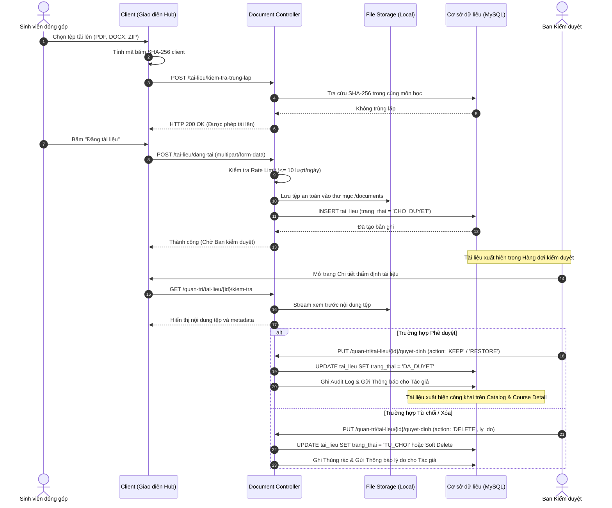
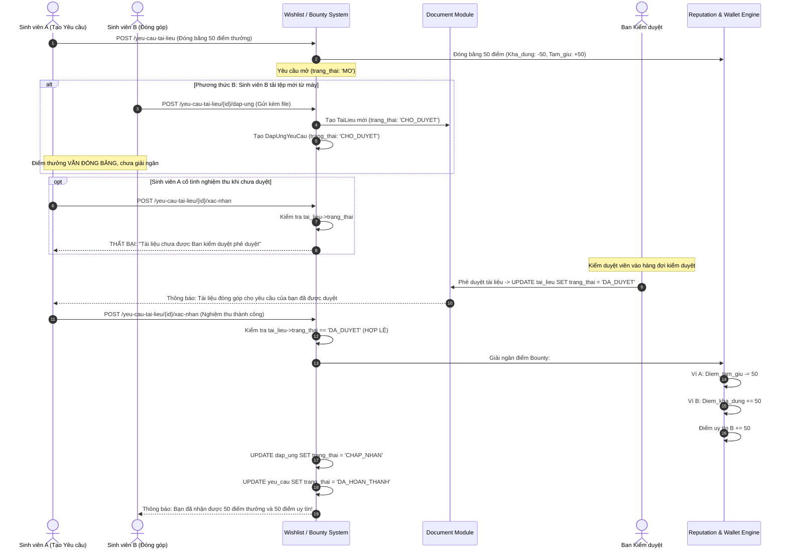
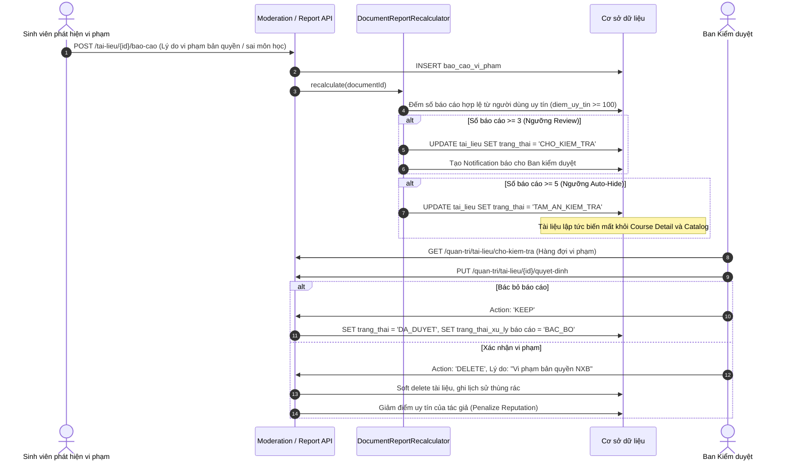

# TÀI LIỆU BÀN GIAO NGHIỆP VỤ KIỂM DUYỆT TÀI LIỆU (STUDENT / ALUMNI & MODERATION HANDOFF SPECIFICATION)

- **Dự án**: AGU Academic Hub
- **Phân hệ bàn giao**: Student / Alumni Integration & Course Detail Ecosystem (Phase 3A, 3B1, 3B2, 3B3, 3C)
- **Đối tượng tiếp nhận**: Thành viên phụ trách Module Moderation (Kiểm duyệt tài liệu, Xử lý vi phạm, Quản lý khiếu nại)
- **Ngày lập**: 07/11/2026
- **Trạng thái**: Hoàn thiện tích hợp phía Student/Alumni – Sẵn sàng kết nối giao diện Moderation

---

## 1. MỤC ĐÍCH VÀ BỐI CẢNH DỰ ÁN

Tài liệu này tổng hợp toàn bộ các quy tắc nghiệp vụ, luồng dữ liệu, trạng thái mô hình và các điểm chạm (`touchpoints`) liên quan đến kiểm duyệt tài liệu học thuật và đóng góp săn thưởng (`Bounty`), được hình thành qua các phân hệ:
1. **Academic Catalog & Course Detail (Phase 3A)**: Thông tin môn học, khoa, chuyên ngành.
2. **Course Document Listing (Phase 3B1)**: Danh sách tài liệu môn học, tìm kiếm, lọc, xem chi tiết, xem trước và tải xuống.
3. **Course Reviews & Community Voting (Phase 3B2)**: Đánh giá môn học đa tiêu chí, bình chọn hữu ích (Upvote/Downvote).
4. **Course Wishlist & Bounty Integration (Phase 3B3)**: Tạo yêu cầu tìm tài liệu, đóng băng điểm thưởng, nộp tài liệu giải quyết yêu cầu, giải ngân điểm thưởng.
5. **Document Contribution & Security Hardening (Phase 3C)**: Nộp tài liệu từ máy tính (Local upload), bảo mật tài liệu chưa duyệt (AUD-H01, AUD-H02), ngăn chặn giải ngân trên tài liệu chưa qua kiểm duyệt.

Tài liệu này được biên soạn nhằm giúp thành viên phụ trách **Module Moderation** nắm bắt trọn vẹn bức tranh tổng thể, các ràng buộc kỹ thuật đã được khóa (`scope lock`), các điều kiện tiền đề, và các câu hỏi mở cần giải quyết khi xây dựng giao diện và luồng xử lý của Kiểm duyệt viên.

---

## 2. KIẾN TRÚC MÔ HÌNH VÀ VÒNG ĐỜI DỮ LIỆU (STATE MACHINES)

### 2.1. Vòng đời Trạng thái Tài liệu (`tai_lieu.trang_thai`)

Mọi tệp tài liệu trong hệ thống AGU Academic Hub được quản lý bởi máy trạng thái (`State Machine`) nghiêm ngặt:

```
[Khởi tạo tải lên]
  │
  ├──> Đăng tải trực tiếp (Standard Upload) ──────> CHO_DUYET
  │                                                   │
  └──> Đóng góp giải quyết Bounty (Local Upload) ─────┘
                                                      │
                       ┌──────────────────────────────┴──────────────────────────────┐
                       ▼ (Kiểm duyệt viên duyệt)                                     ▼ (Kiểm duyệt viên từ chối)
                   DA_DUYET                                                       TU_CHOI
                       │                                                             │
        ┌──────────────┴──────────────┐                                       (Tác giả thấy lý do,
        ▼                             ▼                                        không hiển thị công khai)
 (Báo cáo vượt ngưỡng)         (Tác giả xóa mềm trong 24h & lượt tải = 0)
CHO_KIEM_TRA / TAM_AN_KIEM_TRA        │
        │                             ▼
        │                         XOA_MEM (Soft Delete)
        ▼                             │
(Hàng đợi xử lý vi phạm)               ▼
                                XOA_VINH_VIEN (Sau 30-60 ngày trong thùng rác)
```

| Mã trạng thái | Tên hiển thị | Mô tả nghiệp vụ | Phạm vi hiển thị & Quyền truy cập |
|---|---|---|---|
| `CHO_DUYET` | Chờ duyệt | Tài liệu vừa được tải lên từ sinh viên/cựu sinh viên (cả đăng trực tiếp lẫn nộp qua Bounty). Đang nằm trong hàng đợi kiểm duyệt ban đầu. | **Bảo mật tuyệt đối (AUD-H02)**: Chỉ Tác giả (`ma_nguoi_dang`), Quản trị viên (`QUAN_TRI_VIEN`), và Kiểm duyệt viên (`KIEM_DUYET_VIEN`) mới có quyền xem chi tiết, xem trước stream hoặc tải tệp. Người dùng khác nhận HTTP 403. Không xuất hiện trên Course Catalog. |
| `DA_DUYET` | Đã duyệt | Tài liệu đã được Ban kiểm duyệt kiểm tra và chấp thuận tính hợp lệ, không vi phạm bản quyền và quy chế học thuật. | Xuất hiện công khai trên Course Detail, tìm kiếm toàn hệ thống, người dùng có thể tải về, xem trước trực tuyến, và bình chọn. |
| `TU_CHOI` | Từ chối | Tài liệu không đạt yêu cầu kiểm duyệt (nội dung sai lệch, bản chụp mờ, tài liệu thương mại có bản quyền,...). | Tác giả thấy trạng thái và lý do từ chối. Bị ẩn hoàn toàn với sinh viên khác. |
| `CHO_KIEM_TRA` | Chờ kiểm tra | Tài liệu đã duyệt nhưng bị người dùng báo cáo vi phạm với số lượng đạt ngưỡng kiểm tra (`reviewThreshold`, mặc định: 3 báo cáo hợp lệ). | Vẫn tạm thời hiển thị công khai nhưng được ưu tiên đưa vào hàng đợi kiểm tra lại của Kiểm duyệt viên. |
| `TAM_AN_KIEM_TRA` | Tạm ẩn kiểm tra | Tài liệu bị báo cáo vi phạm đạt ngưỡng tạm ẩn (`autoHideThreshold`, mặc định: 5 báo cáo hợp lệ từ người dùng uy tín). | Tự động ẩn khỏi màn hình công khai cho đến khi Kiểm duyệt viên đưa ra phán quyết (`DecideDocumentReviewAction`). |
| `XOA_MEM` | Đã xóa mềm | Tài liệu bị tác giả xóa (chỉ được xóa trong 24 giờ đầu khi lượt tải = 0) hoặc bị Kiểm duyệt viên xóa do vi phạm quy định. | Chuyển vào Thùng rác (`lich_su_thung_rac`). Lưu trữ có thời hạn (30-60 ngày) trước khi Quản trị viên xóa vĩnh viễn. |

---

### 2.2. Vòng đời Trạng thái Yêu cầu Săn thưởng (`yeu_cau_tai_lieu.trang_thai`)

Yêu cầu tìm tài liệu (Wishlist/Bounty) liên kết chặt chẽ với số dư ví điểm (`vi_diem`):

```
Sinh viên tạo yêu cầu (Cọc tối thiểu 10 điểm)
              │
              ▼
             MO ─────────────────────────────┐ (Người tạo tự hủy yêu cầu)
              │                               ▼
              │ (Người tạo xác nhận       DA_HUY (Hoàn trả 100% điểm tạm giữ)
              │  nghiệm thu bài nộp)
              ▼
        DA_HOAN_THANH
  (Giải ngân điểm tạm giữ -> ví người đóng góp)
```

| Trạng thái Yêu cầu | Tác động ví điểm | Mô tả |
|---|---|---|
| `MO` | Trừ `diem_kha_dung`, cộng `diem_tam_giu` của Requester | Yêu cầu đang mở, hiển thị trên tab Wishlist của môn học. Cho phép thành viên nộp tài liệu phản hồi. |
| `DA_HOAN_THANH` | Trừ `diem_tam_giu` của Requester, cộng `diem_kha_dung` và cộng `diem_uy_tin` của Contributor | Đã có bài nộp được người tạo chấp nhận và giải ngân thành công. Không thể hủy hoặc nộp thêm. |
| `DA_HUY` | Hoàn trả: trừ `diem_tam_giu`, cộng lại `diem_kha_dung` của Requester | Người tạo tự hủy yêu cầu khi chưa nghiệm thu bài nộp nào. Toàn bộ điểm tạm giữ được hoàn trả ngay lập tức kèm bản ghi `GiaoDichDiem` loại `HOAN_TRA`. |

---

### 2.3. Vòng đời Trạng thái Bài nộp Săn thưởng (`dap_ung_yeu_cau_tai_lieu.trang_thai`)

```
Contributor nộp bài (Method A hoặc B)
                 │
                 ▼
             CHO_DUYET ──────────────────────┐
                 │                           │ (Người tạo chọn từ chối bài nộp)
                 │                           ▼
                 │                        TU_CHOI
                 ▼ (Người tạo xác nhận nghiệm thu - ĐIỀU KIỆN: tai_lieu.trang_thai == 'DA_DUYET')
             CHAP_NHAN
```

| Trạng thái Bài nộp | Ý nghĩa | Điều kiện chuyển trạng thái |
|---|---|---|
| `CHO_DUYET` | Đang chờ nghiệm thu | Mặc định khi bài nộp được tạo. Bài nộp chưa được nhận điểm thưởng. |
| `CHAP_NHAN` | Nghiệm thu thành công | Người tạo bấm "Xác nhận nhận tài liệu & Tặng thưởng". **Bắt buộc**: Tài liệu đính kèm phải có trạng thái `DA_DUYET` (được Ban kiểm duyệt duyệt trước). |
| `TU_CHOI` | Từ chối bài nộp | Người tạo từ chối bài nộp do tài liệu không đúng yêu cầu đề ra. Điểm thưởng của Requester không bị trừ. |

---

## 3. CÁC ĐIỂM CHẠM VÀ QUY TẮC NGHIỆP VỤ BẮT BUỘC GIỮA HAI PHÂN HỆ

### 3.1. Phương thức Đóng góp Tài liệu (Bounty Fulfillment Methods)
Người dùng Student/Alumni có hai phương thức để nộp tài liệu giải quyết yêu cầu tìm tài liệu:

#### Phương thức A: Chọn từ Kho tài liệu cá nhân (Personal Library)
- **Luồng hoạt động**: Người nộp chọn một tài liệu đã tải lên từ trước trong kho cá nhân của mình (`tai-lieu/cua-toi`).
- **Quy tắc nghiệm ngặt (AUD-H01)**:
  1. Tài liệu phải thuộc quyền sở hữu của chính người nộp: `$document->ma_nguoi_dang === $user->ma_nguoi_dung`.
  2. Tài liệu bắt buộc phải có trạng thái `DA_DUYET` (đã được Kiểm duyệt viên phê duyệt từ trước). Tài liệu đang `CHO_DUYET` hoặc `TU_CHOI` sẽ bị từ chối ngay lập tức.
  3. Tài liệu phải thuộc cùng môn học với yêu cầu: `$document->ma_mon_hoc === $yeuCau->ma_mon_hoc`.
  4. Không được tự nộp tài liệu vào yêu cầu của chính mình (`$user->ma_nguoi_dung !== $yeuCau->ma_nguoi_tao`).
  5. Không được nộp một tài liệu hai lần vào cùng một yêu cầu (Chống spam duplicate).

#### Phương thức B: Tải lên tệp mới trực tiếp từ máy (Local File Upload)
- **Luồng hoạt động**: Người nộp kéo thả hoặc chọn tệp từ máy tính ngay tại Modal nộp bài trên giao diện chi tiết môn học / yêu cầu tài liệu.
- **Quy tắc an toàn và kiểm soát spam**:
  1. **Hạn mức tải lên (Rate Limiting)**: Tối đa **10 lượt tải lên/ngày/tài khoản** (theo SRS 3.2.1).
  2. **Kiểm tra tính toàn vẹn (Integrity)**: Tệp không được rỗng (`size > 0 bytes`), định dạng cho phép: `.pdf, .docx, .pptx, .zip`, dung lượng tối đa 50MB.
  3. **Lọc trùng nhị phân 100% (Binary SHA-256 Deduplication)**:
     - Hệ thống tính mã băm SHA-256 của toàn bộ tệp nhị phân (`hash_file('sha256', ...)`).
     - Kiểm tra trong phạm vi môn học hiện tại. Nếu đã có tài liệu trùng mã băm SHA-256, từ chối tải lên và thông báo rõ tài liệu đã tồn tại.
  4. **Khởi tạo trạng thái**:
     - Bản ghi `TaiLieu` mới được tạo với trạng thái **`CHO_DUYET`**.
     - Bản ghi `DapUngYeuCauTaiLieu` được tạo với trạng thái **`CHO_DUYET`**.
  5. **Bảo vệ điểm thưởng**:
     - **Tuyệt đối không giải ngân điểm tại thời điểm tải lên.**
     - Tệp tải lên được lưu an toàn trên ổ đĩa nội bộ (`local disk` trong thư mục `documents/`).
     - Tài liệu được đẩy vào hàng đợi kiểm duyệt để Kiểm duyệt viên thẩm định trước khi Người tạo có thể bấm nghiệm thu.

---

### 3.2. Chốt chặn Bảo mật Nghiệm thu Giải ngân (AUD-H01 Security Lock)
- Tại `ConfirmBountyFulfillmentAction`:
  ```php
  // BẢO VỆ ĐIỂM THƯỞNG: Bắt buộc tài liệu phải DA_DUYET trước khi giải ngân
  if ($dapUng->taiLieu && $dapUng->taiLieu->trang_thai !== 'DA_DUYET' && $dapUng->taiLieu->trang_thai !== TrangThaiTaiLieu::DA_DUYET) {
      return [
          'success' => false,
          'message' => 'Tài liệu đóng góp này chưa được Ban kiểm duyệt phê duyệt, chưa thể xác nhận giải ngân điểm.',
      ];
  }
  ```
- **Ý nghĩa đối với Phân hệ Moderation**:
  - Khi Kiểm duyệt viên duyệt tài liệu (`trang_thai = DA_DUYET`), tài liệu này đồng thời được phép giải ngân trong Bounty.
  - Nếu Kiểm duyệt viên từ chối tài liệu (`trang_thai = TU_CHOI`), bài nộp không thể giải ngân, bảo vệ điểm thưởng của sinh viên tạo yêu cầu khỏi các nội dung rác hoặc lừa đảo điểm uy tín.

---

### 3.3. Bảo vệ Tài liệu Chưa Phê duyệt (AUD-H02 Protected Access)
- **Vấn đề**: Tài liệu `CHO_DUYET` chưa được kiểm tra về bản quyền, nội dung bạo lực, khiêu dâm, độc hại hoặc gian lận thi cử.
- **Cơ chế phân quyền đã thiết lập**:
  - `GET /tai-lieu/{id}` (`GetDocumentDetailQuery`): Kiểm tra quyền. Nếu không phải tác giả và không phải cán bộ (Admin/Mod) -> HTTP 403 Forbidden.
  - `GET /tai-lieu/{id}/xem-truoc` (`PreviewDocumentAction`): Chặn stream PDF -> HTTP 403 Forbidden.
  - `GET /tai-lieu/{id}/tai-ve` (`DownloadDocumentAction`): Chặn tải tệp đính kèm -> HTTP 403 Forbidden.
- **Ngoại lệ cho Kiểm duyệt viên và Quản trị viên**:
  - Kiểm duyệt viên (`laKiemDuyetVien() === true`) và Quản trị viên (`laQuanTriVien() === true`) **luôn có toàn quyền xem chi tiết, xem trước stream nội dung và tải file gốc** để phục vụ việc thẩm định nội dung trước khi ra quyết định.

---

### 3.4. Đánh giá Môn học & Bình chọn Cộng đồng (Course Reviews & Community Voting)
- Sinh viên và cựu sinh viên đánh giá môn học theo 5 tiêu chí: Điểm tổng quan (1-5 sao), Mức độ hữu ích, Độ khó đề thi, Tính ứng dụng thực tế, Phương pháp giảng dạy.
- **Cơ chế Community Voting**:
  - Người dùng có thể bấm `Upvote` (+1) hoặc `Downvote` (-1) cho từng bài đánh giá để xây dựng `diem_huu_ich`.
  - **Quy tắc độc lập**: Bình chọn cộng đồng của Review **chỉ thay đổi điểm cộng đồng của bài đánh giá, tuyệt đối không được cộng/trừ vào ví điểm (`vi_diem`) hay điểm uy tín (`diem_uy_tin`) của người viết review**.
- **Cơ chế Báo cáo vi phạm Review**:
  - Người dùng có thể báo cáo bài đánh giá có ngôn từ thù địch, xúc phạm giảng viên, hoặc thông tin sai lệch.
  - Báo cáo này cần được chuyển về hàng đợi kiểm duyệt để Kiểm duyệt viên xử lý ẩn bài đánh giá hoặc cảnh cáo tài khoản.

---

## 4. SƠ ĐỒ TUẦN TỰ NGHIỆP VỤ (MERMAID SEQUENCE DIAGRAMS)

### Sơ đồ 1: Luồng Đăng tải và Kiểm duyệt Tài liệu (Document Moderation Flow)



---

### Sơ đồ 2: Luồng Đóng góp Săn thưởng & Nghiệm thu Giải ngân (Bounty Moderation & Disbursement)



---

### Sơ đồ 3: Luồng Báo cáo Vi phạm & Tự động Tạm ẩn (Violation Report & Auto-Hide Flow)



---

## 5. MA TRẬN PHÂN QUYỀN TRÁCH NHIỆM (RACI MATRIX)

Ký hiệu:
- **R (Responsible)**: Người trực tiếp thực hiện hành động.
- **A (Accountable)**: Người chịu trách nhiệm phê duyệt cuối cùng và giải trình.
- **C (Consulted)**: Người được tham vấn, đóng góp ý kiến hoặc phản hồi.
- **I (Informed)**: Người nhận thông báo kết quả.

| Hoạt động / Nghiệp vụ | Sinh viên (`SINH_VIEN`) | Cựu sinh viên (`CUU_SINH_VIEN`) | Kiểm duyệt viên (`KIEM_DUYET_VIEN`) | Quản trị viên (`QUAN_TRI_VIEN`) |
|---|---|---|---|---|
| **Đăng tài liệu độc lập** | R | R | A | I |
| **Tải file mới qua Bounty (Method B)** | R | R | A | I |
| **Xem tài liệu đang chờ duyệt (`CHO_DUYET`)** | R (Chỉ tác giả) | R (Chỉ tác giả) | A / R | A / R |
| **Phê duyệt / Từ chối tài liệu mới** | - | - | **R / A** | **A** |
| **Tạo yêu cầu tìm tài liệu (Wishlist)** | R | R | - | I |
| **Hủy yêu cầu & Hoàn điểm tạm giữ** | R (Chỉ người tạo) | R (Chỉ người tạo) | - | A |
| **Nộp tài liệu săn thưởng (Method A)** | R | R | I | I |
| **Nghiệm thu giải ngân Bounty** | R (Chỉ người tạo) | R (Chỉ người tạo) | **A (Duyệt doc trước)** | A |
| **Báo cáo vi phạm tài liệu** | R | R | A | A |
| **Xử lý tài liệu trong Hàng đợi vi phạm** | I | I | **R / A** | **A** |
| **Khôi phục tài liệu từ Thùng rác** | - | - | R | **A** |
| **Xóa vĩnh viễn tài liệu khỏi đĩa cứng** | - | - | - | **R / A** |
| **Bình chọn Review (Upvote / Downvote)** | R | R | - | - |

---

## 6. BẢNG PHÂN ĐỊNH TRẠNG THÁI TRIỂN KHAI (IMPLEMENTATION STATUS TABLE)

| Hạng mục chức năng | Module phụ trách hiện tại | Trạng thái | Ghi chú & Điểm nối cho Moderation Member |
|---|---|---|---|
| Chặn lộ lọt tài liệu `CHO_DUYET` (AUD-H02) | Documents / Bounties | `[IMPLEMENTED]` | Đã có HTTP 403 cho người ngoài trong `GetDocumentDetailQuery`, `PreviewDocumentAction`, `DownloadDocumentAction`. |
| Chặn nộp tài liệu chưa duyệt / sai chủ sở hữu (AUD-H01) | Bounties | `[IMPLEMENTED]` | Đã kiểm tra trong `BountyRuleEvaluator::canFulfillWithDocument` và `FulfillBountyRequestAction`. |
| Chặn giải ngân khi tài liệu chưa `DA_DUYET` | Bounties | `[IMPLEMENTED]` | Đã kiểm tra trong `ConfirmBountyFulfillmentAction`. |
| Upload file mới từ máy tính vào Bounty (Method B) | Bounties / Documents | `[IMPLEMENTED]` | Lưu disk `local`, tạo `TaiLieu` (`CHO_DUYET`), dedup SHA-256, rate limit 10/ngày. |
| Modal Fulfill 2 tabs & tiền kiểm SHA-256 Web Crypto | Frontend (React) | `[IMPLEMENTED]` | Đã hoàn thiện trong `FulfillRequestModal.jsx`. |
| Hàng đợi duyệt tài liệu báo cáo vi phạm | Moderation | `[IMPLEMENTED]` | `GetReviewQueueQuery` và `DocumentModerationController`. |
| Xử lý quyết định vi phạm (`KEEP`, `RESTORE`, `HIDE`, `DELETE`) | Moderation | `[IMPLEMENTED]` | `DecideDocumentReviewAction` hoạt động với Audit Log. |
| **Hàng đợi duyệt tài liệu mới đăng (`CHO_DUYET`)** | **Moderation** | `[PARTIALLY IMPLEMENTED]` | Backend query hiện lọc `['CHO_KIEM_TRA', 'TAM_AN_KIEM_TRA']`. Cần mở rộng query để lấy cả danh sách tài liệu mới `CHO_DUYET`. |
| **Giao diện phân loại tài liệu Bounty vs Thường** | **Moderation** | `[REQUIRED / NOT IMPLEMENTED]` | Màn hình ReviewQueue cần hiển thị huy hiệu (Badge) phân biệt rõ: "Tài liệu đóng góp Bounty (Cần duyệt để giải ngân)" vs "Tài liệu đăng thông thường". |
| **Thông báo tự động khi Duyệt / Từ chối tài liệu Bounty** | **Moderation** | `[REQUIRED / NOT IMPLEMENTED]` | Khi Moderation duyệt một tài liệu thuộc bài nộp Bounty, cần bắn Notification cho Requester ("Tài liệu bạn cần đã được duyệt, hãy vào kiểm tra") và Contributor ("Tài liệu của bạn đã được duyệt"). |
| **Cơ chế nộp lại khi bị Từ chối kiểm duyệt** | **Moderation / Bounties** | `[REQUIRED / NOT IMPLEMENTED]` | Nếu Kiểm duyệt viên từ chối tài liệu nộp Bounty, cần cập nhật trạng thái `DapUngYeuCauTaiLieu` thành `TU_CHOI` và cho phép Contributor nộp file thay thế. |

---

## 7. CÂU HỎI MỞ VÀ ĐỀ XUẤT CHO THÀNH VIÊN MODERATION (OPEN QUESTIONS FOR MODERATION MEMBER)

Dưới đây là 7 vấn đề nghiệp vụ và thiết kế kiến trúc then chốt cần thành viên phụ trách Moderation làm rõ và đưa vào kịch bản hoàn thiện giao diện:

### 1. Tích hợp Hàng đợi Duyệt ban đầu (`Initial Review Queue`)
- **Hiện trạng**: Màn hình `admin.documents.review-queue` hiện chỉ truy vấn các tài liệu có `trang_thai IN ('CHO_KIEM_TRA', 'TAM_AN_KIEM_TRA')` (do bị báo cáo vi phạm). Các tài liệu mới tải lên (`CHO_DUYET`) chưa có tab hiển thị riêng trên giao diện Admin/Moderator.
- **Câu hỏi cho bạn**:
  - Bạn dự định gom chung vào 1 bảng có bộ lọc (Filter Tab: "Tài liệu mới chờ duyệt" | "Tài liệu bị báo cáo vi phạm"), hay tạo trang riêng `admin.documents.pending-approval`?
  - *Khuyến nghị*: Gom chung với Filter Tabs `status: all | pending | reported | auto_hidden` để Kiểm duyệt viên dễ dàng lọc trên cùng 1 trang.

### 2. Ưu tiên xử lý tài liệu Đóng góp Săn thưởng (Bounty Priority Tagging)
- **Vấn đề**: Tài liệu đóng góp Bounty có liên quan đến việc đóng băng điểm của sinh viên khác. Nếu tài liệu nằm chờ duyệt quá lâu, Requester sẽ sốt ruột và có thể hủy yêu cầu.
- **Câu hỏi cho bạn**:
  - Có nên hiển thị nhãn ưu tiên `[BOUNTY SUBMISSION - X ĐIỂM]` và sắp xếp lên đầu hàng đợi kiểm duyệt để xử lý nhanh hơn tài liệu thường không?

### 3. Xử lý đồng bộ khi Kiểm duyệt viên từ chối tài liệu nộp Bounty
- **Hiện trạng**: Khi Kiểm duyệt viên chọn `action = 'DELETE'` hoặc gán `TU_CHOI` cho `TaiLieu`:
- **Câu hỏi cho bạn**:
  - Bản ghi `dap_ung_yeu_cau_tai_lieu` tương ứng có tự động cập nhật sang `TU_CHOI` không?
  - Sinh viên đóng góp có được phép nộp lại file mới cho cùng một yêu cầu đó không?
  - *Khuyến nghị*: Khi từ chối `TaiLieu`, tự động set `dap_ung_yeu_cau_tai_lieu.trang_thai = 'TU_CHOI'`, gửi kèm lý do từ chối vào thông báo cho Contributor để họ sửa file và nộp lại bản khác.

### 4. Thời hạn kiểm duyệt tối đa và Cơ chế Tự động Hủy/Hoàn điểm (SLA Timeout)
- **Vấn đề**: Sinh viên A tạo Bounty 50 điểm. Sinh viên B nộp tài liệu vào ngày 1. Ban kiểm duyệt không xử lý trong suốt 14 ngày.
- **Câu hỏi cho bạn**:
  - Hệ thống có nên quy định SLA kiểm duyệt (ví dụ: tối đa 72 giờ)?
  - Nếu quá hạn mà chưa duyệt, Sinh viên A có quyền bấm "Rút lại cọc điểm / Hủy yêu cầu" không, hay phải chờ Moderator giải quyết xong?

### 5. Cơ chế Phê duyệt Tự động (Fast-Track / Auto-Approval) theo Điểm uy tín
- **Vấn đề**: Các sinh viên có điểm uy tín cao (ví dụ: `diem_uy_tin >= 200` hoặc Cựu sinh viên đã KYC thành công) khi đăng tài liệu có cần phải chờ duyệt thủ công từng file không?
- **Câu hỏi cho bạn**:
  - Có nên thiết lập cấu hình `moderation.auto_approve_min_reputation`: nếu tác giả có uy tín cao và file vượt qua kiểm tra hash/virus, tự động set `DA_DUYET` ngay lập tức; chỉ chuyển sang kiểm duyệt nếu có báo cáo vi phạm (hậu kiểm)?

### 6. Xử lý Thu hồi Điểm khi Tài liệu bị Xóa do Vi phạm Bản quyền sau khi Đã Giải ngân
- **Kịch bản**: Sinh viên B nộp tài liệu, được duyệt, Sinh viên A nghiệm thu và chuyển 50 điểm cho B. 1 tuần sau, tác giả gốc khiếu nại bản quyền, Kiểm duyệt viên xác minh đúng là vi phạm và xóa tài liệu.
- **Câu hỏi cho bạn**:
  - Có thu hồi (clawback) 50 điểm đã giải ngân từ ví của B không?
  - Nếu ví của B đã tiêu hết điểm thì số dư có được phép âm không, hay trừ vào điểm uy tín (`diem_uy_tin`) của B và khóa tài khoản?

### 7. Kiểm duyệt Bài đánh giá Môn học (Course Reviews)
- **Vấn đề**: Hiện tại Phase 3B2 đã hoàn thiện bình chọn Upvote/Downvote và báo cáo vi phạm review.
- **Câu hỏi cho bạn**:
  - Giao diện Moderation của bạn đã có màn hình quản lý các Báo cáo bài đánh giá (`Review Violation Queue`) tương tự như tài liệu chưa, hay mới chỉ làm cho tài liệu?
  - *Khuyến nghị*: Có thể tái sử dụng cấu trúc bảng `bao_cao_vi_pham` (hoặc mở rộng cột `loai_doi_tuong: TAI_LIEU | DANH_GIA`) để hiển thị chung trong cùng module Moderation.

---

## 8. TỔNG KẾT BÀN GIAO

Toàn bộ nền tảng dữ liệu, bảo mật, API và giao diện tương tác của nhóm người dùng `SINH_VIEN` và `CUU_SINH_VIEN` trong việc Đăng tải tài liệu, Nộp tài liệu Bounty, Đóng băng điểm, Chặn giải ngân khi chưa duyệt, và Bảo vệ tài liệu chờ duyệt đã được kiểm thử tự động **255/255 tests thành công (1,925 assertions)**.

Module Moderation hoàn toàn có thể an tâm kế thừa và mở rộng các Action/Query để hoàn thiện các màn hình quản trị dành cho Kiểm duyệt viên mà không lo xảy ra xung đột hay phá vỡ tính toàn vẹn dữ liệu của hệ sinh thái AGU Academic Hub.

