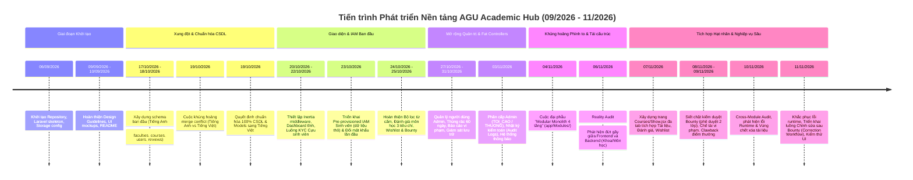

# LỊCH SỬ PHÁT TRIỂN & TIẾN TRÌNH KIẾN TRÚC DỰ ÁN AGU ACADEMIC HUB
**Vị trí:** `docs/knowledge/00_PROJECT_HISTORY.md`  
**Ngày lập:** 11/11/2026  
**Cương vị phân tích:** Senior Software Architect & Technical Historian  
**Phương pháp:** Tái dựng từ 55 tài liệu nội bộ, 75+ git commits và đối chiếu trực tiếp mã nguồn thực tế.

---

## 1. DÒNG THỜI GIAN PHÁT TRIỂN TỔNG THỂ (PROJECT TIMELINE)

---

## 2. CHI TIẾT CÁC GIAI ĐOẠN PHÁT TRIỂN & MỤC TIÊU (DEVELOPMENT PHASES)

### Phase 0: Khởi tạo Nền tảng & Đặc tả Ban đầu (06/09/2026 - 10/09/2026)
- **Mục tiêu:** Thiết lập cấu hình khung ứng dụng Laravel 11, Breeze, Vite, Tailwind CSS v4, và xác định bộ quy chuẩn giao diện của Trường Đại học An Giang.
- **Tài liệu nguồn:**
  - `README.md`
  - `.md/DESIGN_GUIDELINES.md`
  - `.md/TaiLieuYeuCau.md`
  - `.md/TaiLieuThietKe.md`
  - `.md/TaiLieuKyThuat.md`
- **Kết quả:**
  - Thiết lập bảng màu nhận diện thương hiệu AGU: Xanh dương chủ đạo (`#0284c7`), cam điểm nhấn (`#f97316`).
  - Đưa ra đặc tả ban đầu về 5 phân hệ: IAM, Document Management, Data Protection, Wishlist/Bounty, và Course Reviews.
- **Dấu mốc Git:** `ea367ee` (first commit), `05c67af` (initialize Laravel application), `6efcd75` (tài liệu font-end hoàn chỉnh).

---

### Phase 1: Xây dựng Schema & Cuộc khủng hoảng Xung đột Ngôn ngữ CSDL (17/10/2026 - 19/10/2026)
- **Mục tiêu:** Tạo dựng hệ cơ sở dữ liệu quan hệ, Eloquent Models, Factories và Seeders cho toàn bộ hệ thống.
- **Sự cố kiến trúc then chốt:**
  - Nhánh `feat/database-iam-reviews-bounty` xây dựng CSDL theo danh pháp Tiếng Anh (`faculties`, `courses`, `users`, `point_wallets`, `document_requests`).
  - Trong khi đó, nhánh `feature/set-up-migration` đã lập trình các bảng cốt lõi bằng Tiếng Việt (`khoa`, `mon_hoc`, `tai_lieu`, `bao_cao_vi_pham`) và giao diện React/Inertia đã gắn chặt với các trường tiếng Việt này.
  - Khi merge gây ra lỗi xung đột nghiêm trọng: khóa ngoại `tai_lieu.ma_nguoi_dang` trỏ tới `nguoi_dung(ma_nguoi_dung)` nhưng CSDL lại chỉ có bảng `users(id)`.
- **Quyết định kiến trúc lịch sử (19/10/2026):**
  - **Quyết định:** Chuẩn hóa toàn bộ Cơ sở dữ liệu, Models, Migrations và Enums sang **Tiếng Việt 100% không dấu** (snake_case cho bảng/cột, PascalCase cho Model).
  - Tách biệt hoàn toàn: Code kỹ thuật/framework viết Tiếng Anh (Action, Query, Controller, Repository, Service), còn Domain và CSDL viết Tiếng Việt (`NguoiDung`, `MonHoc`, `TaiLieu`, `ViDiem`, `YeuCauTaiLieu`, `DapUngYeuCauTaiLieu`).
- **Tài liệu nguồn:**
  - `.md/reportChange/BAO_CAO_CHUYEN_DOI_CSDL_TIENG_VIET.md`
  - `agu_academic_hub_schema/README.md`
- **Dấu mốc Git:** `294df09` (feat B1.1), `48a2389` (refactor CSDL sang tiếng Việt), `c33fd3a` (rename schema).

---

### Phase 2: Triển khai Nghiệp vụ Cốt lõi & Hội chứng "Fat Controllers" (20/10/2026 - 31/10/2026)
- **Mục tiêu:** Triển khai các tính năng người dùng: Đăng nhập/Đăng xuất, KYC Cựu sinh viên, Định danh sinh viên bằng dữ liệu thô, Đánh giá môn học, Đóng băng điểm Wishlist và các màn hình quản trị của Admin.
- **Tiến độ triển khai:**
  - **22/10/2026:** Hoàn thiện `KycController`, bảo mật phân vùng nhạy cảm `storage/app/private/kyc/` và cơ chế Signed URL xem trước ảnh minh chứng cựu sinh viên.
  - **23/10/2026:** Cài đặt luồng định danh Zero-KYC cho sinh viên đang học qua `danh_sach_sinh_vien_raw` và middleware `EnsurePasswordChanged`.
  - **23/10/2026:** Hoàn thiện `ProfanityFilterService` (bộ lọc từ cấm bẻ leetspeak) và `CourseReviewController` (đánh giá 3 tiêu chí, ẩn danh 2 lớp).
  - **25/10/2026:** Hoàn thiện `WishlistBountyController` và `ReputationService` quản lý biến động điểm khả dụng / tạm giữ.
  - **27/10 - 31/10/2026:** Phát triển hàng loạt màn hình Admin: Quản lý người dùng, Báo cáo vi phạm, Yêu cầu gỡ tài liệu cộng đồng, Thùng rác 60 ngày (`lich_su_thung_rac`), Giám sát dung lượng lưu trữ (`AdminStorageController`).
- **Vấn đề phát sinh (Code Smell & Tech Debt):**
  - **Hội chứng Fat Controllers:** Toàn bộ logic nghiệp vụ, giao dịch CSDL, xử lý tệp, và kiểm tra quyền bị nhồi nhét trực tiếp vào các Controller tại `app/Http/Controllers/` (nhiều controller dài 300 - 600 dòng).
  - **Phụ thuộc Driver CSDL:** Việc sử dụng các hàm SQL raw đặc thù của MySQL như `DATE_FORMAT()` khiến việc chạy kiểm thử tự động trên SQLite `:memory:` bị gãy đổ.
- **Tài liệu nguồn:**
  - `.md/reportChange/KYC_ALUMNI_WORKFLOW_REPORT.md`
  - `.md/reportChange/BaoCaoQuanTriTaiKhoanVaPhanQuyen.md`
  - `.md/reportChange/REPORT_VIOLATION_MODERATION.md`
  - `.md/reportChange/TASK-8-TRASH-MANAGEMENT-REPORT.md`
  - `.md/reportChange/BAO_CAO_TASK_6_TU_DONG_XU_LY_BAO_CAO_TAI_LIEU.md`
  - `.md/reportChange/BAO_CAO_TASK_7_YEU_CAU_GO_BO_TAI_LIEU_CONG_DONG.md`

---

### Phase 3: Đại phẫu Kiến trúc — Tái Cấu Trúc Modular Monolith 4 Tầng (03/11/2026 - 04/11/2026)
- **Mục tiêu:** Giải quyết triệt để vấn đề Fat Controllers và phân tán logic nghiệp vụ, tái thiết kế hệ thống theo mô hình **Modular Monolith 4 tầng** (`Domain`, `Infrastructure`, `Application`, `Presentation`).
- **Nội dung thực hiện:**
  - Tách hệ thống thành 7 Bounded Contexts độc lập trong `app/Modules/`:
    1. `AcademicCatalog`
    2. `Administration`
    3. `Identity`
    4. `Documents`
    5. `Moderation`
    6. `Reviews`
    7. `Bounties`
  - Xóa bỏ toàn bộ các Fat Controllers cũ tại `app/Http/Controllers/`. Controller mới trở thành "Skinny Controller" (30 - 70 dòng), chỉ nhận request, gọi Action/Query và trả về Inertia/JSON.
  - Tách biệt triệt để:
    - **Actions:** Thực thi các tác vụ thay đổi trạng thái (Ghi DB, Transaction, Event Dispatch).
    - **Queries:** Thực thi các tác vụ đọc dữ liệu (Read-only, Cache, Pagination).
    - **Evaluators / Domain Services:** Xử lý quy tắc nghiệp vụ thuần túy (Rule validation, Phạt điểm, Lọc từ cấm, Idempotency).
    - **Repositories:** Truy vấn CSDL, tương thích cả MySQL và SQLite.
- **Nguyên tắc bảo toàn (Strict Invariants):**
  - Giữ nguyên 100% routes, URL và method.
  - Giữ nguyên 100% props truyền xuống React Inertia.
  - Đạt tỷ lệ kiểm thử thành công 100%.
- **Tài liệu nguồn:**
  - `.md/reportChange/BAO_CAO_TAI_CAU_TRUC_MODULAR_MONOLITH.md`
  - `app/Modules/README.md`
- **Dấu mốc Git:** `4d4b827`, `1fdf798`, `e3ca96c`, `48fc53e`.

---

### Phase 4: Reality Audit & Cuộc khủng hoảng Đứt Gãy Frontend - Backend (06/11/2026)
- **Bối cảnh:** Sau đợt tái cấu trúc backend, bộ kiểm thử backend đạt 171/171 passed. Tuy nhiên, khi một nhóm kiểm toán độc lập tiến hành rà soát luồng thực thi từ giao diện người dùng, họ phát hiện ra một sự thật chấn động.
- **Những phát hiện nghiêm trọng (Reality Gaps):**
  - **Kho môn học bị "nuốt chửng":** Người dùng truy cập route `/mon-hoc` ("Kho môn học") lại bị điều hướng render `Documents/Index.jsx` (chỉ hiển thị tài liệu). Prop `courses` gửi từ backend bị frontend bỏ qua hoàn toàn. Sinh viên không có cách nào xem danh sách môn học hay tìm kiếm môn học.
  - **Thiếu trang chi tiết môn học:** Không tồn tại trang `Courses/Show.jsx`. Khi click vào một môn học, hệ thống lại trỏ về danh sách tài liệu. Ba phân hệ Môn học, Đánh giá và Wishlist bị chia cắt rời rạc, không có điểm hội tụ.
  - **Mất liên kết tham số Khoa:** Trên thẻ Khoa (`Faculties/Index.jsx`), nút "Xem môn học" trỏ về `route('courses.index')` mà không truyền tham số `ma_khoa`.
  - **Tìm kiếm rỗng:** Thanh tìm kiếm tài liệu ghi "Tìm theo tên môn, mã học phần" nhưng repository backend chỉ tìm theo cột `tieu_de` của tài liệu (`where('tieu_de', 'like', ...)`).
- **Tài liệu nguồn:**
  - `docs/audits/REALITY_AUDIT_REPORT.md`
  - `docs/audits/FEATURE_GAP_MATRIX.md`
  - `docs/audits/REVISED_IMPLEMENTATION_PLAN.md`
- **Dấu mốc Git:** `4131a0d` (Phân tích và rà soát module).

---

### Phase 5: Tái Sinh Phân Hệ Sinh Viên — Xây Dựng Trang Hạt Nhân Courses/Show (06/11/2026 - 07/11/2026)
- **Mục tiêu:** Khắc phục toàn bộ các lỗi đứt gãy phát hiện trong Reality Audit; đưa trang Chi tiết Môn học (`Courses/Show.jsx`) trở thành trung tâm kết nối 3 phân hệ học thuật.
- **Tiến trình triển khai:**
  - **Phase 1 (Course Catalog):** Xây dựng `Courses/Index.jsx`, sửa bộ lọc khoa, bổ sung tìm kiếm theo mã môn học và tên môn (`PHASE_1_COURSE_CATALOG_RESULT.md`).
  - **Phase 2 (Dashboard):** Sửa các liên kết tắt, hiển thị khối tài liệu mới cập nhật (`PHASE_2_DASHBOARD_RESULT.md`).
  - **Phase 3A (Course Detail Skeleton):** Tạo khung trang `Courses/Show.jsx` tiếp nhận thông tin môn học, tín chỉ, mô tả đề cương (`PHASE_3A_COURSE_DETAIL_RESULT.md`).
  - **Phase 3B1 (Documents Tab):** Tích hợp kho tài liệu môn học, bộ lọc phân loại đề thi/bài giảng, download, preview PDF (`PHASE_3B1_DOCUMENT_LISTING_RESULT.md`).
  - **Phase 3B2 (Reviews Tab):** Tích hợp hệ thống đánh giá 3 tiêu chí, modal gửi đánh giá có kiểm tra từ cấm realtime, bình chọn Up/Downvote hữu ích (`PHASE_3B2_COURSE_REVIEWS_RESULT.md`).
  - **Phase 3B3 (Wishlist & Bounty Tab):** Tích hợp danh sách yêu cầu tài liệu theo môn, modal tạo yêu cầu cọc điểm Bounty (`PHASE_3B3_COURSE_WISHLIST_RESULT.md`).
  - **Phase 3C (Document Contribution & Payout):** Hoàn thiện luồng nộp tài liệu giải quyết Bounty (chọn file có sẵn hoặc upload file mới từ máy) (`PHASE_3C_DOCUMENT_CONTRIBUTION_IMPLEMENTATION.md`).
- **Tài liệu nguồn:**
  - `docs/audits/COURSE_DETAIL_INTEGRATION_AUDIT.md`
- **Dấu mốc Git:** `a16c81b`, `e285a88`, `785a449`.

---

### Phase 6: Nâng Cấp Bảo Mật, Siết Chặt Phê Duyệt Bounty & Thu Hồi Điểm (08/11/2026 - 09/11/2026)
- **Bối cảnh & Nguy cơ phát hiện:**
  - Khi sinh viên yêu cầu (SV A) bấm "Xác nhận" tài liệu do người khác (SV B) nộp, nếu hệ thống lập tức giải ngân điểm thưởng ngay mà không có sự kiểm soát của nhà trường, sẽ nảy sinh nguy cơ:
    1. **Thông đồng cày điểm:** Hai tài khoản cấu kết đăng yêu cầu và nộp tài liệu rác để rút/chuyển điểm thưởng.
    2. **Tài liệu độc hại / Sai bản quyền:** Tài liệu chưa qua kiểm duyệt nội dung đã được nhận thưởng.
- **Giải pháp triển khai:**
  - **Phê duyệt 2 bước đối với Bounty:**
    - Bước 1: Người tạo yêu cầu (SV A) nghiệm thu chất lượng tài liệu $\to$ Trạng thái chuyển sang `CHO_GIAI_NGAN`. **Chưa giải ngân điểm!**
    - Bước 2: Đưa vào "Hàng đợi Phê duyệt Giải ngân" (`admin.bounties.payout-queue`). Cán bộ Kiểm duyệt viên hoặc Admin thẩm định lần cuối $\to$ Thực hiện giải ngân qua `ApproveBountyPayoutAction`.
  - **Quy trình Thu hồi điểm thưởng (Bounty Clawback):**
    - Nếu tài liệu đã giải ngân Bounty sau đó bị phát hiện vi phạm bản quyền và bị gỡ bỏ, hệ thống tự động:
      1. Khấu trừ điểm khả dụng của người nộp (không để âm ví nhờ DB constraint).
      2. Hoàn trả điểm về cho sinh viên yêu cầu ban đầu.
      3. Ghi sổ cái `GiaoDichDiem` loại `HOAN_TRA` và trừ điểm uy tín học thuật.
  - **Hàng đợi Phê duyệt Tài liệu Mới (Method B):**
    - Tài liệu nộp từ máy tính được đưa vào hàng đợi `CHO_DUYET`. Moderator duyệt xong thì Requester mới được xác nhận.
- **Tài liệu nguồn:**
  - `docs/integration/ADMIN_MODERATOR_INTEGRATION_SPECIFICATION.md`
  - `docs/integration/STUDENT_ALUMNI_MODERATION_HANDOFF.md`
- **Dấu mốc Git:** `be6cbe9`, `3940b87`, `c9cb98b`, `2d0c996`, `984c271`.

---

### Phase 7: Cross-Module Audit, Chuẩn hóa Thông báo & Sửa Lỗi Tích hợp (10/11/2026)
- **Mục tiêu:** Kiểm toán độc lập ranh giới liên module giữa nhánh Student/Alumni và nhánh Admin/Moderator.
- **Các phát hiện và quyết định then chốt:**
  - **Lỗi Fatal Runtime:** Phát hiện thiếu `use UserViolationPenaltyEvaluator` trong `DecideDocumentReviewAction.php` làm tê liệt hàng loạt test kiểm duyệt vi phạm.
  - **Vùng chết xóa tài liệu (Deadlock Zone):** Phát hiện tác giả không thể xóa hay xin gỡ tài liệu nếu số lượt tải từ 1 đến 9 hoặc quá 24 giờ mà 0 tải.
  - **Đồng bộ bảng thông báo sang tiếng Việt:** Đổi các cột bảng `notifications` sang tiếng Việt đồng bộ (`du_lieu`, `nguoi_nhan_id`, `da_doc_luc`).
- **Tài liệu nguồn:**
  - `docs/audits/cross_module/CROSS_MODULE_AUDIT_SUMMARY.md`
  - `docs/audits/cross_module/INTEGRATION_GAP_ANALYSIS.md`
  - `docs/audits/cross_module/CROSS_MODULE_DECISIONS_REQUIRED.md`
- **Dấu mốc Git:** `7946774`, `c8c9b3b`, `7dde66f`, `e86bc9d`.

---

### Phase 8: Nghiệp vụ Chỉnh Sửa Sau Hoàn Thành Bounty & Kiểm Thử UI Thực Tế (11/11/2026 - Hiện tại)
- **Mục tiêu:** Hoàn thiện vòng đời Bounty với tính năng Chỉnh sửa & Bổ sung tài liệu sau khi hoàn thành (Correction Workflow); kiểm thử giao diện trực tiếp trên trình duyệt.
- **Các thành phần được triển khai và kiểm chứng:**
  - Migration tạo 2 bảng mới: `yeu_cau_chinh_sua_dong_gop` và `lan_nop_tai_lieu_thay_the`.
  - Triển khai đầy đủ bộ 5 Actions:
    1. `CreateCorrectionRequestAction`
    2. `RespondCorrectionRequestAction`
    3. `SubmitReplacementDocumentAction`
    4. `ConfirmCorrectionCompletionAction`
    5. `RejectBountyFulfillmentAction`
  - Bộ kiểm thử tự động toàn diện: `tests/Feature/PostBountyCorrectionWorkflowTest.php` (6/6 tests passed).
  - Kiểm thử giao diện người dùng trực tiếp trên trình duyệt Chromium (`AGU_ACADEMIC_HUB_UI_TEST_REPORT.md`): Đạt 20/24 kịch bản PASS (83.3%), 0 kịch bản FAIL.
- **Tài liệu nguồn:**
  - `docs/student-alumni-bounty-analysis.md`
  - `docs/student-alumni-bounty-design.md`
  - `docs/student-alumni-bounty-implementation-report.md`
  - `docs/audits/AGU_ACADEMIC_HUB_UI_TEST_REPORT.md`
- **Dấu mốc Git:** `c32db49` (implement student and alumni bounty wishlist and correction workflow).

---

## 3. DANH MỤC QUYẾT ĐỊNH KIẾN TRÚC & TÌNH TRẠNG HIỆU LỰC

| STT | Quyết định Kiến trúc | Thời điểm | Tài liệu nguồn | Trạng thái hiện tại | Lý do / Tác động |
|:---:|:---|:---:|:---|:---:|:---|
| **AD-01** | **Chuyển đổi toàn bộ CSDL sang Tiếng Việt** | 19/10/2026 | `BAO_CAO_CHUYEN_DOI_CSDL_TIENG_VIET.md` | **CÒN HIỆU LỰC** | Thống nhất dữ liệu, chấm dứt xung đột giữa 2 nhánh phát triển. CSDL, Models, Enums thuần Việt. |
| **AD-02** | **Sử dụng Kiến trúc Monolith Inertia.js thay vì REST API riêng biệt** | 20/10/2026 | `BAO_CAO_TAI_CAU_TRUC_MODULAR_MONOLITH.md` | **CÒN HIỆU LỰC** *(Thay thế đặc tả cũ)* | Thay thế thiết kế ban đầu tại `TaiLieuKyThuat.md` (vốn định nghĩa `/api/v1` với Bearer Token). Inertia.js giúp chia sẻ props trực tiếp, không cần duy trì 2 codebases riêng. |
| **AD-03** | **Zero-KYC cho Sinh viên đang học (Pre-provisioned IAM)** | 23/10/2026 | `TaiLieuYeuCau.md`, `ADMIN_MODERATOR_INTEGRATION_SPECIFICATION.md` | **CÒN HIỆU LỰC** | Sinh viên nạp trước từ `danh_sach_sinh_vien_raw`, chỉ đổi mật khẩu lần đầu để kích hoạt. Tuyệt đối không nộp ảnh thẻ, không qua hàng đợi KYC thủ công. |
| **AD-04** | **Bảo vệ PII Cựu sinh viên qua Private Storage & Signed URL** | 22/10/2026 | `KYC_ALUMNI_WORKFLOW_REPORT.md` | **CÒN HIỆU LỰC** | Minh chứng tốt nghiệp lưu tại `storage/app/private/kyc/`, không tạo symlink public, chỉ xem qua URL chữ ký số thời hạn 30 phút. |
| **AD-05** | **Tái cấu trúc Modular Monolith 4 tầng** | 04/11/2026 | `BAO_CAO_TAI_CAU_TRUC_MODULAR_MONOLITH.md` | **CÒN HIỆU LỰC** | Xóa bỏ Fat Controllers, chia 7 module Bounded Context, phân định nghiêm ngặt Action/Query/Domain/Repository. |
| **AD-06** | **Trang Hạt nhân Tích hợp Đa Tab `Courses/Show.jsx`** | 07/11/2026 | `COURSE_DETAIL_INTEGRATION_AUDIT.md` | **CÒN HIỆU LỰC** | Khắc phục sự phân tán giữa Tài liệu, Đánh giá và Săn thưởng theo từng môn học. |
| **AD-07** | **Quy trình Phê duyệt Bounty 2 bước & Khóa Payout Hàng đợi** | 08/11/2026 | `ADMIN_MODERATOR_INTEGRATION_SPECIFICATION.md` | **CÒN HIỆU LỰC** *(Thay thế cơ chế tự động cũ)* | Ngăn chặn gian lận cày điểm và phát tán tài liệu rác; bổ sung bước Admin/Mod duyệt giải ngân. |
| **AD-08** | **Cơ chế Thu hồi Điểm (Bounty Clawback)** | 09/11/2026 | `ADMIN_MODERATOR_INTEGRATION_SPECIFICATION.md` | **CÒN HIỆU LỰC** | Tự động đòi lại điểm khi tài liệu giải quyết Bounty bị gỡ do vi phạm bản quyền. |
| **AD-09** | **Quy trình Chỉnh sửa & Bổ sung sau Hoàn thành Bounty** | 10/11/2026 | `student-alumni-bounty-design.md` | **CÒN HIỆU LỰC** | Cho phép người tạo yêu cầu nộp bản sửa lỗi/bổ sung mà không phát sinh thêm chi phí điểm thưởng. |
| **AD-10** | **Đặc tả REST API `/api/v1` dùng Bearer Token** | 10/09/2026 | `.md/TaiLieuKyThuat.md` | **ĐÃ BỊ THAY THẾ** | Đã được thay thế hoàn toàn bằng kiến trúc Inertia.js web routes, session cookies và CSRF token. |
| **AD-11** | **Sinh viên đang học nộp ảnh thẻ duyệt KYC** | 10/09/2026 | `.md/TaiLieuYeuCau.md (bản thảo sơ khởi)` | **ĐÃ BỊ HỦY BỎ** | Đã bị hủy bỏ và thay thế bằng cơ chế nạp trước dữ liệu thô (Pre-provisioning). |
| **AD-12** | **Giải ngân Bounty tự động ngay khi Người yêu cầu bấm xác nhận** | 25/10/2026 | `.md/reportChange/BAO_CAO_TAI_CAU_TRUC_MODULAR_MONOLITH.md` | **ĐÃ BỊ THAY THẾ** | Thay thế bằng quy trình 2 bước có bước duyệt của Ban Quản trị (`CHO_GIAI_NGAN`). |

---

## 4. TỔNG HỢP CÁC CHỨC NĂNG CHƯA TRIỂN KHAI HOẶC THIẾU BẰNG CHỨNG (GAPS & UNVERIFIED)

1. **Bộ lọc tương đồng nội dung SimHash / Cosine Similarity (Lớp 2):**
   - *Tình trạng:* `DESIGNED ONLY / PROPOSED`.
   - *Chi tiết:* Tài liệu `.md/TaiLieuYeuCau.md` và `TaiLieuKyThuat.md` đề xuất bóc tách text bỏ trang bìa và tính SimHash >85% trong Background Queue. Tuy nhiên, mã nguồn hiện tại chỉ triển khai **Lớp 1: Băm nhị phân SHA-256 chống trùng lặp 100%** (`DocumentDeduplicationEvaluator.php`). Chưa có worker bóc tách text hay thư viện tính khoảng cách Hamming của SimHash.
2. **Cơ chế Tự động Hết hạn Yêu cầu Bounty (Automatic Expiration & Point Refund):**
   - *Tình trạng:* `PROPOSED`.
   - *Chi tiết:* Hiện tại yêu cầu Bounty chỉ chuyển sang đóng hoặc hủy khi có thao tác chủ động của người tạo (`CancelBountyRequestAction`). Chưa có Scheduled Console Command (`artisan schedule:run`) để tự động quét các yêu cầu quá 30 ngày không có bài nộp để tự hủy và hoàn cọc.
3. **Giải quyết "Vùng chết xóa tài liệu" (Deadlock Zone của tác giả):**
   - *Tình trạng:* `NEEDS DECISION / NOT FULLY RESOLVED`.
   - *Chi tiết:* Tài liệu đã có lượt tải từ 1 đến 9 hiện vẫn bị kẹt: tác giả không thể tự xóa (vì có tải) và cũng không thể gửi đơn xin gỡ (vì chưa đạt mốc 10 tải của quyền sở hữu cộng đồng). Cần nới lỏng điều kiện `DocumentAuthorRemovalEvaluator::canRequestRemoval()` cho phép gửi đơn khi `luot_tai > 0`.
4. **Hệ thống WebSocket Realtime (Laravel Reverb / Pusher):**
   - *Tình trạng:* `PARTIALLY IMPLEMENTED (Database Polling Fallback)`.
   - *Chi tiết:* Hệ thống đã tạo bảng `notifications` tiếng Việt, có chuông thông báo hiển thị badge trên header, nhưng việc cập nhật thông báo đang dựa vào HTTP request hoặc reload trang thay vì broadcast sự kiện qua WebSocket thời gian thực.

