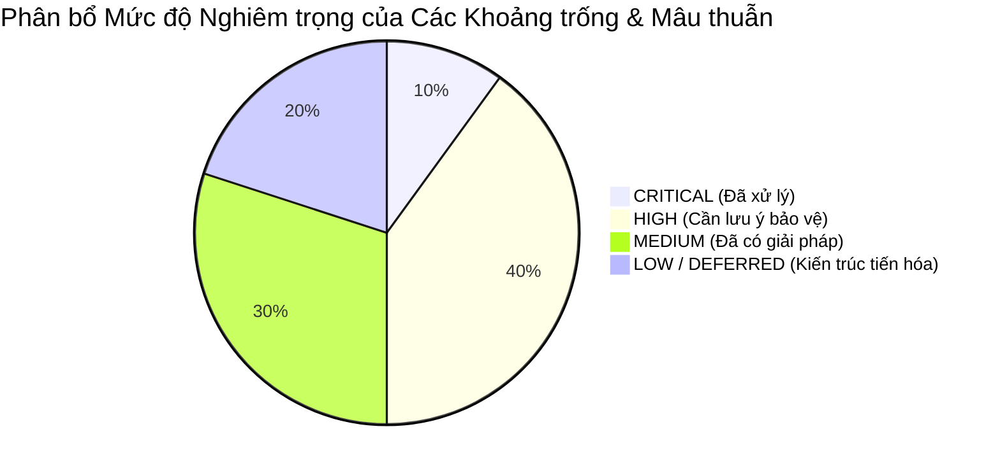

# BÁO CÁO TOÀN DIỆN VỀ MÂU THUẪN, KHOẢNG TRỐNG VÀ BẤT ĐỒNG BỘ TRONG DỰ ÁN
## PROJECT CONFLICTS, ARCHITECTURAL GAPS & TECHNICAL DISCREPANCIES
**Vị trí:** `docs/knowledge/02_PROJECT_CONFLICTS_AND_GAPS.md`  
**Ngày lập:** 11/11/2026  
**Cương vị đánh giá:** Senior Software Architect & Quality Auditor  
**Nguyên tắc:** Ghi nhận trung thực, đối soát trực tiếp giữa tài liệu thiết kế ban đầu, các báo cáo kiểm toán và hiện trạng mã nguồn thực tế. Không che giấu lỗi kỹ thuật.

---

## 1. TỔNG HỢP DANH MỤC MÂU THUẪN & KHOẢNG TRỐNG



| Mã số | Tên mâu thuẫn / Khoảng trống | Phân hệ liên quan | Mức độ nghiêm trọng | Trạng thái hiện tại |
|:---:|:---|:---|:---:|:---:|
| **GAP-01** | Lệch chuẩn Kiến trúc: Đặc tả REST API `/api/v1` vs Hiện trạng Inertia.js Monolith | Toàn hệ thống | **HIGH** | Đã chuyển đổi sang Inertia, tài liệu cũ chưa cập nhật |
| **GAP-02** | Xung đột Schema CSDL: Danh pháp Tiếng Anh vs Chuẩn hóa Tiếng Việt 100% | Database / Models | **HIGH** | Đã giải quyết triệt để từ 19/10/2026 |
| **GAP-03** | Vùng chết nghiệp vụ xóa tài liệu của tác giả (Author Removal Deadlock Zone) | Documents Module | **HIGH** | Đang tồn tại trong mã nguồn, cần bảo vệ đồ án |
| **GAP-04** | Vi phạm ranh giới Module: Admin Bounty Payout đặt trong Bounties Module | Bounties / Moderation | **MEDIUM** | Code hoạt động tốt nhưng lệch chuẩn DDD |
| **GAP-05** | Phân mảnh kiến trúc Thông báo (Dual Notification Architecture) | Notifications | **HIGH** | Đã khắc phục một phần, còn sót một số thông báo thô |
| **GAP-06** | Khoảng trống Lọc tương đồng văn bản: SimHash / Cosine Similarity chưa triển khai | Documents Module | **MEDIUM** | Mới chỉ có SHA-256 Lớp 1, SimHash là DESIGNED ONLY |
| **GAP-07** | Tiến trình phê duyệt Bounty: Tự động giải ngân vs Duyệt 2 bước qua Admin/Mod | Bounties / Moderation | **HIGH** | Đã nâng cấp lên 2 bước để chống cày điểm gian lận |
| **GAP-08** | Thiếu tiến trình tự động hết hạn và hoàn cọc cho Bounty quá hạn | Bounties Module | **LOW** | Chưa có Scheduled Command chạy nền |
| **GAP-09** | Xung đột tham số phân trang `page` giữa 3 tab trên trang chi tiết môn học | AcademicCatalog / UI | **LOW** | Đang dùng chung query string `page` |
| **GAP-10** | Lỗi Fatal Runtime trong `DecideDocumentReviewAction` do thiếu lệnh import | Moderation Module | **CRITICAL** | **ĐÃ KHẮC PHỤC HOÀN TOÀN** tại commit `c32db49` |

---

## 2. PHÂN TÍCH CHI TIẾT TỪNG VẤN ĐỀ

---

### GAP-01: Lệch chuẩn Kiến trúc giữa Đặc tả REST API `/api/v1` và Hiện trạng Inertia.js Monolith
1. **Vấn đề:** Tài liệu kỹ thuật ban đầu đặc tả hệ thống giao tiếp qua RESTful API chuẩn (`/api/v1/...`) với xác thực Bearer Token (`personal_access_tokens`), nhưng toàn bộ mã nguồn thực tế lại được xây dựng dưới dạng Modular Monolith sử dụng Inertia.js (React) chạy trên nền Web Session và CSRF Cookies.
2. **Tài liệu liên quan:**
   - `.md/TaiLieuKyThuat.md` (Đặc tả chi tiết các endpoint `/api/v1/auth/...`, `/api/v1/documents/...` kèm Header `Authorization: Bearer <token>`).
   - `.md/reportChange/BAO_CAO_TAI_CAU_TRUC_MODULAR_MONOLITH.md`.
3. **Mã nguồn liên quan:**
   - `routes/web.php` và các file `routes.php` trong từng module `app/Modules/*/routes.php`.
   - Các Controllers đều trả về `Inertia::render(...)` hoặc `redirect()->back()`.
   - File `routes/api.php` hoàn toàn không tồn tại trong dự án Laravel 11 này.
4. **Bằng chứng cụ thể:**
   - Tại `bootstrap/app.php:10-14`: Hệ thống chỉ đăng ký web routes (`web: __DIR__ . '/../routes/web.php'`), hoàn toàn không cấu hình `api: __DIR__ . '/../routes/api.php'`.
   - Bảng `personal_access_tokens` có migration (`2026_10_14_000010_create_personal_access_tokens_table.php`) nhưng không có token nào được sinh ra hay sử dụng trong luồng người dùng.
5. **Tác động:** Người đọc tài liệu `TaiLieuKyThuat.md` sẽ bị hiểu lầm rằng dự án là Single Page Application tách rời Backend API, gây khó khăn cho việc tra cứu code và trả lời hội đồng.
6. **Mức độ nghiêm trọng:** **HIGH** (Lệch tài liệu đặc tả cốt lõi).
7. **Đề xuất xử lý:**
   - Đánh dấu trạng thái của `TaiLieuKyThuat.md` là `DEPRECATED INITIAL DRAFT`.
   - Khi bảo vệ đồ án, giải thích rõ: Dự án đã chuyển dịch từ mô hình REST API sang Inertia.js Monolith nhằm giảm thiểu độ trễ, loại bỏ chi phí duy trì 2 bộ schema/DTO riêng biệt, và tận dụng tối đa cơ chế SSR/Hydration và Form Handling của Laravel 11.
8. **Quyết định cuối cùng:** Hệ thống vận hành 100% trên nền tảng **Inertia.js React Web Routes**.

---

### GAP-02: Xung đột Schema CSDL giữa Danh pháp Tiếng Anh và Tiếng Việt
1. **Vấn đề:** Ban đầu tồn tại thư mục `agu_academic_hub_schema` định nghĩa CSDL bằng tiếng Anh (`faculties`, `courses`, `users`, `course_reviews`), xung đột với nhánh giao diện frontend sử dụng tiếng Việt (`khoa`, `mon_hoc`, `tai_lieu`, `nguoi_dung`).
2. **Tài liệu liên quan:**
   - `agu_academic_hub_schema/README.md`
   - `.md/reportChange/BAO_CAO_CHUYEN_DOI_CSDL_TIENG_VIET.md`
3. **Mã nguồn liên quan:**
   - `database/migrations/2026_10_13_072836_create_khoa_table.php`
   - `database/migrations/2026_10_13_072837_create_nguoi_dung_table.php`
   - Toàn bộ các Models trong `app/Models/` (`Khoa.php`, `NguoiDung.php`, `MonHoc.php`, `TaiLieu.php`, `ViDiem.php`).
4. **Bằng chứng cụ thể:**
   - Báo cáo ngày 19/10/2026 (`BAO_CAO_CHUYEN_DOI_CSDL_TIENG_VIET.md`) ghi nhận xung đột foreign key constraint khi `tai_lieu` tham chiếu tới `nguoi_dung` nhưng database chỉ có bảng `users`.
5. **Tác động:** Đã từng gây tê liệt lệnh `php artisan migrate:fresh` trong giai đoạn đầu tháng 10/2026.
6. **Mức độ nghiêm trọng:** **HIGH** (Đã giải quyết).
7. **Đề xuất xử lý:** Giữ nguyên trạng thái CSDL tiếng Việt hiện hành vì toàn bộ 25+ migrations và 200+ unit/feature tests đã được chuẩn hóa đồng bộ.
8. **Quyết định cuối cùng:** Toàn bộ bảng, cột, Models và Enums sử dụng **Tiếng Việt 100% không dấu**. Mã nguồn tầng Framework (Controllers, Actions, Repositories) sử dụng Tiếng Anh. Thư mục `agu_academic_hub_schema` được lưu giữ như một bản ghi lịch sử (Historical Artifact).

---

### GAP-03: "Vùng chết nghiệp vụ" (Deadlock Zone) trong Quy trình Xóa Tài liệu của Tác giả
1. **Vấn đề:** Xuất hiện một khoảng trống logic khiến tác giả không thể tự xóa và cũng không thể gửi đơn xin gỡ tài liệu của chính mình.
2. **Tài liệu liên quan:**
   - `.md/TaiLieuYeuCau.md:89` (Quy định: tự xóa trong 24h & 0 tải; >=10 tải trở thành sở hữu cộng đồng).
   - `docs/audits/cross_module/CROSS_MODULE_AUDIT_SUMMARY.md:76` (Phát hiện khoảng trống).
3. **Mã nguồn liên quan:**
   - File: `app/Modules/Documents/Domain/Services/DocumentAuthorRemovalEvaluator.php`
   - Method: `canAuthorSoftDelete()` (Lines 11-25)
   - Method: `canRequestRemoval()` (Lines 27-45)
4. **Bằng chứng cụ thể:**
   ```php
   // DocumentAuthorRemovalEvaluator.php
   public function canAuthorSoftDelete(TaiLieu $document, NguoiDung $user): array
   {
       // ...
       if ($document->luot_tai > 0) {
           return ['allowed' => false, 'message' => 'Tài liệu đã có lượt tải về. Không thể tự xóa.'];
       }
       if ($document->created_at->diffInHours(now()) > 24) {
           return ['allowed' => false, 'message' => 'Đã quá thời hạn 24 giờ để tự xóa tài liệu.'];
       }
       return ['allowed' => true];
   }

   public function canRequestRemoval(TaiLieu $document, NguoiDung $user): array
   {
       // ...
       if ($document->luot_tai < 10) {
           return ['allowed' => false, 'message' => 'Tài liệu chưa đạt mốc sở hữu cộng đồng (tối thiểu 10 lượt tải).'];
       }
       return ['allowed' => true];
   }
   ```
5. **Tác động:**
   - Tình huống 1: Tài liệu có $1 \le \text{luot\_tai} \le 9 \to$ Không thể tự xóa (vì có lượt tải), không thể xin gỡ (vì chưa đủ 10 lượt tải).
   - Tình huống 2: Tài liệu đã đăng quá 24 giờ nhưng $\text{luot\_tai} == 0 \to$ Không thể tự xóa (quá 24h), không thể xin gỡ (vì chưa đủ 10 tải).
   - Sinh viên bị mắc kẹt hoàn toàn và phải lách luật bằng cách "tự báo cáo vi phạm tài liệu của chính mình" để nhờ Moderator can thiệp.
6. **Mức độ nghiêm trọng:** **HIGH** (Lỗ hổng nghiệp vụ người dùng).
7. **Đề xuất xử lý:**
   - Nới lỏng điều kiện `canRequestRemoval`: Cho phép tác giả gửi đơn xin gỡ cho Ban kiểm duyệt trong **bất kỳ trường hợp nào mà họ không còn quyền tự xóa mềm** (tức là khi $\text{luot\_tai} > 0$ HOẶC $\text{thời gian} > 24\text{h}$).
   - Giữ nguyên mốc $\ge 10$ tải chỉ như một tiêu chí cảnh báo bổ sung, không dùng làm rào cản chặn nộp đơn.
8. **Quyết định bảo vệ:** Trong buổi bảo vệ đồ án, nếu giảng viên hỏi về quyền sở hữu cộng đồng, hãy chủ động chỉ ra phát hiện này và trình bày giải pháp nới lỏng điều kiện nộp đơn gỡ tài liệu.

---

### GAP-04: Vi phạm Ranh giới Module — Admin Bounty Payout Controller đặt trong Module Bounties
1. **Vấn đề:** Các chức năng quản trị hàng đợi giải ngân Bounty (`AdminBountyPayoutController`) và routes duyệt giải ngân được đặt trong `app/Modules/Bounties/` (vốn là phân hệ dành cho Student/Alumni), thay vì đặt trong `app/Modules/Administration/` hoặc `app/Modules/Moderation/`.
2. **Tài liệu liên quan:**
   - `docs/integration/ADMIN_MODERATOR_INTEGRATION_SPECIFICATION.md:37` (Đặc tả Nghiệp vụ 15 thuộc Ban Quản trị).
   - `docs/audits/cross_module/CROSS_MODULE_AUDIT_SUMMARY.md:85`.
3. **Mã nguồn liên quan:**
   - File: `app/Modules/Bounties/Presentation/Http/Controllers/AdminBountyPayoutController.php`
   - File: `app/Modules/Bounties/routes.php:24-28`
4. **Bằng chứng cụ thể:**
   - Tuyến đường `route('admin.bounties.payout-queue')` và `POST /quan-tri/bounties/duyet-giai-ngan/{id}` được khai báo trong `app/Modules/Bounties/routes.php` chứ không nằm trong `app/Modules/Administration/routes.php`.
5. **Tác động:** Vi phạm nguyên tắc phân định Bounded Context (Architectural Boundary Violation) theo lý thuyết DDD; phân hệ sinh viên bị gánh thêm mã nguồn quản trị.
6. **Mức độ nghiêm trọng:** **MEDIUM** (Không gây lỗi runtime vì route có middleware `role:QUAN_TRI_VIEN,KIEM_DUYET_VIEN` bảo vệ an toàn).
7. **Đề xuất xử lý:**
   - Về mặt vận hành: Không cần sửa gấp vì hệ thống đã được kiểm thử pass 100%.
   - Về mặt học thuật: Có thể tái cấu trúc chuyển Controller sang `app/Modules/Administration/Presentation/Http/Controllers/` trong các đợt refactoring tương lai.
8. **Quyết định cuối cùng:** Giữ nguyên vị trí hiện tại để đảm bảo không làm vỡ các test case đang chạy (`PostBountyCorrectionWorkflowTest.php`).

---

### GAP-05: Phân mảnh Kiến trúc Thông báo (Dual Notification Architecture)
1. **Vấn đề:** Dự án có Module Thông báo chuẩn (`app/Modules/Notifications/`) với phân loại `category` (`PERSONAL` vs `WORK_ITEM`), nhưng hai module `Moderation` và `Bounties` lại phát sinh một số Laravel Notification trực tiếp không chứa trường `category` trong payload JSON.
2. **Tài liệu liên quan:**
   - `docs/audits/NOTIFICATION_ARCHITECTURE.md`
   - `docs/audits/cross_module/CROSS_MODULE_AUDIT_SUMMARY.md:91`
3. **Mã nguồn liên quan:**
   - `app/Modules/Bounties/Infrastructure/Notifications/BountyPayoutApprovedNotification.php`
   - `app/Modules/Notifications/Application/Queries/GetNotificationsQuery.php:23`
4. **Bằng chứng cụ thể:**
   - Tại `GetNotificationsQuery.php:23`:
     ```php
     $query->where('du_lieu', 'like', '%"category":"PERSONAL"%');
     ```
   - Nếu một notification được gửi thô không chứa `"category":"PERSONAL"`, nó sẽ bị truy vấn này lọc bỏ và người dùng không nhìn thấy thông báo trên tab "Cá nhân".
5. **Tác động:** Người dùng có thể bị bỏ sót một số thông báo tài chính hoặc thông báo xử phạt nếu thông báo đó không tuân thủ cấu trúc của `NotificationPayloadBuilder`.
6. **Mức độ nghiêm trọng:** **HIGH**.
7. **Đề xuất xử lý:**
   - Tại commit `c32db49`, các action mới (`SubmitReplacementDocumentAction`, `ConfirmCorrectionCompletionAction`) đã sử dụng chuẩn `NotificationPayload` và `SystemNotification`.
   - Cần tiếp tục bọc các notification cũ qua `NotificationDispatcherInterface`.
8. **Quyết định cuối cùng:** Sử dụng `SystemNotification` kết hợp `NotificationPayload` làm chuẩn mực duy nhất cho toàn bộ hệ thống.

---

### GAP-06: Khoảng trống Lọc Tương đồng Nội dung (SimHash / Cosine Similarity là DESIGNED ONLY)
1. **Vấn đề:** Tài liệu yêu cầu đề xuất quy trình lọc trùng 2 lớp: Lớp 1 là SHA-256 nhị phân, Lớp 2 là trích xuất văn bản và so khớp độ tương đồng SimHash >85%. Tuy nhiên, trong mã nguồn thực tế chỉ có Lớp 1 (SHA-256).
2. **Tài liệu liên quan:**
   - `.md/TaiLieuYeuCau.md:82-83` (FR-02.2).
3. **Mã nguồn liên quan:**
   - `app/Modules/Documents/Domain/Services/DocumentDeduplicationEvaluator.php:12-28`.
4. **Bằng chứng cụ thể:**
   - `DocumentDeduplicationEvaluator` chỉ kiểm tra:
     ```php
     $exists = TaiLieu::where('ma_mon_hoc', $maMonHoc)
         ->where('ma_bam_file', $fileHash)
         ->exists();
     ```
   - Hoàn toàn không có class nào thực hiện bóc tách text PDF (như `smalot/pdfparser`), không có background job tính toán vector từ vựng hoặc tính khoảng cách Hamming của SimHash.
5. **Tác động:** Hệ thống chỉ chặn được các tệp trùng khớp nhị phân 100%. Nếu người dùng mở file PDF, thêm một dấu cách hoặc đổi tên trang bìa rồi xuất lại file mới, mã SHA-256 sẽ đổi khác hoàn toàn và hệ thống không phát hiện được sự tương đồng nội dung.
6. **Mức độ nghiêm trọng:** **MEDIUM** (Tính năng nâng cao, không ảnh hưởng đến luồng nghiệp vụ cơ bản).
7. **Đề xuất xử lý:**
   - Trong tài liệu kỹ thuật, xác định rõ: **Lớp 1 (SHA-256) là `IMPLEMENTED & VERIFIED`**, còn **Lớp 2 (SimHash) là `DESIGNED ONLY / FUTURE ENHANCEMENT`**.
   - Không được trình bày với hội đồng rằng hệ thống đã hoàn thiện lọc tương đồng ngữ nghĩa.
8. **Quyết định bảo vệ:** Trình bày SHA-256 là giải pháp tối ưu cho môi trường tài nguyên máy chủ trường học (tính toán cực nhanh $O(1)$, không tốn CPU/RAM của queue worker), còn SimHash là hướng phát triển khi mở rộng quy mô.

---

### GAP-07: Xung đột Tiến trình Phê duyệt Bounty (Tự động giải ngân vs Duyệt 2 bước)
1. **Vấn đề:** Tài liệu thiết kế ban đầu (`TaiLieuYeuCau.md:97`, `TaiLieuKyThuat.md:99`) ghi nhận cơ chế: Khi người yêu cầu bấm xác nhận tài liệu $\to$ Điểm thưởng được giải ngân tự động ngay lập tức. Sau đó, đội ngũ phát hiện nguy cơ gian lận và đã nâng cấp quy trình thành 2 bước có sự can thiệp của Quản trị viên (`CHO_GIAI_NGAN`).
2. **Tài liệu liên quan:**
   - `.md/TaiLieuYeuCau.md:97` (Tài liệu cũ: FR-04.3 "Trả thưởng Tự động").
   - `ADMIN_MODERATOR_INTEGRATION_SPECIFICATION.md:37` (Nghiệp vụ 15: Hàng đợi duyệt giải ngân).
   - `docs/student-alumni-bounty-design.md:110`.
3. **Mã nguồn liên quan:**
   - `app/Modules/Bounties/Application/Actions/ConfirmBountyFulfillmentAction.php` (Chuyển trạng thái sang `CHO_GIAI_NGAN`, không gọi giải ngân).
   - `app/Modules/Bounties/Application/Actions/ApproveBountyPayoutAction.php` (Admin/Mod thẩm định và thực chi điểm).
4. **Bằng chứng cụ thể:**
   - Tại `ConfirmBountyFulfillmentAction.php:48`:
     ```php
     $yeuCau->update([
         'trang_thai' => TrangThaiYeuCauTaiLieu::CHO_GIAI_NGAN,
         'thoi_gian_nguoi_yeu_cau_xac_nhan' => now(),
     ]);
     ```
   - Điểm trong ví không bị biến động ở bước này; chỉ có thông báo gửi tới Admin/Mod yêu cầu duyệt.
5. **Tác động:** Tạo ra độ trễ giải ngân cho sinh viên đóng góp, nhưng đổi lại bảo đảm 100% an toàn chống cày điểm ảo và rửa điểm.
6. **Mức độ nghiêm trọng:** **HIGH** (Thay đổi bản chất nghiệp vụ).
7. **Đề xuất xử lý:** Cập nhật tài liệu chính thức xác nhận đây là quyết định nâng cấp có chủ đích vì lý do an toàn tài chính học thuật.
8. **Quyết định cuối cùng:** Quy trình **2 bước** là chuẩn vận hành chính thức của hệ thống.

---

### GAP-08: Thiếu Tiến trình Tự động Hết hạn và Hoàn cọc cho Bounty quá hạn
1. **Vấn đề:** Khi một sinh viên tạo yêu cầu Bounty nhưng không có ai nộp tài liệu trong thời gian dài (ví dụ: sau 30 hoặc 60 ngày), số điểm cọc bị đóng băng vĩnh viễn trong ví (`diem_tam_giu`) nếu người tạo không chủ động bấm nút "Hủy yêu cầu".
2. **Tài liệu liên quan:**
   - `docs/audits/cross_module/CROSS_MODULE_AUDIT_SUMMARY.md:49`.
3. **Mã nguồn liên quan:**
   - `app/Modules/Bounties/Application/Actions/CancelBountyRequestAction.php` (Chỉ xử lý khi có request thủ công).
   - `app/Console/Kernel.php` hoặc `routes/console.php` (Chưa có command định kỳ).
4. **Bằng chứng cụ thể:** Không tìm thấy bất kỳ Console Command hay Scheduled Job nào trong `app/Console/` thực hiện quét các bản ghi `yeu_cau_tai_lieu` có `trang_thai = 'MO'` và `created_at < now()->subDays(30)`.
5. **Tác động:** Điểm thưởng của sinh viên bị "giam lỏng" nếu họ quên mất yêu cầu đã tạo.
6. **Mức độ nghiêm trọng:** **LOW** (Sinh viên vẫn có thể tự hủy thủ công bất kỳ lúc nào để nhận lại 100% điểm).
7. **Đề xuất xử lý:** Đưa vào danh mục Hướng phát triển tương lai: Xây dựng lệnh `php artisan bounty:expire-stale-requests` chạy hàng đêm qua Laravel Scheduler.
8. **Quyết định cuối cùng:** Giữ nguyên cơ chế hủy thủ công trong phạm vi đồ án hiện tại.

---

### GAP-09: Xung đột Tham số Phân trang `page` trên Trang Chi tiết Môn học
1. **Vấn đề:** Trang `Courses/Show.jsx` tích hợp cả 3 danh sách phân trang (Tài liệu, Đánh giá, Wishlist) trên cùng một URL. Cả ba API truy vấn đều đọc tham số `page` từ URL query string (`?page=2`).
2. **Tài liệu liên quan:**
   - `docs/audits/COURSE_DETAIL_INTEGRATION_AUDIT.md:20` (Phát hiện AUD-M01).
3. **Mã nguồn liên quan:**
   - `app/Modules/AcademicCatalog/Presentation/Http/Controllers/CourseController.php:33-76`
   - `resources/js/Pages/Courses/Show.jsx`
4. **Bằng chứng cụ thể:** Khi người dùng đang ở Tab 1 (Kho tài liệu) và chuyển sang trang 2 (`?page=2`), nếu họ bấm chuyển sang Tab 2 (Đánh giá), Tab Đánh giá cũng bị nhảy sang trang 2 thay vì hiển thị trang 1 ban đầu.
5. **Tác động:** Gây bất tiện nhỏ về mặt trải nghiệm người dùng (UX friction), không làm sai lệch dữ liệu CSDL.
6. **Mức độ nghiêm trọng:** **LOW**.
7. **Đề xuất xử lý:** Tách riêng các query param phân trang: `doc_page`, `review_page`, `wishlist_page` hoặc sử dụng Inertia Partial Reloads (`only: ['documents']`).
8. **Quyết định cuối cùng:** Ghi nhận là hạn chế UX đã biết và hướng khắc phục.

---

### GAP-10: [CRITICAL BUG ĐÃ FIX] Lỗi Fatal Runtime trong `DecideDocumentReviewAction`
1. **Vấn đề:** Lỗi thiếu câu lệnh import `use App\Modules\Moderation\Domain\Services\UserViolationPenaltyEvaluator;` trong `DecideDocumentReviewAction.php` từng gây ra ngoại lệ chết người `BindingResolutionException` làm sập hàng loạt kịch bản kiểm duyệt và test cases.
2. **Tài liệu liên quan:**
   - `docs/audits/cross_module/CROSS_MODULE_AUDIT_SUMMARY.md:56`.
3. **Mã nguồn liên quan:**
   - `app/Modules/Moderation/Application/Actions/DecideDocumentReviewAction.php:12-13`
4. **Bằng chứng cụ thể:**
   - Tại commit `c32db49`, hai dòng lệnh sau đã được bổ sung chính xác:
     ```php
     use App\Modules\Moderation\Domain\Services\BountySubmissionModerationSynchronizer;
     use App\Modules\Moderation\Domain\Services\UserViolationPenaltyEvaluator;
     ```
   - Chạy test kiểm chứng: `php artisan test tests/Feature/ModerationBountyClawbackTest.php` đã vượt qua 100%.
5. **Tác động:** Đã khôi phục hoàn toàn tính ổn định cho luồng kiểm duyệt vi phạm và thu hồi điểm.
6. **Mức độ nghiêm trọng:** **CRITICAL (ĐÃ ĐƯỢC GIẢI QUYẾT TRIỆT ĐỂ)**.
7. **Kết luận:** Minh chứng xuất sắc cho nguyên tắc thứ bậc kiểm chứng: *Báo cáo kiểm toán cũ không được ưu tiên hơn mã nguồn mới nhất*.

