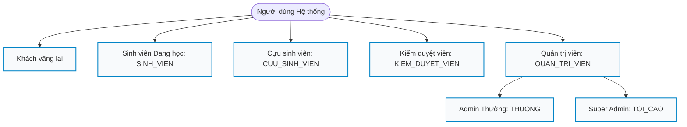
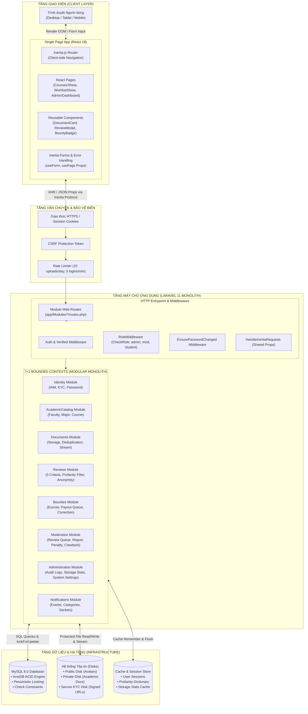
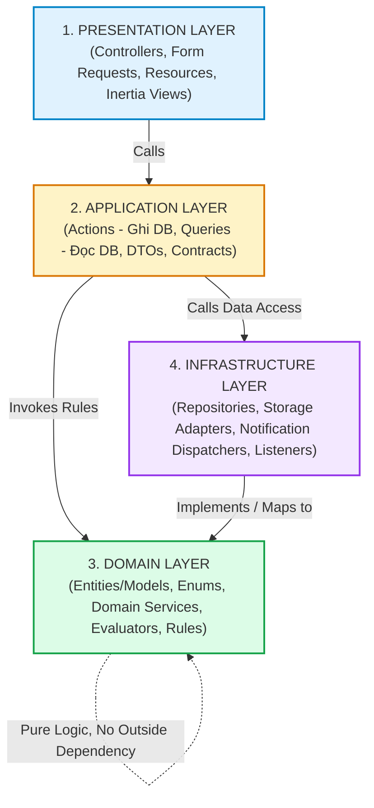
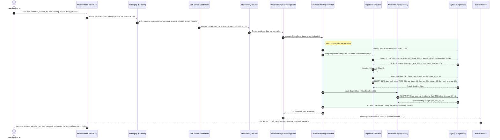
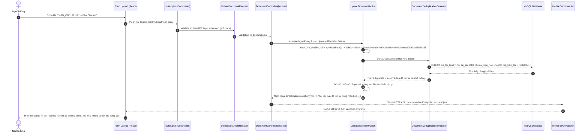

# KIẾN TRÚC TỔNG THỂ HỆ THỐNG AGU ACADEMIC HUB
## OVERALL SYSTEM ARCHITECTURE & 4-TIER MODULAR MONOLITH
**Vị trí:** `docs/knowledge/03_SYSTEM_ARCHITECTURE.md`  
**Ngày lập:** 11/11/2026  
**Cương vị kiến trúc:** Senior Software Architect  
**Công nghệ nền tảng:** Laravel 11.x, PHP 8.2+, MySQL 8.0 (InnoDB), React 18, Inertia.js v2, Tailwind CSS v4, Vite 7.

---

## 1. TỔNG QUAN HỆ THỐNG (SYSTEM OVERVIEW)

### 1.1. AGU Academic Hub là gì?
**AGU Academic Hub** là Nền tảng Tri thức và Cộng đồng Học thuật Nội bộ dành riêng cho sinh viên, cựu sinh viên, cán bộ kiểm duyệt và ban quản trị **Trường Đại học An Giang (ĐHQG-HCM)**.

Hệ thống được xây dựng nhằm giải quyết 4 vấn đề nhức nhối trong thực tế:
1. **Phân mảnh và thất thoát tri thức học thuật:** Tài liệu học tập (đề thi, bài giảng, đồ án, đề cương) bị trôi dạt trên các hội nhóm mạng xã hội mở (Facebook, Zalo, Telegram), dễ mất liên kết tải, không được phân loại theo mã học phần chuẩn của nhà trường.
2. **Bùng nổ dữ liệu rác và file trùng lặp:** Tình trạng upload tự do dẫn đến cùng một file PDF bị đổi tên, đổi bìa rồi upload lặp lại nhiều lần, làm phình dung lượng lưu trữ máy chủ nhưng không đem lại giá trị học thuật.
3. **Nguy cơ phá hoại và xóa tài liệu quý:** Khi sinh viên tốt nghiệp hoặc xảy ra xích mích cá nhân, nhiều tác giả tự ý xóa hàng loạt tài liệu có giá trị mà cộng đồng đang sử dụng học tập.
4. **Môi trường thiếu an toàn cho đánh giá môn học:** Sinh viên thiếu kênh phản hồi khách quan, trung thực về độ khó và phương pháp học của từng môn vì sợ bị lộ danh tính cá nhân.

---

### 1.2. Các Đối tượng Người dùng & Phân cấp Vai trò (Actors & RBAC)



1. **Khách vãng lai (Guest):** Chỉ được xem trang chủ, tra cứu danh mục môn học công khai; bị chặn tải file, chặn xem đánh giá chi tiết và không được tham gia thảo luận.
2. **Sinh viên đang học (`SINH_VIEN`):** Định danh tự động qua dữ liệu nạp trước (`danh_sach_sinh_vien_raw`), kích hoạt qua đổi mật khẩu lần đầu. Được tra cứu, tải về, đăng tải tài liệu, đánh giá môn học ẩn danh, tạo yêu cầu tìm tài liệu và nhận thưởng Bounty.
3. **Cựu sinh viên (`CUU_SINH_VIEN`):** Đăng ký tự do, nộp minh chứng bằng tốt nghiệp qua hàng đợi KYC. Có quyền hạn tương đương sinh viên trong việc chia sẻ tài liệu và giải quyết yêu cầu Bounty.
4. **Kiểm duyệt viên (`KIEM_DUYET_VIEN`):** Cán bộ / Ban học tập thẩm định tài liệu mới đăng tải, duyệt hồ sơ KYC cựu sinh viên, xử lý hàng đợi báo cáo vi phạm, và kiểm duyệt giải ngân điểm thưởng Bounty.
5. **Quản trị viên (`QUAN_TRI_VIEN`):**
   - **Admin thường (`THUONG`):** Quản lý tài khoản sinh viên, theo dõi dung lượng lưu trữ, cấu hình danh mục đào tạo.
   - **Super Admin (`TOI_CAO`):** Toàn quyền hệ thống, quản lý tài khoản quản trị, khôi phục tài liệu trong thùng rác 60 ngày, dọn dẹp vĩnh viễn tệp rác quá hạn.

---

## 2. SƠ ĐỒ KIẾN TRÚC TỔNG THỂ (OVERALL ARCHITECTURE DIAGRAM)



---

## 3. KIẾN TRÚC PHÂN LỚP MODULAR MONOLITH (4-TIER ARCHITECTURE)

Hệ thống tuân thủ nghiêm ngặt mô hình **Modular Monolith** kết hợp nguyên lý thiết kế **Domain-Driven Design (DDD)** và phân tầng 4 lớp trong từng Bounded Context tại `app/Modules/<ModuleName>/`:



---

### 3.1. Chi tiết Trách nhiệm Từng Tầng

#### Tầng 1: Presentation Layer (`Presentation/Http/`)
- **Trách nhiệm:** Điểm tiếp nhận request từ giao thức Inertia/HTTP, xác thực tính hợp lệ của dữ liệu đầu vào (Form Request Validation), phân quyền người dùng (Authorization Gate), và đóng gói dữ liệu trả về cho React hoặc JSON.
- **Thành phần:**
  - **Controllers:** Là các "Skinny Controller" (~30-70 dòng). Tuyệt đối **không** viết câu lệnh SQL thô, **không** mở `DB::transaction()`, và **không** tính toán nghiệp vụ tại đây. Chỉ làm nhiệm vụ điều hướng: nhận request $\to$ gọi Action/Query $\to$ trả về `Inertia::render(...)` hoặc `redirect()`.
  - **Requests (Form Requests):** Chịu trách nhiệm validate kiểu dữ liệu, dung lượng, định dạng file và kiểm tra quyền cơ bản (`authorize()`).
  - **Resources:** Định dạng lại dữ liệu trước khi xuất ra ngoài; thực thi kỹ thuật **Ẩn danh 2 lớp** (che giấu `ma_nguoi_dung` và thông tin PII).
- **Ví dụ thực tế trong code:**
  - File: `app/Modules/Bounties/Presentation/Http/Controllers/WishlistBountyController.php`
  ```php
  // Skinny Controller chỉ gọi Action và Query
  public function store(StoreBountyRequest $request): RedirectResponse
  {
      $bounty = $this->createBountyAction->execute(
          $request->user(),
          $request->validated()
      );

      return redirect()
          ->route('wishlist.show', $bounty->ma_yeu_cau)
          ->with('success', 'Tạo yêu cầu tìm tài liệu và đóng băng điểm thành công!');
  }
  ```

---

#### Tầng 2: Application Layer (`Application/`)
- **Trách nhiệm:** Điều phối và thực thi các trường hợp sử dụng (Use Cases) của hệ thống. Tách bạch hoàn toàn giữa thao tác đọc và ghi theo nguyên lý CQS (Command-Query Separation):
  - **Actions (Command Handlers):** Thực thi các use case làm thay đổi trạng thái hệ thống (tạo mới, cập nhật, xóa, đóng băng điểm, giải ngân, chuyển trạng thái). Mọi thao tác ghi phức tạp đều được bọc trong `DB::transaction()`.
  - **Queries (Query Handlers):** Thực thi các use case chỉ đọc dữ liệu (Read-only). Tối ưu hóa truy vấn, áp dụng Eager Loading (`with()`) chống lỗi N+1 Query, hỗ trợ phân trang và bộ nhớ đệm (Cache).
  - **DTOs & Contracts:** Đóng gói tham số truyền giữa các layer hoặc giữa các module với nhau.
- **Ví dụ thực tế trong code:**
  - File: `app/Modules/Bounties/Application/Actions/ApproveBountyPayoutAction.php`
  - Đảm nhận toàn bộ nghiệp vụ duyệt giải ngân: Kiểm tra quyền Admin/Mod $\to$ Khóa hàng bi quan `lockForUpdate()` $\to$ Gọi `ReputationEvaluator` thực chi điểm $\to$ Ghi nhật ký `AuditLogger` $\to$ Bắn sự kiện `BountyFulfillmentConfirmedEvent`.

---

#### Tầng 3: Domain Layer (`Domain/`)
- **Trách nhiệm:** Trái tim của hệ thống. Chứa đựng toàn bộ các quy tắc nghiệp vụ cốt lõi (Business Rules & Domain Invariants) độc lập với Framework và cơ sở dữ liệu.
- **Thành phần:**
  - **Domain Evaluators / Services:** Thực thi các thuật toán và quy tắc đánh giá:
    - `ReputationEvaluator.php`: Quản lý quy tắc số dư ví điểm, khóa hàng chống Race Condition, kiểm tra khóa chống trùng Idempotency.
    - `DocumentDeduplicationEvaluator.php`: Quy tắc chống trùng lặp nhị phân SHA-256.
    - `DocumentAuthorRemovalEvaluator.php`: Quy tắc giới hạn quyền tự xóa mềm và điều kiện chuyển giao quyền sở hữu cộng đồng.
    - `ProfanityFilterEvaluator.php`: Thuật toán bẻ gãy Leetspeak phát hiện từ cấm.
    - `UserViolationPenaltyEvaluator.php`: Bảng thang điểm xử phạt và tích lũy vi phạm.
  - **Enums:** Các giá trị định danh bất biến (PHP 8.2 Backed Enums): `TrangThaiYeuCauTaiLieu`, `LoaiGiaoDichDiem`, `VaiTroNguoiDung`, `TrangThaiTaiLieu`.
  - **Value Objects:** Đóng gói kiểu dữ liệu và ràng buộc bất biến (ví dụ: `ByteSize.php`).
- **Nguyên tắc:** Tầng Domain không phụ thuộc vào tầng Presentation hay Infrastructure.

---

#### Tầng 4: Infrastructure Layer (`Infrastructure/`)
- **Trách nhiệm:** Tương tác trực tiếp với các tài nguyên phần cứng, hệ thống tệp và cơ sở hạ tầng bên ngoài.
- **Thành phần:**
  - **Persistence (Repositories):** Trực tiếp viết câu truy vấn Eloquent / Query Builder, xử lý các khác biệt giữa MySQL và SQLite in-memory (ví dụ: hàm trích xuất tháng năm `strftime` vs `DATE_FORMAT`).
  - **Storage Adapters:** Quản lý lưu trữ tệp vật lý, phân định giữa đĩa công khai (`public`), đĩa riêng tư bảo mật (`private/docs`), và đĩa chứng từ nhạy cảm (`private/kyc/`). Hỗ trợ sinh Temporary Signed URL và Stream dữ liệu.
  - **Listeners & Adapters:** Lắng nghe sự kiện Domain Event và điều phối gửi thông báo qua Laravel Notification System.

---

## 4. LUỒNG REQUEST CHI TIẾT END-TO-END (END-TO-END REQUEST FLOW TRACING)

Để hiểu rõ cách thức hệ thống vận hành từ giao diện đến database và chiều phản hồi, dưới đây là phân tích chi tiết của 2 kịch bản điển hình: một kịch bản **Thành công** và một kịch bản **Thất bại/Bị chặn**.

---

### 4.1. Kịch bản Thành công: Sinh viên Tạo Yêu Cầu Tìm Tài Liệu & Đóng Băng Điểm (Bounty Request Creation)



- **Chi tiết các thành phần tham gia:**
  1. `resources/js/Components/Wishlist/CreateRequestModal.jsx`: Sử dụng hook `useForm()` của Inertia, gửi dữ liệu qua `post(route('wishlist.store'))`.
  2. `app/Modules/Bounties/routes.php:12`: Tuyến đường `Route::post('/yeu-cau-tai-lieu', [WishlistBountyController::class, 'store'])->name('wishlist.store');`.
  3. `app/Modules/Bounties/Presentation/Http/Requests/StoreBountyRequest.php`: Kiểm tra `diem_thuong >= 10`, `tieu_de` bắt buộc, `ma_mon_hoc` tồn tại.
  4. `app/Modules/Bounties/Presentation/Http/Controllers/WishlistBountyController.php:40-48`: Nhận request, gọi `CreateBountyRequestAction`.
  5. `app/Modules/Bounties/Application/Actions/CreateBountyRequestAction.php:23-45`: Bọc toàn bộ trong `DB::transaction()`.
  6. `app/Modules/Bounties/Domain/Services/ReputationEvaluator.php:29-71`: Khóa bi quan hàng `vi_diem` bằng `lockForUpdate()`, kiểm tra `diem_kha_dung >= diem_thuong`, ghi sổ cái `giao_dich_diem` có khóa chống lặp `khoa_chong_trung`.
  7. Database Commit: Cập nhật đồng thời bảng `vi_diem`, `giao_dich_diem` và `yeu_cau_tai_lieu`.

---

### 4.2. Kịch bản Thất bại: Người Dùng Nộp File Trùng Lặp Nhị Phân SHA-256 (Duplicate File Upload)



- **Ý nghĩa kỹ thuật của luồng này:**
  1. **Bảo vệ đĩa cứng (Zero Storage Waste):** Việc băm SHA-256 diễn ra trên tệp tạm (`tmp`) của tiến trình PHP. Khi phát hiện mã băm đã tồn tại trong cùng môn học, hệ thống lập tức hủy tiến trình, không bao giờ di chuyển tệp vào `storage/app/private/`.
  2. **Trải nghiệm tức thời:** Phản hồi lỗi qua giao thức Inertia giúp giữ nguyên các trường dữ liệu người dùng đã điền trên Form, không bị mất công nhập lại.

