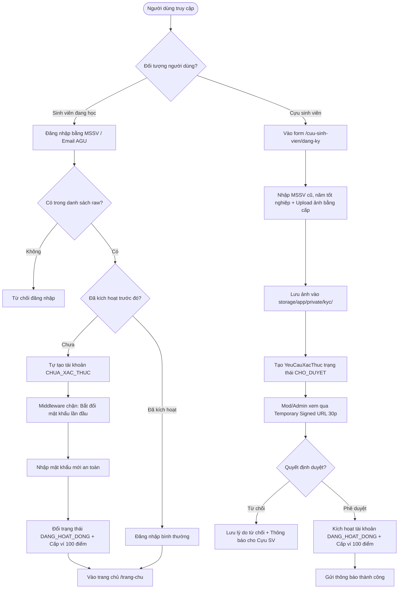
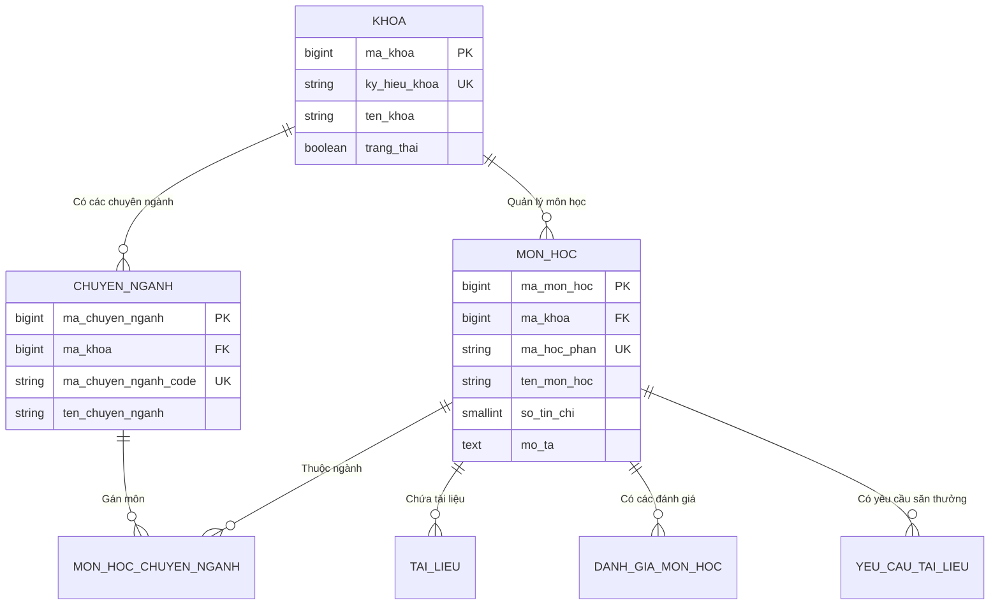

# CHI TIẾT CÁC PHÂN HỆ NGHIỆP VỤ & USE CASES HỆ THỐNG AGU ACADEMIC HUB
## COMPREHENSIVE MODULES & USE CASES SPECIFICATION
**Vị trí:** `docs/knowledge/04_MODULES_AND_USECASES.md`  
**Ngày lập:** 11/11/2026  
**Cương vị phân tích:** Senior Business Analyst & Backend Architect  
**Phạm vi:** Toàn bộ 8 Bounded Contexts trong kiến trúc Modular Monolith của dự án:
1. `Identity` (Định danh, Xác thực & KYC)
2. `AcademicCatalog` (Danh mục Học thuật: Khoa, Ngành, Môn)
3. `Documents` (Kho Lưu trữ & Quản lý Tài liệu)
4. `Moderation` (Trung tâm Kiểm duyệt & Chế tài Vi phạm)
5. `Reviews` (Đánh giá Môn học & Bộ lọc Từ cấm)
6. `Bounties` (Yêu cầu Tài liệu, Săn thưởng & Chỉnh sửa)
7. `Administration` (Quản trị Hệ thống, Giám sát Lưu trữ & Audit Logs)
8. `Notifications` (Hệ thống Thông báo Nghiệp vụ Thời gian thực)

---

# PHÂN HỆ 1: IDENTITY (ĐỊNH DANH, XÁC THỰC & HỒ SƠ)

### 1. Mục đích nghiệp vụ
Phân hệ **Identity** chịu trách nhiệm quản lý vòng đời tài khoản người dùng, bảo đảm 100% người dùng trong hệ thống là sinh viên, cựu sinh viên hoặc cán bộ của Trường Đại học An Giang; loại bỏ hoàn toàn tài khoản ảo, spam thương mại.

### 2. Actors và Ma trận Quyền hạn
- **Khách (Guest):** Đăng nhập sinh viên, xem trang đăng ký cựu sinh viên, quên mật khẩu.
- **Sinh viên (`SINH_VIEN`):** Đổi mật khẩu lần đầu, cập nhật hồ sơ cá nhân, đổi mật khẩu định kỳ, đăng xuất.
- **Cựu sinh viên (`CUU_SINH_VIEN`):** Nộp hồ sơ đăng ký KYC, theo dõi trạng thái phê duyệt hồ sơ.
- **Admin / Mod (`QUAN_TRI_VIEN`, `KIEM_DUYET_VIEN`):** Duyệt/từ chối hồ sơ KYC, xem ảnh chứng từ qua Signed URL 30 phút.

| Chức năng | Guest | Sinh viên | Cựu SV | Moderator | Admin | Bằng chứng Code / Middleware |
|:---|:---:|:---:|:---:|:---:|:---:|:---|
| Đăng nhập | ✔ | ✔ | ✔ | ✔ | ✔ | `routes/web.php`, `AuthenticatedSessionController` |
| Đăng ký tự do | ✖ (Chặn email AGU) | ✖ | ✖ | ✖ | ✖ | `RegisteredUserController@store` |
| Đổi mật khẩu lần đầu | ✖ | ✔ (Bắt buộc) | ✖ | ✖ | ✖ | `EnsurePasswordChanged`, `FirstTimePasswordController` |
| Nộp hồ sơ KYC | ✔ (Cựu SV) | ✖ | ✖ | ✖ | ✖ | `KycController@submit` |
| Duyệt hồ sơ KYC | ✖ | ✖ | ✖ | ✔ | ✔ | `role:KIEM_DUYET_VIEN,QUAN_TRI_VIEN`, `KycController@approve` |
| Xem ảnh minh chứng KYC | ✖ | ✖ | ✖ | ✔ (Signed) | ✔ (Signed) | `signed` middleware, `PrivateKycStorage` |

---

### 3. Use Case Trọng Tâm: UC-IAM-01: Đăng nhập Sinh viên Lần đầu & Đổi Mật Khẩu Bắt Buộc
- **Actor:** Sinh viên đang học.
- **Tiền điều kiện:** Nhà trường đã nạp trước thông tin sinh viên vào bảng `danh_sach_sinh_vien_raw`.
- **Trigger:** Sinh viên truy cập `/dang-nhap` và điền MSSV + Mật khẩu mặc định do trường cấp.
- **Main Flow:**
  1. Sinh viên nhập MSSV (ví dụ `DTH235638`) và mật khẩu mặc định.
  2. Hệ thống kiểm tra bảng `nguoi_dung`: chưa tồn tại tài khoản chính.
  3. Hệ thống đối soát bảng `danh_sach_sinh_vien_raw`: tìm thấy bản ghi có `da_kich_hoat = false`.
  4. Hệ thống tự động tạo tài khoản trong bảng `nguoi_dung` với vai trò `SINH_VIEN`, trạng thái `CHUA_XAC_THUC`.
  5. Hệ thống khởi tạo phiên đăng nhập và điều hướng ngay lập tức về route `/mat-khau-lan-dau`.
  6. Sinh viên nhập mật khẩu mới (tối thiểu 8 ký tự, có chữ hoa, chữ thường, số).
  7. Hệ thống cập nhật mật khẩu Bcrypt, đổi `trang_thai = DANG_HOAT_DONG`, đánh dấu `da_kich_hoat = true` và `kich_hoat_luc = now()` trên bảng raw.
  8. Hệ thống tự động tạo ví điểm `ViDiem` với 100 điểm khả dụng (`diem_kha_dung = 100`).
  9. Hệ thống chuyển hướng sinh viên vào Bảng điều khiển `/trang-chu`.
- **Exception Flow:**
  - Nhập sai mật khẩu mặc định $\to$ Báo lỗi xác thực `422 Unprocessable Entity`.
  - Sinh viên cố tình truy cập các trang khác mà chưa đổi mật khẩu $\to$ Middleware `EnsurePasswordChanged` chặn lại và ép quay về `/mat-khau-lan-dau`.
- **Kết quả:** Tài khoản được kích hoạt, có ví điểm, sẵn sàng sử dụng hệ thống.

---

### 4. Sơ đồ Nghiệp vụ: Luồng Định Danh Sinh Viên vs Cựu Sinh Viên



---

### 5. Luồng Mã Nguồn & Code Chứng Minh
- **Đường dẫn file:** `app/Modules/Identity/Application/Actions/AuthenticateUserAction.php`
- **Dòng thực tế:** Lines 35-72
```php
// Trích xuất xử lý đối soát sinh viên thô và tạo tài khoản tự động
if (!$user) {
    $rawStudent = $this->identityRepository->findRawStudentByCredentials($identifier);
    if ($rawStudent && Hash::check($password, $rawStudent->mat_khau_mac_dinh)) {
        $user = $this->identityRepository->createStudentFromRaw($rawStudent);
        Auth::login($user);
        return [
            'status' => 'first_time_password_required',
            'redirect' => route('password.first-time'),
        ];
    }
}
```
- **Tại sao viết như vậy?** Tránh cho sinh viên đang học phải chụp ảnh thẻ nộp qua mạng, vừa tốn công xét duyệt thủ công của cán bộ, vừa tiềm ẩn rủi ro lộ ảnh cá nhân.

---

# PHÂN HỆ 2: ACADEMIC CATALOG (DANH MỤC HỌC THUẬT)

### 1. Mục đích nghiệp vụ
Tổ chức và quản lý cây phân cấp học thuật chuẩn của Đại học An Giang: **Khoa $\to$ Chuyên ngành $\to$ Môn học**. Đây là "xương sống" phân loại dữ liệu cho toàn bộ các phân hệ Tài liệu, Đánh giá và Săn thưởng.

### 2. Sơ đồ Quan hệ Thực thể Phân hệ Danh mục (ERD)



### 3. Use Case Hạt Nhân: UC-CAT-01: Truy cập Trang Chi Tiết Môn Học Tích Hợp Đa Tab
- **Actor:** Sinh viên, Cựu sinh viên, Khách.
- **Route:** `GET /mon-hoc/{course_code}` $\to$ `CourseController@show`.
- **Thực thi:**
  - Controller gọi song song 4 truy vấn:
    1. `GetPublicCoursesQuery::findActiveCourseByCode($course_code)` $\to$ Nạp thông tin môn học, số tín chỉ, mô tả đề cương.
    2. `DocumentRepository::paginatePublicDocuments($maMonHoc, 8)` $\to$ Nạp danh sách tài liệu đã duyệt của môn.
    3. `GetCourseReviewsQuery::getCourseReviewStats($maMonHoc)` & `getPaginatedReviews(...)` $\to$ Nạp điểm đánh giá trung bình 3 tiêu chí và danh sách review đã ẩn danh.
    4. `WishlistBountyRepository::getPaginatedWishlist($maMonHoc, 8)` $\to$ Nạp danh sách yêu cầu tài liệu đang mở kèm mức thưởng Bounty.
  - Trả về component React: `Courses/Show.jsx`.
- **Kiểm thử xác minh:** `tests/Feature/Phase3aCourseDetailTest.php` (Pass 100%).

---

# PHÂN HỆ 3: DOCUMENTS (KHO LƯU TRỮ & QUẢN LÝ TÀI LIỆU)

### 1. Mục đích nghiệp vụ
Quản lý vòng đời tài liệu học tập: đăng tải, lọc trùng nhị phân, lưu trữ an toàn, xem trước PDF trực tuyến, tải về, bình chọn hữu ích, và cơ chế chuyển giao quyền sở hữu cộng đồng.

### 2. Thuật toán Lọc Trùng Lặp Nhị Phân Lớp 1 (Binary SHA-256 Deduplication)
- **Mã nguồn:** `app/Modules/Documents/Domain/Services/DocumentDeduplicationEvaluator.php:12-28`
```php
public function checkDuplicate(int $maMonHoc, string $fileHash): array
{
    $existing = TaiLieu::where('ma_mon_hoc', $maMonHoc)
        ->where('ma_bam_file', $fileHash)
        ->first();

    if ($existing) {
        return [
            'is_duplicate' => true,
            'existing_document' => $existing,
            'message' => "Tài liệu này đã tồn tại trong môn học: '{$existing->tieu_de}'",
        ];
    }

    return ['is_duplicate' => false];
}
```
- **Ý nghĩa:**
  - Tính mã băm SHA-256 ngay trên file tạm `tmp` trước khi lưu ổ đĩa.
  - Phân vùng kiểm tra theo từng `ma_mon_hoc`: Cùng một file slide nếu thuộc 2 môn khác nhau thì vẫn được chấp nhận; nhưng trong cùng 1 môn học thì chặn hoàn toàn.
  - Độ phức tạp tính toán: $O(1)$ nhờ chỉ mục index trên cột `ma_bam_file`.

---

### 3. Cơ chế Bảo tồn Tri thức: Community Ownership & Soft Delete
- **Quy tắc:**
  - Tài liệu mới đăng, trong **24 giờ đầu** VÀ **chưa có ai tải (`luot_tai == 0`)**: Tác giả có quyền tự xóa mềm (`AuthorSoftDeleteDocumentAction.php`).
  - Tài liệu có **$\ge 10$ lượt tải**: Trở thành tài sản học thuật chung của sinh viên toàn trường (Community Ownership). Tác giả bị khóa nút xóa, chỉ có quyền gửi đơn xin Ban kiểm duyệt gỡ bỏ kèm lý do giải trình (`SubmitRemovalRequestAction.php`).
  - Toàn bộ thao tác xóa từ người dùng hay kiểm duyệt viên đều chỉ cập nhật `deleted_at` (Soft Delete). Bản ghi và file vật lý được lưu vết trong bảng `lich_su_thung_rac` tối thiểu 60 ngày trước khi bị Super Admin xóa vĩnh viễn.

---

# PHÂN HỆ 4: MODERATION (TRUNG TÂM KIỂM DUYỆT & XỬ PHẠT)

### 1. Mục đích nghiệp vụ
Cung cấp công cụ cho Kiểm duyệt viên và Quản trị viên để giám sát chất lượng học liệu, thẩm định tài liệu mới, xử lý khiếu nại vi phạm, và thực thi các chế tài xử phạt tự động.

### 2. Bốn Hàng Đợi Kiểm Duyệt Cốt Lõi (Moderation Queues)
1. **Hàng đợi Thẩm định Tài liệu Mới (`Review Queue`):** Tiếp nhận tài liệu do sinh viên tải lên để giải quyết Bounty (Method B). Trạng thái ban đầu `CHO_DUYET`. Moderator duyệt $\to$ chuyển `DA_DUYET`.
2. **Hàng đợi Báo cáo Vi phạm (`Report Queue`):** Tiếp nhận khiếu nại từ sinh viên về tài liệu hoặc bài đánh giá có nội dung sai lệch, chứa mã độc, xúc phạm cá nhân hoặc vi phạm bản quyền.
3. **Hàng đợi Yêu cầu Gỡ Tài liệu (`Removal Request Queue`):** Tiếp nhận giải trình của các tác giả muốn xin rút tài liệu thuộc quyền sở hữu cộng đồng.
4. **Hàng đợi Xét duyệt Hồ sơ KYC Cựu sinh viên (`KYC Queue`):** Thẩm định bằng tốt nghiệp, tích xanh định danh cho cựu sinh viên.

---

### 3. Quy trình Thu Hồi Điểm Thưởng (Bounty Clawback Workflow)
Khi một tài liệu từng được dùng để nhận điểm thưởng Bounty bị Moderator phát hiện vi phạm bản quyền và quyết định gỡ bỏ:
1. `BountyClawbackHandler.php` được kích hoạt tự động bên trong `DecideDocumentReviewAction.php`.
2. Hệ thống tìm kiếm bản ghi `dap_ung_yeu_cau_tai_lieu` và `yeu_cau_tai_lieu` liên kết với tài liệu đó.
3. Hệ thống khóa dòng ví của cả 2 bên bằng `lockForUpdate()`.
4. Khấu trừ số điểm thưởng trong ví người nộp tài liệu vi phạm (bảo đảm không âm ví nhờ DB Check Constraint).
5. Hoàn trả đúng số điểm thưởng đó về ví của người đã đăng yêu cầu tìm tài liệu.
6. Ghi sổ cái `GiaoDichDiem` loại `HOAN_TRA` và trừ điểm uy tín của kẻ vi phạm.

---

# PHÂN HỆ 5: REVIEWS (ĐÁNH GIÁ MÔN HỌC & BỘ LỌC TỪ CẤM)

### 1. Mục đích nghiệp vụ
Tạo môi trường an toàn, trung thực để sinh viên chia sẻ kinh nghiệm học tập, định hướng chọn môn và phương pháp ôn thi thông qua hệ thống đánh giá ẩn danh và bộ lọc từ cấm tự động.

### 2. Đánh Giá 3 Tiêu Chí & Ẩn Danh 2 Lớp
- **3 Tiêu chí định lượng (1-5 sao):**
  1. `diem_do_kho`: Mức độ khó của kiến thức môn học.
  2. `diem_thuc_tien`: Khả năng ứng dụng thực tế trong công việc.
  3. `diem_khoi_luong`: Áp lực bài tập, đồ án, tiểu luận.
- **Cơ chế Ẩn danh 2 lớp (2-Layer Anonymity):**
  - **Lớp 1 (Giao diện & API Public):** `CourseReviewResource.php` bóc tách dữ liệu, gán cứng `user.name = "Sinh viên ẩn danh"`, `user.mssv = null`, loại bỏ hoàn toàn `ma_nguoi_dung`.
  - **Lớp 2 (Hậu kiểm An toàn):** Trường `ma_nguoi_danh_gia` vẫn được lưu tại CSDL MySQL. Khi phát hiện bài review có hành vi vu khống, bôi nhọ nghiêm trọng, Super Admin có quyền tra cứu định danh để xử lý kỷ luật.

---

### 3. Thuật toán Bộ Lọc Từ Cấm & Bẻ Gãy Leetspeak
- **Mã nguồn:** `app/Modules/Reviews/Domain/Services/ProfanityFilterEvaluator.php`
- **Cơ chế xử lý:**
  1. Chuẩn hóa chuỗi văn bản về chữ thường, loại bỏ các ký tự dấu cách giả lập ngắt quãng (`đ.m`, `d m`, `c_o_n_c_a_c`).
  2. Bẻ gãy ký tự biến thể Leetspeak: `0` $\to$ `o`, `1` $\to$ `i`, `3` $\to$ `e`, `4` $\to$ `a`, `5` $\to$ `s`, `@` $\to$ `a`.
  3. Đối soát với từ điển từ cấm tiếng Việt lưu trong Cache.
  4. Báo lỗi form validation ngay trên giao diện nếu phát hiện vi phạm.

---

# PHÂN HỆ 6: BOUNTIES (YÊU CẦU TÀI LIỆU, SĂN THƯỞNG & CHỈNH SỬA)

*(Lưu ý: Phân hệ Bounties được phân tích chuyên sâu toàn diện tại tài liệu riêng `docs/knowledge/05_BOUNTY_DEEP_DIVE.md`).*

Tóm tắt các điểm then chốt:
- Đóng băng điểm khả dụng vào điểm tạm giữ (Escrow Holding).
- Hai phương thức nộp tài liệu (Method A: kho cá nhân, Method B: upload mới).
- Nghiệm thu 2 bước: Người yêu cầu xác nhận $\to$ Chuyển `CHO_GIAI_NGAN` $\to$ Admin/Mod duyệt chi điểm.
- Quy trình Chỉnh sửa & Bổ sung sau khi Bounty hoàn thành (Correction Workflow) qua 2 bảng mới `yeu_cau_chinh_sua_dong_gop` và `lan_nop_tai_lieu_thay_the`.

---

# PHÂN HỆ 7: ADMINISTRATION (QUẢN TRỊ & NHẬT KÝ KIỂM TOÁN)

### 1. Mục đích nghiệp vụ
Quản trị người dùng, cấu hình hệ thống, theo dõi chỉ số vận hành và lưu trữ nhật ký kiểm toán bất biến phục vụ công tác thanh tra học đường.

### 2. Nhật Ký Kiểm Toán Bất Biến (Immutable Audit Logs)
- **Bảng CSDL:** `nhat_ky_kiem_toan`.
- **Quy tắc bất biến:** File `app/Models/NhatKyKiemToan.php:24-38` ghi đè các hàm model lifecycle:
```php
protected static function booted(): void
{
    static::updating(function () {
        throw new \DomainException('Bản ghi nhật ký kiểm toán là bất biến (Immutable), không được phép chỉnh sửa.');
    });

    static::deleting(function () {
        throw new \DomainException('Bản ghi nhật ký kiểm toán là bất biến (Immutable), không được phép xóa.');
    });
}
```
- **Ý nghĩa:** Bảo đảm tính trung thực tuyệt đối của nhật ký kiểm toán. Ngay cả khi hacker có tài khoản Admin hoặc chạy mã PHP, cũng không thể can thiệp sửa đổi hoặc xóa dấu vết thao tác.

---

# PHÂN HỆ 8: NOTIFICATIONS (THÔNG BÁO NGHIỆP VỤ THỜI GIAN THỰC)

### 1. Mục đích nghiệp vụ
Truyền tải tức thời các biến động tài chính, kết quả kiểm duyệt, và nhắc nhở nhiệm vụ tới đúng người dùng mục tiêu.

### 2. Phân loại Category & Đồng bộ Tiếng Việt
- **Category:**
  - `PERSONAL`: Thông báo cá nhân (nhận điểm thưởng, bị trừ điểm uy tín, kết quả KYC, yêu cầu chỉnh sửa tài liệu).
  - `WORK_ITEM`: Thông báo hàng đợi dành cho cán bộ (có báo cáo mới cần duyệt, có yêu cầu giải ngân Bounty chờ duyệt).
- **Chuẩn hóa Tiếng Việt:** Bảng `notifications` lưu trữ tại CSDL với các cột thuần Việt: `ma_thong_bao`, `du_lieu` (JSON payload), `nguoi_nhan_id`, `da_doc_luc`.

