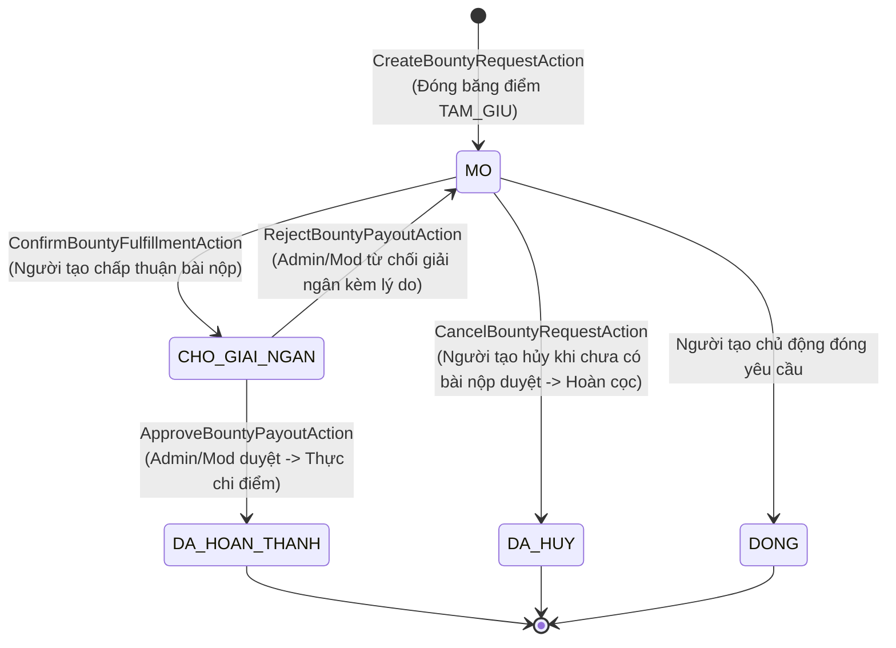
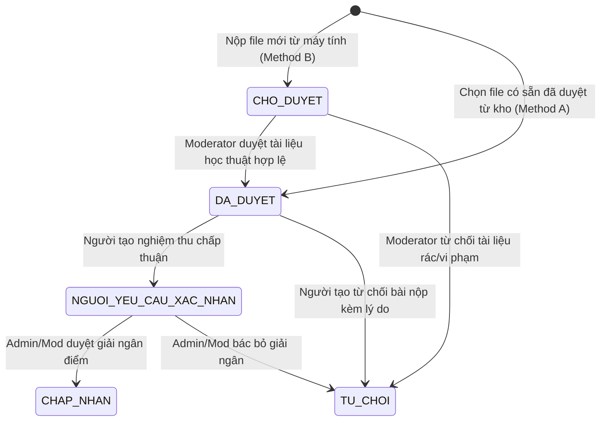
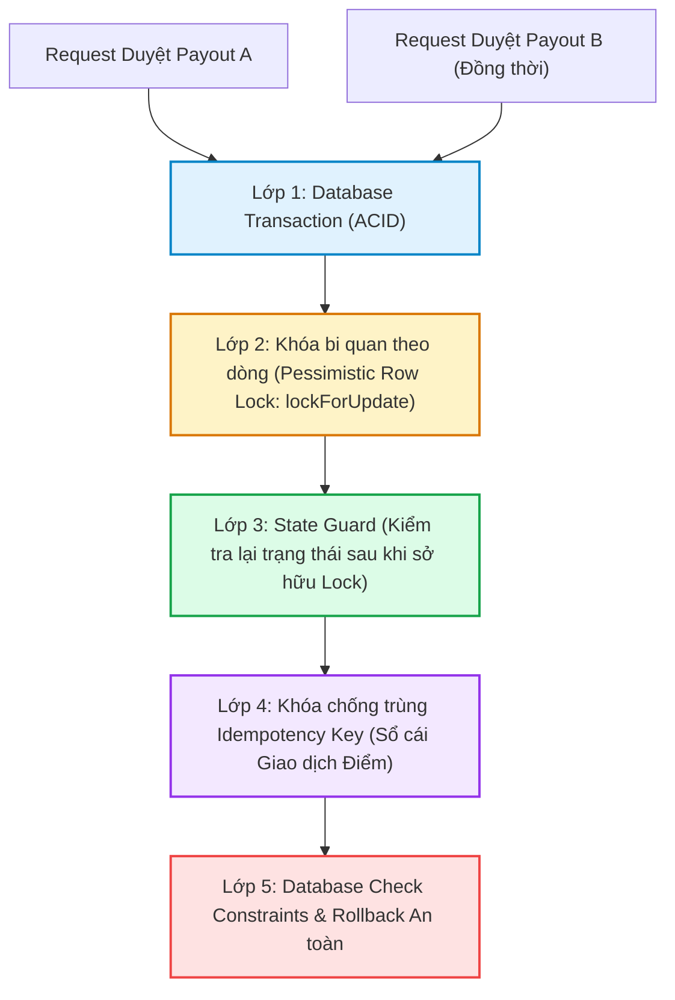
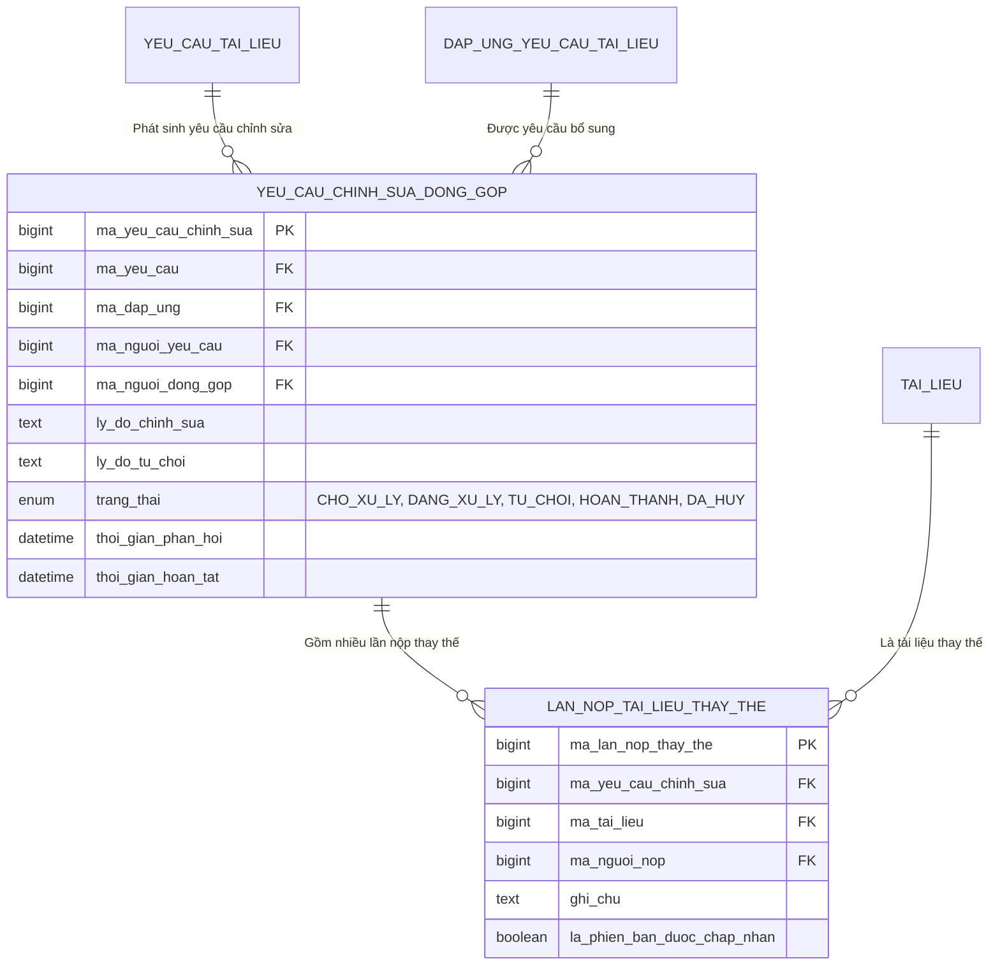
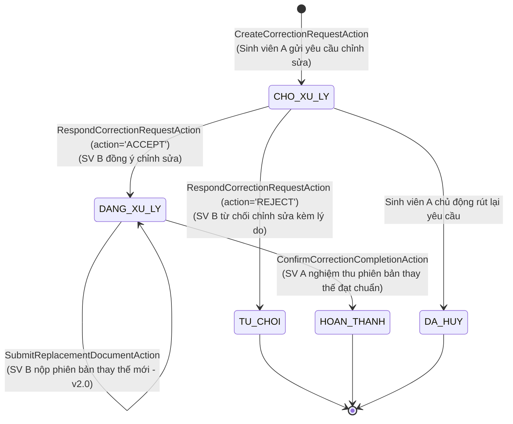

# PHÂN TÍCH CHUYÊN SÂU PHÂN HỆ SĂN THƯỞNG TÀI LIỆU (BOUNTY & WISHLIST DEEP DIVE)
## TOÀN DIỆN VÒNG ĐỜI, KÝ QUỸ ĐIỂM, MÁY TRẠNG THÁI, CHỐNG DOUBLE PAYOUT & LUỒNG CHỈNH SỬA
**Vị trí:** `docs/knowledge/05_BOUNTY_DEEP_DIVE.md`  
**Ngày lập:** 11/11/2026  
**Cương vị phân tích:** Senior Financial Systems Architect & Concurrency Specialist  
**Mục tiêu:** Cung cấp tài liệu kỹ thuật hoàn chỉnh nhất về nghiệp vụ Săn thưởng tài liệu — phân hệ có độ phức tạp cao nhất về giao dịch dữ liệu, bảo vệ tài chính học thuật và tương tranh trong hệ thống AGU Academic Hub.

---

## 1. TOÀN CẢNH VÒNG ĐỜI 16 BƯỚC CỦA MỘT BOUNTY (END-TO-END LIFECYCLE)

```mermaid
sequenceDiagram
    autonumber
    actor SV_A as Sinh viên Yêu cầu (SV A)
    actor SV_B as Người Đóng góp (SV B)
    actor Mod as Kiểm duyệt viên / Admin
    participant BountySys as Hệ thống Bounty (Actions)
    participant WalletSys as Hệ thống Ví Điểm (ReputationEvaluator)
    participant Ledger as Sổ Cái (GiaoDichDiem)
    participant DB as CSDL MySQL (InnoDB)

    %% Giai đoạn 1: Tạo yêu cầu & Đóng băng điểm
    rect rgb(240, 249, 255)
        note over SV_A, DB: GIAI ĐOẠN 1: TẠO YÊU CẦU & KÝ QUỸ ĐIỂM THƯỞNG (ESCROW HOLDING)
        SV_A->>BountySys: 1. Tạo yêu cầu tìm tài liệu (Môn COS101, thưởng 50 điểm)
        BountySys->>WalletSys: 2. Kiểm tra số dư ví khả dụng của SV A
        WalletSys->>DB: 3. Khóa hàng ví SV A (lockForUpdate)
        WalletSys->>DB: 4. diem_kha_dung -= 50, diem_tam_giu += 50
        WalletSys->>Ledger: 5. Ghi sổ cái TAM_GIU (-50 khả dụng, +50 tạm giữ, Idempotency key)
        BountySys->>DB: 6. Tạo YeuCauTaiLieu trạng thái 'MO'
    end

    %% Giai đoạn 2: Đóng góp tài liệu
    rect rgb(254, 249, 195)
        note over SV_B, Mod: GIAI ĐOẠN 2: ĐÓNG GÓP TÀI LIỆU (METHOD A HOẶC METHOD B)
        SV_B->>BountySys: 7. Chọn giải quyết Bounty (Nộp file mới từ máy tính - Method B)
        BountySys->>BountySys: 8. Kiểm tra SHA-256 chống trùng lặp nhị phân
        BountySys->>DB: 9. Tạo TaiLieu trạng thái 'CHO_DUYET' & DapUng trạng thái 'CHO_DUYET'
        Mod->>BountySys: 10. Moderator thẩm định tài liệu $\to$ Phê duyệt 'DA_DUYET'
    end

    %% Giai đoạn 3: Nghiệm thu & Duyệt Giải ngân
    rect rgb(236, 253, 245)
        note over SV_A, Mod: GIAI ĐOẠN 3: NGHIỆM THU 2 BƯỚC & GIẢI NGÂN ĐIỂM THƯỞNG
        SV_A->>BountySys: 11. SV A nghiệm thu nội dung tài liệu $\to$ Bấm "Xác nhận chấp thuận"
        BountySys->>DB: 12. Chuyển DapUng sang 'NGUOI_YEU_CAU_XAC_NHAN', Bounty sang 'CHO_GIAI_NGAN' (CHƯA GIẢI NGÂN!)
        BountySys-->>Mod: 13. Đẩy vào hàng đợi Admin/Mod Payout Queue
        Mod->>BountySys: 14. Admin/Mod thẩm định lần cuối $\to$ Bấm "Duyệt Giải ngân" (ApproveBountyPayoutAction)
        BountySys->>WalletSys: 15. Giải ngân: Khóa ví cả 2 bên (lockForUpdate)
        WalletSys->>DB: Ví A: diem_tam_giu -= 50; Ví B: diem_kha_dung += 50; SV B: diem_uy_tin += 50
        WalletSys->>Ledger: Ghi sổ cái: GIAI_PHONG (A) và CONG_DIEM (B)
        BountySys->>DB: 16. Chuyển Bounty sang 'DA_HOAN_THANH', DapUng sang 'CHAP_NHAN'
    end
```

---

## 2. PHÂN TÍCH CƠ CHẾ KÝ QUỸ ĐIỂM THƯỞNG (ESCROW / POINT HOLDING)

### 2.1. Tại sao cần Đóng Băng Điểm?
Trong mô hình giao dịch điểm thưởng ngang hàng (Peer-to-Peer Academic Bounty), nếu không có cơ chế ký quỹ (Escrow), hệ thống sẽ đối mặt với các nguy cơ nghiêm trọng:
1. **Gian lận "Ví rỗng" (Empty Wallet Attack):** Sinh viên A có 50 điểm trong ví, đăng 10 yêu cầu Bounty khác nhau, mỗi yêu cầu treo thưởng 50 điểm (tổng cộng 500 điểm). Khi có người nộp tài liệu, hệ thống không còn đủ điểm để thanh toán.
2. **Chi tiêu kép (Double Spending):** Sinh viên A đăng Bounty 50 điểm. Trong lúc người khác đang tìm tài liệu, sinh viên A dùng 50 điểm đó để tải tài liệu khác hoặc bình chọn. Khi tài liệu được nộp về, ví A có số dư bằng 0.

### 2.2. Giải pháp Kiến trúc: Tách Biệt Hai Loại Số Dư
Bảng `vi_diem` phân định rõ ràng:
- `diem_kha_dung` (Available Balance): Số điểm sinh viên đang tự do sử dụng.
- `diem_tam_giu` (Escrow / Held Balance): Số điểm đang bị khóa tạm thời để bảo chứng cho các yêu cầu Bounty đang mở.

Ràng buộc toàn vẹn CSDL (Database Check Constraints):
```sql
CONSTRAINT chk_vi_diem_kha_dung CHECK (diem_kha_dung >= 0),
CONSTRAINT chk_vi_diem_tam_giu CHECK (diem_tam_giu >= 0)
```

---

### 2.3. Bảng Diễn Tiến Số Học Minh Họa Chi Tiết (Arithmetic Simulation)

> [!NOTE]
> Bảng dưới đây là ví dụ số học minh họa trực quan cho cơ chế Ký quỹ, Giải ngân và Hoàn tiền.

Giả sử ban đầu:
- **Sinh viên A (Người tạo):** Có 100 điểm khả dụng ban đầu (được cấp khi kích hoạt tài khoản).
- **Sinh viên B (Người đóng góp):** Có 100 điểm khả dụng ban đầu.

| Bước | Hành động nghiệp vụ | Ví Sinh viên A (diem_kha_dung / diem_tam_giu) | Ví Sinh viên B (diem_kha_dung / diem_tam_giu) | Điểm uy tín SV B | Dòng ghi Sổ cái `giao_dich_diem` |
|:---:|:---|:---:|:---:|:---:|:---|
| **0** | **Khởi tạo tài khoản** | `100 / 0` | `100 / 0` | 100 | Nạp khởi tạo 100 điểm |
| **1** | **SV A tạo Bounty treo thưởng 40 điểm** | `60 / 40` *(Khả dụng -40, Tạm giữ +40)* | `100 / 0` | 100 | `TAM_GIU`: -40 khả dụng, +40 tạm giữ (Ref: YeuCau #1) |
| **2** | **SV B nộp tài liệu giải quyết** | `60 / 40` *(Không đổi)* | `100 / 0` *(Không cộng điểm non)* | 100 | Chưa có giao dịch điểm (Bảo vệ chống cộng điểm sớm) |
| **3** | **SV A nghiệm thu tài liệu** | `60 / 40` *(Chuyển hàng đợi Admin/Mod)* | `100 / 0` *(Chưa giải ngân)* | 100 | Yêu cầu chuyển `CHO_GIAI_NGAN` |
| **4** | **Admin duyệt giải ngân Bounty** | `60 / 0` *(Tạm giữ -40)* | `140 / 0` *(Khả dụng +40)* | **140** *(+40 uy tín)* | 1. `GIAI_PHONG`: 0 khả dụng, -40 tạm giữ (Ví A)<br>2. `CONG_DIEM`: +40 khả dụng, 0 tạm giữ (Ví B) |
| **5a** | *(Kịch bản phụ)* **Nếu SV A hủy yêu cầu ở Bước 1** | `100 / 0` *(Hoàn lại +40)* | `100 / 0` | 100 | `HOAN_TRA`: +40 khả dụng, -40 tạm giữ (Ví A) |
| **5b** | *(Kịch bản phụ)* **Nếu tài liệu bị gỡ do vi phạm (Clawback)** | `100 / 0` *(Được đền bù +40)* | `100 / 0` *(Bị tịch thu -40)* | **60** *(-40 uy tín vi phạm)* | `HOAN_TRA` clawback: Khấu trừ B, hoàn tiền cho A |

---

## 3. MÁY TRẠNG THÁI TOÀN DIỆN (STATE MACHINES)

### 3.1. Máy Trạng Thái Yêu Cầu Tài Liệu (Bounty Request State Machine)
- **Enum đại diện:** `App\Enums\TrangThaiYeuCauTaiLieu` (Giá trị: `MO`, `CHO_GIAI_NGAN`, `DA_HOAN_THANH`, `DONG`, `DA_HUY`).



#### Ma trận Chuyển trạng thái Hợp lệ của Bounty:
| Trạng thái hiện tại | Trạng thái tiếp theo | Actor được phép | Điều kiện tiên quyết | Action thực thi |
|:---|:---|:---:|:---|:---|
| `[*]` | `MO` | Sinh viên, Cựu SV | `diem_kha_dung >= diem_thuong` | `CreateBountyRequestAction` |
| `MO` | `CHO_GIAI_NGAN` | Người tạo yêu cầu | Bài nộp ở trạng thái `DA_DUYET` | `ConfirmBountyFulfillmentAction` |
| `MO` | `DA_HUY` | Người tạo yêu cầu | Chưa có bài nộp nào được chấp thuận | `CancelBountyRequestAction` |
| `CHO_GIAI_NGAN` | `DA_HOAN_THANH` | Admin, Moderator | Bài nộp ở trạng thái `NGUOI_YEU_CAU_XAC_NHAN` | `ApproveBountyPayoutAction` |
| `CHO_GIAI_NGAN` | `MO` | Admin, Moderator | Phát hiện bài nộp không đạt yêu cầu giải ngân | `RejectBountyPayoutAction` |

---

### 3.2. Máy Trạng Thái Bài Nộp Đóng Góp (Contribution State Machine)
- **Bảng CSDL:** `dap_ung_yeu_cau_tai_lieu`. Cột: `trang_thai`.
- **Các giá trị trạng thái:**
  - `CHO_DUYET`: Bài nộp tải file mới từ máy tính (Method B), đang chờ Kiểm duyệt viên thẩm định file.
  - `DA_DUYET`: Tài liệu đã được Moderator duyệt nội dung, sẵn sàng để người tạo yêu cầu nghiệm thu. (Nếu nộp tài liệu có sẵn từ kho - Method A - bài nộp sẽ ở ngay trạng thái này).
  - `NGUOI_YEU_CAU_XAC_NHAN`: Người tạo yêu cầu đã kiểm tra và bấm chấp thuận; bài nộp chuyển vào hàng đợi duyệt chi.
  - `CHAP_NHAN`: Admin/Mod đã duyệt giải ngân thành công; bài nộp chính thức hoàn tất.
  - `TU_CHOI`: Người tạo yêu cầu từ chối bài nộp kèm lý do giải trình (`RejectBountyFulfillmentAction`).



---

## 4. CƠ CHẾ CHỐNG TRẢ THƯỞNG HAI LẦN (ANTI-DOUBLE PAYOUT ARCHITECTURE)

Trong môi trường phân tán hoặc khi có sự cố mạng, một trong những rủi ro tài chính lớn nhất là **Double Payout**: Cán bộ quản trị bấm duyệt nhiều lần, hoặc 2 Moderator cùng mở màn hình và đồng thời bấm duyệt một yêu cầu trong cùng một tích tắc.

Hệ thống AGU Academic Hub áp dụng chiến lược **Phòng thủ Chiều sâu 5 Lớp (5-Layer Defensive Shield)**:



---

### 4.1. Chi tiết Triển khai 5 Lớp trong Source Code

#### Lớp 1: Giao dịch Nguyên tử (Database Transaction)
Bọc toàn bộ tiến trình kiểm tra, cập nhật trạng thái và biến động số dư ví trong `DB::transaction()`. Nếu có bất kỳ lỗi nào xảy ra giữa chừng, toàn bộ các bảng CSDL tự động rollback 100%.

#### Lớp 2: Khóa bi quan theo dòng (Pessimistic Row Locking - `lockForUpdate()`)
- **Vị trí code:** `app/Modules/Bounties/Application/Actions/ApproveBountyPayoutAction.php:36`
```php
$yeuCau = YeuCauTaiLieu::where('ma_yeu_cau', $maYeuCau)->lockForUpdate()->first();
```
- **Cơ chế:** Khi Transaction 1 chạy lệnh này, động cơ MySQL InnoDB sẽ áp đặt một độc quyền `X-Lock` (Exclusive Row-Level Lock) lên hàng `yeu_cau_tai_lieu` có `ma_yeu_cau` tương ứng. Transaction 2 nếu gửi đến cùng thời điểm sẽ **bị buộc phải dừng chờ (block/wait)** tại tầng database cho đến khi Transaction 1 commit hoặc rollback.

#### Lớp 3: Bảo vệ Trạng thái Sau khi Sở hữu Khóa (Post-Lock State Guard)
- **Vị trí code:** `ApproveBountyPayoutAction.php:37-42`
```php
if (!$yeuCau || $yeuCau->trang_thai !== TrangThaiYeuCauTaiLieu::CHO_GIAI_NGAN) {
    return [
        'success' => false,
        'message' => 'Yêu cầu này không ở trạng thái chờ duyệt giải ngân hoặc đã được xử lý bởi quản trị viên khác.',
    ];
}
```
- **Ý nghĩa sống còn:** Khi Transaction 1 kết thúc, trạng thái của Bounty đã được cập nhật thành `DA_HOAN_THANH`. Khi Transaction 2 được giải phóng khỏi trạng thái chờ và đọc dữ liệu, nó sẽ thấy ngay `trang_thai === 'DA_HOAN_THANH'`. Khối `if` này lập tức chặn đứng Transaction 2 và trả về thông báo an toàn, **không bao giờ thực thi tiếp lệnh giải ngân lần hai**.

#### Lớp 4: Khóa chống trùng Idempotency Key (Sổ Cái Giao Dịch)
- **Vị trí code:** `app/Modules/Bounties/Domain/Services/ReputationEvaluator.php:76-81`
```php
$khoaChongLap = $khoaChongLap ?? "giai_ngan_yc_{$yeuCau->ma_yeu_cau}_nd_{$nguoiDongGop->ma_nguoi_dung}";

$daGiaiNgan = GiaoDichDiem::where('khoa_chong_trung', $khoaChongLap.'_nguoi_tao')->exists();
if ($daGiaiNgan) {
    return;
}
```
- Cột `khoa_chong_trung` trong bảng `giao_dich_diem` có ràng buộc `UNIQUE INDEX`. Kể cả trong trường hợp lỗi logic ứng dụng lọt qua được các tầng trên, lệnh insert dòng giao dịch trùng lặp cũng sẽ bị MySQL chặn đứng bằng lỗi `SQLSTATE[23000]: Integrity constraint violation: 1062 Duplicate entry`.

#### Lớp 5: Phát sự kiện sau khi Cam kết (Event Dispatching via `DB::afterCommit`)
- **Vị trí code:** `ApproveBountyPayoutAction.php:81-88`
```php
DB::afterCommit(function () use ($yeuCau, $dapUng, $nguoiYeuCau) {
    BountyFulfillmentConfirmedEvent::dispatch(
        $yeuCau,
        $dapUng,
        $nguoiYeuCau,
        $yeuCau->diem_thuong
    );
});
```
- **Ý nghĩa:** Thông báo và email chỉ được gửi đi **SAU KHI CƠ SỞ DỮ LIỆU ĐÃ COMMIT THÀNH CÔNG**. Tuyệt đối không có chuyện email chúc mừng nhận thưởng đã gửi đi nhưng trong CSDL điểm lại chưa được cộng do rollback.

---

## 5. QUY TRÌNH CHỈNH SỬA & BỔ SUNG SAU HOÀN THÀNH (POST-BOUNTY CORRECTION WORKFLOW)

### 5.1. Bối cảnh Nghiệp vụ & Tại sao cần Luồng này?
Trong thực tế học thuật, một tài liệu sau khi được nghiệm thu và giải ngân Bounty vẫn có thể phát sinh các thiếu sót chuyên môn:
- File đồ án nộp thiếu file đính kèm (source code, database sql script).
- Đề thi giải sai một câu bài tập khó hoặc thiếu đáp án phần trắc nghiệm.
- File PDF scan bị mờ một vài trang quan trọng.

Nếu hệ thống bắt sinh viên tạo một Bounty mới, họ sẽ bị mất thêm điểm thưởng một cách bất công. Nếu hệ thống cho phép ghi đè trực tiếp lên file cũ, sẽ làm mất tính toàn vẹn của bằng chứng đã nghiệm thu ban đầu.

Do đó, AGU Academic Hub thiết kế một quy trình chuyên biệt: **Yêu cầu Chỉnh sửa & Bổ sung sau Hoàn thành (Correction Workflow)**.

---

### 5.2. Cấu trúc Thực thể & Quan hệ Dữ liệu



---

### 5.3. Máy Trạng Thái Yêu Cầu Chỉnh Sửa (Correction State Machine)
- **Enum đại diện:** `App\Enums\TrangThaiYeuCauChinhSua`



---

### 5.4. Các Nguyên Tắc Bất Biến Cốt Lõi (Invariants):
1. **Bảo tồn Tài liệu Gốc:** Khi SV B nộp tài liệu thay thế, hệ thống **không xóa và không ghi đè** lên bản ghi `TaiLieu` cũ. Một bản ghi `TaiLieu` mới hoàn toàn được tạo ra với phiên bản `2.0`, giữ nguyên lịch sử tải về và đánh giá của bản gốc.
2. **Tuyệt đối Không Phát sinh Giao dịch Điểm (Zero Financial Movement):** Quá trình yêu cầu chỉnh sửa, nộp tài liệu thay thế và nghiệm thu hoàn thành **hoàn toàn không can thiệp vào bảng `vi_diem` hay `giao_dich_diem`**. Không trừ thêm điểm của SV A và không trả thêm điểm cho SV B.
3. **Bình đẳng Sinh viên & Cựu sinh viên (Role Parity):** Cựu sinh viên (`CUU_SINH_VIEN`) có đầy đủ 100% quyền hạn như sinh viên đang học trong việc tạo yêu cầu chỉnh sửa, tiếp nhận yêu cầu, nộp file thay thế và nghiệm thu hoàn thành.
4. **Kiểm thử Xác minh Toàn diện:** Bộ test `tests/Feature/PostBountyCorrectionWorkflowTest.php` bao phủ 100% các nhánh: từ chối, chấp nhận, nộp file rỗng, nộp file sai định dạng, nghiệm thu thành công và kiểm tra tính toàn vẹn của số dư ví.

