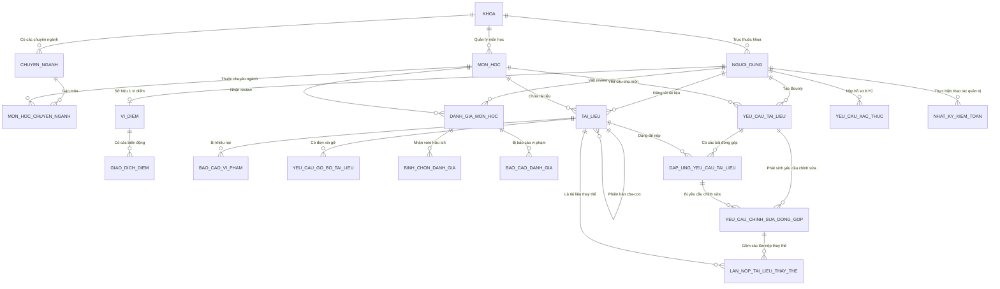

# PHÂN TÍCH CHUYÊN SÂU CƠ SỞ DỮ LIỆU AGU ACADEMIC HUB
## DATABASE SCHEMA, ERD, CONSTRAINTS & QUERY OPTIMIZATION
**Vị trí:** `docs/knowledge/07_DATABASE_DEEP_DIVE.md`  
**Ngày lập:** 11/11/2026  
**Cương vị phân tích:** Senior Database Administrator & ORM Performance Engineer  
**Hệ quản trị CSDL:** MySQL 8.0 (Động cơ InnoDB, Khóa hàng Row-level Locking, UTF8MB4)  
**Môi trường kiểm thử:** SQLite 3 in-memory (`:memory:`)

---

## 1. SƠ ĐỒ QUAN HỆ THỰC THỂ TỔNG THỂ (COMPREHENSIVE DATABASE ERD)



---

## 2. PHÂN NHÓM BẢNG THEO MODULE & CHI TIẾT CẤU TRÚC

Hệ thống gồm **23 bảng cơ sở dữ liệu** được thiết kế hoàn toàn bằng danh pháp Tiếng Việt không dấu (snake_case).

---

### PHÂN NHÓM 1: ĐỊNH DANH & PHÂN QUYỀN (IAM)

#### 1. Bảng `nguoi_dung` (Tài khoản Người dùng Trung tâm)
Lưu trữ toàn bộ tài khoản người dùng, vai trò, trạng thái bảo mật và điểm uy tín.

| Cột (Column) | Kiểu dữ liệu | Ràng buộc (Constraints) | Ý nghĩa nghiệp vụ |
|:---|:---|:---|:---|
| `ma_nguoi_dung` | BIGINT UNSIGNED | PK, AUTO_INCREMENT | Mã định danh duy nhất của người dùng |
| `ma_khoa` | BIGINT UNSIGNED | FK $\to$ `khoa.ma_khoa`, NULLABLE | Khoa chủ quản (chỉ gán cho Sinh viên/Cựu SV; Admin/Mod để NULL) |
| `ho_ten` | VARCHAR(255) | NOT NULL | Họ và tên đầy đủ |
| `email` | VARCHAR(255) | UNIQUE, NOT NULL | Địa chỉ email đăng nhập (sinh viên dùng email trường) |
| `mssv` | VARCHAR(50) | UNIQUE, NULLABLE | Mã số sinh viên AGU (Ví dụ: `DTH235638`) |
| `mat_khau` | VARCHAR(255) | NOT NULL | Mật khẩu băm an toàn bằng thuật toán Bcrypt |
| `vai_tro` | ENUM | NOT NULL | `SINH_VIEN`, `CUU_SINH_VIEN`, `KIEM_DUYET_VIEN`, `QUAN_TRI_VIEN` |
| `cap_quan_tri` | ENUM | NULLABLE, DEFAULT NULL | `THUONG` (Admin thường), `TOI_CAO` (Super Admin) |
| `trang_thai` | ENUM | NOT NULL, DEFAULT 'CHUA_XAC_THUC' | `CHUA_XAC_THUC`, `DANG_HOAT_DONG`, `TAM_KHOA` |
| `diem_uy_tin` | INT | NOT NULL, DEFAULT 100 | Điểm uy tín học thuật (tăng khi chia sẻ tốt, trừ khi vi phạm) |
| `so_lan_vi_pham`| INT | NOT NULL, DEFAULT 0 | Số lần bị xử lý vi phạm nội dung tích lũy |
| `xac_thuc_email_luc` | TIMESTAMP | NULLABLE | Dấu mốc xác minh email |
| `ngay_xoa_tam` | TIMESTAMP | NULLABLE | Soft delete timestamp |

#### 2. Bảng `danh_sach_sinh_vien_raw` (Dữ liệu Sinh viên Nạp trước)
Nguồn dữ liệu đối soát Zero-KYC cho sinh viên đang học, do phòng Đào tạo/Admin import vào hệ thống.

| Cột | Kiểu dữ liệu | Ràng buộc | Ý nghĩa nghiệp vụ |
|:---|:---|:---|:---|
| `ma_sinh_vien_raw` | BIGINT UNSIGNED | PK, AUTO_INCREMENT | Khóa chính |
| `mssv` | VARCHAR(50) | UNIQUE, NOT NULL | Mã số sinh viên nhập học |
| `ho_ten` | VARCHAR(255) | NOT NULL | Họ tên sinh viên |
| `email_truong` | VARCHAR(255) | UNIQUE, NOT NULL | Email đuôi `@student.agu.edu.vn` |
| `mat_khau_mac_dinh` | VARCHAR(255) | NOT NULL | Mật khẩu mặc định khởi tạo ban đầu |
| `ky_hieu_khoa` | VARCHAR(20) | NOT NULL | Ký hiệu khoa nhập học (CNTT, SP, KT...) |
| `da_kich_hoat` | BOOLEAN | NOT NULL, DEFAULT FALSE | Đánh dấu đã đổi mật khẩu lần đầu hay chưa |
| `kich_hoat_luc` | DATETIME | NULLABLE | Thời điểm kích hoạt thành công |

#### 3. Bảng `yeu_cau_xac_thuc` (Hồ sơ Duyệt KYC Cựu Sinh viên)
Lưu vết hồ sơ nộp minh chứng bằng cấp của cựu sinh viên.

| Cột | Kiểu dữ liệu | Ràng buộc | Ý nghĩa nghiệp vụ |
|:---|:---|:---|:---|
| `ma_yeu_cau_xac_thuc` | BIGINT UNSIGNED | PK, AUTO_INCREMENT | Khóa chính |
| `ma_nguoi_dung` | BIGINT UNSIGNED | FK $\to$ `nguoi_dung.ma_nguoi_dung` | Tài khoản cựu sinh viên nộp hồ sơ |
| `duong_dan_minh_chung` | VARCHAR(255) | NOT NULL | Đường dẫn file nhạy cảm trong `storage/app/private/kyc/` |
| `loai_tep` | VARCHAR(20) | NOT NULL, DEFAULT 'image' | `image` hoặc `pdf` |
| `trang_thai` | ENUM | NOT NULL, DEFAULT 'CHO_DUYET' | `CHO_DUYET`, `DA_DUYET`, `TU_CHOI` |
| `ly_do_tu_choi` | TEXT | NULLABLE | Lý do từ chối phản hồi cho cựu sinh viên |
| `nguoi_duyet_id` | BIGINT UNSIGNED | FK $\to$ `nguoi_dung.ma_nguoi_dung`, NULLABLE | Cán bộ thực hiện xét duyệt hồ sơ |

---

### PHÂN NHÓM 2: DANH MỤC HỌC THUẬT (ACADEMIC CATALOG)

#### 4. Bảng `khoa` (Danh mục Khoa / Bộ môn)
- `ma_khoa` (PK), `ky_hieu_khoa` (UNIQUE, ví dụ `CNTT`), `ten_khoa`, `trang_thai` (BOOLEAN).

#### 5. Bảng `chuyen_nganh` (Chuyên ngành Đào tạo)
- `ma_chuyen_nganh` (PK), `ma_khoa` (FK $\to$ `khoa.ma_khoa`), `ma_chuyen_nganh_code` (UNIQUE, ví dụ `DTH`), `ten_chuyen_nganh`.

#### 6. Bảng `mon_hoc` (Danh mục Học phần / Môn học)
- `ma_mon_hoc` (PK), `ma_khoa` (FK $\to$ `khoa.ma_khoa`), `ma_hoc_phan` (UNIQUE, ví dụ `COS101`), `ten_mon_hoc`, `so_tin_chi` (SMALLINT, DEFAULT 3), `mo_ta` (TEXT), `trang_thai` (BOOLEAN).

#### 7. Bảng `mon_hoc_chuyen_nganh` (Bảng Trung gian Môn học - Ngành)
- `ma_mon_hoc` (FK $\to$ `mon_hoc.ma_mon_hoc`), `ma_chuyen_nganh` (FK $\to$ `chuyen_nganh.ma_chuyen_nganh`).
- Khóa chính phức hợp: `PRIMARY KEY (ma_mon_hoc, ma_chuyen_nganh)`.

---

### PHÂN NHÓM 3: KHO LƯU TRỮ TÀI LIỆU & KIỂM DUYỆT (DOCUMENTS & MODERATION)

#### 8. Bảng `tai_lieu` (Kho Lưu trữ Học liệu Số)
| Cột | Kiểu dữ liệu | Ràng buộc | Ý nghĩa nghiệp vụ |
|:---|:---|:---|:---|
| `ma_tai_lieu` | BIGINT UNSIGNED | PK, AUTO_INCREMENT | Khóa chính tài liệu |
| `ma_tai_lieu_goc` | BIGINT UNSIGNED | FK $\to$ `tai_lieu.ma_tai_lieu`, NULLABLE | Liên kết phiên bản cha (dùng cho v1.1, v2.0) |
| `ma_mon_hoc` | BIGINT UNSIGNED | FK $\to$ `mon_hoc.ma_mon_hoc` | Môn học chứa tài liệu |
| `ma_nguoi_dang` | BIGINT UNSIGNED | FK $\to$ `nguoi_dung.ma_nguoi_dung` | Tác giả tải lên |
| `tieu_de` | VARCHAR(255) | NOT NULL | Tiêu đề hiển thị |
| `duong_dan_tep` | VARCHAR(255) | NOT NULL | Đường dẫn file vật lý trên đĩa private |
| `dinh_dang_tep` | VARCHAR(20) | NOT NULL | Định dạng mở rộng (`pdf`, `docx`, `pptx`, `zip`) |
| `dung_luong_kb` | INT UNSIGNED | NOT NULL | Kích thước file tính bằng Kilobytes |
| `ma_bam_file` | VARCHAR(64) | NOT NULL, INDEX | Chuỗi băm SHA-256 chống trùng nhị phân |
| `phan_loai` | ENUM | NOT NULL | `DE_THI`, `BAI_GIANG`, `DO_AN`, `BAI_TAP`, `GIAO_TRINH`, `KHAC` |
| `phien_ban` | VARCHAR(20) | NOT NULL, DEFAULT '1.0' | Nhãn phiên bản |
| `luot_tai` | INT UNSIGNED | NOT NULL, DEFAULT 0 | Tổng số lượt tải về máy thành công |
| `luot_thich` | INT UNSIGNED | NOT NULL, DEFAULT 0 | Tổng số lượt Upvote từ cộng đồng |
| `so_luong_bao_cao`| INT UNSIGNED | NOT NULL, DEFAULT 0 | Số lượng khiếu nại vi phạm đang ghi nhận |
| `trang_thai` | ENUM | NOT NULL, DEFAULT 'CHO_DUYET' | `CHO_DUYET`, `DA_DUYET`, `TAM_AN_KIEM_TRA`, `TU_CHOI` |
| `deleted_at` | TIMESTAMP | NULLABLE | Dấu mốc xóa mềm (Soft Delete) |

- **Chỉ mục Tối ưu (Composite Indexes):**
  - `INDEX idx_mon_trang_thai (ma_mon_hoc, trang_thai)`: Tối ưu hóa truy vấn lọc tài liệu công khai của môn học.
  - `INDEX idx_dedup (ma_mon_hoc, ma_bam_file)`: Tối ưu hóa câu truy vấn kiểm tra trùng lặp nhị phân $O(1)$.

#### 9. Bảng `lich_su_thung_rac` (Lưu vết Thùng rác 60 ngày)
Ghi nhận metadata của các tài liệu bị xóa mềm để phục vụ chức năng khôi phục hoặc xóa vĩnh viễn của Super Admin.
- `ma_thung_rac` (PK), `ma_tai_lieu` (FK), `ma_nguoi_xoa` (FK), `ly_do_xoa` (TEXT), `thoi_gian_xoa`, `ngay_het_han_luu_tru` (DATETIME: `thoi_gian_xoa + 60 ngày`).

#### 10. Bảng `bao_cao_vi_pham` (Hàng đợi Khiếu nại Vi phạm Tài liệu)
- `ma_bao_cao` (PK), `ma_tai_lieu` (FK), `ma_nguoi_bao_cao` (FK), `ly_do` (`TRUNG_LAP`, `SAI_NOI_DUNG`, `MA_DOC`, `BAN_QUYEN`, `KHAC`), `chi_tiet_loi` (TEXT), `trang_thai_xu_ly` (`CHO_XU_LY`, `DA_XU_LY`, `BAC_BO`), `nguoi_xu_ly_id` (FK), `thoi_gian_xu_ly`.

---

### PHÂN NHÓM 4: SĂN THƯỞNG, KÝ QUỸ & CHỈNH SỬA (BOUNTIES & WALLET)

#### 11. Bảng `vi_diem` (Ví Điểm Cá Nhân)
Quản lý hai loại số dư điểm của mỗi người dùng.
- `ma_vi` (PK, BIGINT UNSIGNED AUTO_INCREMENT).
- `ma_nguoi_dung` (FK $\to$ `nguoi_dung.ma_nguoi_dung`, UNIQUE, NOT NULL).
- `diem_kha_dung` (INT NOT NULL, DEFAULT 100).
- `diem_tam_giu` (INT NOT NULL, DEFAULT 0).
- **Ràng buộc toàn vẹn quan trọng:**
  - `CONSTRAINT chk_vi_diem_kha_dung CHECK (diem_kha_dung >= 0)`
  - `CONSTRAINT chk_vi_diem_tam_giu CHECK (diem_tam_giu >= 0)`

#### 12. Bảng `giao_dich_diem` (Sổ Cái Kế Toán Biến Động Điểm)
Lưu vết toàn bộ lịch sử cộng, trừ, đóng băng, giải ngân, và thu hồi điểm.
| Cột | Kiểu dữ liệu | Ràng buộc | Ý nghĩa nghiệp vụ |
|:---|:---|:---|:---|
| `ma_giao_dich` | BIGINT UNSIGNED | PK, AUTO_INCREMENT | Mã giao dịch sổ cái |
| `ma_vi` | BIGINT UNSIGNED | FK $\to$ `vi_diem.ma_vi` | Ví điểm phát sinh giao dịch |
| `loai_giao_dich` | ENUM | NOT NULL | `CONG_DIEM`, `TAM_GIU`, `GIAI_PHONG`, `SU_DUNG`, `HOAN_TRA` |
| `so_diem` | INT | NOT NULL | Số điểm phát sinh của nghiệp vụ |
| `thay_doi_kha_dung` | INT | NOT NULL | Biến động số dư khả dụng ($\Delta$) |
| `thay_doi_tam_giu` | INT | NOT NULL | Biến động số dư tạm giữ ($\Delta$) |
| `loai_tham_chieu` | VARCHAR(255) | NULLABLE | Tên Model nghiệp vụ (Ví dụ: `App\Models\YeuCauTaiLieu`) |
| `ma_tham_chieu` | BIGINT UNSIGNED | NULLABLE | ID của bản ghi nghiệp vụ phát sinh |
| `khoa_chong_trung` | VARCHAR(100) | UNIQUE, NOT NULL | Khóa Idempotency Key chống lặp giao dịch |
| `mo_ta` | VARCHAR(255) | NULLABLE | Diễn giải nội dung giao dịch hiển thị trên UI ví |
| `thoi_gian_tao` | TIMESTAMP | NOT NULL | Thời điểm ghi nhận giao dịch |

#### 13. Bảng `yeu_cau_tai_lieu` (Phiếu Yêu Cầu Săn Thưởng / Wishlist)
- `ma_yeu_cau` (PK), `ma_mon_hoc` (FK), `ma_nguoi_tao` (FK $\to$ `nguoi_dung`), `tieu_de`, `mo_ta`, `ten_giang_vien`, `phan_loai`, `diem_thuong` (INT $\ge 10$), `trang_thai` (`MO`, `CHO_GIAI_NGAN`, `DA_HOAN_THANH`, `DONG`, `DA_HUY`), `ma_tai_lieu_dap_ung` (FK, NULLABLE), `ma_dap_ung_duoc_chon` (FK, NULLABLE), `thoi_gian_nguoi_yeu_cau_xac_nhan` (DATETIME), `nguoi_xac_nhan` (FK), `thoi_gian_xac_nhan` (DATETIME).

#### 14. Bảng `dap_ung_yeu_cau_tai_lieu` (Bài Nộp Đóng Góp Bounty)
- `ma_dap_ung` (PK), `ma_yeu_cau` (FK $\to$ `yeu_cau_tai_lieu`), `ma_tai_lieu` (FK $\to$ `tai_lieu`), `ma_nguoi_dong_gop` (FK $\to$ `nguoi_dung`), `trang_thai` (`CHO_DUYET`, `DA_DUYET`, `NGUOI_YEU_CAU_XAC_NHAN`, `CHAP_NHAN`, `TU_CHOI`), `ghi_chu_dong_gop` (TEXT), `ly_do_nguoi_tao_tu_choi` (TEXT), `nguoi_duyet` (FK), `thoi_gian_duyet` (DATETIME).
- Ràng buộc: `UNIQUE (ma_yeu_cau, ma_tai_lieu)`.

#### 15. Bảng `yeu_cau_chinh_sua_dong_gop` (Yêu Cầu Chỉnh Sửa Sau Hoàn Thành)
- `ma_yeu_cau_chinh_sua` (PK), `ma_yeu_cau` (FK), `ma_dap_ung` (FK), `ma_nguoi_yeu_cau` (FK), `ma_nguoi_dong_gop` (FK), `ly_do_chinh_sua` (TEXT), `ly_do_tu_choi` (TEXT), `trang_thai` (`CHO_XU_LY`, `DANG_XU_LY`, `TU_CHOI`, `HOAN_THANH`, `DA_HUY`), `thoi_gian_phan_hoi`, `thoi_gian_hoan_tat`.

#### 16. Bảng `lan_nop_tai_lieu_thay_the` (Lần Nộp Tài Liệu Thay Thế v2.0)
- `ma_lan_nop_thay_the` (PK), `ma_yeu_cau_chinh_sua` (FK), `ma_tai_lieu` (FK), `ma_nguoi_nop` (FK), `ghi_chu` (TEXT), `la_phien_ban_duoc_chap_nhan` (BOOLEAN DEFAULT FALSE).

---

### PHÂN NHÓM 5: ĐÁNH GIÁ MÔN HỌC (COURSE REVIEWS)

#### 17. Bảng `danh_gia_mon_hoc`
- `ma_danh_gia` (PK), `ma_mon_hoc` (FK), `ma_nguoi_danh_gia` (FK), `diem_do_kho` (TINYINT 1-5), `diem_thuc_tien` (TINYINT 1-5), `diem_khoi_luong` (TINYINT 1-5), `nhan_xet` (TEXT), `la_an_danh` (BOOLEAN DEFAULT TRUE), `luot_huu_ich` (INT DEFAULT 0), `trang_thai` (`CHO_DUYET`, `DA_DUYET`, `TAM_AN`, `TU_CHOI`), `deleted_at`.

#### 18. Bảng `binh_chon_danh_gia` (Upvote/Downvote Review)
- `ma_binh_chon` (PK), `ma_danh_gia` (FK), `ma_nguoi_dung` (FK), `loai_binh_chon` (`HUU_ICH`, `KHONG_HUU_ICH`).
- Ràng buộc: `UNIQUE (ma_danh_gia, ma_nguoi_dung)`.

#### 19. Bảng `tu_cam` (Từ Điển Từ Cấm Tiếng Việt)
- `ma_tu_cam` (PK), `tu_ngu` (VARCHAR(100) UNIQUE), `muc_do` (ENUM: `CANH_BAO`, `CHAN_DANG`).

---

### PHÂN NHÓM 6: QUẢN TRỊ & THÔNG BÁO (ADMIN & NOTIFICATIONS)

#### 20. Bảng `nhat_ky_kiem_toan` (Immutable Audit Logs)
- `ma_nhat_ky` (PK), `ma_nguoi_thuc_hien` (FK), `hanh_dong` (VARCHAR(50)), `loai_doi_tuong` (VARCHAR(50)), `ma_doi_tuong` (BIGINT UNSIGNED), `mo_ta` (VARCHAR(255)), `du_lieu_cu` (JSON), `du_lieu_moi` (JSON), `dia_chi_ip` (VARCHAR(45)), `thoi_gian_tao` (TIMESTAMP).

#### 21. Bảng `notifications` (Thông Báo Nghiệp Vụ Chuẩn Hóa Tiếng Việt)
- `id` (CHAR(36) UUID PK), `type` (VARCHAR(255)), `notifiable_type` (VARCHAR(255)), `notifiable_id` (BIGINT UNSIGNED), `du_lieu` (TEXT / JSON payload), `nguoi_nhan_id` (BIGINT UNSIGNED, INDEX), `da_doc_luc` (TIMESTAMP NULLABLE), `created_at`, `updated_at`.

---

## 3. CHIẾN LƯỢC TỐI ƯU HÓA TRUY VẤN & PHÒNG CHỐNG N+1 QUERY

### 3.1. Vấn đề N+1 Query trong Laravel Eloquent
Khi hiển thị danh sách 10 môn học kèm danh sách tài liệu và khoa chủ quản, nếu viết mã thiếu Eager Loading:
```php
// BAD PRACTICE: Gây ra 1 + 10 + 10 = 21 câu truy vấn SQL (N+1 Problem)
$courses = MonHoc::take(10)->get();
foreach ($courses as $course) {
    echo $course->khoa->ten_khoa; // Mỗi vòng lặp bắn 1 câu SELECT * FROM khoa WHERE ma_khoa = ?
}
```

### 3.2. Giải pháp Thực tế Triển khai trong Dự án
Tại các Repositories và Queries của AGU Academic Hub, 100% các câu truy vấn nạp danh sách đều sử dụng **Eager Loading với mệnh đề `with()`**:

- **File:** `app/Modules/AcademicCatalog/Infrastructure/Persistence/AcademicCatalogRepository.php:80-92`
```php
public function getActiveCoursesWithRelations(array $filters = []): LengthAwarePaginator
{
    return MonHoc::query()
        ->with([
            'khoa:ma_khoa,ky_hieu_khoa,ten_khoa', // Chỉ nạp các cột cần thiết của khoa
            'chuyenNganhs:ma_chuyen_nganh,ten_chuyen_nganh',
        ])
        ->withCount([
            'taiLieus as so_tai_lieu' => function ($q) {
                $q->where('trang_thai', 'DA_DUYET');
            },
            'danhGiaMonHocs as so_danh_gia' => function ($q) {
                $q->where('trang_thai', 'DA_DUYET');
            }
        ])
        ->paginate(12);
}
```
- **Hiệu quả:**
  - Giảm thiểu số truy vấn từ hàng chục câu xuống còn **duy nhất 3 câu SQL cố định** (1 câu lấy môn học + count, 1 câu nạp khoa qua `IN (...)`, 1 câu nạp chuyên ngành qua bảng trung gian).
  - Sử dụng `withCount()` để đếm trực tiếp tại database, không nạp toàn bộ collections bản ghi tài liệu vào RAM của PHP.

