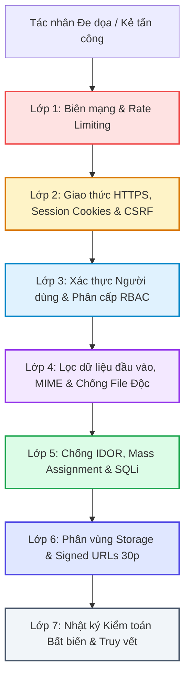

# PHÂN TÍCH CHUYÊN SÂU BẢO MẬT & PHÂN QUYỀN TRUY CẬP (SECURITY & AUTHORIZATION)
## APPLICATION SECURITY, RBAC POLICIES, ATTACK VECTORS & DEFENSIVE SHIELDS
**Vị trí:** `docs/knowledge/08_SECURITY_AND_AUTHORIZATION.md`  
**Ngày lập:** 11/11/2026  
**Cương vị kiểm toán:** Senior Application Security Engineer (AppSec)  
**Tiêu chuẩn đánh giá:** OWASP Top 10 (2021) & Quy chuẩn An toàn Thông tin Giáo dục

---

## 1. MA TRẬN TỔNG THỂ CÁC LỚP BẢO VỆ AN NINH (DEFENSE-IN-DEPTH MATRIX)



---

## 2. PHÂN TÍCH CHI TIẾT TỪNG NGUY CƠ BẢO MẬT & CƠ CHẾ PHÒNG VỆ

---

### 2.1. Phân quyền Truy cập (RBAC) & Ngăn chặn Tấn công IDOR (Insecure Direct Object References)

#### 1. Nguy cơ IDOR là gì?
Kẻ tấn công sau khi đăng nhập tài khoản sinh viên bình thường, thay đổi tham số ID trên URL hoặc Body Request (ví dụ: `POST /tai-lieu/xoa-mem/45` hoặc `POST /yeu-cau-tai-lieu/xac-nhan/12`) để can thiệp, xóa hoặc nghiệm thu tài liệu của người khác mà không có sự cho phép.

#### 2. Kịch bản Tấn công Minh họa
Sinh viên X đăng nhập thành công. Sinh viên X muốn phá hoại đề thi của Sinh viên Y (có `ma_tai_lieu = 100`). Sinh viên X mở Postman hoặc Console trình duyệt, gửi lệnh `DELETE /tai-lieu/100`. Nếu hệ thống chỉ kiểm tra `auth()->check()` mà không kiểm tra quyền sở hữu, tài liệu của Y sẽ bị xóa.

#### 3. Cơ chế Phòng thủ Thực tế trong AGU Academic Hub
Hệ thống áp dụng kiểm tra quyền sở hữu chặt chẽ ở **tầng Application Action và Domain Evaluator**, không chỉ dựa vào việc ẩn nút bấm ở Frontend:

- **Vị trí code:** `app/Modules/Documents/Domain/Services/DocumentAuthorRemovalEvaluator.php:11-25`
```php
public function canAuthorSoftDelete(TaiLieu $document, NguoiDung $user): array
{
    // Kiểm tra IDOR: Người thực hiện bắt buộc phải là chính chủ tải lên
    if ($document->ma_nguoi_dang !== $user->ma_nguoi_dung) {
        return [
            'allowed' => false,
            'message' => 'Bạn không phải là tác giả của tài liệu này.',
        ];
    }
    // ...
}
```
- **Tại phân hệ Bounty:** File `app/Modules/Bounties/Application/Actions/ConfirmBountyFulfillmentAction.php:28-34`
```php
// Chống IDOR: Chỉ người tạo yêu cầu (SV A) mới có quyền bấm nghiệm thu
if ($yeuCau->ma_nguoi_tao !== $user->ma_nguoi_dung) {
    throw new \DomainException('Bạn không có quyền xác nhận yêu cầu tìm tài liệu này.');
}
```
- **Kiểm thử tự động xác minh:** `tests/Feature/DocumentContributionBountyIntegrationTest.php` (Test case `cannot fulfill bounty with another users document` pass 100%).

---

### 2.2. Bảo vệ Tệp tin Tải lên & Ngăn chặn Thực thi Mã độc (File Upload Security)

#### 1. Nguy cơ
Kẻ xấu ngụy trang file mã độc chứa webshell PHP (ví dụ: `shell.php` hoặc `backdoor.php.pdf`) tải lên hệ thống. Nếu file được lưu trong thư mục `public/` và web server (Nginx/Apache) thực thi trực tiếp, kẻ tấn công sẽ chiếm toàn quyền điều khiển máy chủ.

#### 2. Cơ chế Phòng thủ Đa tầng
1. **Kiểm tra đuôi mở rộng (Extension Whitelist):**
   - Chỉ chấp nhận các định dạng học thuật an toàn: `pdf`, `docx`, `pptx`, `zip`. Tuyệt đối chặn các đuôi `.exe`, `.sh`, `.php`, `.bat`, `.js`, `.phtml`.
2. **Kiểm tra định dạng MIME thực tế (MIME Sniffing):**
   - Sử dụng Form Request của Laravel để đọc byte header của tệp, ngăn chặn thủ thuật đổi đuôi file `.php` thành `.pdf`.
3. **Lưu trữ ngoài thư mục Web Root (Private Storage):**
   - 100% tài liệu học thuật được lưu trong `storage/app/private/docs/`. Thư mục này **hoàn toàn không được tạo Symlink ra ngoài `public/`**. Không có bất kỳ URL trực tiếp nào dạng `http://domain.com/storage/file.php` có thể chạm tới tệp.
4. **Đổi tên tệp ngẫu nhiên (UUID / Random File Names):**
   - Tên file gốc của người dùng được mã hóa thành chuỗi ngẫu nhiên (ví dụ: `doc/d7a8f9c1-4b2e-4e3a-8f1b-2c3d4e5f6a7b.pdf`). Kẻ tấn công không thể đoán được vị trí file trên đĩa cứng.
5. **Xem trước và tải về có kiểm soát (Protected Stream Response):**
   - File chỉ được đọc và stream cho người dùng qua hàm `Storage::response()` sau khi đã vượt qua các Middleware kiểm tra trạng thái đăng nhập và kiểm duyệt.

---

### 2.3. Bảo vệ Dữ liệu Riêng tư (PII) Cựu Sinh viên qua Temporary Signed URL 30 Phút

#### 1. Nguy cơ Rò rỉ Thông tin Cá nhân (PII Leakage)
Ảnh chụp bằng tốt nghiệp hoặc giấy chứng nhận của cựu sinh viên chứa các thông tin nhạy cảm: Họ tên, ngày sinh, số CMND/CCCD, xếp loại tốt nghiệp, chữ ký và con dấu của Hiệu trưởng. Nếu đường dẫn này bị lộ công khai hoặc bị thu thập bởi các công cụ tìm kiếm (Googlebot), danh tính cựu sinh viên sẽ bị đe dọa.

#### 2. Giải pháp Kiến trúc Thực tế
- **Vị trí code:** `app/Modules/Identity/Infrastructure/Storage/PrivateKycStorage.php:20-35`
```php
public function getTemporarySignedUrl(string $path, int $expirationMinutes = 30): string
{
    // Tạo URL có chữ ký số HMAC-SHA256 với thời hạn chính xác 30 phút
    return URL::temporarySignedRoute(
        'kyc.preview',
        now()->addMinutes($expirationMinutes),
        ['path' => base64_encode($path)]
    );
}
```
- **Cơ chế:**
  - URL sinh ra có dạng: `/kyc/xem-anh/12?expires=1731315600&signature=8f4e2b...`
  - Chữ ký `signature` được tạo bởi khóa bí mật `APP_KEY` của ứng dụng kết hợp thời điểm hết hạn.
  - Sau 30 phút, chữ ký mất hiệu lực; bất kỳ ai mở lại link đều bị trả về lỗi `403 Invalid Signature`.
  - Tuyến đường `kyc.preview` được bảo vệ đồng thời bởi 2 lớp: Middleware `signed` và Middleware `role:KIEM_DUYET_VIEN,QUAN_TRI_VIEN`. Sinh viên hoặc khách lạ không bao giờ có thể truy cập.

---

### 2.4. Phòng Chống Tấn Công Giả Mạo Yêu Cầu (Cross-Site Request Forgery - CSRF)

#### 1. Nguy cơ
Kẻ xấu tạo một trang web độc hại và dụ dỗ sinh viên (đang đăng nhập AGU Academic Hub) bấm vào một liên kết. Trang web đó tự động kích hoạt một request ngầm gửi đến `POST /yeu-cau-tai-lieu` để tạo Bounty trừ điểm sinh viên.

#### 2. Cơ chế Phòng thủ trong Inertia.js & Laravel
- Laravel tự động sinh một mã CSRF Token duy nhất cho mỗi phiên làm việc (Session) của người dùng.
- Thư viện `axios` của Inertia.js tự động đọc cookie `XSRF-TOKEN` được mã hóa và đính kèm vào header `X-XSRF-TOKEN` của **100% các request POST, PUT, DELETE**.
- Middleware `VerifyCsrfToken` của Laravel kiểm tra và xác thực token này trước khi cho phép request đi vào Controller. Nếu thiếu token hoặc token không khớp, hệ thống lập tức hủy request với mã lỗi **HTTP 419 Page Expired**.

---

### 2.5. Phòng Chống Tiêm Lệnh SQL (SQL Injection - SQLi)

#### 1. Nguy cơ
Kẻ tấn công nhập các chuỗi độc hại vào ô tìm kiếm hoặc trường đăng nhập (ví dụ: `' OR '1'='1`) nhằm thao túng câu lệnh SQL của hệ thống để đánh cắp dữ liệu hoặc vượt qua đăng nhập.

#### 2. Cơ chế Phòng thủ
- 100% các thao tác truy vấn CSDL trong AGU Academic Hub đều sử dụng **Laravel Eloquent ORM** hoặc **Query Builder**, vận hành trên nền tảng **PDO Prepared Statements**:
```php
// File: DocumentRepository.php
$query->where('tieu_de', 'like', "%{$search}%");
```
- Dữ liệu đầu vào của người dùng (`$search`) luôn được phân tách hoàn toàn với câu lệnh SQL và được truyền dưới dạng tham số (Parameter Binding). Hệ quản trị MySQL sẽ xử lý chuỗi này như một giá trị văn bản thuần túy, triệt tiêu 100% nguy cơ SQL Injection.

---

### 2.6. Phòng Chống Gán Giá Trị Hàng Loạt (Mass Assignment Vulnerability)

#### 1. Nguy cơ
Kẻ tấn công gửi thêm các trường dữ liệu trái phép trong form request (ví dụ: gửi thêm `"vai_tro": "QUAN_TRI_VIEN"` hoặc `"diem_uy_tin": 9999` trong form cập nhật hồ sơ) nhằm tự nâng quyền quản trị hoặc tự cấp điểm.

#### 2. Cơ chế Phòng thủ
- 100% các Eloquent Model trong dự án đều khai báo tường minh danh sách `$fillable`:
```php
// File: app/Models/NguoiDung.php
protected $fillable = [
    'ma_khoa',
    'ho_ten',
    'email',
    'mssv',
    'mat_khau',
    'vai_tro',
    'trang_thai',
    'diem_uy_tin',
    'so_lan_vi_pham',
];
```
- Các Form Request (`ProfileUpdateRequest.php`) chỉ validate và cho phép truyền qua các trường an toàn (`ho_ten`, `email`). Mọi trường lạ gửi lên đều bị loại bỏ tự động trước khi gọi lệnh `update()`.

---

### 2.7. Giới Hạn Tần Suất Truy Cập (Rate Limiting)

Hệ thống thiết lập các ngưỡng giới hạn truy cập tại `bootstrap/app.php` và các Action để chống tấn công từ chối dịch vụ (DoS) và vét cạn mật khẩu (Brute-force):
1. **Đăng nhập:** Giới hạn tối đa **5 lần thử sai / phút** cho mỗi địa chỉ IP và tài khoản. Sau 5 lần, IP bị khóa tạm thời 60 giây.
2. **Đăng tải tài liệu:** Giới hạn tối đa **10 lượt upload tài liệu / ngày** cho mỗi tài khoản sinh viên thường (`NFR-04`), ngăn chặn hành vi spam làm tràn dung lượng ổ cứng máy chủ.

---

## 3. CÁC HẠN CHẾ BẢO MẬT HIỆN TẠI & HƯỚNG NÂNG CẤP

> [!WARNING]
> Không có hệ thống nào an toàn tuyệt đối 100%. Dưới đây là các điểm cần lưu ý thực tế khi hội đồng hỏi sâu về bảo mật:

1. **Xác thực 2 yếu tố (2FA / MFA):** Hiện tại hệ thống chưa tích hợp OTP qua SMS hoặc Google Authenticator cho tài khoản Super Admin; mới chỉ dừng lại ở mật khẩu Bcrypt + phân cấp vai trò.
2. **Quét virus tự động (ClamAV):** Tệp tải lên mới được kiểm tra MIME type và extension ở tầng ứng dụng, chưa có tiến trình quét virus nhị phân bằng ClamAV Daemon trước khi lưu đĩa. Đây là tính năng được đề xuất cho môi trường Production thực tế.

