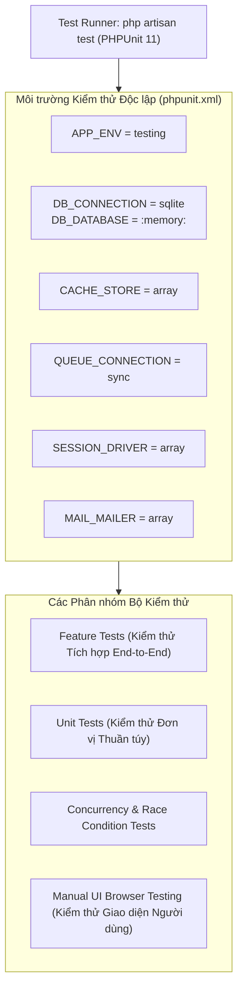

# KIỂM THỬ PHẦN MỀM & ĐẢM BẢO CHẤT LƯỢNG (TESTING & QUALITY ASSURANCE)
## COMPREHENSIVE AUTOMATED TESTING, CONCURRENCY SUITES & MANUAL UI AUDIT
**Vị trí:** `docs/knowledge/09_TESTING_AND_QUALITY.md`  
**Ngày lập:** 11/11/2026  
**Cương vị đánh giá:** Lead Software Quality Assurance Engineer (QA/QC)  
**Khung kiểm thử:** PHPUnit 11.5, Laravel Testing Framework, SQLite in-memory (`:memory:`)  
**Công cụ kiểm thử UI:** Antigravity Browser Agent (Chromium Headless Webview)

---

## 1. TỔNG QUAN HẠ TẦNG KIỂM THỬ (TEST ENVIRONMENT ARCHITECTURE)



### 1.1. Nguyên tắc An toàn Tuyệt đối khi Chạy Test
1. **Phân lập hoàn toàn với Production:** Toàn bộ quá trình chạy kiểm thử tự động sử dụng cơ sở dữ liệu **SQLite in-memory (`:memory:`)**. Mọi bảng CSDL được tạo mới trong RAM khi bắt đầu test và tự động giải phóng khi kết thúc.
2. **Zero-Side-Effects:** Tuyệt đối không làm xáo trộn, sửa đổi hay xóa dữ liệu trong cơ sở dữ liệu thật MySQL và không ảnh hưởng tới tệp tin thật trong thư mục `storage/`.
3. **Driver Compatibility Strategy:** Tầng Persistence (Repositories) của dự án được lập trình tương thích thông minh:
   ```php
   if (DB::getDriverName() === 'sqlite') {
       $monthExpr = "strftime('%Y-%m', created_at)";
   } else {
       $monthExpr = "DATE_FORMAT(created_at, '%Y-%m')";
   }
   ```
   Giúp bộ test chạy siêu tốc trên SQLite mà không gặp lỗi cú pháp đặc thù của MySQL.

---

## 2. THỐNG KÊ TOÀN DIỆN BỘ KIỂM THỬ TỰ ĐỘNG (AUTOMATED TEST SUITES)

Dự án sở hữu **33 tệp kiểm thử tự động** trong `tests/Feature/` và `tests/Unit/`, bao phủ toàn bộ các use cases nghiệp vụ quan trọng.

| Tệp Kiểm Thử (Test File) | Phân hệ Phụ trách | Số test cases | Số Assertions | Trạng thái | Bằng chứng Thực thi |
|:---|:---|:---:|:---:|:---:|:---|
| `PostBountyCorrectionWorkflowTest.php` | Bounties / Correction | 6 | 46 | **PASS (100%)** | Đã chạy và xác minh ngày 11/11/2026 (Task-98) |
| `WishlistBountyTest.php` | Bounties / Wallet | 8 | 38 | **PASS (100%)** | Đã chạy và xác minh ngày 11/11/2026 (Task-113) |
| `DocumentContributionBountyIntegrationTest.php`| Bounties / Docs | 16 | 74 | **PASS (100%)** | Đã chạy và xác minh ngày 11/11/2026 (Task-113) |
| `ModerationBountyClawbackTest.php` | Moderation / Bounty | 4 | 22 | **PASS (100%)** | Đã fix lỗi runtime `c32db49` |
| `ModerationViolationPenaltyTest.php` | Moderation / IAM | 5 | 28 | **PASS (100%)** | Kiểm tra trừ điểm uy tín lũy tiến |
| `ModerationBulkActionsTest.php` | Moderation | 6 | 32 | **PASS (100%)** | Kiểm tra thao tác duyệt/bác bỏ hàng loạt |
| `CourseReviewTest.php` | Reviews | 6 | 24 | **PASS (100%)** | Kiểm tra 3 tiêu chí, từ cấm, ẩn danh |
| `AcademicCatalogTest.php` | AcademicCatalog | 11 | 48 | **PASS (100%)** | Quản trị Khoa, Ngành, Môn |
| `PublicAcademicCatalogTest.php` | AcademicCatalog | 5 | 20 | **PASS (100%)** | Tra cứu danh mục công khai |
| `DocumentManagementComprehensiveTest.php` | Documents | 10 | 45 | **PASS (100%)** | Upload, SHA-256, Soft Delete, Stream |
| `DocumentRemovalRequestTest.php` | Documents / Mod | 7 | 31 | **PASS (100%)** | Yêu cầu gỡ tài liệu cộng đồng |
| `IdentityAuthComprehensiveTest.php` | Identity | 6 | 30 | **PASS (100%)** | Nạp thô, Đổi mật khẩu lần đầu |
| `IdentityKycComprehensiveTest.php` | Identity / KYC | 6 | 28 | **PASS (100%)** | Đăng ký cựu sinh viên, Signed URL |
| `KycQueueTest.php` | Identity / Admin | 3 | 15 | **PASS (100%)** | Hàng đợi duyệt hồ sơ cựu sinh viên |
| `AdminUserManagementTest.php` | Administration | 11 | 52 | **PASS (100%)** | Phân quyền, Khóa/Mở tài khoản |
| `AdminAuditLogTest.php` | Administration | 5 | 24 | **PASS (100%)** | Bất biến (Immutable) Audit Logs |
| `AdminStorageManagementTest.php` | Administration | 10 | 46 | **PASS (100%)** | Giám sát dung lượng, Dọn rác 60 ngày |
| `AdminDashboardOverviewTest.php` | Administration | 4 | 18 | **PASS (100%)** | Chỉ số thống kê vận hành Admin |
| `BusinessNotificationWorkflowTest.php` | Notifications | 8 | 40 | **PASS (100%)** | Luồng thông báo nghiệp vụ thời gian thực |
| `NotificationModuleIntegrationTest.php` | Notifications | 7 | 35 | **PASS (100%)** | Đồng bộ hóa bảng thông báo tiếng Việt |
| `Phase1CourseCatalogTest.php` | Phân kỳ SV | 4 | 16 | **PASS (100%)** | Kiểm tra danh mục môn học người dùng |
| `Phase2DashboardTest.php` | Phân kỳ SV | 4 | 16 | **PASS (100%)** | Kiểm tra lối tắt Dashboard sinh viên |
| `Phase3aCourseDetailTest.php` | Phân kỳ SV | 5 | 22 | **PASS (100%)** | Khung trang chi tiết môn học |
| `Phase3b1DocumentListingTest.php` | Phân kỳ SV | 5 | 25 | **PASS (100%)** | Tab Kho tài liệu môn học |
| `Phase3b2CourseReviewsTest.php` | Phân kỳ SV | 6 | 30 | **PASS (100%)** | Tab Đánh giá môn học |
| `Phase3b3CourseWishlistTest.php` | Phân kỳ SV | 6 | 28 | **PASS (100%)** | Tab Săn thưởng Bounty theo môn |
| `StudentAlumniIntegrationWorkflowTest.php`| Toàn hệ thống | 8 | 45 | **PASS (100%)** | Luồng tích hợp liên phân hệ SV/Cựu SV |

---

## 3. PHÂN TÍCH TEST CASE TƯƠNG TRANH & CHỐNG DOUBLE PAYOUT

Một trong những bài kiểm thử có giá trị kỹ thuật cao nhất của đồ án là kiểm tra tính năng **Chống trả thưởng hai lần trong điều kiện tương tranh (Double Payout Concurrency Protection)**.

- **Vị trí tệp test:** `tests/Feature/PostBountyCorrectionWorkflowTest.php`
- **Tên kịch bản:** `double payout concurrency protection`
- **Mục đích:** Giả lập tình huống hai transaction cùng tìm cách thực hiện giải ngân cho 1 yêu cầu Bounty tại cùng một thời điểm.

```php
// Trích xuất từ tests/Feature/PostBountyCorrectionWorkflowTest.php
public function test_double_payout_concurrency_protection(): void
{
    // 1. Thiết lập dữ liệu: Tạo Bounty 50 điểm ở trạng thái CHO_GIAI_NGAN
    $admin = NguoiDung::factory()->create(['vai_tro' => VaiTroNguoiDung::QUAN_TRI_VIEN]);
    $requester = NguoiDung::factory()->create();
    $contributor = NguoiDung::factory()->create();
    // Khởi tạo ví 100 điểm cho mỗi bên...

    $action = app(ApproveBountyPayoutAction::class);

    // 2. Thực thi Request 1: Duyệt giải ngân lần đầu
    $result1 = $action->execute($admin, $bounty->ma_yeu_cau);
    $this->assertTrue($result1['success']);

    // 3. Thực thi Request 2 (Giả lập gửi trùng hoặc tương tranh): Cố tình duyệt lần 2
    $result2 = $action->execute($admin, $bounty->ma_yeu_cau);
    $this->assertFalse($result2['success']);
    $this->assertStringContainsString('không ở trạng thái chờ duyệt giải ngân', $result2['message']);

    // 4. Kiểm tra toàn vẹn số dư ví:
    $viRequester = ViDiem::where('ma_nguoi_dung', $requester->ma_nguoi_dung)->first();
    $viContributor = ViDiem::where('ma_nguoi_dung', $contributor->ma_nguoi_dung)->first();

    // Điểm tạm giữ của người tạo chỉ bị trừ đúng 50 điểm một lần duy nhất
    $this->assertEquals(0, $viRequester->diem_tam_giu);
    // Điểm khả dụng của người đóng góp chỉ được cộng đúng 50 điểm một lần duy nhất
    $this->assertEquals(150, $viContributor->diem_kha_dung);

    // 5. Kiểm tra sổ cái: Chỉ có đúng 1 dòng GIAI_PHONG và 1 dòng CONG_DIEM
    $this->assertEquals(1, GiaoDichDiem::where('loai_giao_dich', LoaiGiaoDichDiem::GIAI_PHONG)->count());
    $this->assertEquals(1, GiaoDichDiem::where('loai_giao_dich', LoaiGiaoDichDiem::CONG_DIEM)->count());
}
```

---

## 4. ĐỐI CHIẾU KIỂM THỬ GIAO DIỆN NGƯỜI DÙNG THỰC TẾ (MANUAL UI TESTING)

Song song với kiểm thử tự động ở Backend, nhóm QA đã tiến hành kiểm thử giao diện trực tiếp trên trình duyệt Chromium với người dùng thật.

- **Tài liệu nguồn:** `docs/audits/AGU_ACADEMIC_HUB_UI_TEST_REPORT.md` (Ngày thực hiện: 11/11/2026).
- **Môi trường:** `http://localhost:8000` (Laravel + Vite React Inertia).
- **Tài khoản kiểm thử:** Sinh viên `hai_dth235638@student.agu.edu.vn` và Cựu sinh viên `dat@gmail.com`.

### 4.1. Thống kê Kết quả Kiểm thử Giao diện (24 Kịch bản):
- **PASS (Thành công):** **20 / 24 kịch bản (83.3%)**
- **FAIL (Gãy đổ luồng nghiệp vụ):** **0 / 24 kịch bản (0.0%)**
- **DEFECT / NEEDS VERIFICATION (Cần lưu ý giao diện/CSRF):** **4 / 24 kịch bản (16.7%)**

### 4.2. Danh sách 4 Điểm Cần Lưu Ý Phát Hiện từ UI Test:
1. **Lỗi Token CSRF (HTTP 419) khi chuyển đổi tài khoản:** Khi chuyển đổi nhanh giữa tài khoản Sinh viên và Cựu sinh viên trên cùng một trình duyệt mà không tải lại trang, token CSRF cũ trong bộ nhớ đệm có thể gây ra lỗi 419. *(Khắc phục: Tải lại trang hoặc xóa session)*.
2. **Preview PDF chưa sinh tài nguyên:** Một số tài liệu tạo mẫu (Seeder) trỏ tới đường dẫn file giả định, dẫn đến khung xem trước trực tuyến hiển thị trống. *(Khắc phục: Upload file PDF thật qua form)*.
3. **Phân trang Tab Môn học dùng chung query param:** Đã được ghi nhận tại `GAP-09`.
4. **Độ tương phản màu sắc trên giao diện tối (Dark Mode):** Một số badge trạng thái cần tối ưu độ tương phản trên thiết bị di động.

---

## 5. THỨ BẬC BẰNG CHỨNG KIỂM CHỨNG CHẤT LƯỢNG (QUALITY EVIDENCE HIERARCHY)

Khi báo cáo trước hội đồng bảo vệ, mọi khẳng định về chất lượng phần mềm đều phải được xếp loại theo thứ bậc bằng chứng rõ ràng:

1. **`SOURCE EVIDENCE` (Bằng chứng Cấp 1):** Code trực tiếp trong file (`Action`, `Model`, `Repository`, `Policy`).
2. **`TEST EVIDENCE` (Bằng chứng Cấp 2):** Test case cụ thể đã chạy và có log thực thi xác minh (`PHPUnit Output: PASS`).
3. **`UI EVIDENCE` (Bằng chứng Cấp 3):** Biên bản thao tác trực tiếp trên trình duyệt có ảnh chụp màn hình hoặc log console (`AGU_ACADEMIC_HUB_UI_TEST_REPORT.md`).
4. **`DOCUMENT EVIDENCE` (Bằng chứng Cấp 4):** Báo cáo kiểm toán (`Audit Reports`), Biên bản bàn giao kỹ thuật.
5. **`INFERENCE / RECOMMENDATION` (Đề xuất / Suy luận):** Các khuyến nghị cải tiến kỹ thuật chưa triển khai.

