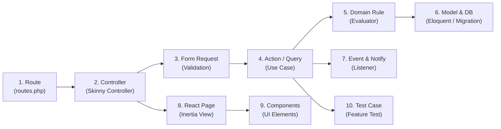

# CẨM NANG ĐỌC CODE, TỰ SỬA ĐỔI TÍNH NĂNG & XỬ LÝ SỰ CỐ (DEVELOPER CHANGE & DEBUGGING GUIDE)
## PRACTICAL GUIDE FOR CODE EXPLORATION, FEATURE EXPANSION & SYSTEM TROUBLESHOOTING
**Vị trí:** `docs/knowledge/10_CODE_READING_AND_CHANGE_GUIDE.md`  
**Ngày lập:** 11/11/2026  
**Mục tiêu tối thượng:** Trao quyền làm chủ toàn diện cho chủ dự án. Giúp bạn tự tin định vị mã nguồn, tự chỉnh sửa nghiệp vụ, bổ sung tính năng mới và tự khắc phục mọi sự cố runtime mà không bị phụ thuộc vào bất kỳ ai.

---

## 1. BẢN ĐỒ ĐỊNH VỊ MÃ NGUỒN THEO NGHIỆP VỤ (BUSINESS CODE LOCATOR)

Khi cần tìm kiếm mã nguồn của một tính năng bất kỳ, hãy đi theo quy trình 10 bước chuẩn hóa sau:



---

### Bảng Tra Cứu Tệp Thực Tế Theo Từng Tính Năng Điển Hình

#### Trường hợp A: Tính năng Tạo Yêu Cầu Săn Thưởng Tài Liệu (Bounty Request)
1. **Route:** `app/Modules/Bounties/routes.php:12` (`POST /yeu-cau-tai-lieu` $\to$ `name: wishlist.store`)
2. **Controller:** `app/Modules/Bounties/Presentation/Http/Controllers/WishlistBountyController.php` (Method: `store`)
3. **Form Request:** `app/Modules/Bounties/Presentation/Http/Requests/StoreBountyRequest.php` (Quy định: `diem_thuong >= 10`, `tieu_de`)
4. **Action:** `app/Modules/Bounties/Application/Actions/CreateBountyRequestAction.php`
5. **Domain Rule:** `app/Modules/Bounties/Domain/Services/ReputationEvaluator.php` (Hàm: `dongBangDiemBounty`)
6. **Model:** `app/Models/YeuCauTaiLieu.php`, `app/Models/ViDiem.php`, `app/Models/GiaoDichDiem.php`
7. **Migration:** `database/migrations/2026_10_14_000008_create_vi_diem_va_yeu_cau_tai_lieus_table.php`
8. **Notification:** `app/Modules/Notifications/Domain/Events/DocumentContributedToBountyEvent.php`
9. **Frontend Page:** `resources/js/Pages/Wishlist/Index.jsx` và `resources/js/Pages/Courses/Show.jsx`
10. **Frontend Modal:** `resources/js/Components/Wishlist/CreateRequestModal.jsx`
11. **Test xác minh:** `tests/Feature/WishlistBountyTest.php`

---

#### Trường hợp B: Tính năng Phê duyệt Giải ngân Điểm thưởng (Bounty Payout)
1. **Route:** `app/Modules/Bounties/routes.php:26` (`POST /quan-tri/bounties/duyet-giai-ngan/{id}` $\to$ `name: admin.bounties.approve-payout`)
2. **Controller:** `app/Modules/Bounties/Presentation/Http/Controllers/AdminBountyPayoutController.php` (Method: `approve`)
3. **Action:** `app/Modules/Bounties/Application/Actions/ApproveBountyPayoutAction.php`
4. **Domain Rule:** `app/Modules/Bounties/Domain/Services/ReputationEvaluator.php` (Hàm: `giaiNganDiemBounty`)
5. **Sổ cái CSDL:** Ghi vào bảng `giao_dich_diem` với `loai_giao_dich = GIAI_PHONG` (A) và `CONG_DIEM` (B)
6. **Nhật ký:** `app/Modules/Administration/Domain/Services/AuditLogger.php` (Ghi vào `nhat_ky_kiem_toan`)
7. **Event:** `app/Modules/Notifications/Domain/Events/BountyFulfillmentConfirmedEvent.php`
8. **Frontend Page:** `resources/js/Pages/Admin/Bounties/PayoutQueue.jsx`
9. **Test xác minh:** `tests/Feature/PostBountyCorrectionWorkflowTest.php` (Kịch bản: `test_double_payout_concurrency_protection`)

---

## 2. HƯỚNG DẪN THỰC CHIẾN KHI THAY ĐỔI NGHIỆP VỤ (CHANGE GUIDE)

---

### Kịch bản 1: Thêm một Trường mới vào Bảng Dữ liệu (Ví dụ: Thêm trường `so_trang` vào Tài liệu)
Khi cần thêm trường `so_trang` (số trang của file PDF):
1. **Bước 1 - Tạo Migration:**
   Chạy lệnh tạo migration bổ sung:
   `php artisan make:migration add_so_trang_to_tai_lieu_table --table=tai_lieu`
   Khai báo trong file migration:
   ```php
   $table->integer('so_trang')->unsigned()->nullable()->after('dung_luong_kb');
   ```
2. **Bước 2 - Cập nhật Model:**
   Mở `app/Models/TaiLieu.php`, thêm `'so_trang'` vào mảng `$fillable`.
3. **Bước 3 - Cập nhật Form Request:**
   Mở `app/Modules/Documents/Presentation/Http/Requests/UploadDocumentRequest.php`, thêm rule validate:
   ```php
   'so_trang' => ['nullable', 'integer', 'min:1'],
   ```
4. **Bước 4 - Cập nhật Action:**
   Mở `app/Modules/Documents/Application/Actions/UploadDocumentAction.php`, gán giá trị:
   ```php
   'so_trang' => $data['so_trang'] ?? null,
   ```
5. **Bước 5 - Cập nhật Frontend UI:**
   Mở `resources/js/Pages/Documents/UploadModal.jsx`, thêm input nhập số trang và hiển thị badge số trang trên `DocumentCard.jsx`.
6. **Bước 6 - Bổ sung Test:**
   Mở `tests/Feature/DocumentManagementComprehensiveTest.php`, thêm assertion:
   ```php
   $this->assertDatabaseHas('tai_lieu', ['so_trang' => 25]);
   ```

---

### Kịch bản 2: Thay đổi Quy tắc Nghiệp vụ Điểm thưởng (Ví dụ: Tăng mức thưởng tối thiểu từ 10 lên 20 điểm)
1. Mở Form Request: `app/Modules/Bounties/Presentation/Http/Requests/StoreBountyRequest.php`.
   Sửa rule: `'diem_thuong' => ['required', 'integer', 'min:20']`.
2. Mở Domain Evaluator: `app/Modules/Bounties/Domain/Services/BountyRuleEvaluator.php`.
   Sửa ngưỡng kiểm tra: `if ($diemThuong < 20) ...`.
3. Mở Component React: `resources/js/Components/Wishlist/CreateRequestModal.jsx`.
   Sửa nhãn gợi ý: `<input min="20" placeholder="Tối thiểu 20 điểm..." />`.
4. Chạy lại test suite: `php artisan test tests/Feature/WishlistBountyTest.php`.

---

## 3. CẨM NANG GỠ LỖI THỰC CHIẾN (DEBUGGING SCENARIOS)

---

### Tình huống 1: Lỗi HTTP 419 (Page Expired / CSRF Token Mismatch)
- **Triệu chứng:** Người dùng bấm Submit form đăng nhập hoặc nộp bài, trang bị đơ hoặc báo lỗi "Trang đã hết hạn (419)".
- **Nguyên nhân phổ biến:**
  1. Phiên làm việc (Session) của người dùng đã hết hạn sau thời gian dài không tương tác.
  2. Vừa chuyển đổi nhanh giữa tài khoản Sinh viên và Cựu sinh viên trên cùng 1 tab trình duyệt khiến cookie CSRF cũ chưa kịp làm mới.
  3. Môi trường local `.env` cấu hình `SESSION_DOMAIN` không khớp với tên miền đang chạy (`localhost` vs `127.0.0.1`).
- **Cách khắc phục:**
  - Nhấn tổ hợp phím `Ctrl + F5` để làm mới hoàn toàn trang và nhận CSRF Token mới.
  - Kiểm tra file `.env`: Đảm bảo `SESSION_DRIVER=database` hoặc `file`, xóa cache cấu hình bằng lệnh:
    `php artisan config:clear && php artisan cache:clear`

---

### Tình huống 2: Lỗi HTTP 403 (Forbidden / Unauthorized Access)
- **Triệu chứng:** Sinh viên click vào đường dẫn nhưng bị màn hình trắng hoặc thông báo "Bạn không có quyền thực hiện thao tác này".
- **Nguyên nhân & Cách kiểm tra:**
  1. **Chặn bởi RoleMiddleware:** Kiểm tra xem route có bị gán quyền `role:KIEM_DUYET_VIEN,QUAN_TRI_VIEN` hay không.
     - *File kiểm tra:* `app/Modules/<ModuleName>/routes.php`.
  2. **Chặn bởi EnsurePasswordChanged:** Sinh viên đăng nhập lần đầu chưa đổi mật khẩu nhưng cố tình truy cập trang khác.
     - *File kiểm tra:* `app/Http/Middleware/EnsurePasswordChanged.php`.
  3. **Chặn bởi IDOR Domain Check:** Người dùng cố tình xóa tài liệu hoặc duyệt Bounty không thuộc quyền sở hữu của mình.
     - *File kiểm tra:* Tra cứu hàm `authorize()` trong Form Request hoặc câu lệnh kiểm tra `$user->ma_nguoi_dung !== $ownerId` trong Action tương ứng.

---

### Tình huống 3: Lỗi HTTP 422 (Unprocessable Entity / Validation Failure)
- **Triệu chứng:** Người dùng bấm nút nhưng hệ thống không thực hiện thao tác và tự động cuộn trang lên trên hoặc viền đỏ các ô input.
- **Nguyên nhân:** Dữ liệu gửi lên không vượt qua được bộ quy tắc của `FormRequest`.
- **Cách debug nhanh:**
  - Mở tab **Network** trong Developer Tools trình duyệt (`F12`), lọc các request `Fetch/XHR`.
  - Tìm request bị đỏ (mã 422), bấm xem tab **Response**. Laravel sẽ trả về chi tiết trường bị lỗi:
    ```json
    {
      "errors": {
        "file": ["Tài liệu này đã tồn tại trong môn học: 'Đề thi cuối kỳ COS101'"],
        "diem_thuong": ["Số dư khả dụng của bạn không đủ để treo thưởng."]
      }
    }
    ```
  - Mở Form Request tương ứng tại `app/Modules/<ModuleName>/Presentation/Http/Requests/` để xem và hiệu chỉnh lại rule nếu cần.

---

### Tình huống 4: Số Dư Ví Bị Kẹt hoặc Bounty Không Thể Giải Ngân
- **Triệu chứng:** Bounty ở trạng thái `CHO_GIAI_NGAN`, Admin bấm duyệt nhưng báo lỗi: "Không thể giải ngân".
- **Nguyên nhân:**
  1. Bản ghi `dap_ung_yeu_cau_tai_lieu` chưa ở trạng thái `NGUOI_YEU_CAU_XAC_NHAN` (Người tạo chưa bấm xác nhận).
  2. Cột `ma_dap_ung_duoc_chon` trong bảng `yeu_cau_tai_lieu` bị NULL.
  3. Điểm tạm giữ trong ví người tạo (`diem_tam_giu`) bị nhỏ hơn mức điểm thưởng do lỗi dữ liệu cũ trước đây.
- **Cách tra cứu tại CSDL:**
  ```sql
  -- Kiểm tra tính nhất quán giữa Yêu cầu và Bài nộp
  SELECT ma_yeu_cau, trang_thai, diem_thuong, ma_dap_ung_duoc_chon 
  FROM yeu_cau_tai_lieu WHERE ma_yeu_cau = 12;

  -- Kiểm tra trạng thái bài nộp
  SELECT ma_dap_ung, trang_thai, ma_tai_lieu, ma_nguoi_dong_gop 
  FROM dap_ung_yeu_cau_tai_lieu WHERE ma_yeu_cau = 12;

  -- Kiểm tra số dư ví người tạo
  SELECT ma_vi, ma_nguoi_dung, diem_kha_dung, diem_tam_giu 
  FROM vi_diem WHERE ma_nguoi_dung = (SELECT ma_nguoi_tao FROM yeu_cau_tai_lieu WHERE ma_yeu_cau = 12);
  ```
- **Xử lý:** Mở `app/Modules/Bounties/Application/Actions/ApproveBountyPayoutAction.php:36-58` để theo dõi các điều kiện guard clauses đang chặn luồng thực thi.

