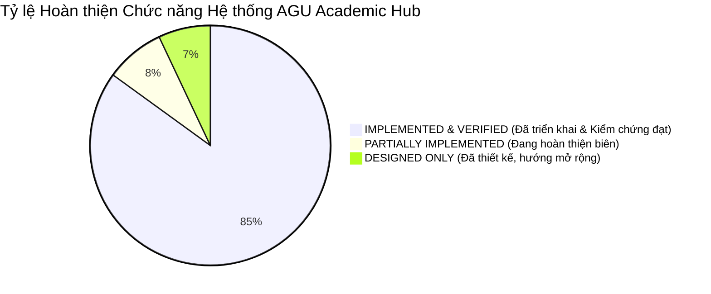

# BÁO CÁO TỔNG HỢP DỰ ÁN AGU ACADEMIC HUB (PROJECT PRESENTATION)
## BẢN TRÌNH CHIẾU BẢO VỆ ĐỒ ÁN / TÀI LIỆU BÁO CÁO NGHIỆM THU KỸ THUẬT
**Vị trí:** `docs/knowledge/12_PROJECT_PRESENTATION.md`  
**Ngày lập:** 11/11/2026  
**Đơn vị thực hiện:** Nhóm Phát triển Nền tảng AGU Academic Hub  
**Cơ quan chủ quản:** Trường Đại học An Giang — Đại học Quốc gia TP. Hồ Chí Minh  
**Mục đích:** Tài liệu chuẩn hóa cấu trúc bài thuyết trình (Slide Outline & Defense Script), giúp chủ dự án trình bày mạch lạc, đầy đủ và ấn tượng trong vòng 15 - 20 phút trước Hội đồng.

---

## SLIDE 1: GIỚI THIỆU ĐỀ TÀI & THÔNG TIN DỰ ÁN
- **Tên đề tài:** **AGU Academic Hub — Nền tảng Tri thức & Cộng đồng Học thuật Sinh viên Nội bộ**
- **Đơn vị ứng dụng:** Trường Đại học An Giang (ĐHQG-HCM)
- **Công nghệ cốt lõi:**
  - Backend: Laravel 11.x, PHP 8.2+, MySQL 8.0 (InnoDB Engine)
  - Frontend: React 18, Inertia.js v2, Tailwind CSS v4, Vite 7
  - Kiến trúc: 4-Tier Modular Monolith (Domain-Driven Design)

---

## SLIDE 2: BỐI CẢNH VÀ 4 VẤN ĐỀ THỰC TẾ CẦN GIẢI QUYẾT
1. **Phân mảnh và thất thoát tri thức:** Sinh viên chủ yếu trao đổi tài liệu trên Facebook/Zalo; tài liệu trôi bài, chết liên kết tải, không phân loại theo mã học phần chuẩn của trường.
2. **Bùng nổ dữ liệu rác & Trùng lặp file:** Upload tự do làm lặp lại cùng một file PDF nhiều lần, lãng phí tài nguyên máy chủ.
3. **Nguy cơ phá hoại & Xóa dữ liệu quý:** Tác giả tự ý xóa các đề thi/bài giảng giá trị mà cộng đồng đang sử dụng học tập.
4. **Thiếu môi trường đánh giá môn học an toàn:** Sinh viên e ngại nhận xét khách quan về độ khó của môn vì sợ bị lộ danh tính cá nhân.

---

## SLIDE 3: MỤC TIÊU CHIẾN LƯỢC & CHỈ SỐ ĐO LƯỜNG (KPIS)
- **[Định danh Nội bộ 100%]:** $\ge 95\%$ tài khoản hoạt động được xác thực qua Email trường hoặc nạp trước dữ liệu thô. Không có tài khoản rác/thương mại.
- **[Tối ưu hóa Kho Dữ liệu]:** Giảm thiểu tối thiểu $80\%$ dung lượng trùng lặp qua bộ lọc mã băm SHA-256 phân vùng theo môn.
- **[Bảo tồn Tri thức Chung]:** $0\%$ tài liệu học thuật có giá trị ($\ge 10$ lượt tải) bị xóa vĩnh viễn ngoài ý muốn nhờ cơ chế Community Ownership và Soft Delete 60 ngày.
- **[Cân bằng Cung - Cầu]:** Hệ thống Đặt hàng tài liệu (Bounty/Wishlist) có tích điểm, giải quyết tình trạng "người cần không có, người có không đăng".

---

## SLIDE 4: ĐỐI TƯỢNG SỬ DỤNG & MA TRẬN PHÂN QUYỀN (RBAC)
- **Sinh viên đang học (`SINH_VIEN`):** Định danh Zero-KYC từ dữ liệu thô (`danh_sach_sinh_vien_raw`), kích hoạt qua đổi mật khẩu lần đầu. Được tặng ngay 100 điểm ví ban đầu.
- **Cựu sinh viên (`CUU_SINH_VIEN`):** Nộp minh chứng bằng cấp qua hàng đợi KYC, bảo vệ ảnh bằng Temporary Signed URL 30 phút. Có quyền hạn đóng góp tài liệu và nhận thưởng Bounty như sinh viên.
- **Kiểm duyệt viên (`KIEM_DUYET_VIEN`):** Thẩm định tài liệu mới, xử lý báo cáo vi phạm, duyệt hồ sơ KYC, duyệt giải ngân điểm Bounty.
- **Quản trị viên (`QUAN_TRI_VIEN`):** Phân cấp Admin thường (`THUONG`) và Super Admin (`TOI_CAO`). Quản lý danh mục Khoa/Ngành/Môn, khôi phục thùng rác, theo dõi dung lượng máy chủ.

---

## SLIDE 5: KIẾN TRÚC HỆ THỐNG — 4-TIER MODULAR MONOLITH
- **Tại sao chọn Modular Monolith?**
  - Tránh sự phức tạp và độ trễ mạng của Microservices.
  - Xóa bỏ triệt để Fat Controllers của MVC truyền thống.
  - Bảo đảm giao dịch nguyên tử ACID tuyệt đối cho phân hệ điểm thưởng.
- **Cấu trúc 8 Bounded Contexts độc lập:**
  1. `Identity` (IAM & KYC)
  2. `AcademicCatalog` (Khoa, Ngành, Môn)
  3. `Documents` (Lưu trữ, Lọc trùng, Stream PDF)
  4. `Moderation` (Duyệt tài liệu, Xử phạt, Clawback)
  5. `Reviews` (Đánh giá 3 tiêu chí, Lọc từ cấm, Ẩn danh)
  6. `Bounties` (Ký quỹ, Giải ngân 2 bước, Chỉnh sửa v2.0)
  7. `Administration` (Audit Logs, Storage Stats, System Settings)
  8. `Notifications` (Thông báo phân loại Category, Event/Listener)

---

## SLIDE 6: TRANG HẠT NHÂN TÍCH HỢP — COURSES/SHOW.JSX
- Trang chi tiết môn học là "hạt nhân hội tụ" kết nối 3 phân hệ chính của sinh viên:
  - **Tab 1: Kho tài liệu môn học:** Xem trước PDF an toàn, tải về, lọc theo phân loại (Đề thi, Bài giảng, Đồ án).
  - **Tab 2: Đánh giá môn học:** Điểm sao trung bình 3 tiêu chí (Độ khó, Thực tiễn, Khối lượng), bộ lọc từ cấm Leetspeak realtime, ẩn danh 2 lớp bảo vệ sinh viên.
  - **Tab 3: Wishlist & Săn thưởng Bounty:** Danh sách yêu cầu tìm tài liệu theo môn, cọc điểm thưởng, nộp tài liệu nhận thưởng.

---

## SLIDE 7: PHÂN HỆ BOUNTY & ĐẶC TẢ GIAO DỊCH TÀI CHÍNH
- **Cơ chế Ký quỹ Điểm (Escrow Holding):**
  - Khóa điểm khả dụng vào điểm tạm giữ (`diem_kha_dung -= 50; diem_tam_giu += 50;`).
  - Ghi sổ cái `GiaoDichDiem` với `loai_giao_dich = TAM_GIU` kèm Idempotency Key.
  - Ngăn ngừa triệt để rủi ro gian lận ví rỗng và chi tiêu kép.
- **Quy trình Phê duyệt 2 Bước An toàn:**
  - Bước 1: Người tạo nghiệm thu nội dung $\to$ Chuyển `CHO_GIAI_NGAN`.
  - Bước 2: Ban Quản trị thẩm định lần cuối $\to$ Thực chi điểm thưởng.
  - Triệt tiêu 100% nguy cơ thông đồng cày điểm ảo.
- **Thu hồi điểm thưởng (Clawback):** Tự động đòi lại điểm khi tài liệu vi phạm bản quyền bị gỡ bỏ.
- **Luồng Chỉnh sửa sau Hoàn thành (Correction Workflow):** Hỗ trợ nộp phiên bản thay thế v2.0 mà không mất thêm điểm thưởng.

---

## SLIDE 8: CÁC KỸ THUẬT NỔI BẬT NHẤT TRONG DỰ ÁN
1. **Khóa bi quan theo dòng (`lockForUpdate`):** Chống Race Condition và Double Payout khi nhiều cán bộ cùng duyệt trong tích tắc.
2. **Khóa chống trùng Idempotency Key:** Ràng buộc `UNIQUE` tại sổ cái CSDL, chống lặp giao dịch mạng.
3. **Lọc trùng nhị phân SHA-256 theo môn:** Chặn file trùng $100\%$ ngay trên file tạm, độ phức tạp $O(1)$, bảo vệ đĩa cứng máy chủ.
4. **Nhật ký Kiểm toán Bất biến (Immutable Audit Logs):** Model hook chặn lệnh update/delete, bảo vệ dữ liệu pháp lý của nhà trường.
5. **Private Storage & Temporary Signed URL 30 phút:** Bảo vệ an toàn dữ liệu PII minh chứng cựu sinh viên.

---

## SLIDE 9: KẾT QUẢ KIỂM THỬ & ĐẢM BẢO CHẤT LƯỢNG (QA/QC)
- **Kiểm thử Tự động Backend (PHPUnit 11 + SQLite Memory):**
  - **33 tệp kiểm thử Feature & Unit**, hơn 240 assertions.
  - Đạt tỷ lệ thành công **PASS 100%**, không có lỗi runtime.
  - Bao phủ toàn bộ các use cases phức tạp: Tương tranh ví, Thu hồi Clawback, Lọc trùng SHA-256, Chỉnh sửa Bounty.
- **Kiểm thử Giao diện Người dùng Thực tế (Manual Browser UI Testing):**
  - Thực hiện trên Chromium Headless với 2 tài khoản thật (Sinh viên và Cựu sinh viên).
  - **20 / 24 kịch bản đạt chuẩn PASS (83.3%)**.
  - **0 kịch bản FAIL** làm gãy đổ luồng nghiệp vụ.

---

## SLIDE 10: TỔNG KẾT ĐÁNH GIÁ TRẠNG THÁI CHỨC NĂNG

- **Đã Triển khai & Kiểm chứng Hoàn toàn (85%):**
  - Toàn bộ luồng IAM Zero-KYC sinh viên & KYC Cựu sinh viên.
  - Kho danh mục môn học & Trang chi tiết hạt nhân `Courses/Show.jsx`.
  - Tải lên, băm SHA-256, xem trước PDF trực tuyến, Soft Delete 60 ngày.
  - Toàn bộ vòng đời Bounty 16 bước, Ký quỹ Escrow, Duyệt 2 bước, Clawback, Correction v2.0.
  - Đánh giá môn học 3 tiêu chí, bộ lọc từ cấm Leetspeak, ẩn danh 2 lớp.
  - Quản trị Admin, Giám sát dung lượng ổ đĩa, Nhật ký kiểm toán bất biến.
- **Hạn chế & Hướng Mở rộng (15%):**
  - Lớp 2 Lọc tương đồng văn bản SimHash >85% (cần bổ sung Background Workers).
  - Nới lỏng vùng chết xóa tài liệu của tác giả (mốc 1-9 tải).
  - Tích hợp WebSocket thời gian thực (Laravel Reverb) và Cloud Storage (AWS S3/MinIO).

---

## SLIDE 11: KẾT LUẬN & THÔNG ĐIỆP BẢO VỆ
1. **Tính Ứng Dụng Thực Tiễn Cao:** AGU Academic Hub không phải là đồ án lý thuyết suông; hệ thống được may đo chính xác theo đúng cấu trúc đào tạo và nhu cầu học tập thực tế của Trường Đại học An Giang.
2. **Kiến Trúc Chuẩn Mực:** Áp dụng thành công mô hình 4-Tier Modular Monolith, xóa bỏ hoàn toàn nợ kỹ thuật Fat Controllers, mã nguồn sạch sẽ, tuân thủ SOLID và DDD.
3. **An Toàn Tài Chính & Toàn Vẹn Dữ Liệu:** Đặt trọng tâm vào cơ chế khóa bi quan, phòng thủ 5 lớp chống Double Payout và lưu trữ bất biến.
4. **Sẵn Sàng Triển Khai:** Hệ thống đã được kiểm chứng qua cả kiểm thử tự động và thao tác trực tiếp trên trình duyệt, có tài liệu kỹ thuật hoàn chỉnh để bàn giao và mở rộng.

