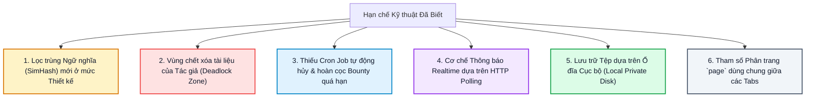
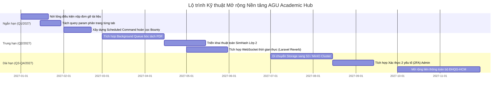

# HẠN CHẾ ĐÃ BIẾT & HƯỚNG PHÁT TRIỂN TƯƠNG LAI (KNOWN LIMITATIONS & FUTURE ROADMAP)
## TRANSPARENT DEFENSE AUDIT & ARCHITECTURAL ROADMAP
**Vị trí:** `docs/knowledge/14_KNOWN_LIMITATIONS_AND_FUTURE_WORK.md`  
**Ngày lập:** 11/11/2026  
**Nguyên tắc:** Đánh giá trung thực, minh bạch tuyệt đối về các giới hạn kỹ thuật của phiên bản hiện tại, đồng thời cung cấp lộ trình giải pháp kỹ thuật cụ thể cho giai đoạn mở rộng tiếp theo.

---

## 1. DANH MỤC HẠN CHẾ KỸ THUẬT HIỆN TẠI (CURRENT LIMITATIONS)

---

### Chi tiết Phân tích Từng Hạn chế:

### 1.1. Lọc Trùng Lặp Ngữ Nghĩa (SimHash / Cosine Similarity là `DESIGNED ONLY`)
- **Hiện trạng:** Hệ thống hiện tại chỉ chặn được các tệp tin trùng khớp nhị phân 100% thông qua mã băm SHA-256. Nếu người dùng chèn thêm một trang trắng hoặc thay đổi trang bìa file PDF, mã SHA-256 sẽ đổi khác và file vẫn được tải lên thành công.
- **Nguyên nhân kỹ thuật:** Việc bóc tách văn bản thô từ file PDF/Office scan và tính toán vector khoảng cách Hamming của SimHash đòi hỏi tài nguyên tính toán CPU/RAM rất lớn, vượt quá năng lực xử lý đồng bộ trong một HTTP Request và cần hạ tầng Background Queue Workers riêng biệt.
- **Đánh giá rủi ro:** Trung bình (Đã có ban kiểm duyệt thẩm định ở Lớp Review Queue).

---

### 1.2. Vùng Chết Xóa Tài Liệu của Tác Giả (Author Removal Deadlock Zone)
- **Hiện trạng:**
  - Quy tắc `canAuthorSoftDelete`: Chỉ cho phép tác giả tự xóa khi `luot_tai == 0` VÀ `created_at <= 24h`.
  - Quy tắc `canRequestRemoval`: Chỉ cho phép tác giả nộp đơn xin gỡ khi `luot_tai >= 10`.
- **Hệ quả:** Tài liệu rơi vào khoảng $1 \le \text{luot\_tai} \le 9$ hoặc tài liệu quá 24h nhưng có 0 tải sẽ bị kẹt: Tác giả không thể tự xóa và cũng không đủ điều kiện để nộp đơn xin ban kiểm duyệt gỡ bỏ.
- **Biện pháp tạm thời hiện tại:** Sinh viên phải dùng tính năng báo cáo vi phạm để nhờ Moderator can thiệp thủ công.

---

### 1.3. Thiếu Cron Job Tự Động Hủy & Hoàn Cọc Bounty Quá Hạn
- **Hiện trạng:** Khi một yêu cầu Bounty được tạo ra, số điểm cọc bị đóng băng trong ví (`diem_tam_giu`). Nếu qua nhiều tháng không có ai nộp tài liệu và người tạo quên không bấm nút "Hủy yêu cầu", số điểm này sẽ bị giam vĩnh viễn trong quỹ tạm giữ.
- **Giải pháp cần bổ sung:** Cần một Scheduled Command (`php artisan bounty:expire-stale-requests`) chạy định kỳ hàng đêm qua cron job để tự động quét các yêu cầu quá 30 ngày không có bài nộp và tự động hoàn trả điểm về ví khả dụng.

---

### 1.4. Thông Báo Thời Gian Thực Dựa Trên HTTP Polling
- **Hiện trạng:** Badge đếm số thông báo chưa đọc trên header và danh sách thông báo được cập nhật khi người dùng chuyển trang hoặc tải lại trang; chưa sử dụng kết nối WebSocket hai chiều liên tục (Full-duplex WebSocket).
- **Đánh giá:** Hoàn toàn đủ đáp ứng cho môi trường học tập (nơi thông báo không yêu cầu độ trễ tính bằng mili-giây như ứng dụng nhắn tin chat hoặc sàn giao dịch tài chính).

---

### 1.5. Phân Trang Dùng Chung Query Parameter `page` trên `Courses/Show.jsx`
- **Hiện trạng:** Cả 3 tab Kho tài liệu, Đánh giá và Săn thưởng trên trang chi tiết môn học đều dùng chung query string `?page=2`. Khi người dùng chuyển tab, tab mới cũng bị mở ở trang 2 thay vì quay về trang 1.
- **Đánh giá:** Đây là lỗi trải nghiệm người dùng nhỏ (Minor UX defect), không gây sai lệch dữ liệu CSDL.

---

## 2. LỘ TRÌNH PHÁT TRIỂN & NÂNG CẤP TƯƠNG LAI (FUTURE ROADMAP)

### 2.1. Giai đoạn 1: Hoàn thiện Tiện ích & Trải nghiệm Người dùng (Q1/2027)
1. **Khắc phục triệt để Deadlock Zone:** Sửa hàm `DocumentAuthorRemovalEvaluator::canRequestRemoval()` cho phép tác giả gửi đơn xin gỡ bất kỳ lúc nào nếu tài liệu đã có lượt tải ($>0$).
2. **Tối ưu hóa Phân trang:** Sử dụng Inertia Partial Reloads (`only: ['documents']`) hoặc tách query params thành `doc_page`, `rev_page`, `bty_page`.
3. **Tự động hóa Quản lý Bounty:** Thêm lệnh `php artisan bounty:auto-refund` tự động giải phóng cọc sau 30 ngày không có phản hồi.

---

### 2.2. Giai đoạn 2: Nâng cấp Trí tuệ Nội dung & Realtime (Q2/2027)
1. **Lớp 2 Lọc trùng lặp Ngữ nghĩa:**
   - Tích hợp thư viện `smalot/pdfparser` bóc tách văn bản trong Laravel Queue.
   - Tính toán chuỗi băm 64-bit SimHash, lưu vào cột `chu_ky_noi_dung` trong bảng `tai_lieu`.
   - Cảnh báo người dùng khi độ tương đồng vượt quá 85%.
2. **WebSocket Thời gian thực:**
   - Kích hoạt **Laravel Reverb** (WebSocket server hiệu năng cao tích hợp sẵn trong Laravel 11).
   - Đẩy thông báo tức thời tới chuông thông báo mà không cần người dùng tải lại trang.

---

### 2.3. Giai đoạn 3: Hạ tầng Phân tán & Mở rộng Liên trường (Q3 - Q4/2027)
1. **Chuyển đổi Hạ tầng Lưu trữ Đám mây (Cloud Storage):**
   - Di dời phân vùng `private/docs/` từ máy chủ cục bộ sang cụm lưu trữ đối tượng **MinIO** nội bộ hoặc **Cloudflare R2 / AWS S3**.
   - Sinh Pre-signed URL cho trình duyệt tải trực tiếp, giải phóng hoàn toàn băng thông máy chủ.
2. **Bảo mật Nâng cao:** Tích hợp xác thực 2 yếu tố (TOTP 2FA) qua Google Authenticator cho toàn bộ tài khoản Quản trị viên và Kiểm duyệt viên.
3. **Mở rộng Đa phân hiệu:** Mở rộng danh mục học thuật để hỗ trợ sinh viên các trường thành viên khác trong hệ thống Đại học Quốc gia TP. Hồ Chí Minh (ĐHQG-HCM).

