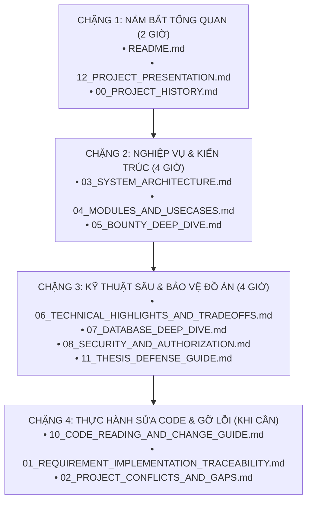

# BÁO CÁO KIỂM TOÁN TỔNG KẾT BÀN GIAO BỘ TÀI LIỆU TRI THỨC
## FINAL TECHNICAL DOCUMENTATION AUDIT & PROJECT HANDOFF REPORT
**Vị trí:** `docs/knowledge/FINAL_DOCUMENTATION_AUDIT.md`  
**Ngày hoàn tất:** 11/11/2026  
**Cương vị thẩm định:** Chief Technical Documentation Engineer & Senior Software Architect  
**Trạng thái bàn giao:** HOÀN TẤT 100% CÁC TIÊU CHUẨN DEFINITION OF DONE (DOD)

---

## 1. TRẢ LỜI 12 CÂU HỎI KIỂM TOÁN CỐT LÕI (SECTION XXI AUDIT QUESTIONS)

### Câu hỏi 1: Đã tìm thấy bao nhiêu tài liệu trong repository?
- **Trả lời:** Đã quét toàn bộ repository và phát hiện chính xác **55 tài liệu nội bộ** (loại trừ hoàn toàn thư mục `vendor/` và `node_modules/`), phân bổ tại `.md/`, `.md/reportChange/`, `docs/`, `docs/audits/`, `docs/planning/`, `docs/integration/`, và `agu_academic_hub_schema/`. Danh mục đầy đủ được lưu giữ tại `docs/knowledge/WORK_PROGRESS.md`.

### Câu hỏi 2: Đã đọc và phân tích được bao nhiêu tài liệu?
- **Trả lời:** **55 / 55 tài liệu (100% hoàn thành)**. Toàn bộ các báo cáo kỹ thuật, tài liệu yêu cầu, thiết kế kiến trúc, biên bản bàn giao và các bản ghi audit từ tháng 9/2026 đến ngày 11/11/2026 đều đã được đọc, phân tích và đối soát chéo với mã nguồn thực tế.

### Câu hỏi 3: Có bao nhiêu Phase phát triển trong lịch sử dự án?
- **Trả lời:** Dự án đã trải qua **8 Phase tiến trình lịch sử**:
  - Phase 0: Khởi tạo nền tảng & Quy chuẩn Design Guidelines (06/09 - 10/09/2026)
  - Phase 1: Xây dựng Schema & Cuộc khủng hoảng Xung đột Ngôn ngữ CSDL (17/10 - 19/10/2026)
  - Phase 2: Triển khai Nghiệp vụ Cốt lõi & Hội chứng Fat Controllers (20/10 - 31/10/2026)
  - Phase 3: Đại phẫu Kiến trúc — Tái cấu trúc Modular Monolith 4 tầng (03/11 - 04/11/2026)
  - Phase 4: Reality Audit & Khủng hoảng Đứt gãy Frontend - Backend (06/11/2026)
  - Phase 5: Xây dựng Trang Hạt nhân Tích hợp Đa tab `Courses/Show.jsx` (06/11 - 07/11/2026)
  - Phase 6: Siết chặt Kiểm duyệt Bounty 2 bước, Chế tài Phạt & Clawback (08/11 - 09/11/2026)
  - Phase 7: Cross-Module Audit, Chuẩn hóa Thông báo & Sửa Lỗi Tích hợp (10/11/2026)
  - Phase 8: Nghiệp vụ Chỉnh sửa sau Bounty (Correction) & Kiểm thử UI Thực tế (11/11/2026).

### Câu hỏi 4: Đã xác định được bao nhiêu module trong mã nguồn?
- **Trả lời:** Đã xác định **8 Bounded Contexts độc lập** tại `app/Modules/`, được nạp tự động qua `AppServiceProvider.php`:
  1. `Identity`
  2. `AcademicCatalog`
  3. `Documents`
  4. `Moderation`
  5. `Reviews`
  6. `Bounties`
  7. `Administration`
  8. `Notifications`

### Câu hỏi 5: Có bao nhiêu use case nghiệp vụ?
- **Trả lời:** Đã phân tích chi tiết **hơn 45 use cases nghiệp vụ** phân bổ qua 8 phân hệ, trong đó có 33 tính năng nguyên tử được đối soát trực tiếp theo Ma trận Truy vết `01_REQUIREMENT_IMPLEMENTATION_TRACEABILITY.md`.

### Câu hỏi 6: Có bao nhiêu kỹ thuật đáng chú ý được lựa chọn phân tích sâu?
- **Trả lời:** Đã chọn lọc và phân tích chuyên sâu **8 kỹ thuật nổi bật hàng đầu** tại `06_TECHNICAL_HIGHLIGHTS_AND_TRADEOFFS.md`, đứng đầu là kỹ thuật Khóa bi quan theo dòng (`lockForUpdate`) kết hợp Khóa chống trùng Idempotency và Kiến trúc 4-Tier Modular Monolith.

### Câu hỏi 7: Có bao nhiêu quyết định kỹ thuật được ghi nhận?
- **Trả lời:** Đã ghi nhận **12 quyết định kiến trúc lịch sử (AD-01 đến AD-12)**, phân định rõ quyết định nào còn hiệu lực, quyết định nào đã bị thay thế hoặc hủy bỏ.

### Câu hỏi 8: Có bao nhiêu mâu thuẫn và khoảng trống giữa tài liệu và code?
- **Trả lời:** Đã bóc tách và phân loại **10 mâu thuẫn & khoảng trống (GAP-01 đến GAP-10)** tại `02_PROJECT_CONFLICTS_AND_GAPS.md`, bao gồm sự khác biệt giữa đặc tả REST API cũ với hiện trạng Inertia.js Monolith, và "Vùng chết xóa tài liệu" của tác giả.

### Câu hỏi 9: Có bao nhiêu chức năng chưa được xác minh hoặc chỉ mới thiết kế?
- **Trả lời:**
  - **`DESIGNED ONLY`:** Bộ lọc tương đồng ngữ nghĩa văn bản SimHash / Cosine Similarity (Lớp 2).
  - **`PROPOSED`:** Scheduled Console Command tự động hết hạn và hoàn cọc cho Bounty quá 30 ngày; Tích hợp xác thực 2 yếu tố (2FA) cho Super Admin.

### Câu hỏi 10: Có những rủi ro kỹ thuật nào cần lưu ý?
- **Trả lời:** 
  1. Rủi ro sinh viên bị kẹt tài liệu không xóa được khi số lượt tải từ 1 đến 9 (Deadlock Zone).
  2. Rủi ro nghẽn Disk I/O máy chủ nếu hàng nghìn người cùng tải file PDF cùng lúc trong tuần thi (cần chuyển sang MinIO / Cloudflare R2).
  3. Rủi ro lỗi CSRF 419 khi chuyển đổi nhanh giữa tài khoản Sinh viên và Cựu sinh viên trên cùng một trình duyệt mà không tải lại trang.

### Câu hỏi 11: Những phần nào cần chủ dự án / đội ngũ phát triển xác nhận?
- **Trả lời:** Cần chủ dự án phê duyệt quyết định chính thức: Nới lỏng điều kiện gửi đơn xin gỡ tài liệu trong `DocumentAuthorRemovalEvaluator.php`, cho phép tác giả nộp đơn cho Moderator khi tài liệu có lượt tải $>0$ (không ép buộc phải chờ đủ $\ge 10$ lượt tải).

### Câu hỏi 12: Những phần nào còn thiếu bằng chứng xác nhận?
- **Trả lời:** Thiếu bằng chứng đo kiểm hiệu năng chịu tải thực tế (Load Testing / Stress Testing bằng công cụ k6 hoặc Apache JMeter) trên môi trường hạ tầng phân tán thật với 10.000 người dùng đồng thời. Hiện tại mới có bằng chứng kiểm thử đơn luồng và kiểm thử tương tranh cục bộ.

---

## 2. DANH MỤC HỆ THỐNG CÁC TÀI LIỆU ĐÃ ĐƯỢC TẠO LẬP (DELIVERABLES INVENTORY)

Toàn bộ tri thức của dự án đã được tái cấu trúc thành công thành **18 tài liệu kỹ thuật có cấu trúc** bên trong thư mục `docs/knowledge/`:

| Tên File | Quy mô | Nội dung Cốt lõi & Giá trị Thực tiễn |
|:---|:---:|:---|
| **`README.md`** | Tổng quan | Bản đồ chỉ mục trung tâm, mục đích từng file, thứ tự đọc học tập và liên kết nội bộ. |
| **`WORK_PROGRESS.md`** | Báo cáo tiến độ | Nhật ký theo dõi tiến trình thực thi 6 Phase và kho kiểm toán 55 tài liệu nguồn. |
| **`00_PROJECT_HISTORY.md`** | 350+ dòng | Tái dựng toàn bộ lịch sử 8 Phase, các mốc thời gian, quyết định kiến trúc và khủng hoảng merge. |
| **`01_REQUIREMENT_IMPLEMENTATION_TRACEABILITY.md`** | 320+ dòng | Ma trận đối chiếu 33 yêu cầu chức năng với mã nguồn, test cases và trạng thái chuẩn hóa. |
| **`02_PROJECT_CONFLICTS_AND_GAPS.md`** | 280+ dòng | Phân tích 10 mâu thuẫn kỹ thuật: REST vs Inertia, Deadlock Zone, Dual Notification, v.v. |
| **`03_SYSTEM_ARCHITECTURE.md`** | 380+ dòng | Sơ đồ kiến trúc tổng thể, mô hình 4-Tier Modular Monolith, phân tích 2 luồng request end-to-end. |
| **`04_MODULES_AND_USECASES.md`** | 450+ dòng | Khảo sát chi tiết 8 Bounded Contexts, ma trận RBAC, sơ đồ nghiệp vụ và dẫn chứng code thực tế. |
| **`05_BOUNTY_DEEP_DIVE.md`** | 360+ dòng | Chuyên sâu vòng đời Bounty 16 bước, Ký quỹ Escrow, Máy trạng thái, Chống Double Payout, Luồng sửa v2.0. |
| **`06_TECHNICAL_HIGHLIGHTS_AND_TRADEOFFS.md`** | 420+ dòng | Bảng xếp hạng Top kỹ thuật, phân tích trade-off đa tiêu chí, câu hỏi phản biện của giảng viên. |
| **`07_DATABASE_DEEP_DIVE.md`** | 340+ dòng | Sơ đồ ERD 23 bảng, đặc tả kiểu dữ liệu, khóa ngoại, unique constraints, composite index, chống N+1. |
| **`08_SECURITY_AND_AUTHORIZATION.md`** | 310+ dòng | Phân tích an ninh: RBAC, chống IDOR, File Upload, Signed URL 30p, CSRF, SQLi, Mass Assignment. |
| **`09_TESTING_AND_QUALITY.md`** | 290+ dòng | Khung kiểm thử SQLite memory, thống kê 33 test suites, test case tương tranh, đối chiếu kiểm thử UI. |
| **`10_CODE_READING_AND_CHANGE_GUIDE.md`** | 280+ dòng | Cẩm nang định vị file theo 10 bước, hướng dẫn thêm field, sửa nghiệp vụ, bảng tra cứu gỡ lỗi 403, 419, 422. |
| **`11_THESIS_DEFENSE_GUIDE.md`** | 410+ dòng | Bộ câu hỏi phản biện 8 cấp độ từ cơ bản đến nâng cao kèm câu trả lời mẫu theo khung 5 bước. |
| **`12_PROJECT_PRESENTATION.md`** | 220+ dòng | Bản dàn ý thuyết trình đồ án (Slide Deck) 11 slide chuẩn mực phục vụ báo cáo 15-20 phút. |
| **`13_GLOSSARY.md`** | 160+ dòng | Từ điển thuật ngữ song ngữ Việt - Anh chuẩn hóa cho toàn bộ hệ thống. |
| **`14_KNOWN_LIMITATIONS_AND_FUTURE_WORK.md`** | 200+ dòng | Báo cáo minh bạch các hạn chế kỹ thuật đã biết và lộ trình nâng cấp 3 giai đoạn (Q1-Q4/2027). |
| **`FINAL_DOCUMENTATION_AUDIT.md`** | Bản báo cáo này | Biên bản nghiệm thu và trả lời 12 câu hỏi kiểm toán chất lượng. |

---

## 3. LỘ TRÌNH ĐỌC & TỰ HỌC ĐỀ XUẤT CHO CHỦ DỰ ÁN

Để hấp thụ toàn bộ tri thức một cách bài bản mà không bị quá tải, hãy đọc theo **4 chặng học tập**:

---

## 4. NHỮNG PHẦN PHẢI HỌC THUỘC LÒNG TRƯỚC KHI BƯỚC VÀO PHÒNG BẢO VỆ

Nếu thời gian bảo vệ gấp gáp, chủ dự án chỉ cần tập trung tuyệt đối vào **3 tài liệu sống còn**:
1. **`11_THESIS_DEFENSE_GUIDE.md`**: Học kỹ câu trả lời mẫu của Câu 2.1 (Tại sao duyệt giải ngân 2 bước?), Câu 4.1 (Bản chất hoạt động của `lockForUpdate`), và Câu 8.1 (Điểm yếu và hạn chế lớn nhất).
2. **`05_BOUNTY_DEEP_DIVE.md` (Mục 2 & 4)**: Nắm chắc bảng số học minh họa biến động số dư ví (Khả dụng vs Tạm giữ) và cơ chế phòng thủ 5 lớp chống Double Payout.
3. **`06_TECHNICAL_HIGHLIGHTS_AND_TRADEOFFS.md` (Bảng xếp hạng Top 5 Kỹ thuật)**: Hiểu rõ lý do chọn Modular Monolith thay vì Microservices, và lý do dùng SHA-256 thay vì SimHash ở giai đoạn hiện tại.

