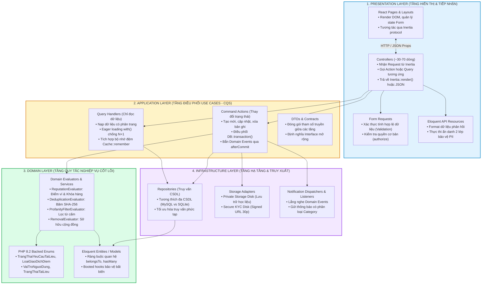

# SƠ ĐỒ KIẾN TRÚC PHÂN TẦNG 4 LỚP (4-TIER LAYERED ARCHITECTURE DIAGRAM)
**Vị trí:** `docs/knowledge/diagrams/architecture.md`  
**Mục đích:** Đặc tả cấu trúc phân tầng bên trong mỗi Bounded Context theo chuẩn Domain-Driven Design (DDD).

