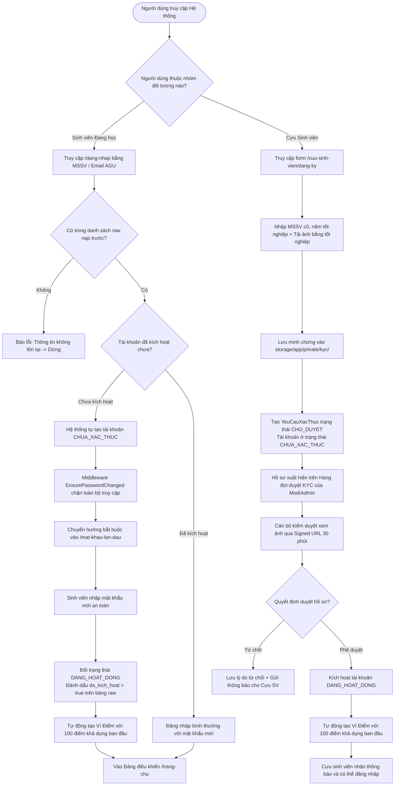

# SƠ ĐỒ LUỒNG ĐỊNH DANH SINH VIÊN VS CỰU SINH VIÊN (AUTHENTICATION & KYC FLOW)
**Vị trí:** `docs/knowledge/diagrams/auth-flow.md`  
**Mục đích:** Đặc tả sự tách biệt rạch ròi giữa cơ chế Zero-KYC của sinh viên đang học và quy trình KYC có kiểm duyệt của cựu sinh viên.

