# SƠ ĐỒ LUỒNG NGHIỆP VỤ BOUNTY (BOUNTY ACTIVITY DIAGRAM)
**Vị trí:** `docs/knowledge/diagrams/bounty-flow.md`  
**Mục đích:** Mô tả toàn bộ tiến trình nghiệp vụ từ lúc tạo yêu cầu, đóng băng điểm, nộp tài liệu, nghiệm thu, kiểm duyệt và giải ngân.

```mermaid
flowchart TD
    Start([Sinh viên A có nhu cầu tìm tài liệu]) --> FormBounty[Mở Modal Tạo Yêu cầu trên Courses/Show]
    FormBounty --> InputPoints[Nhập thông tin môn học + Treo thưởng N điểm]
    
    InputPoints --> CheckBalance{Số dư khả dụng >= N?}
    CheckBalance -->|Không đủ| ErrorBalance[Báo lỗi: Số dư không đủ -> Dừng]
    CheckBalance -->|Đủ điểm| LockWallet[Khóa bi quan ví A qua lockForUpdate]
    
    LockWallet --> EscrowPoints[Ví A: Khả dụng -= N, Tạm giữ += N]
    EscrowPoints --> InsertLedger[Ghi Sổ cái GiaoDichDiem: TAM_GIU]
    InsertLedger --> CreateBounty[Tạo YeuCauTaiLieu: Trạng thái 'MO']
    
    CreateBounty --> WaitFulfill([Chờ cộng đồng đóng góp tài liệu])
    
    WaitFulfill --> Contributor[Sinh viên B / Cựu sinh viên tìm thấy yêu cầu]
    Contributor --> SelectMethod{Lựa chọn Phương thức nộp?}
    
    SelectMethod -->|Method A: File có sẵn| PickExisting[Chọn tài liệu chính chủ đã duyệt trong kho]
    PickExisting --> SubmitA[Tạo DapUng: Trạng thái 'DA_DUYET']
    
    SelectMethod -->|Method B: Upload file mới| UploadNew[Tải tệp từ máy tính]
    UploadNew --> CheckSHA256{Trùng mã SHA-256 môn?}
    CheckSHA256 -->|Trùng| RejectUpload[Báo lỗi trùng file nhị phân -> Dừng]
    CheckSHA256 -->|Hợp lệ| SubmitB[Lưu file vào Private Disk + Tạo TaiLieu 'CHO_DUYET']
    SubmitB --> ModReview[Chờ Moderator thẩm định tệp mới]
    ModReview --> ModDecision{Mod duyệt file?}
    ModDecision -->|Từ chối| RejectB[DapUng chuyển 'TU_CHOI' -> Dừng]
    ModDecision -->|Phê duyệt| ApproveB[TaiLieu & DapUng chuyển 'DA_DUYET']
    
    SubmitA --> NotifyA[Gửi thông báo tới Sinh viên A]
    ApproveB --> NotifyA
    
    NotifyA --> SV_A_Review{SV A nghiệm thu nội dung?}
    SV_A_Review -->|Không đạt| RejectA[SV A từ chối kèm lý do giải trình]
    SV_A_Review -->|Hài lòng| AcceptA[SV A bấm 'Xác nhận chấp thuận']
    
    AcceptA --> QueuePayout[DapUng: 'NGUOI_YEU_CAU_XAC_NHAN'<br>Bounty: 'CHO_GIAI_NGAN'<br>ĐẨY VÀO ADMIN/MOD PAYOUT QUEUE]
    
    QueuePayout --> AdminModCheck{Admin/Mod thẩm định giải ngân?}
    AdminModCheck -->|Phát hiện gian lận/sai phạm| AdminReject[Từ chối giải ngân -> Trả Bounty về 'MO']
    AdminModCheck -->|"Hợp lệ 100%"| AdminApprove[Thực thi ApproveBountyPayoutAction]
    
    AdminApprove --> DisbursePoints[Khóa ví 2 bên qua lockForUpdate:<br>• Ví A: Tạm giữ -= N<br>• Ví B: Khả dụng += N<br>• SV B: Điểm uy tín += N]
    DisbursePoints --> LedgerDisburse["Ghi Sổ cái: GIAI_PHONG (A) & CONG_DIEM (B)"]
    LedgerDisburse --> CompleteBounty[Bounty chuyển 'DA_HOAN_THANH'<br>DapUng chuyển 'CHAP_NHAN']
    CompleteBounty --> End([Kết thúc chu trình Bounty])
```

