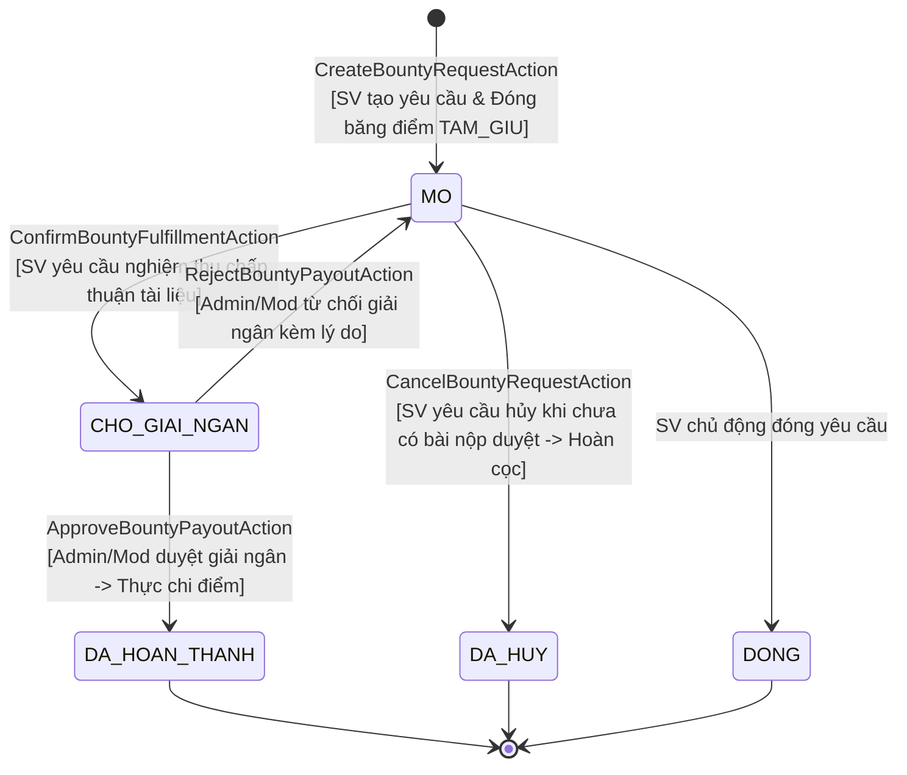
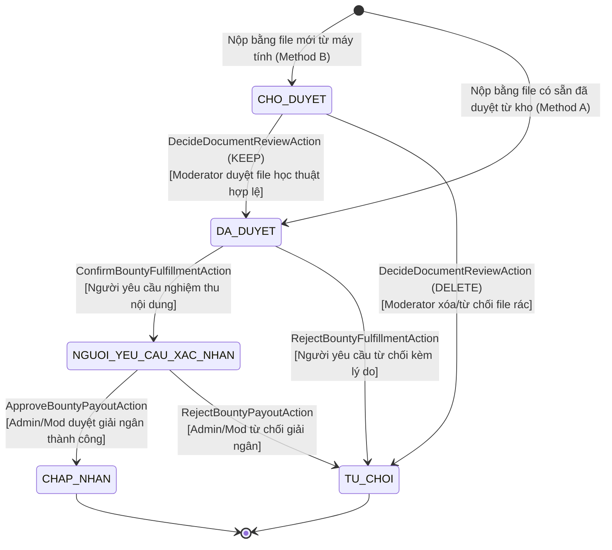

# SƠ ĐỒ MÁY TRẠNG THÁI BOUNTY & BÀI NỘP (BOUNTY & CONTRIBUTION STATE MACHINES)
**Vị trí:** `docs/knowledge/diagrams/bounty-state-machine.md`  
**Mục đích:** Đặc tả tường minh các trạng thái hợp lệ, điều kiện chuyển trạng thái và các tác nhân được phép can thiệp.

## title Máy Trạng Thái Yêu Cầu Săn Thưởng (YeuCauTaiLieu)

   ## title Máy Trạng Thái Bài Nộp Đóng Góp (DapUngYeuCauTaiLieu)

