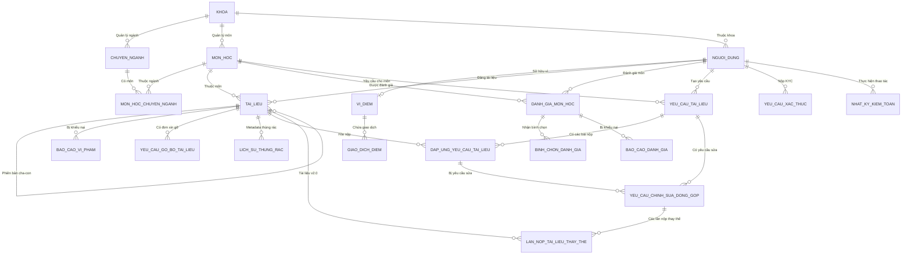

# SƠ ĐỒ QUAN HỆ THỰC THỂ CƠ SỞ DỮ LIỆU (DATABASE ERD)
**Vị trí:** `docs/knowledge/diagrams/database-erd.md`  
**Mục đích:** Đặc tả mối quan hệ giữa 23 bảng trong cơ sở dữ liệu MySQL 8.0 của dự án AGU Academic Hub.

## Chú thích ký hiệu quan hệ

Sơ đồ sử dụng ký hiệu chân quạ (Crow's Foot). Ký hiệu ở mỗi đầu đường nối cho biết số bản ghi ở đầu đó có thể liên kết với **một bản ghi ở đầu đối diện**. `n` là nhiều; `0` biểu thị quan hệ không bắt buộc.

### Ký hiệu tại mỗi đầu đường nối

| Số lượng | Đầu bên trái | Đầu bên phải | Ý nghĩa |
| --- | --- | --- | --- |
| `1` | `\|\|` | `\|\|` | Đúng một bản ghi, bắt buộc có. |
| `0..1` | `\|o` | `o\|` | Không có hoặc có tối đa một bản ghi. |
| `0..n` | `}o` | `o{` | Không có hoặc có nhiều bản ghi. |
| `1..n` | `}\|` | `\|{` | Có ít nhất một bản ghi, có thể có nhiều. |

Các ký hiệu đối xứng theo phía đặt chúng: vòng tròn `o` nghĩa là không bắt buộc, vạch đứng nghĩa là một, còn chân quạ (`{` hoặc `}`) nghĩa là nhiều.

### Các kiểu quan hệ thường gặp

| Quan hệ | Cú pháp Mermaid | Cách đọc |
| --- | --- | --- |
| Một – một (`1–1`) | `A \|\|--\|\| B` | Mỗi A có đúng một B; mỗi B thuộc đúng một A. |
| Một – không hoặc một (`1–0..1`) | `A \|\|--o\| B` | Mỗi A có thể không có B hoặc có một B; mỗi B thuộc đúng một A. |
| Một – nhiều, tùy chọn (`1–0..n`) | `A \|\|--o{ B` | Mỗi A có từ không đến nhiều B; mỗi B thuộc đúng một A. |
| Một – nhiều, bắt buộc (`1–1..n`) | `A \|\|--\|{ B` | Mỗi A có ít nhất một B; mỗi B thuộc đúng một A. |
| Nhiều – nhiều (`n–n`), tùy chọn hai phía | `A }o--o{ B` | Mỗi A có thể liên kết với nhiều B và ngược lại; cả hai phía đều có thể chưa có liên kết. |
| Nhiều – nhiều (`n–n`), bắt buộc hai phía | `A }\|--\|{ B` | Mỗi A liên kết với ít nhất một B và mỗi B liên kết với ít nhất một A. |

**Lưu ý:** Cách gọi `1–0` thường muốn nói `1–0..1` (một – không hoặc một). Nên ghi đầy đủ `0..1` để tránh hiểu nhầm là luôn không có bản ghi liên quan. Tương tự, `1–n` chưa thể hiện rõ phía nhiều có được phép bằng không hay không; hãy dùng `0..n` hoặc `1..n` khi cần phân biệt.

### Ví dụ trong sơ đồ này

- `KHOA ||--o{ CHUYEN_NGANH`: một khoa có thể chưa có hoặc có nhiều chuyên ngành; mỗi chuyên ngành thuộc đúng một khoa.
- `NGUOI_DUNG ||--o| VI_DIEM`: một người dùng có thể chưa có ví hoặc có tối đa một ví; mỗi ví thuộc đúng một người dùng.
- `MON_HOC` và `CHUYEN_NGANH` có quan hệ **nhiều – nhiều** thông qua bảng trung gian `MON_HOC_CHUYEN_NGANH`. Sơ đồ biểu diễn bằng hai quan hệ `1–0..n`: mỗi dòng trong bảng trung gian gắn đúng một môn học với đúng một chuyên ngành.

### Kiểu đường nối

Trong Mermaid ERD, `--` là nét liền, biểu thị quan hệ định danh (khóa định danh của thực thể con phụ thuộc vào thực thể cha); `..` là nét đứt, biểu thị quan hệ không định danh. Kiểu đường nối độc lập với số lượng `1`, `0..1`, `0..n` và `1..n`; nét liền không tự có nghĩa là quan hệ một – một. Sơ đồ hiện tại sử dụng nét liền cho tất cả các liên kết; khi đối chiếu thiết kế vật lý, cần kiểm tra khóa chính và khóa ngoại để xác nhận kiểu quan hệ định danh.

## Diễn giải toàn bộ quan hệ trong ERD

Quy ước `A (1) — (0..n) B`: một A có ít nhất 0 và nhiều nhất n B; mỗi B liên kết với đúng một A. `n` biểu thị nhiều bản ghi, không phải một giới hạn số lượng cố định. Các diễn giải dưới đây bám theo các đường nối trong sơ đồ hiện tại.

### Khoa, chuyên ngành và môn học

- `KHOA (1) — (0..n) CHUYEN_NGANH`: một khoa có ít nhất 0 chuyên ngành, nhiều nhất n chuyên ngành; mỗi chuyên ngành thuộc đúng một khoa.
- `KHOA (1) — (0..n) MON_HOC`: một khoa quản lý ít nhất 0 môn học, nhiều nhất n môn học; mỗi môn học thuộc đúng một khoa.
- `KHOA (1) — (0..n) NGUOI_DUNG`: một khoa có ít nhất 0 người dùng, nhiều nhất n người dùng; mỗi người dùng thuộc đúng một khoa.
- `CHUYEN_NGANH (1) — (0..n) MON_HOC_CHUYEN_NGANH`: một chuyên ngành có ít nhất 0 bản ghi liên kết môn học, nhiều nhất n bản ghi; mỗi bản ghi liên kết thuộc đúng một chuyên ngành.
- `MON_HOC (1) — (0..n) MON_HOC_CHUYEN_NGANH`: một môn học có ít nhất 0 bản ghi liên kết chuyên ngành, nhiều nhất n bản ghi; mỗi bản ghi liên kết thuộc đúng một môn học.

Hai quan hệ với bảng trung gian trên biểu diễn `MON_HOC (0..n) — (0..n) CHUYEN_NGANH`: một môn học thuộc ít nhất 0, nhiều nhất n chuyên ngành; một chuyên ngành có ít nhất 0, nhiều nhất n môn học.

### Ví điểm và giao dịch

- `NGUOI_DUNG (1) — (0..1) VI_DIEM`: một người dùng có ít nhất 0 ví điểm, nhiều nhất 1 ví điểm; mỗi ví điểm thuộc đúng một người dùng.
- `VI_DIEM (1) — (0..n) GIAO_DICH_DIEM`: một ví điểm có ít nhất 0 giao dịch điểm, nhiều nhất n giao dịch điểm; mỗi giao dịch điểm thuộc đúng một ví điểm.

### Tài liệu và kiểm duyệt tài liệu

- `NGUOI_DUNG (1) — (0..n) TAI_LIEU`: một người dùng đăng ít nhất 0 tài liệu, nhiều nhất n tài liệu; mỗi tài liệu do đúng một người dùng đăng.
- `MON_HOC (1) — (0..n) TAI_LIEU`: một môn học có ít nhất 0 tài liệu, nhiều nhất n tài liệu; mỗi tài liệu thuộc đúng một môn học.
- `TAI_LIEU (cha, 1) — (0..n, con) TAI_LIEU`: một tài liệu cha có ít nhất 0 phiên bản con, nhiều nhất n phiên bản con; phía tài liệu con được sơ đồ hiện tại biểu diễn là gắn với đúng một tài liệu cha.
- `TAI_LIEU (1) — (0..n) BAO_CAO_VI_PHAM`: một tài liệu có ít nhất 0 báo cáo vi phạm, nhiều nhất n báo cáo vi phạm; mỗi báo cáo vi phạm liên quan đến đúng một tài liệu.
- `TAI_LIEU (1) — (0..n) YEU_CAU_GO_BO_TAI_LIEU`: một tài liệu có ít nhất 0 yêu cầu gỡ bỏ, nhiều nhất n yêu cầu gỡ bỏ; mỗi yêu cầu gỡ bỏ liên quan đến đúng một tài liệu.
- `TAI_LIEU (1) — (0..n) LICH_SU_THUNG_RAC`: một tài liệu có ít nhất 0 bản ghi lịch sử thùng rác, nhiều nhất n bản ghi; mỗi bản ghi lịch sử thùng rác liên quan đến đúng một tài liệu.

### Đánh giá môn học

- `NGUOI_DUNG (1) — (0..n) DANH_GIA_MON_HOC`: một người dùng viết ít nhất 0 đánh giá môn học, nhiều nhất n đánh giá; mỗi đánh giá do đúng một người dùng viết.
- `MON_HOC (1) — (0..n) DANH_GIA_MON_HOC`: một môn học có ít nhất 0 đánh giá, nhiều nhất n đánh giá; mỗi đánh giá dành cho đúng một môn học.
- `DANH_GIA_MON_HOC (1) — (0..n) BINH_CHON_DANH_GIA`: một đánh giá môn học nhận ít nhất 0 bình chọn, nhiều nhất n bình chọn; mỗi bình chọn dành cho đúng một đánh giá.
- `DANH_GIA_MON_HOC (1) — (0..n) BAO_CAO_DANH_GIA`: một đánh giá môn học có ít nhất 0 báo cáo, nhiều nhất n báo cáo; mỗi báo cáo liên quan đến đúng một đánh giá.

### Yêu cầu tài liệu và bài nộp đáp ứng

- `NGUOI_DUNG (1) — (0..n) YEU_CAU_TAI_LIEU`: một người dùng tạo ít nhất 0 yêu cầu tài liệu, nhiều nhất n yêu cầu tài liệu; mỗi yêu cầu tài liệu do đúng một người dùng tạo.
- `MON_HOC (1) — (0..n) YEU_CAU_TAI_LIEU`: một môn học có ít nhất 0 yêu cầu tài liệu, nhiều nhất n yêu cầu tài liệu; mỗi yêu cầu tài liệu dành cho đúng một môn học.
- `YEU_CAU_TAI_LIEU (1) — (0..n) DAP_UNG_YEU_CAU_TAI_LIEU`: một yêu cầu tài liệu nhận ít nhất 0 bài nộp đáp ứng, nhiều nhất n bài nộp đáp ứng; mỗi bài nộp đáp ứng thuộc đúng một yêu cầu tài liệu.
- `TAI_LIEU (1) — (0..n) DAP_UNG_YEU_CAU_TAI_LIEU`: một tài liệu được sử dụng trong ít nhất 0 bài nộp đáp ứng, nhiều nhất n bài nộp đáp ứng; mỗi bài nộp đáp ứng sử dụng đúng một tài liệu.

### Chỉnh sửa đóng góp và nộp tài liệu thay thế

- `YEU_CAU_TAI_LIEU (1) — (0..n) YEU_CAU_CHINH_SUA_DONG_GOP`: một yêu cầu tài liệu có ít nhất 0 yêu cầu chỉnh sửa đóng góp, nhiều nhất n yêu cầu chỉnh sửa; mỗi yêu cầu chỉnh sửa gắn với đúng một yêu cầu tài liệu.
- `DAP_UNG_YEU_CAU_TAI_LIEU (1) — (0..n) YEU_CAU_CHINH_SUA_DONG_GOP`: một bài nộp đáp ứng có ít nhất 0 yêu cầu chỉnh sửa đóng góp, nhiều nhất n yêu cầu chỉnh sửa; mỗi yêu cầu chỉnh sửa dành cho đúng một bài nộp đáp ứng.
- `YEU_CAU_CHINH_SUA_DONG_GOP (1) — (0..n) LAN_NOP_TAI_LIEU_THAY_THE`: một yêu cầu chỉnh sửa đóng góp có ít nhất 0 lần nộp tài liệu thay thế, nhiều nhất n lần nộp; mỗi lần nộp thuộc đúng một yêu cầu chỉnh sửa đóng góp.
- `TAI_LIEU (1) — (0..n) LAN_NOP_TAI_LIEU_THAY_THE`: một tài liệu được sử dụng trong ít nhất 0 lần nộp tài liệu thay thế, nhiều nhất n lần nộp; mỗi lần nộp sử dụng đúng một tài liệu thay thế.

### Xác thực và nhật ký kiểm toán

- `NGUOI_DUNG (1) — (0..n) YEU_CAU_XAC_THUC`: một người dùng gửi ít nhất 0 yêu cầu xác thực, nhiều nhất n yêu cầu xác thực; mỗi yêu cầu xác thực do đúng một người dùng gửi.
- `NGUOI_DUNG (1) — (0..n) NHAT_KY_KIEM_TOAN`: một người dùng có ít nhất 0 bản ghi nhật ký kiểm toán, nhiều nhất n bản ghi; mỗi bản ghi nhật ký kiểm toán gắn với đúng một người dùng thực hiện thao tác.
