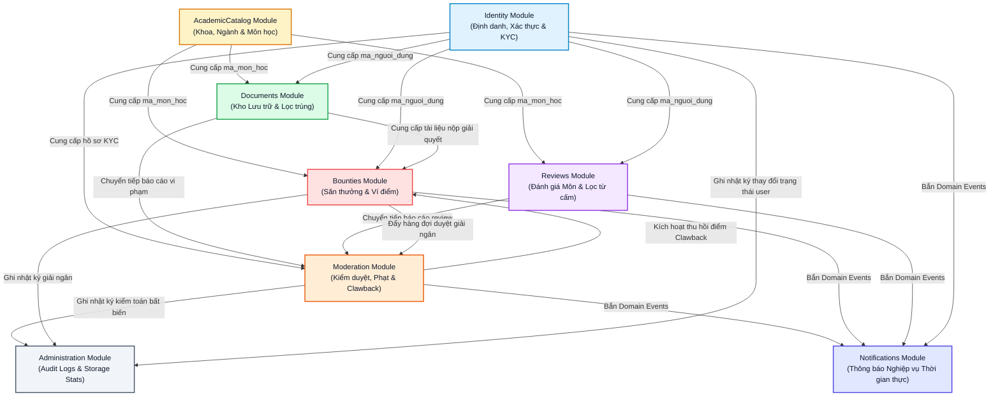

# SƠ ĐỒ PHỤ THUỘC GIỮA CÁC MODULE (MODULE DEPENDENCY GRAPH)
**Vị trí:** `docs/knowledge/diagrams/module-dependencies.md`  
**Mục đích:** Thể hiện luồng phụ thuộc dữ liệu và sự kiện giữa 8 Bounded Contexts trong kiến trúc Modular Monolith.

