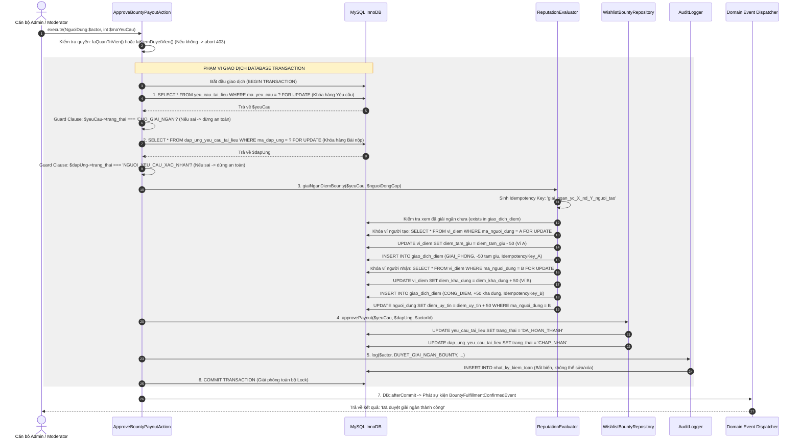

# SƠ ĐỒ TUẦN TỰ DUYỆT GIẢI NGÂN BOUNTY AN TOÀN (SAFE PAYOUT SEQUENCE DIAGRAM)
**Vị trí:** `docs/knowledge/diagrams/payout-sequence.md`  
**Mục đích:** Đặc tả các bước thực thi an toàn trong `ApproveBountyPayoutAction` bao gồm khóa bi quan, kiểm tra trạng thái và cam kết giao dịch.

