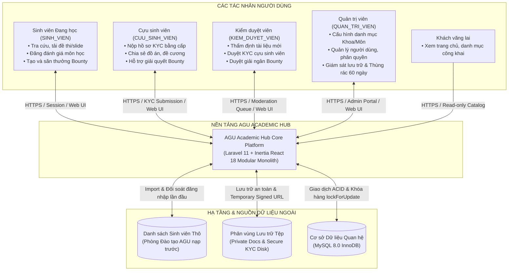

# SƠ ĐỒ NGỮ CẢNH HỆ THỐNG AGU ACADEMIC HUB (SYSTEM CONTEXT DIAGRAM)
**Vị trí:** `docs/knowledge/diagrams/system-context.md`  
**Mục đích:** Mô tả ranh giới tương tác giữa các tác nhân người dùng, hệ thống bên ngoài và nền tảng AGU Academic Hub.

