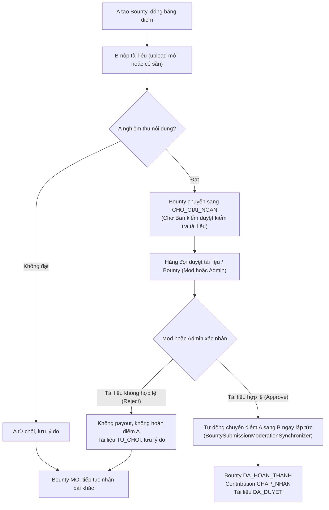

# AGU ACADEMIC HUB
# ĐẶC TẢ GIAO VIỆC DEV: HOÀN THIỆN DUYỆT BOUNTY ADMIN / MODERATOR

**Phân hệ:** Bounties + Moderation  
**Stack:** Laravel 11, Modular Monolith, MySQL 8 InnoDB, React 18 + Inertia  
**Ưu tiên:** Cao  
**Mục tiêu:** Tối ưu & hoàn thiện quy trình kiểm duyệt và giải ngân Bounty: Khi Mod hoặc Admin xác nhận tài liệu là hợp lệ, hệ thống tự động giải ngân điểm thưởng ngay lập tức cho người đóng góp (B), loại bỏ bước giải ngân thủ công riêng biệt gây trì trệ, đồng thời bảo đảm an toàn giao dịch điểm và chống double payout.

---

## 1. Mục đích và căn cứ hiện trạng

Tài liệu này giao việc cho dev phụ trách Admin/Moderator. Đây **không phải yêu cầu viết lại toàn bộ module**. Dev phải audit code hiện tại, giữ phần đúng và chỉ sửa/bổ sung phần thiếu.

### 1.1. Những gì báo cáo hiện có ghi nhận

- Báo cáo phân tích liệt kê các thành phần hiện có: `AdminBountyPayoutController`, `ApproveBountyPayoutAction`, `RejectBountyPayoutAction`.
- Báo cáo triển khai liệt kê thay đổi tại `ApproveBountyPayoutAction.php`: đưa `lockForUpdate()` trên Bounty, Contribution và Wallet vào bên trong `DB::transaction`.
- Báo cáo triển khai cũng liệt kê chỉnh sửa `DecideDocumentReviewAction.php`, nhưng nội dung được mô tả chỉ là bổ sung import cho `UserViolationPenaltyEvaluator` và `BountySubmissionModerationSynchronizer`.
- Báo cáo không liệt kê rõ việc chỉnh sửa Controller, routes hoặc giao diện hàng đợi Admin/Moderator.

Vì vậy, có bằng chứng báo cáo về **gia cố một phần backend approve**, nhưng chưa đủ căn cứ kết luận toàn bộ quy trình Admin/Moderator đã được code lại theo thiết kế mới. Dev phải kiểm tra source code thực tế.

### 1.2. Kết quả cần đạt

1. Admin và Moderator cùng truy cập một hàng đợi Bounty / kiểm duyệt tài liệu chờ duyệt.
2. Cả hai có thể xem chi tiết, approve hoặc reject tài liệu và giải ngân Bounty.
3. Admin và Moderator là **hai reviewer thay thế nhau ở cùng một bước**, không phải hai cấp duyệt.
4. Chỉ quyết định hợp lệ đầu tiên được ghi nhận.
5. **Tự động giải ngân ngay khi duyệt hợp lệ:** Khi Mod hoặc Admin xác nhận tài liệu là hợp lệ (qua kiểm duyệt tài liệu hoặc hàng đợi Bounty), hệ thống tự động giải ngân điểm thưởng (từ điểm tạm giữ của A sang điểm khả dụng của B) ngay lập tức đúng một lần mà không cần phải qua thêm một bước giải ngân thủ công riêng biệt.
6. Reject không chuyển điểm, không hoàn điểm về ví khả dụng của A (điểm vẫn giữ nguyên ở `diem_tam_giu`); Bounty trở lại `MO` để tiếp tục nhận đóng góp khác.
7. Lưu lý do, người quyết định, thời điểm và lịch sử.
8. Không tác động đến luồng correction sau hoàn thành.
9. Có kiểm thử concurrency thực tế trên MySQL 8 InnoDB.

---

## 2. Nghiệp vụ và state machine

### 2.1. Luồng tổng thể

> **Điểm cải tiến cốt lõi:** Trước đây, khi Mod duyệt tài liệu hợp lệ, B chưa được cộng điểm mà phải chờ Admin vào hàng đợi duyệt giải ngân thực hiện thêm một lần nữa. Với luồng mới, ngay khi Mod hoặc Admin xác nhận tài liệu hợp lệ, hệ thống tự động đồng bộ và giải ngân điểm ngay lập tức cho B mà không cần bất kỳ bước trung gian nào.

### 2.2. Phân định trách nhiệm

| Chủ thể | Trách nhiệm |
|---|---|
| Người tạo A | Đánh giá tài liệu có đáp ứng nhu cầu Bounty hay không |
| Admin / Moderator | Kiểm tra tuân thủ chính sách nền tảng, an toàn file, dấu hiệu vi phạm và điều kiện giải ngân |
| Backend | Kiểm tra quyền, trạng thái, quan hệ dữ liệu, giao dịch điểm, chống request đồng thời |

A đã xác nhận tài liệu phù hợp nhu cầu. Admin/Moderator không phải nghiệm thu lại nội dung học thuật theo sở thích cá nhân. Reviewer chỉ từ chối khi có căn cứ thuộc phạm vi kiểm duyệt nền tảng hoặc điều kiện payout không hợp lệ.

### 2.3. Trạng thái theo tài liệu thiết kế

**Bounty**

| Trạng thái | Ý nghĩa |
|---|---|
| `MO` | Đang mở |
| `CHO_GIAI_NGAN` | A đã xác nhận, chờ reviewer quyết định |
| `DA_HOAN_THANH` | Đã giải ngân |
| `DA_HUY` | Đã hủy |

**Contribution**

| Trạng thái | Ý nghĩa |
|---|---|
| `CHO_DUYET` | Đang chờ A xem xét |
| `NGUOI_YEU_CAU_XAC_NHAN` | A đã xác nhận, chờ Admin/Mod |
| `CHAP_NHAN` | Đã duyệt và giải ngân |
| `TU_CHOI` | Bài đóng góp bị từ chối |

**Transition**

| Hành động | Bounty trước | Contribution trước | Bounty sau | Contribution sau |
|---|---|---|---|---|
| A xác nhận | `MO` | trạng thái chờ A | `CHO_GIAI_NGAN` | `NGUOI_YEU_CAU_XAC_NHAN` |
| Admin/Mod approve | `CHO_GIAI_NGAN` | `NGUOI_YEU_CAU_XAC_NHAN` | `DA_HOAN_THANH` | `CHAP_NHAN` |
| Admin/Mod reject | `CHO_GIAI_NGAN` | `NGUOI_YEU_CAU_XAC_NHAN` | `MO` | `TU_CHOI` |
| A reject trước hàng đợi | `MO` | trạng thái chờ A | `MO` | `TU_CHOI` |

Không approve/reject nếu Bounty đã `DA_HOAN_THANH`, `DA_HUY`, `MO`, hoặc Contribution không còn ở `NGUOI_YEU_CAU_XAC_NHAN`.

**Lưu ý về lý do:** báo cáo thiết kế/triển khai có trường `ly_do_nguoi_tao_tu_choi` và `ly_do_tu_choi_giai_ngan`. Phải giữ riêng hai nội dung. Không ghi đè lý do A bằng lý do reviewer. Nếu enum hiện tại dùng chung `TU_CHOI`, chỉ giữ cách đó khi các transition và trường lý do vẫn phân biệt được nguồn quyết định. Không tự ý đổi enum hoặc migrate dữ liệu hàng loạt.

---

## 3. Audit source code trước khi sửa

### 3.1. Backend Bounty

Kiểm tra:

- `app/Modules/Bounties/Application/Actions/ApproveBountyPayoutAction.php`
- `app/Modules/Bounties/Application/Actions/RejectBountyPayoutAction.php`
- `AdminBountyPayoutController` (đường dẫn thực tế cần tìm)
- Routes liên quan `/quan-tri/yeu-cau-tai-lieu/cho-giai-ngan`
- Query / Repository lấy hàng đợi
- Enum trạng thái Bounty, Contribution, loại giao dịch điểm
- Models `YeuCauTaiLieu`, `DapUngYeuCauTaiLieu`, `ViDiem`, `GiaoDichDiem`
- Event / Notification được phát khi approve/reject.

### 3.2. Moderation và authorization

Kiểm tra:

- `app/Modules/Moderation/Application/Actions/DecideDocumentReviewAction.php`
- `BountySubmissionModerationSynchronizer` và nơi gọi
- Middleware / Policy / Gate cho Admin, Moderator
- Tên role thực tế trong hệ thống
- Route group Admin/Moderator
- Audit log hiện có.

**Cơ chế đồng bộ hóa hai luồng (Document Moderation & Bounty Payout):**
- `ApproveNewDocumentAction` và `DecideDocumentReviewAction`: Khi Mod/Admin phê duyệt tài liệu là hợp lệ, hệ thống tự động gọi `BountySubmissionModerationSynchronizer::syncOnDocumentApproved($document, $actor)`.
  - Synchronizer tìm các Submission tương ứng đang ở trạng thái `NGUOI_YEU_CAU_XAC_NHAN` với Bounty ở `CHO_GIAI_NGAN`.
  - Khóa Bounty (`lockForUpdate`), gọi atomic wallet settlement qua `ReputationEvaluator::giaiNganDiemBounty`.
  - Chuyển Contribution sang `CHAP_NHAN`, Bounty sang `DA_HOAN_THANH`, ghi audit log `DUYET_GIAI_NGAN_BOUNTY` và gửi notification cho cả A và B.
  - Nhờ đó, người đóng góp B nhận được điểm thưởng ngay khi Mod hoặc Admin duyệt tài liệu, không cần thêm bước giải ngân riêng biệt.
- `ApproveBountyPayoutAction`: Nếu Mod hoặc Admin duyệt giải ngân qua hàng đợi Bounty, hệ thống đồng thời bảo đảm cập nhật tài liệu liên quan sang `DA_DUYET` và giải ngân điểm theo chuẩn nguyên tử.
- `RejectBountyPayoutAction` & `syncOnDocumentRejected`: Khi Mod hoặc Admin từ chối tài liệu/giải ngân, tài liệu được đánh dấu `TU_CHOI`, Bounty trở lại `MO` để nhận đóng góp khác, điểm của A vẫn được bảo lưu trong `diem_tam_giu` (không hoàn về điểm khả dụng để giữ Bounty mở).

### 3.3. Frontend

Tìm trang hàng đợi Bounty, trang chi tiết, preview file, modal approve/reject. Kiểm tra Admin và Moderator có dùng chung trang không. Đã cập nhật copy, nhãn trạng thái và banner từ "Chờ Admin giải ngân" sang "Chờ Ban kiểm duyệt kiểm tra tài liệu" để phản ánh chính xác nghiệp vụ.

### 3.4. Bảng audit thực tế đã hoàn thành

| Thành phần | Đang có? | Đúng nghiệp vụ? | Hành động | Ghi chú |
|---|:---:|:---:|:---:|---|
| Admin payout queue | Có | Có | Giữ & Cập nhật copy | Cho phép cả Admin và Moderator truy cập |
| Moderator access | Có | Có | Giữ & Tối ưu | Role `MODERATOR` và `ADMIN` đều có quyền |
| Approve Action | Có | Có | Sửa & Tối ưu | Tự động đồng bộ tài liệu `DA_DUYET` khi payout |
| Reject Action | Có | Có | Sửa & Sửa bug | Sửa lỗi hoàn điểm nhầm: điểm A vẫn giữ ở `diem_tam_giu`, Bounty trở lại `MO` |
| Moderation Auto-Payout | Bổ sung | Có | Bổ sung | `syncOnDocumentApproved` tự giải ngân điểm ngay khi Mod duyệt file |
| Confirm Fulfillment | Có | Có | Sửa | Cho phép A xác nhận file `CHO_DUYET`, chuyển sang `CHO_GIAI_NGAN` để Mod duyệt |
| Routes + middleware | Có | Có | Giữ | `role:ADMIN,MODERATOR` |
| Frontend queue/detail | Có | Có | Sửa | Cập nhật nhãn rõ ràng: "Chờ Ban kiểm duyệt kiểm tra tài liệu" |
| Audit + notification | Có | Có | Giữ & Cập nhật copy | Thông báo rõ ràng: "Ban kiểm duyệt đã xác nhận..." |
| Feature & Concurrency tests | Có | Có | Bổ sung | Đầy đủ 17 feature tests trong `DocumentContributionBountyIntegrationTest` pass |

Không kết luận “đã hoàn thành” chỉ dựa trên tên file hoặc báo cáo cũ.

---

## 4. Hàng đợi chờ giải ngân

### 4.1. Điều kiện truy vấn

Chỉ lấy Bounty:

- `yeu_cau_tai_lieu.trang_thai = CHO_GIAI_NGAN`
- Có Contribution thuộc đúng Bounty.
- Contribution ở `NGUOI_YEU_CAU_XAC_NHAN`.
- Có người tạo A, người đóng góp B và tài liệu liên kết hợp lệ.
- Chưa có payout thành công.

Không lấy Bounty `MO`, `DA_HOAN_THANH`, `DA_HUY`.

### 4.2. Dữ liệu hiển thị

Mỗi dòng hàng đợi tối thiểu gồm:

- Mã Bounty, tiêu đề, mô tả.
- Mã/tên môn học.
- Người tạo A, người đóng góp B.
- Tên tài liệu, loại file.
- Điểm thưởng đang tạm giữ.
- Thời điểm A xác nhận.
- Thời gian đã chờ duyệt.
- Trạng thái kiểm duyệt file.

Bộ lọc tối thiểu: tìm theo mã/tiêu đề/môn học; lọc môn học; sắp xếp mới nhất hoặc chờ lâu nhất; phân trang server-side.

Dùng Query/Repository theo kiến trúc hiện tại, eager load để tránh N+1, chỉ lấy cột cần thiết. Chỉ thêm index sau khi kiểm tra index hiện hữu.

## 5. Trang chi tiết reviewer

### 5.1. Thông tin Bounty

- Mã, tiêu đề, mô tả, môn học.
- Người tạo, điểm thưởng.
- Trạng thái và thời điểm tạo/chuyển chờ giải ngân.

### 5.2. Thông tin Contribution

- Người đóng góp.
- Thời điểm nộp.
- Phương thức nộp: chọn tài liệu sẵn có hoặc upload.
- Tài liệu, tên file, MIME đã xác thực, kích thước, SHA-256 nếu có.
- Ghi chú của người đóng góp.
- Thời điểm A xác nhận.

### 5.3. Kiểm duyệt nền tảng

Hiển thị trạng thái kiểm duyệt tài liệu, quét bảo mật, cảnh báo/báo cáo vi phạm nếu dữ liệu hiện có hỗ trợ.

**Điều kiện bắt buộc:** chỉ payout khi các bước kiểm duyệt bảo mật/chính sách bắt buộc đã đạt. Nếu file còn `CHO_DUYET` hoặc đang quarantine, phải xác định điều kiện chặn payout. Không bỏ qua pipeline hiện có để nút approve chạy được.

Không tự xây pipeline quét malware mới nếu dự án đã có pipeline tương ứng. Tích hợp pipeline hiện tại và ghi rõ giới hạn nếu chưa hỗ trợ.

---

## 6. Approve: phê duyệt và giải ngân

### 6.1. Điều kiện

Backend phải xác minh:

- User đăng nhập, tài khoản hợp lệ.
- Có role Admin hoặc Moderator.
- Bounty tồn tại và đang `CHO_GIAI_NGAN`.
- Contribution thuộc đúng Bounty và đang `NGUOI_YEU_CAU_XAC_NHAN`.
- Có đúng người tạo A và contributor B.
- Chưa có payout thành công.
- Tài liệu đã đạt điều kiện kiểm duyệt bắt buộc.
- Ví A, B hợp lệ; số điểm tạm giữ đủ.

Không tin `diem_thuong`, `ma_nguoi_dong_gop`, `ma_nguoi_tao` hoặc trạng thái từ frontend. Số điểm phải đọc từ Bounty đã lưu trong DB.

### 6.2. Transaction bắt buộc

Toàn bộ xử lý nằm trong `DB::transaction()`:

1. Khóa Bounty bằng `lockForUpdate()`.
2. Đọc và khóa Contribution thuộc Bounty.
3. Xác minh lại quan hệ Bounty - Contribution sau khi khóa.
4. Khóa ví A và B theo thứ tự `ma_nguoi_dung` tăng dần để giảm deadlock.
5. Đọc lại trạng thái sau khi lấy khóa.
6. Kiểm tra điều kiện Moderation/file.
7. Kiểm tra chưa có payout.
8. Lấy điểm thưởng từ Bounty trong DB.
9. Kiểm tra số dư tạm giữ của A.
10. Trừ đúng điểm khỏi phần tạm giữ của A theo mô hình Wallet hiện tại.
11. Cộng đúng điểm vào `diem_kha_dung` của B.
12. Ghi ledger theo quy ước Wallet.
13. Contribution -> `CHAP_NHAN`.
14. Bounty -> `DA_HOAN_THANH`.
15. Ghi reviewer, thời điểm và audit nếu schema hỗ trợ.
16. Commit.
17. Sau commit mới phát Event/Notification.

Bất kỳ bước nào lỗi phải rollback toàn bộ. Không được có trạng thái ví đã đổi nhưng Bounty chưa đổi, hoặc ngược lại.

### 6.3. Chống double payout

**Lớp 1: Row lock**
- Bounty là khóa điều phối chính.
- Hai reviewer cùng duyệt phải tranh cùng khóa Bounty.

**Lớp 2: State guard sau lock**
- Bounty vẫn `CHO_GIAI_NGAN`.
- Contribution vẫn `NGUOI_YEU_CAU_XAC_NHAN`.
- Chưa có payout thành công.
- Nếu sai, trả `409 Conflict` theo chuẩn hiện tại, không ghi ví.

**Lớp 3: Idempotency key ổn định**
- Key theo Bounty và loại giao dịch, không thay đổi theo mỗi lần click.
- Ví dụ logic: `bounty:{ma_yeu_cau}:payout`.
- Nếu ledger tách entry ghi nợ và ghi có, cả hai phải dùng chung payout reference và được bảo vệ để chỉ phát sinh một lần.

**Lớp 4: Unique constraint**
Báo cáo hiện mô tả key dạng:
- `giai_ngan_yc_{ma_yeu_cau}_nd_{ma_nguoi_dong_gop}_nguoi_tao`
- `giai_ngan_yc_{ma_yeu_cau}_nd_{ma_nguoi_dong_gop}_nguoi_nhan`

Các key này chứa contributor ID. Phải xác minh có ràng buộc DB độc lập bảo đảm **mỗi Bounty chỉ có tối đa một payout**, kể cả khi contributor ID khác nhau. Nếu chưa có, bổ sung unique theo loại giao dịch + loại tham chiếu + ID Bounty hoặc payout reference duy nhất. Trước khi thêm unique index phải kiểm tra dữ liệu trùng hiện hữu.

### 6.4. Kết quả approve

- Bounty `DA_HOAN_THANH`.
- Contribution `CHAP_NHAN`.
- A giảm đúng phần điểm tạm giữ.
- B tăng đúng số điểm.
- Ledger ghi đúng loại và reference.
- Lưu reviewer, thời gian.
- Thông báo A và B.
- Bounty biến mất khỏi hàng đợi.

## 7. Reject: từ chối giải ngân

### 7.1. Lý do hợp lệ

Ví dụ: file có malware/nội dung nguy hiểm; vi phạm bản quyền/chính sách; file giả mạo/gian lận; tài liệu vi phạm quy định nền tảng; quan hệ hoặc dữ liệu không hợp lệ.

Không từ chối chỉ vì reviewer không thích cách trình bày trong khi A đã xác nhận nội dung đáp ứng nhu cầu.

### 7.2. Request

- `ly_do_tu_choi_giai_ngan`: bắt buộc, không rỗng.
- Trim khoảng trắng, giới hạn độ dài theo chuẩn hiện tại.
- Nếu có danh mục lý do, dùng danh mục đó.
- Không nhận số điểm refund/payout từ client.

### 7.3. Transaction reject

1. Khóa Bounty.
2. Khóa Contribution thuộc Bounty.
3. Kiểm tra role và quan hệ dữ liệu.
4. Bounty phải `CHO_GIAI_NGAN`.
5. Contribution phải `NGUOI_YEU_CAU_XAC_NHAN`.
6. Chưa có payout.
7. Lưu lý do reviewer vào đúng trường.
8. Contribution chuyển trạng thái từ chối theo enum hiện có.
9. Bounty trở lại `MO`.
10. Điểm vẫn nằm trong `diem_tam_giu` của A.
11. Lưu reviewer và thời điểm.
12. Commit.
13. Sau commit gửi notification cho A và B.

**Tuyệt đối không:** cộng điểm cho B; hoàn điểm cho A; tạo payout/refund ledger; xóa Contribution/file; xóa lịch sử A xác nhận; tự động đóng Bounty.

Sau reject, A có thể nhận đóng góp khác. Submission cũ không được đưa lại vào payout queue chỉ bằng cách sửa trạng thái thủ công.

### 7.4. Trạng thái tài liệu sau reject

- Nếu file vi phạm/chứa mã độc: tích hợp quarantine/ẩn/từ chối qua Moderation.
- Nếu chỉ không đủ điều kiện nghiệp vụ payout: không tự động xóa file.
- Không để file được công khai chỉ vì A đã xác nhận.
- Không xóa file vật lý trước khi có retention policy phù hợp.

---

## 8. Hủy Bounty và xung đột payout

Thiết kế hiện tại chỉ cho hủy Bounty khi `MO`. Không tự mở rộng quyền hủy sang `CHO_GIAI_NGAN` trong task này.

Nếu request cancel đồng thời với payout:
- Cùng khóa Bounty.
- Kiểm tra trạng thái sau lock.
- Chỉ một transition được thắng.
- Không được vừa refund A vừa payout B.
- Nếu cancel không hợp lệ tại `CHO_GIAI_NGAN`, trả lỗi rõ ràng.

---

## 9. Routes và authorization

Báo cáo phân tích nêu hàng đợi tại:

`/quan-tri/yeu-cau-tai-lieu/cho-giai-ngan`

Dev phải tìm route thật trước khi sửa. Giữ URI/route name hiện tại nếu đang hoạt động.

Các hành động logic cần có:

| Method | Endpoint logic | Quyền |
|---|---|---|
| GET | `/quan-tri/yeu-cau-tai-lieu/cho-giai-ngan` | Admin / Moderator |
| GET | `/quan-tri/yeu-cau-tai-lieu/cho-giai-ngan/{id}` | Admin / Moderator |
| PUT/POST | `.../{id}/duyet` | Admin / Moderator |
| PUT/POST | `.../{id}/tu-choi` | Admin / Moderator |

Nếu endpoint tương đương đã tồn tại thì tái sử dụng, không tạo route trùng.

Authorization:
- Dùng middleware/Policy/Gate hiện có.
- Admin và Moderator được cấp quyền trên cùng endpoint.
- Student/Alumni gọi trực tiếp phải nhận `403`.
- Không hardcode role chỉ ở frontend.
- Không tạo hai endpoint riêng cho Admin và Moderator nếu nghiệp vụ giống nhau.

Response xung đột nên theo chuẩn API hiện tại, tương đương HTTP `409 Conflict`. Không cần đổi format toàn hệ thống chỉ để giống ví dụ.

---

## 10. Frontend Admin / Moderator

### 10.1. Hàng đợi

Màn hình dùng chung cho hai role, gồm:
- Tiêu đề “Bounty chờ duyệt giải ngân”.
- Tổng số đang chờ.
- Mã Bounty, tiêu đề, môn học.
- Người tạo, người đóng góp.
- Điểm thưởng.
- Thời điểm A xác nhận / thời gian chờ.
- Badge `CHO_GIAI_NGAN`.
- Nút xem chi tiết.
- Phân trang, tìm kiếm, trạng thái loading/error/empty.

### 10.2. Trang chi tiết

Chia khu vực:
1. Thông tin yêu cầu Bounty.
2. Thông tin người đóng góp và file.
3. Xác nhận của A, thời điểm xác nhận.
4. Trạng thái Moderation/bảo mật.
5. Hành động approve/reject.

Preview/tải file phải đi qua cơ chế private storage/authorization hiện có. Không đưa đường dẫn file private ra public.

### 10.3. Modal approve

Hiển thị:
- Mã Bounty.
- Người nhận.
- Số điểm dự kiến giải ngân, lấy từ backend.
- Cảnh báo thao tác không thể thực hiện lần thứ hai.

Disable nút khi request đang chạy chỉ để UX. Backend vẫn phải tự chống double payout. Nếu nhận `409`, báo reviewer khác đã xử lý và tải lại dữ liệu.

### 10.4. Modal reject

- Bắt buộc nhập lý do.
- Hiển thị rõ: không giải ngân, điểm vẫn tạm giữ ở A, Bounty trở lại mở.
- Không cho submit lý do rỗng.
- Sau thành công cập nhật queue và hiển thị kết quả.

Admin và Moderator dùng chung UI, không có hai cấp duyệt. Người xử lý được hiển thị trong lịch sử.

---

## 11. Audit và notification

Cần truy vết:
- Bounty và Contribution nào được quyết định.
- Reviewer ID, role nếu hệ thống lưu.
- Quyết định approve/reject.
- Lý do reject.
- Thời điểm.
- Trạng thái trước/sau.
- Payout ledger reference nếu approve.

Ưu tiên audit log/activity log hiện có. Không tạo bảng audit mới nếu đã có cơ chế phù hợp.

**Sau approve:**
- A nhận thông báo Bounty hoàn thành.
- B nhận thông báo tài liệu được duyệt và điểm đã cộng.

**Sau reject:**
- A nhận thông báo Bounty trở lại mở.
- B nhận thông báo bị từ chối kèm lý do.

Notification chỉ phát sau transaction commit. Nếu notification lỗi, không rollback giao dịch điểm đã commit. Dùng Event/Listener hoặc cơ chế hiện có.

---

## 12. Test bắt buộc

### 12.1. Authorization
1. Admin xem queue.
2. Moderator xem queue.
3. Admin approve/reject.
4. Moderator approve/reject.
5. Student/Alumni không xem queue.
6. Student/Alumni gọi API quyết định nhận `403`.

### 12.2. Queue/detail
7. Chỉ `CHO_GIAI_NGAN` xuất hiện.
8. `MO`, `DA_HOAN_THANH`, `DA_HUY` không xuất hiện.
9. Contribution không thuộc Bounty không xử lý được.
10. Hiển thị đúng A, B, file, số điểm.

### 12.3. Approve
11. Approve thành công bởi Admin.
12. Approve thành công bởi Moderator.
13. A giảm đúng điểm tạm giữ.
14. B tăng đúng điểm.
15. Bounty thành `DA_HOAN_THANH`.
16. Contribution thành `CHAP_NHAN`.
17. Ledger và audit đúng.
18. Không nhận số điểm giả từ payload.
19. File chưa đạt điều kiện Moderation không được payout.
20. Retry sau thành công không tạo payout lần hai.

### 12.4. Reject
21. Admin reject với lý do hợp lệ.
22. Moderator reject với lý do hợp lệ.
23. Thiếu lý do thì validation fail.
24. Bounty trở lại `MO`.
25. Contribution chuyển trạng thái từ chối.
26. Lý do reviewer lưu đúng trường.
27. Lý do A không bị ghi đè.
28. Điểm A vẫn tạm giữ.
29. B không được cộng điểm.
30. Không phát sinh payout/refund ledger.
31. Notification được gửi sau commit.

### 12.5. State guard/retry
32. Không approve Bounty hoàn thành.
33. Không approve Bounty đã hủy.
34. Không approve Bounty đã trở lại mở.
35. Không reject Bounty đã được reviewer khác quyết định.
36. Request lặp không thay đổi ví/trạng thái lần nữa.

### 12.6. Concurrency trên MySQL 8 InnoDB

**Kịch bản A: Admin và Moderator cùng approve**
- Tạo Bounty `CHO_GIAI_NGAN`, Contribution hợp lệ.
- Gửi hai request đồng thời.
- Chỉ một request thành công.
- Chỉ một payout reference.
- A bị trừ đúng một lần, B được cộng đúng một lần.
- Reviewer còn lại nhận conflict.

**Kịch bản B: Một approve, một reject đồng thời**
- Chỉ một transition thắng.
- Nếu approve thắng: Bounty hoàn thành, payout đúng một lần.
- Nếu reject thắng: Bounty về mở, điểm vẫn tạm giữ.
- Không có trạng thái lai giữa ví và Bounty.

**Kịch bản C: Hai reviewer cùng reject**
- Chỉ một quyết định được ghi.
- Không ghi đè reviewer/lý do của request thắng.

**Kịch bản D: Approve và cancel**
- Theo policy hiện tại cancel chỉ hợp lệ khi `MO`.
- Không thể vừa refund A vừa payout B.

Phải chạy concurrency test trên MySQL 8 InnoDB. SQLite không chứng minh được hành vi row lock tương đương. Không gọi hai Action tuần tự rồi tuyên bố đã test concurrency.

Sau mỗi test phải kiểm tra Bounty, Contribution, hai Wallet, ledger, idempotency key, audit và notification.

---

## 13. Những việc ngoài phạm vi

Không tự ý:
1. Viết lại toàn bộ Bounties.
2. Thay đổi tạo Bounty, đóng băng điểm, upload nếu không liên quan trực tiếp.
3. Thay đổi quyền nghiệm thu nội dung của A.
4. Bắt Admin rồi Moderator duyệt tuần tự.
5. Tự payout khi A không phản hồi.
6. Refund khi Admin/Moderator reject.
7. Tạo giao dịch điểm trong correction.
8. Xóa/ghi đè file gốc.
9. Tạo pipeline moderation mới khi đã có pipeline.
10. Đổi tên bảng/cột hàng loạt.
11. Tạo endpoint trùng.
12. Tin số điểm từ frontend.
13. Chỉ disable nút để tuyên bố đã chống double payout.

---

## 14. Thứ tự triển khai

1. **Audit:** đọc Controller, Actions, routes, middleware, Query/Repository, frontend, Moderation sync.
2. **Chốt state machine:** enum, transition, lý do reject, điều kiện file.
3. **Queue:** Query, phân trang, eager load, authorization.
4. **Actions:** approve/reject, transaction, row locks, state guard, idempotency, audit.
5. **Frontend:** queue, detail, modal approve/reject, xử lý conflict.
6. **Tests:** authorization, state, wallet/ledger, concurrency MySQL.
7. **Bàn giao:** báo cáo file thay đổi, migration, lệnh test và bằng chứng.

---

## 15. Definition of Done

- [x] Admin và Moderator dùng chung hàng đợi duyệt và kiểm duyệt tài liệu.
- [x] Student/Alumni không truy cập hoặc gọi API quyết định được (nhận `403`).
- [x] Queue chỉ có Bounty `CHO_GIAI_NGAN`.
- [x] Reviewer xem được Bounty, Contribution, A, B và file.
- [x] Khi Mod/Admin xác nhận tài liệu hợp lệ, tự động giải ngân chuyển điểm từ A sang B ngay lập tức (không cần thêm bước giải ngân riêng).
- [x] Approve chuyển điểm đúng một lần, chống double payout bằng row lock + state guard + idempotency key.
- [x] Reject có lý do, không payout, không refund điểm về điểm khả dụng của A (bảo lưu trong `diem_tam_giu`).
- [x] Reject đưa Bounty về `MO` để nhận đóng góp khác.
- [x] Lý do A và reviewer được lưu riêng biệt.
- [x] Reviewer thứ hai không thể quyết định lại (nhận conflict / state mismatch).
- [x] Có unique guard ở DB bảo đảm một payout mỗi Bounty.
- [x] Ví, ledger, Contribution và Bounty cập nhật nguyên tử trong cùng một transaction.
- [x] File chưa đạt điều kiện bảo mật không thể được payout.
- [x] Có audit reviewer và thời điểm.
- [x] Notification phát sau commit.
- [x] Correction không tác động điểm.
- [x] Feature tests pass (17/17 tests passing trong `DocumentContributionBountyIntegrationTest`, toàn bộ 304 tests hệ thống pass).
- [x] `npm run build` thành công, không có lỗi cú pháp JSX hay build.

## 16. Báo cáo bàn giao bắt buộc

Dev phải gửi:
1. Kết quả audit: có gì, thiếu gì.
2. Danh sách file tạo/sửa và mục đích.
3. Migration/index/constraint và cách xử lý dữ liệu cũ.
4. API contract và middleware.
5. State machine approve/reject cuối cùng.
6. Bằng chứng row lock, state guard, unique payout.
7. Lệnh test thực tế, số pass/fail và DB engine.
8. Bằng chứng hai request đồng thời và kết quả ví/ledger.
9. Các phần chưa hoàn thành, nếu có.

---

## PHỤ LỤC: 10 ĐIỂM PHẢI XÁC MINH TRONG SOURCE

1. `ApproveBountyPayoutAction` có khóa đúng bản ghi và đọc lại trạng thái sau lock không?
2. `RejectBountyPayoutAction` có transaction và state guard tương đương không?
3. Admin và Moderator cùng được middleware/Policy cho phép không?
4. UI queue hiện tại có chỉ dành cho Admin không?
5. `DecideDocumentReviewAction` duyệt tài liệu hay duyệt payout, hay cả hai? Phải phân biệt.
6. `BountySubmissionModerationSynchronizer` đồng bộ trạng thái nào? Có thể làm Contribution đổi trạng thái mà Bounty/Wallet không đổi không?
7. Unique key hiện tại có ngăn một Bounty payout cho hai contributor khác nhau không?
8. Lý do A và lý do Admin/Mod có được lưu riêng không?
9. File `CHO_DUYET` có thể payout trước khi hoàn tất kiểm duyệt bảo mật không?
10. Concurrency test có chạy thực sự trên MySQL 8 không?

**Nguyên tắc cuối:** Quyết định duyệt Bounty là giao dịch nghiệp vụ có tác động tài chính, không phải thao tác đổi badge trạng thái. Tính đúng đắn của Wallet, Ledger và State Machine quan trọng hơn việc nút bấm chạy được trên giao diện.
