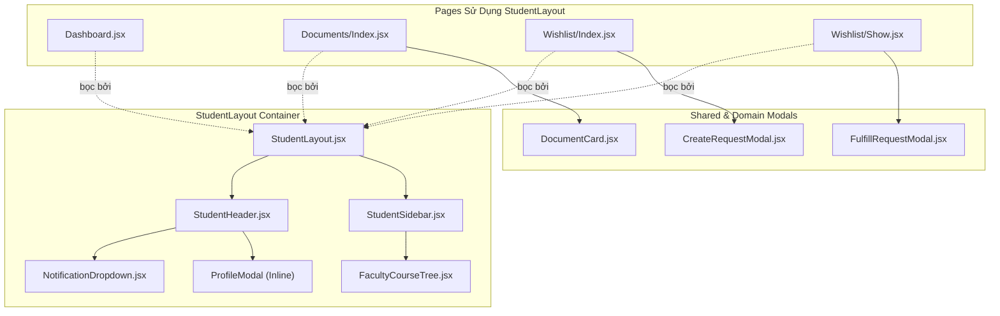
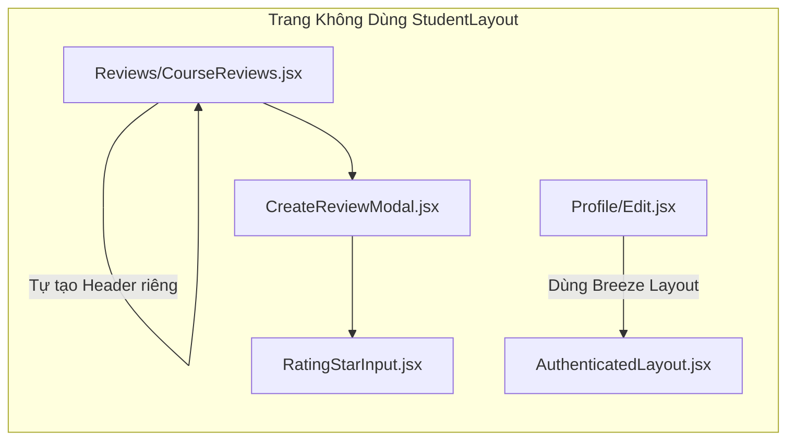

# BÁO CÁO KIỂM KÊ TOÀN DIỆN FRONTEND & ĐÁNH GIÁ MỨC ĐỘ SẴN SÀNG TRIỂN KHAI
## AGU Academic Hub — Phân Hệ Sinh Viên (`SINH_VIEN`) & Cựu Sinh Viên (`CUU_SINH_VIEN`)
**Tài liệu định hướng triển khai giao diện và trải nghiệm người dùng (Frontend Implementation Readiness)**

---

| Thông Tin Kiểm Kê | Chi Tiết |
| :--- | :--- |
| **Dự Án** | AGU Academic Hub (ĐHQG-HCM / Trường Đại học An Giang) |
| **Kiến Trúc** | Modular Monolith (Laravel 11 + Inertia.js React 18 + Vite 7 + Tailwind CSS) |
| **Phạm Vi Trọng Tâm** | M01 - M10: Toàn bộ giao diện người dùng Sinh viên & Cựu sinh viên |
| **Phương Thức Audit** | **READ-ONLY AUDIT** (Không sửa code, không thay đổi DB/Route/Package) |
| **Thời Điểm Kiểm Tra** | Tháng 11/2026 |
| **Đường Dẫn Báo Cáo** | `docs/planning/STUDENT_ALUMNI_FRONTEND_INVENTORY.md` |

---

## 1. TÓM TẮT ĐIỀU HÀNH (EXECUTIVE SUMMARY)

Báo cáo này cung cấp kết quả rà soát và kiểm kê mã nguồn thực tế tại tầng Frontend (React 18 + Inertia.js) cùng các lớp Data Contract liên kết với Backend (Controller, Application Query/Action, Model) dành riêng cho hai nhóm tác nhân: **Sinh viên hiện hành (`SINH_VIEN`)** và **Cựu sinh viên (`CUU_SINH_VIEN`)**.

### 1.1. Các Phát Hiện Trọng Yếu & Rủi Ro Chặn Nền Tảng (P0 / P1)

1. **[P0 - Build Failure / Runtime Crash] Thư viện `canvas-confetti` chưa được cài đặt trong `node_modules`:**
   - Trong file `resources/js/Pages/Wishlist/Show.jsx` dòng 5: `import confetti from 'canvas-confetti';`.
   - File `package.json` có khai báo `"canvas-confetti": "^1.9.4"`, nhưng thư viện **chưa từng được cài đặt vào `node_modules/`** (`Test-Path node_modules\canvas-confetti` trả về `False`).
   - Lệnh `npm run build` lập tức thất bại với mã lỗi Rollup: `Rollup failed to resolve import "canvas-confetti" from "resources/js/Pages/Wishlist/Show.jsx"`.
   - Bất kỳ người dùng nào truy cập vào trang chi tiết yêu cầu tài liệu (`/yeu-cau-tai-lieu/{id}`) đều đối mặt với nguy cơ sập trang toàn diện nếu build production.

2. **[P1 - Missing Page / 404 Inertia Crash] Giao diện Ví Điểm (`Wallet/Index.jsx`) hoàn toàn không tồn tại:**
   - Tuyến đường `GET /vi-diem` (`wallet.index`) được điều phối bởi `WalletController@index`, thực hiện lệnh `Inertia::render('Wallet/Index')` không truyền props.
   - Thư mục `resources/js/Pages/Wallet/` và file `Index.jsx` **không tồn tại trên ổ đĩa**.
   - Bất kỳ sinh viên hay cựu sinh viên nào click vào liên kết ví điểm trên Header hoặc Dashboard đều nhận lỗi sập trang Inertia: `Page not found: ./Pages/Wallet/Index.jsx`.

3. **[P1 - Broken Document Flow] `Documents/Index.jsx` bỏ qua hoàn toàn prop `isUploadMode` và `document` (Detail View):**
   - Tuyến `GET /tai-lieu/dang-tai` (`documents.create`) gọi `DocumentController@create`, trả về `Inertia::render('Documents/Index', ['isUploadMode' => true, ...])`.
   - Tuyến `GET /tai-lieu/{id}` (`documents.show`) gọi `DocumentController@show`, trả về `Inertia::render('Documents/Index', ['document' => $document])`.
   - Tuy nhiên, component `resources/js/Pages/Documents/Index.jsx` **chỉ nhận và xử lý danh sách `documents`**. Component này hoàn toàn không có mã nguồn kiểm tra `isUploadMode` (không có Form/Modal upload) và không có mã nguồn hiển thị chi tiết tài liệu đơn lẻ (`document`).
   - **Hậu quả:** Cả tuyến đăng tải tài liệu lẫn tuyến xem chi tiết tài liệu đều chỉ render ra màn hình danh sách trống rỗng! Người dùng không có cách nào xem trước PDF trực tuyến, tải file về máy, upvote hay báo cáo vi phạm tài liệu từ giao diện.

4. **[P2 - Data Contract Mismatch] Lệch tên trường dữ liệu người dùng (`name` vs `ho_ten`):**
   - Tầng Backend (`HandleInertiaRequests.php`) chia sẻ thông tin tài khoản qua biến toàn cục `auth.user` với trường định danh là `ho_ten`, hoàn toàn không có trường `name`.
   - Giao diện `resources/js/Layouts/AuthenticatedLayout.jsx` dòng 47 truy cập `{user.name}`, dẫn đến giá trị `undefined` (nút tài khoản bị trống tên).
   - Form cập nhật hồ sơ `resources/js/Pages/Profile/Partials/UpdateProfileInformationForm.jsx` dòng 16 khởi tạo `useForm({ name: user.name, email: user.email })`, khiến React phát cảnh báo input uncontrolled và trường họ tên người dùng bị xóa trắng khi tải trang.

5. **[P2 - Architecture Drift & Orphan Pages] Trang mồ côi và lệch chuẩn Layout:**
   - File `resources/js/Pages/Courses/Index.jsx` và `resources/js/Pages/Home.jsx` là mã nguồn cũ còn sót lại, sử dụng `AppLayout.jsx` (layout cũ trước khi refactor) và không được bất kỳ route nào trong hệ thống trỏ đến.
   - Trang đánh giá môn học `resources/js/Pages/Reviews/CourseReviews.jsx` tự xây dựng một Header riêng biệt thay vì tích hợp vào `StudentLayout`, làm đứt gãy luồng điều hướng Sidebar và cây thư mục môn học.
   - Tuyến `GET /khoa` (`faculties.index`) gọi `FacultyController@index`, trả về view `Dashboard` nhưng **không truyền props thống kê (`stats`) hay tài liệu mới (`recentDocuments`)**, dẫn đến màn hình Dashboard hiển thị số liệu 0 giả tạo.

---

## 2. PHẠM VI AUDIT (AUDIT SCOPE)

Phạm vi kiểm tra giới hạn trong hai vai trò người dùng cuối và 10 miền chức năng:

```
AGU Academic Hub (Frontend Scope)
├── M01: Dashboard (Tổng quan, thống kê sinh viên, tài liệu mới)
├── M02: Academic Catalog (Khoa, chuyên ngành, cây môn học)
├── M03: Document (Danh sách, chi tiết, upload, xem trước PDF, tải file)
├── M04: Review (Đánh giá môn học, bình chọn hữu ích, lọc từ cấm)
├── M05: Wishlist (Yêu cầu tìm tài liệu, danh sách bài đăng)
├── M06: Bounty (Săn thưởng điểm ví, đóng góp và nghiệm thu tài liệu)
├── M07: Wallet (Số dư ví điểm khả dụng, điểm tạm giữ, lịch sử giao dịch)
├── M08: Profile (Xem thông tin cá nhân, chỉnh sửa họ tên, đổi email)
├── M09: Notification (Thông báo chuông, polling chưa đọc, đánh dấu đã đọc)
└── M10: Shared UI (StudentLayout, Header, Sidebar, Tree, Modals, Pagination)
```

---

## 3. KIỂM KÊ TOÀN BỘ PAGES (T0.1 - FRONTEND PAGES INVENTORY)

Dưới đây là bảng kiểm kê chi tiết toàn bộ các Page Component liên quan đến Student & Alumni:

| STT | File Path | Component Name | Nhóm CN | Layout Sử Dụng | Component Con Được Import | Props Đầu Vào Nhận Từ Backend | Phân Loại Trạng Thái | Chức Năng Đang Hoạt Động | Chức Năng Thiếu / Chỉ Có UI / Nguy Cơ Lỗi |
| :---: | :--- | :--- | :---: | :--- | :--- | :--- | :---: | :--- | :--- |
| **P01** | `resources/js/Pages/Dashboard.jsx` | `Dashboard` | M01 | `StudentLayout` | `StatCard` (inline), `SectionTitle` (inline) | `auth`, `stats`, `recentDocuments` | `IMPLEMENTED` | - Chào mừng cá nhân hóa<br>- Hiển thị 3 thẻ thống kê<br>- Shortcut Săn thưởng & Đăng tải<br>- Danh sách 3 tài liệu mới | - Chưa hiển thị `diem_tam_giu`<br>- Tuyến `/khoa` tái sử dụng page này nhưng thiếu `stats` & `recentDocuments` |
| **P02** | `resources/js/Pages/Documents/Index.jsx` | `Index` | M02<br>M03 | `StudentLayout` | `DocumentCard` | `documents`, `filters`, `course` | `BROKEN` | - Tìm kiếm debounce (300ms)<br>- Lọc theo danh mục môn học<br>- Sắp xếp (mới nhất, tải nhiều)<br>- Render danh sách DocumentCard | - **Không có UI upload** khi nhận `isUploadMode = true`<br>- **Không có UI chi tiết** khi nhận `document`<br>- **Không có phân trang (Pagination)** |
| **P03** | `resources/js/Pages/Courses/Index.jsx` | `Index` | M02 | `AppLayout` (Legacy) | Không có | `courses` | `ORPHAN` | - Hiển thị tiêu đề tĩnh | - **File mồ côi**, không có route nào gọi tới. Sử dụng Layout cũ đã lỗi thời. |
| **P04** | `resources/js/Pages/Reviews/CourseReviews.jsx` | `CourseReviews` | M04 | Tự dựng Layout (Standalone) | `CreateReviewModal`, Lucide Icons | `course`, `mon_hoc`, `stats`, `thong_ke`, `reviews` | `PARTIAL` | - Xem danh sách bài đánh giá<br>- Bình chọn hữu ích (AJAX)<br>- Mở modal tạo review mới<br>- Chuẩn hóa field song ngữ | - Không dùng `StudentLayout`, mất Sidebar và Navigation<br>- Báo cáo vi phạm review chưa có Modal giao diện |
| **P05** | `resources/js/Pages/Wishlist/Index.jsx` | `WishlistIndex` | M05 | `StudentLayout` | `CreateRequestModal` | `requests`, `filters`, `courses` | `IMPLEMENTED` | - Lọc trạng thái (Mở/Đóng)<br>- Lọc theo môn học & loại tài liệu<br>- Mở modal tạo yêu cầu treo thưởng<br>- Phân trang danh sách bài đăng | - Tự render JSX phân trang thay vì tái sử dụng component `Pagination.jsx` dùng chung |
| **P06** | `resources/js/Pages/Wishlist/Show.jsx` | `WishlistShow` | M05<br>M06 | `StudentLayout` | `FulfillRequestModal`, `canvas-confetti` | `item`, `is_creator` | `BROKEN` | - Chi tiết yêu cầu & điểm thưởng<br>- Danh sách bài nộp phản hồi<br>- Xác nhận giải ngân điểm<br>- Hủy yêu cầu hoàn cọc | - **Lỗi Build Vite P0:** Thiếu package `canvas-confetti` trong `node_modules` |
| **P07** | `resources/js/Pages/Wallet/Index.jsx` | *Không có* | M07 | *Không có* | *Không có* | *Không có* | `MISSING` | - Không có | - **File không tồn tại trên ổ đĩa**. Route `/vi-diem` gây lỗi Fatal Crash phía client. |
| **P08** | `resources/js/Pages/Profile/Edit.jsx` | `Edit` | M08 | `AuthenticatedLayout` | `UpdateProfileInformationForm`, `UpdatePasswordForm`, `DeleteUserForm` | `mustVerifyEmail`, `status` | `BROKEN` | - Gửi form cập nhật hồ sơ<br>- Đổi mật khẩu cá nhân<br>- Form xóa tài khoản | - Lệch Layout Breeze (tiếng Anh)<br>- `user.name` bị `undefined`, input họ tên bị rỗng<br>- Chưa có upload avatar |
| **P09** | `resources/js/Pages/Auth/Login.jsx` | `Login` | Auth | `GuestLayout` | Form inputs, Alert blocks | `status`, `kycStatus`, `canResetPassword` | `IMPLEMENTED` | - Đăng nhập MSSV / Email<br>- Hiển thị lý do từ chối KYC<br>- Thông báo hồ sơ đang chờ duyệt<br>- Toggle ẩn/hiện mật khẩu | - Cựu sinh viên bị từ chối KYC không có nút bấm dẫn tới trang nộp lại minh chứng |
| **P10** | `resources/js/Pages/Auth/AlumniRegister.jsx` | `AlumniRegister` | Auth | `GuestLayout` | Drag & Drop Dropzone, Image Preview | `danh_sach_khoa` | `IMPLEMENTED` | - Nhập thông tin cựu SV<br>- Kéo thả ảnh minh chứng bằng tốt nghiệp<br>- Client-side validation file (5MB, định dạng ảnh)<br>- Hiển thị thanh tiến trình tải lên | - Chưa hỗ trợ tải file PDF minh chứng (chỉ mới cho phép định dạng ảnh JPEG/PNG/WEBP) |
| **P11** | `resources/js/Pages/Auth/FirstTimeChangePassword.jsx` | `FirstTimeChangePassword` | Auth | `GuestLayout` | Password Strength Meter | `user` (`ho_ten`, `mssv`, `email`) | `IMPLEMENTED` | - Thẻ định danh sinh viên<br>- Đo độ mạnh mật khẩu client-side<br>- Đổi mật khẩu & kích hoạt tài khoản | - Hoạt động hoàn chỉnh |
| **P12** | `resources/js/Pages/Auth/Register.jsx` | `Register` | Auth | `GuestLayout` | Form controls | Không có | `PARTIAL` | - Form đăng ký sinh viên | - Logic nghiệp vụ không cho sinh viên tự đăng ký, gây xung đột định danh |
| **P13** | `resources/js/Pages/Auth/ForgotPassword.jsx` | `ForgotPassword` | Auth | `GuestLayout` | Form inputs | `status` | `IMPLEMENTED` | - Nhập email nhận link reset | - Đang dùng giao diện Breeze mặc định |
| **P14** | `resources/js/Pages/Auth/ResetPassword.jsx` | `ResetPassword` | Auth | `GuestLayout` | Form inputs | `token`, `email` | `IMPLEMENTED` | - Nhập mật khẩu mới kèm token | - Đang dùng giao diện Breeze mặc định |
| **P15** | `resources/js/Pages/Welcome.jsx` | `Welcome` | Public | Tự dựng | Nav links, Laravel SVG | `auth`, `laravelVersion`, `phpVersion` | `UI_ONLY` | - Liên kết đăng nhập / dashboard | - Giao diện mặc định của Laravel Breeze, chưa chuyển thành trang chủ AGU Hub |
| **P16** | `resources/js/Pages/Home.jsx` | `Home` | Public | `AppLayout` (Legacy) | Không có | Không có | `ORPHAN` | - Hiển thị text giới thiệu tĩnh | - **File mồ côi**, không có route sử dụng |
| **P17** | `resources/js/Pages/TestGuest.jsx` | `TestGuest` | Dev | `GuestLayout` | Text block | Không có | `DEV_ONLY` | - Thử nghiệm render GuestLayout | - Trang thử nghiệm nội bộ |
| **P18** | `resources/js/Pages/TestAdmin.jsx` | `TestAdmin` | Dev | `AdminLayout` | Text block | Không có | `DEV_ONLY` | - Thử nghiệm render AdminLayout | - Trang thử nghiệm nội bộ |

---

## 4. KIỂM KÊ LAYOUT VÀ SHARED COMPONENTS (T0.2)

### 4.1. Cây Cấu Trúc Layout Hiện Tại

```
StudentLayout (Layout chuẩn cho Sinh viên & Cựu sinh viên)
├── StudentHeader (Header cố định phía trên, nền #005BAA)
│   ├── Logo & Brand (AGU Academic Hub)
│   ├── GlobalSearchForm (Tìm kiếm theo mã HP/tên môn -> điều hướng courses.index)
│   ├── BountyShortcutButton (Nút dẫn tới /yeu-cau-tai-lieu)
│   ├── ReputationBadge (Huy hiệu điểm uy tín: {user.diem_uy_tin} pts)
│   ├── NotificationDropdown (Dropdown chuông thông báo)
│   └── UserProfileDropdown (Menu avatar cá nhân)
│       ├── ProfileModal (Modal xem thông tin cá nhân dạng pop-up)
│       ├── BountyWalletLink (Hiển thị điểm khả dụng và link săn thưởng)
│       └── LogoutButton (Gửi request POST /dang-xuat)
└── ContentArea (Khu vực nội dung)
    ├── StudentSidebar (Sidebar ngăn kéo di động & cố định trên Desktop)
    │   ├── NavigationMenu (Tổng quan, Kho môn, Săn thưởng, DS Khoa, Đăng tài liệu)
    │   └── FacultyCourseTree (Cây phân cấp Khoa và Môn học)
    └── Main (Thẻ <main> chứa ruột trang Page tương ứng)
```

### 4.2. Danh Sách Chi Tiết Các Shared Components

| Component | Đường Dẫn File | Component Cha Sử Dụng | Component Con / Dependency | Props Nhận Vào | State & Callbacks Chính | Tình Trạng Tái Sử Dụng & Ghi Chú Kỹ Thuật |
| :--- | :--- | :--- | :--- | :--- | :--- | :--- |
| **`StudentLayout`** | `resources/js/Layouts/StudentLayout.jsx` | `Dashboard`, `Documents/Index`, `Wishlist/Index`, `Wishlist/Show` | `StudentHeader`, `StudentSidebar` | `children`, `title` | `isMobileSidebarOpen`<br>`handleMenuClick`<br>`handleCloseSidebar` | Tái sử dụng 100% giữa Student và Alumni. Đang thiếu ở `CourseReviews` và `Profile/Edit`. |
| **`StudentHeader`** | `resources/js/Components/layouts/StudentHeader.jsx` | `StudentLayout` | `NotificationDropdown`, Lucide Icons | `onMenuClick` | `isHeaderVisible` (ẩn khi scroll xuống)<br>`isUserMenuOpen`<br>`isProfileModalOpen`<br>`searchQuery` | Nhận dữ liệu user từ `usePage().props.auth.user`. Modal xem hồ sơ nằm bên trong component này nhưng chưa có nút link tới trang chỉnh sửa `/ho-so`. |
| **`StudentSidebar`** | `resources/js/Components/layouts/StudentSidebar.jsx` | `StudentLayout` | `FacultyCourseTree`, Lucide Icons | `faculties`, `isOpen`, `onClose` | Active menu logic dựa vào `usePage().url` | Truyền prop cho cây thư mục dưới tên `faculities={faculties}` (có typo chính tả). |
| **`FacultyCourseTree`** | `resources/js/Components/layouts/FacultyCourseTree.jsx` | `StudentSidebar` | Lucide Icons, Inertia Link | `faculities = []` (Typo prop) | `expandedFaculty`<br>`toggleFaculty(makhoa)` | **Thiếu cấp Chuyên ngành (Majors)**. Chỉ lặp `khoa -> mon_hocs`. Tên prop nhận vào bị sai chính tả nhưng khớp với component cha. |
| **`NotificationDropdown`** | `resources/js/Components/NotificationDropdown.jsx` | `StudentHeader`, `AdminHeader` | Lucide Icons | `variant = 'student'` | `isOpen`, `notifications`, `unreadCount`, `loading`<br>`fetchNotifications`, `handleNotificationClick` | Giao tiếp API qua `fetch('/thong-bao')`. Hỗ trợ cả giao diện Student lẫn Admin. Hoạt động mượt mà. |
| **`DocumentCard`** | `resources/js/Components/domain/DocumentCard.jsx` | `Documents/Index` | Lucide Icons, Inertia Link | `document` | `getCategoryBadge(category)` | Hiển thị thẻ tài liệu, huy hiệu cộng đồng ($\ge 10$ lượt tải). Nút "Xem" trỏ tới `route('documents.show')` đang bị lỗi trang trắng. |
| **`CreateRequestModal`** | `resources/js/Components/Wishlist/CreateRequestModal.jsx` | `Wishlist/Index` | Lucide Icons, Inertia useForm | `isOpen`, `onClose`, `courses` | `useForm` (ma_mon_hoc, tieu_de, diem_thuong,...) | Kiểm tra số dư khả dụng từ `auth.user.vi_diem.diem_kha_dung`. Validate cọc điểm cẩn thận. |
| **`FulfillRequestModal`** | `resources/js/Components/Wishlist/FulfillRequestModal.jsx` | `Wishlist/Show` | Lucide Icons, Inertia useForm | `isOpen`, `onClose`, `requestId` | `useForm` (ma_tai_lieu, ghi_chu) | Bắt buộc nhập ID tài liệu đã có. Dẫn link sang `/tai-lieu/dang-tai` (vốn chưa có form upload). |
| **`CreateReviewModal`** | `resources/js/Components/Reviews/CreateReviewModal.jsx` | `CourseReviews` | `RatingStarInput`, `profanityFilter.js` | `isOpen`, `onClose`, `course` | `useForm` đa ngữ<br>`detectProfanity` real-time | Lọc từ cấm ngay trên client trước khi gửi request. Tự động ánh xạ trường tiếng Anh/Việt. |
| **`RatingStarInput`** | `resources/js/Components/RatingStarInput.jsx` | `CreateReviewModal` | Lucide Star | `value`, `onChange`, `label`, `error` | `hoverValue` | Component xếp hạng sao (1 đến 5 sao) tái sử dụng tốt. |
| **`Pagination`** | `resources/js/Components/Common/Pagination.jsx` | Các trang Admin | Lucide Chevron Icons | `links`, `className` | Xử lý icon `Previous`/`Next` | Component phân trang chuẩn nhưng **chưa được dùng trong phân hệ sinh viên** (`Wishlist` tự code lại, `Documents` không có phân trang). |

---

## 5. ĐỐI CHIẾU ROUTE VỚI INERTIA PAGES (T0.3)

Dưới đây là bảng đối chiếu chi tiết giữa danh sách định tuyến Laravel thực tế và các view Inertia tương ứng:

| HTTP Method | URI | Route Name | Controller | Action / Method | Inertia Page Rendered | Trạng Thái & Lỗi Phát Hiện |
| :---: | :--- | :--- | :--- | :--- | :--- | :--- |
| `GET` | `/` | `home` | Closure | Closure | `Welcome` | `UI_ONLY`: Render trang mặc định Breeze, chưa có UI trang chủ AGU Hub. |
| `GET` | `/trang-chu` | `dashboard` | `DashboardController` | `__invoke` | `Dashboard` | `IMPLEMENTED`: Đầy đủ thống kê và tài liệu mới. |
| `GET` | `/dang-nhap` | `login` | `AuthenticatedSessionController` | `create` | `Auth/Login` | `IMPLEMENTED`: Hỗ trợ cờ KYC pending và rejection reason. |
| `POST` | `/dang-nhap` | `login.store` | `AuthenticatedSessionController` | `store` | *Redirect* | `IMPLEMENTED`: Đối soát dữ liệu thô và xác thực sinh viên/cựu sinh viên. |
| `POST` | `/dang-xuat` | `logout` | `AuthenticatedSessionController` | `destroy` | *Redirect /* | `IMPLEMENTED`: Hủy session và cookie. |
| `GET` | `/cuu-sinh-vien/dang-ky` | `alumni.register` | `KycController` | `hienThiFormDangKy` | `Auth/AlumniRegister` | `IMPLEMENTED`: Nhận prop `danh_sach_khoa`. Form upload minh chứng. |
| `POST` | `/cuu-sinh-vien/dang-ky` | `alumni.register.store`| `KycController` | `luuDangKyCuuSinhVien` | *Redirect login* | `IMPLEMENTED`: Lưu private disk và tạo bản ghi KYC. |
| `GET` | `/mat-khau-lan-dau` | `password.change` | `FirstTimePasswordController` | `hienThiFormDoiMatKhau` | `Auth/FirstTimeChangePassword` | `IMPLEMENTED`: Chặn bởi middleware `EnsurePasswordChanged`. |
| `POST` | `/mat-khau-lan-dau` | `password.change.update`| `FirstTimePasswordController`| `capNhatMatKhau` | *Redirect dashboard*| `IMPLEMENTED`: Kích hoạt tài khoản và cấp điểm ví. |
| `GET` | `/khoa` | `faculties.index` | `FacultyController` | `index` | `Dashboard` | `BROKEN DATA`: Tái sử dụng `Dashboard` nhưng **không truyền `stats` và `recentDocuments`**. |
| `GET` | `/khoa/{id}/mon-hoc`| `faculties.courses` | `FacultyController` | `layDanhSachMonHoc` | *JSON Response* | `IMPLEMENTED`: Trả danh sách môn phục vụ dropdown. |
| `GET` | `/khoa/chuyen-nganh/{id}/mon-hoc` | `faculties.majors.courses` | `FacultyController` | `layDanhSachMonHocTheoChuyenNganh` | *JSON Response* | `IMPLEMENTED`: Trả danh sách môn theo chuyên ngành. |
| `GET` | `/mon-hoc` | `courses.index` | `CourseController` | `index` | `Documents/Index` | `IMPLEMENTED`: Tìm kiếm, lọc và phân trang tài liệu theo môn. |
| `GET` | `/mon-hoc/{course_code}` | `courses.show` | `CourseController` | `show` | `Documents/Index` | `IMPLEMENTED`: Hiển thị danh sách tài liệu gắn với môn học cụ thể. |
| `GET` | `/mon-hoc/{code}/tai-lieu`| `courses.documents`| `CourseController` | `documents` | `Documents/Index` | `IMPLEMENTED`: Alias của `courses.show`. |
| `GET` | `/mon-hoc/{code}/danh-gia`| `courses.reviews.index`| `CourseReviewController` | `index` | `Reviews/CourseReviews` | `IMPLEMENTED`: Xem danh sách review môn học. |
| `POST` | `/mon-hoc/{code}/danh-gia`| `courses.reviews.store`| `CourseReviewController` | `store` | *Redirect back* | `IMPLEMENTED`: Lưu đánh giá kèm bộ lọc từ cấm. |
| `POST` | `/danh-gia/{id}/huu-ich` | `reviews.helpful` | `CourseReviewController` | `binhChonHuuIch` | *Redirect back* | `IMPLEMENTED`: Tăng lượt hữu ích của review. |
| `POST` | `/danh-gia/{id}/bao-cao` | `reviews.report` | `CourseReviewController` | `baoCaoViPham` | *Redirect back* | `IMPLEMENTED`: Gửi báo cáo vi phạm bài review. |
| `GET` | `/tai-lieu/dang-tai` | `documents.create` | `DocumentController` | `create` | `Documents/Index` | `BROKEN`: Render `Documents/Index` với `isUploadMode: true` nhưng **view không có form upload**. |
| `POST` | `/tai-lieu/dang-tai` | `documents.store` | `DocumentController` | `store` | *Redirect documents.show* | `BACKEND_ONLY`: Backend xử lý upload SHA-256 tốt nhưng FE chưa có form gọi. |
| `POST` | `/tai-lieu/kiem-tra-trung-lap` | `documents.check-duplicate` | `DocumentController` | `checkDuplicate` | *JSON Response* | `IMPLEMENTED`: API kiểm tra băm SHA-256 tầng 1. |
| `GET` | `/tai-lieu/{id}` | `documents.show` | `DocumentController` | `show` | `Documents/Index` | `BROKEN`: Render `Documents/Index` với `document` nhưng **view không có màn hình xem chi tiết**. |
| `GET` | `/tai-lieu/{id}/xem-truoc` | `documents.preview` | `DocumentController` | `preview` | *Binary PDF Stream*| `BACKEND_ONLY`: Trả stream PDF inline nhưng FE chưa có iframe/viewer nhúng. |
| `GET` | `/tai-lieu/{id}/tai-ve` | `documents.download` | `DocumentController` | `download` | *Binary Download* | `BACKEND_ONLY`: Tự tăng biến đếm lượt tải nhưng FE chưa có nút gọi trực tiếp. |
| `POST` | `/tai-lieu/{id}/binh-chon` | `documents.upvote` | `DocumentController` | `upvote` | *JSON Response* | `BACKEND_ONLY`: Toggle upvote hoạt động nhưng FE chưa gắn handler. |
| `POST` | `/bao-cao/tai-lieu` | `reports.document.store`| `DocumentReportController` | `store` | *Redirect back* | `BACKEND_ONLY`: Backend tính ngưỡng tự ẩn tài liệu tốt nhưng FE chưa có modal báo cáo. |
| `GET` | `/yeu-cau-tai-lieu` | `document-requests.index`| `WishlistBountyController` | `index` | `Wishlist/Index` | `IMPLEMENTED`: Danh sách bài đăng tìm tài liệu. |
| `POST` | `/yeu-cau-tai-lieu` | `document-requests.store`| `WishlistBountyController` | `store` | *Redirect index* | `IMPLEMENTED`: Tạo yêu cầu và cọc đóng băng điểm ví. |
| `GET` | `/yeu-cau-tai-lieu/{id}` | `document-requests.show` | `WishlistBountyController` | `show` | `Wishlist/Show` | `BROKEN RUNTIME`: Thiếu thư viện `canvas-confetti` gây lỗi build. |
| `POST` | `/yeu-cau-tai-lieu/{id}/dong-gop` | `document-requests.fulfill` | `WishlistBountyController` | `fulfill` | *Redirect back* | `IMPLEMENTED`: Nộp ID tài liệu giải quyết yêu cầu. |
| `POST` | `/yeu-cau-tai-lieu/{id}/xac-nhan` | `document-requests.confirm` | `WishlistBountyController` | `confirm` | *Redirect back* | `IMPLEMENTED`: Giải ngân điểm thưởng và cộng uy tín. |
| `DELETE`| `/yeu-cau-tai-lieu/{id}` | `document-requests.destroy` | `WishlistBountyController` | `destroy` | *Redirect index* | `IMPLEMENTED`: Hủy yêu cầu và hoàn lại điểm ví. |
| `GET` | `/vi-diem` | `wallet.index` | `WalletController` | `index` | `Wallet/Index` | `MISSING CRITICAL`: **File `Wallet/Index.jsx` không tồn tại**. Gây lỗi sập trang. |
| `GET` | `/ho-so` | `profile.edit` | `ProfileController` | `edit` | `Profile/Edit` | `BROKEN DATA`: Lệch Layout Breeze, `user.name` bị rỗng. |
| `PATCH` | `/ho-so` | `profile.update` | `ProfileController` | `update` | *Redirect profile.edit* | `IMPLEMENTED`: Cập nhật email và họ tên. |
| `GET` | `/thong-bao` | `notifications.index` | `NotificationController` | `index` | *JSON Response* | `IMPLEMENTED`: Danh sách 20 thông báo gần nhất và unread count. |
| `POST` | `/thong-bao/{id}/doc` | `notifications.read` | `NotificationController` | `markAsRead` | *JSON Response* | `IMPLEMENTED`: Đánh dấu đã đọc cho 1 thông báo. |
| `POST` | `/thong-bao/doc-tat-ca` | `notifications.read-all` | `NotificationController` | `markAllAsRead` | *JSON Response* | `IMPLEMENTED`: Đánh dấu đã đọc tất cả. |

---

## 6. TRUY VẾT LUỒNG DỮ LIỆU BACKEND $\to$ FRONTEND (T0.4)

Dưới đây là bảng truy vết kiến trúc thực tế của từng luồng dữ liệu theo mô hình Modular Monolith:

### 6.1. Bảng Truy Vết Các Thành Phần Kiến Trúc Thực Tế

| Nhóm Dữ Liệu | Route | Controller | Form Request | Application Query / Action | Domain Service | Repository | Model & Bảng CSDL | Inertia Page Nhận Props |
| :--- | :--- | :--- | :--- | :--- | :--- | :--- | :--- | :--- |
| **M01: Dashboard Stats & Recent Docs** | `GET /trang-chu` | `DashboardController` | *None* | `GetPublicFacultiesQuery` | *None* | `AcademicCatalogRepository` | `MonHoc`, `TaiLieu`, `NguoiDung`, `Khoa` | `Dashboard`<br>Props: `faculties`, `stats`, `recentDocuments` |
| **M02: Danh Mục Khoa & Môn Học (Sidebar Tree)** | Global Middleware | `HandleInertiaRequests` | *None* | `GetPublicFacultiesQuery` | *None* | `AcademicCatalogRepository` | `Khoa` with `monHocs` | Toàn bộ các trang qua `usePage().props.faculties` |
| **M03: Danh Sách Tài Liệu Theo Bộ Lọc** | `GET /mon-hoc` | `CourseController@index` | *None* | `GetPublicCoursesQuery` | `AcademicCatalogRuleEvaluator` | `AcademicCatalogRepository` | `MonHoc`, `TaiLieu`, `Khoa` | `Documents/Index`<br>Props: `faculties`, `courses`, `documents`, `filters` |
| **M03: Chi Tiết Môn Học & Tài Liệu Trực Thuộc** | `GET /mon-hoc/{code}` | `CourseController@show` | *None* | `GetPublicCoursesQuery` | *None* | `AcademicCatalogRepository` | `MonHoc`, `TaiLieu`, `Khoa` | `Documents/Index`<br>Props: `faculties`, `course`, `documents`, `filters` |
| **M03: Tải Lên Tài Liệu Mới (Upload Pipeline)** | `POST /tai-lieu/dang-tai` | `DocumentController@store` | Inline Validation | `UploadDocumentAction` | `DocumentDeduplicationEvaluator` | `DocumentRepository` | `TaiLieu` (table `tai_lieu`), file storage | Redirect `documents.show` |
| **M04: Đánh Giá Môn Học & Xếp Hạng Sao** | `GET /mon-hoc/{code}/danh-gia` | `CourseReviewController@index` | *None* | `GetCourseReviewsQuery` | `CourseReviewRuleEvaluator` | `CourseReviewRepository` | `DanhGiaMonHoc`, `MonHoc` | `Reviews/CourseReviews`<br>Props: `mon_hoc`, `thong_ke`, `reviews` |
| **M04: Đăng Đánh Giá Môn Học** | `POST /mon-hoc/{code}/danh-gia` | `CourseReviewController@store` | `StoreCourseReviewRequest` | `StoreCourseReviewAction` | `ProfanityFilterEvaluator` | `CourseReviewRepository` | `DanhGiaMonHoc` (table `danh_gia_mon_hoc`) | Redirect back with flash |
| **M05: Danh Sách Yêu Cầu Tìm Tài Liệu** | `GET /yeu-cau-tai-lieu` | `WishlistBountyController@index` | *None* | `GetWishlistBountyListQuery` | *None* | Direct Eloquent Query | `YeuCauTaiLieu`, `MonHoc` | `Wishlist/Index`<br>Props: `requests`, `filters`, `courses` |
| **M06: Chi Tiết Yêu Cầu & Danh Sách Bài Nộp** | `GET /yeu-cau-tai-lieu/{id}` | `WishlistBountyController@show` | *None* | `GetWishlistBountyDetailQuery` | *None* | Direct Eloquent Query | `YeuCauTaiLieu`, `DapUngYeuCau`, `TaiLieu` | `Wishlist/Show`<br>Props: `item`, `is_creator` |
| **M06: Xác Nhận Nghiệm Thu & Giải Ngân Bounty** | `POST /yeu-cau-tai-lieu/{id}/xac-nhan` | `WishlistBountyController@confirm` | `ConfirmBountyRequest` | `ConfirmBountyFulfillmentAction` | `ReputationEvaluator` | Direct Eloquent Transaction | `ViDiem`, `GiaoDichDiem`, `NguoiDung` | Redirect back with confetti trigger |
| **M07: Ví Điểm Cá Nhân & Lịch Sử Biến Động** | `GET /vi-diem` | `WalletController@index` | *None* | *None* (Chưa có Query) | *None* | *None* | `ViDiem`, `GiaoDichDiem` | `Wallet/Index` (**CHƯA CÓ FILE**) |
| **M08: Hồ Sơ Cá Nhân & Đổi Mật Khẩu** | `GET /ho-so` | `ProfileController@edit` | *None* | `GetUserProfileQuery` | *None* | `IdentityRepository` | `NguoiDung` | `Profile/Edit`<br>Props: `mustVerifyEmail`, `status` |
| **M09: Thông Báo Cá Nhân & Trạng Thái Đã Đọc** | `GET /thong-bao` | `NotificationController@index` | *None* | Direct Eloquent Relationship | *None* | Eloquent `DatabaseNotification` | `ThongBao` (table `notifications`) | JSON Response qua API |

### 6.2. Phân Tích Các Mối Quan Hệ Dữ Liệu Đặc Thù

1. **Quan hệ Khoa $\to$ Chuyên ngành $\to$ Môn học:**
   - Trong CSDL có bảng `khoa`, `chuyen_nganh`, `mon_hoc` và bảng trung gian `mon_hoc_chuyen_nganh`.
   - Khi load cây danh mục trên Sidebar (`getActiveFacultiesWithCourses`), hệ thống chỉ eager load trực tiếp quan hệ `monHocs` từ Khoa mà bỏ qua quan hệ Chuyên ngành.
   - Do đó, nếu một môn học thuộc nhiều chuyên ngành khác nhau (ví dụ: môn *Toán cao cấp* thuộc cả *Khoa học máy tính* và *Kỹ thuật phần mềm*), trên cây thư mục nó chỉ xuất hiện một lần duy nhất dưới Khoa trực thuộc của nó (`mon_hoc.ma_khoa`).
2. **Nguy cơ truy vấn N+1:**
   - Trong `CourseController@show`, query `findActiveCourseByCode` load môn học, sau đó `getPaginatedDocuments` query tài liệu theo môn học có eager load `nguoiDang` và `monHoc`. Luồng này được tối ưu hóa tốt, không có dấu hiệu N+1.
   - Trong `DashboardController`, việc tính toán 3 chỉ số thống kê thực hiện qua 3 câu query `count()` riêng rẽ (`MonHoc::where`, `TaiLieu::where`). Do chỉ đếm đơn lẻ nên chi phí chấp nhận được, nhưng nếu scale lớn cần gom nhóm lại.

---

## 7. KIỂM TRA DATA CONTRACT GIỮA BACKEND VÀ FRONTEND (T0.5)

Bảng tổng hợp chi tiết cấu trúc props truyền từ server sang client và phát hiện các lỗi sai lệch:

| Inertia Page | Tên Prop | Kiểu Dữ Liệu | Cấu Trúc Object / Array Chi Tiết | Nguồn Cung Cấp | Bắt Buộc / Tùy Chọn | Component Sử Dụng | Lỗi & Rủi Ro Tiềm Ẩn Phát Hiện Được |
| :--- | :--- | :---: | :--- | :--- | :---: | :--- | :--- |
| **Global** (Mọi Page) | `auth.user` | `Object \| null` | `{ ma_nguoi_dung, ho_ten, email, mssv, anh_dai_dien, diem_uy_tin, vai_tro, vi_diem: { diem_kha_dung, diem_tam_giu }, khoa }` | `HandleInertiaRequests` | Bắt buộc khi đăng nhập | `StudentHeader`, `StudentSidebar`, `Profile/Edit` | **LỆCH CONTRACT:** Backend cung cấp `ho_ten`, nhưng `AuthenticatedLayout` và `UpdateProfileInformationForm` lại đọc `user.name`. |
| **Global** (Mọi Page) | `faculties` | `Array` | `[ { ma_khoa, ten_khoa, ky_hieu_khoa, mon_hocs: [ { ma_mon_hoc, ma_hoc_phan, ten_mon_hoc, so_tin_chi } ] } ]` | `HandleInertiaRequests` | Bắt buộc | `StudentLayout` $\to$ `StudentSidebar` $\to$ `FacultyCourseTree` | **TYPO CONTRACT:** `StudentSidebar` truyền vào con bằng prop `faculities={faculties}`. Cây chỉ có Khoa và Môn, không có Chuyên ngành. |
| **Global** (Mọi Page) | `flash` | `Object` | `{ success: string\|null, error: string\|null, warning: string\|null, info: string\|null }` | `HandleInertiaRequests` | Bắt buộc | Các Modal, Toast | Chuẩn, không có lỗi. |
| **`Dashboard`** | `stats` | `Object` | `{ totalCourses: number, myDocuments: number, trustScore: number }` | `DashboardController` | Bắt buộc | `StatCard` | **THIẾU TRƯỜNG:** Không truyền điểm ví (`diem_kha_dung`, `diem_tam_giu`). Trang tự lấy từ `auth.user.vi_diem`. Khi vào qua `/khoa`, prop này bị `undefined`. |
| **`Dashboard`** | `recentDocuments` | `Array` | `[ { ma_tai_lieu, ma_mon_hoc, tieu_de, dinh_dang_tep, phan_loai, created_at, mon_hoc } ]` | `DashboardController` | Tùy chọn (Default `[]`) | Recent docs table | Khi vào qua `/khoa`, prop này bị rỗng. |
| **`Documents/Index`** | `documents` | `Object` | Laravel LengthAwarePaginator: `{ data: [ DocumentObject ], links, current_page, last_page, total }` | `CourseController` | Tùy chọn (Default `{ data: [] }`) | Document grid | **THIẾU UI:** Frontend bỏ qua `links` nên không có thanh chuyển trang (Pagination). |
| **`Documents/Index`** | `course` | `Object \| null`| `{ ma_mon_hoc, ma_hoc_phan, ten_mon_hoc, so_tin_chi, mo_ta }` | `CourseController` | Tùy chọn | Tiêu đề Header | Tốt khi xem theo môn; `null` khi xem toàn trường. |
| **`Documents/Index`** | `isUploadMode` | `Boolean` | `true \| undefined` | `DocumentController@create` | Tùy chọn | Không có | **BỎ RƠI PROP:** Backend gửi sang nhưng `Documents/Index.jsx` hoàn toàn không nhận và không xử lý! |
| **`Documents/Index`** | `document` | `Object` | Chi tiết tài liệu đơn lẻ từ `GetDocumentDetailQuery` | `DocumentController@show` | Tùy chọn | Không có | **BỎ RƠI PROP:** Backend gửi sang nhưng `Documents/Index.jsx` hoàn toàn không nhận và không xử lý! |
| **`Reviews/CourseReviews`**| `mon_hoc` / `course` | `Object` | `{ ma_hoc_phan / course_code, ten_mon_hoc / name, so_tin_chi / credits }` | `CourseReviewController` | Bắt buộc | Header môn học | Code FE có fallback `course || mon_hoc`, tương thích tốt. |
| **`Reviews/CourseReviews`**| `thong_ke` / `stats` | `Object` | `{ total_reviews, avg_difficulty, avg_practicality, avg_workload, overall_rating }` | `CourseReviewController` | Bắt buộc | Score summary box | Code FE có fallback `stats || thong_ke`, tương thích tốt. |
| **`Wishlist/Index`** | `requests` | `Object` | Paginator `{ data: [ RequestItem ], links }` | `WishlistBountyController` | Bắt buộc | Request cards | Chạy tốt, tự render pagination. |
| **`Wishlist/Index`** | `courses` | `Array` | `[ { ma_mon_hoc, ma_hoc_phan, ten_mon_hoc } ]` | `WishlistBountyController` | Bắt buộc | `CreateRequestModal` | Dropdown chọn môn học trong modal. |
| **`Wishlist/Show`** | `item` | `Object` | `{ ma_yeu_cau, tieu_de, mo_ta, diem_thuong, trang_thai, nguoi_tao, mon_hoc, dap_ung_yeu_caus: [ ... ] }` | `WishlistBountyController` | Bắt buộc | Show page detail | Chạy tốt nhưng bị crash build do thiếu package `canvas-confetti`. |
| **`Wishlist/Show`** | `is_creator` | `Boolean` | `true \| false` | `WishlistBountyController` | Bắt buộc | Quyền nút xác nhận | Phân quyền client chuẩn. |
| **`Auth/AlumniRegister`** | `danh_sach_khoa` | `Array` | `[ { ma_khoa, ten_khoa, ky_hieu_khoa } ]` | `KycController` | Bắt buộc | Select Khoa tốt nghiệp | Chạy tốt, select box hoạt động chuẩn. |
| **`Auth/FirstTimeChangePassword`** | `user` | `Object` | `{ ho_ten, mssv, email }` | `FirstTimePasswordController` | Bắt buộc | Student identity badge | Chạy tốt. |

---

## 8. SƠ ĐỒ PHỤ THUỘC COMPONENT (COMPONENT DEPENDENCY MAP)

### 8.1. Sơ Đồ Cấu Trúc Layout & Components Sinh Viên



### 8.2. Sơ Đồ Các Trang Bị Tách Rời (Layout Inconsistency)



---

## 9. KẾT QUẢ KIỂM THỬ NỀN TẢNG (T0.6 - BASELINE TESTING RESULTS)

Đã thực hiện chạy kiểm thử trực tiếp trên môi trường thực tế của hệ thống:

### 9.1. Kiểm Tra Build Frontend (`npm run build`)
- **Lệnh thực thi:** `npm run build`
- **Kết quả:** **BUILD FAILED (Exit Code 1)**
- **Chi tiết lỗi:**
  ```
  [vite]: Rollup failed to resolve import "canvas-confetti" from "D:/CNWEB/AGU-Academic-Hub/resources/js/Pages/Wishlist/Show.jsx".
  This is most likely unintended because it can break your application at runtime.
  ```
- **Nguyên nhân gốc rễ:** File `Wishlist/Show.jsx` gọi `import confetti from 'canvas-confetti'`. Gói này có tên trong `package.json` nhưng chưa từng được cài đặt trong thư mục `node_modules`.

### 9.2. Kiểm Tra Toàn Bộ Suite Test Backend (`php artisan test`)
- **Lệnh thực thi:** `php artisan test`
- **Kết quả:** **PASS 100%**
- **Chi tiết chỉ số:**
  - **Tổng số test:** 160 passed (0 failed, 0 skipped).
  - **Tổng số assertions:** 859 assertions.
  - **Thời gian chạy:** 60.02 giây.
- **Đánh giá kiểm thử:** Tầng Backend (Actions, Queries, Rule Evaluators, Repositories, Database Migrations) hoạt động chuẩn xác 100% với các kịch bản kiểm thử đã viết. Tuy nhiên, bộ test hoàn toàn chưa có test case nào kiểm tra việc render trang `Wallet/Index` hay kiểm tra giao diện build của Vite.

---

## 10. MA TRẬN ĐÁNH GIÁ MỨC ĐỘ HOÀN THIỆN CHỨC NĂNG (FUNCTIONAL COMPLETION MATRIX)

Phân loại trạng thái theo 7 mức quy ước: `IMPLEMENTED`, `PARTIAL`, `UI_ONLY`, `MISSING`, `BROKEN`, `BLOCKED`, `NEEDS_VERIFICATION`:

| Mã CN | Tên Chức Năng | Tác Nhân | Trạng Thái Đánh Giá | Bằng Chứng Kỹ Thuật Thực Tế | Nhận Xét & Điểm Nghẽn |
| :---: | :--- | :---: | :---: | :--- | :--- |
| **M01.1** | Xem Dashboard tổng quan | Cả hai | `IMPLEMENTED` | `DashboardController.php`, `Dashboard.jsx:140-270` | Thống kê số môn, số tài liệu và điểm uy tín chuẩn. |
| **M01.2** | Shortcut truy cập nhanh ví điểm trên Dashboard | Cả hai | `BROKEN` | `Dashboard.jsx:218-232` | Nút dẫn tới `route('document-requests.index')` thay vì dẫn tới `/vi-diem`. |
| **M02.1** | Tra cứu danh mục Khoa | Cả hai | `BROKEN` | `FacultyController.php:20-25` | Route `/khoa` tái sử dụng view `Dashboard` nhưng thiếu props `stats` & `recentDocuments`. |
| **M02.2** | Xem cây Khoa và Môn học trên Sidebar | Cả hai | `IMPLEMENTED` | `FacultyCourseTree.jsx`, `GetPublicFacultiesQuery.php` | Mở/đóng cây thư mục tốt, link tới môn học chuẩn. Thiếu cấp Chuyên ngành. |
| **M02.3** | Tìm kiếm môn học toàn cục | Cả hai | `IMPLEMENTED` | `StudentHeader.jsx:54-58` | Form search điều hướng sang `/mon-hoc?search=...` mượt mà. |
| **M03.1** | Xem danh sách tài liệu môn học | Cả hai | `IMPLEMENTED` | `CourseController.php:20-30`, `Documents/Index.jsx` | Lọc danh mục, tìm kiếm và sắp xếp chạy tốt. |
| **M03.2** | Phân trang danh sách tài liệu | Cả hai | `MISSING` | `Documents/Index.jsx` | Không có pagination component trên giao diện. |
| **M03.3** | Đăng tải tài liệu học tập mới | Cả hai | `BROKEN` | `DocumentController.php:38-46`, `Documents/Index.jsx` | Tuyến `/tai-lieu/dang-tai` trả về view danh sách trống, không có form upload. |
| **M03.4** | Xem chi tiết tài liệu học tập | Cả hai | `BROKEN` | `DocumentController.php:104-111`, `Documents/Index.jsx` | Tuyến `/tai-lieu/{id}` trả về view danh sách trống, không có trang xem chi tiết. |
| **M03.5** | Xem trước tài liệu PDF trực tuyến | Cả hai | `UI_ONLY` | `DocumentController.php:114` | Backend có stream PDF, FE chưa có modal/iframe nhúng. |
| **M03.6** | Tải tài liệu về máy (Tự tăng lượt tải) | Cả hai | `UI_ONLY` | `DocumentController.php:120` | Backend có Action tăng `luot_tai`, FE chưa có nút trigger trực tiếp từ thẻ. |
| **M03.7** | Upvote tài liệu | Cả hai | `UI_ONLY` | `DocumentController.php:127` | Backend có API toggle upvote, FE chỉ mới hiển thị số đếm tĩnh. |
| **M03.8** | Báo cáo tài liệu vi phạm | Cả hai | `MISSING` | `DocumentReportController.php:17` | Backend có API lưu báo cáo vi phạm, FE hoàn toàn chưa có Modal báo cáo. |
| **M04.1** | Xem đánh giá & xếp hạng sao môn học | Cả hai | `IMPLEMENTED` | `CourseReviewController.php:28`, `CourseReviews.jsx` | Hiển thị review, điểm khó/thực tiễn, phân trang review tốt. |
| **M04.2** | Viết đánh giá môn học kèm bộ lọc từ cấm | Cả hai | `IMPLEMENTED` | `CreateReviewModal.jsx`, `profanityFilter.js` | Lọc từ tục tĩu real-time trên client và server tốt. |
| **M04.3** | Bình chọn đánh giá hữu ích | Cả hai | `IMPLEMENTED` | `CourseReviewController.php:57`, `CourseReviews.jsx:45` | AJAX toggle hữu ích cập nhật state ngay lập tức. |
| **M05.1** | Xem danh sách yêu cầu tài liệu (Wishlist) | Cả hai | `IMPLEMENTED` | `WishlistBountyController.php:26`, `Wishlist/Index.jsx` | Lọc bài đăng, reset filter, phân trang chạy tốt. |
| **M05.2** | Đăng bài yêu cầu tài liệu kèm cọc Bounty | Cả hai | `IMPLEMENTED` | `CreateRequestModal.jsx`, `CreateBountyRequestAction.php`| Đóng băng điểm khả dụng trong ví và tạo bài đăng thành công. |
| **M06.1** | Xem chi tiết yêu cầu & bài đóng góp | Cả hai | `BROKEN` | `Wishlist/Show.jsx:5` | Lỗi build do thiếu gói `canvas-confetti`. |
| **M06.2** | Nộp tài liệu đáp ứng yêu cầu | Cả hai | `PARTIAL` | `FulfillRequestModal.jsx` | Form yêu cầu nhập ID tài liệu thủ công; chưa có picker chọn từ kho cá nhân. |
| **M06.3** | Nghiệm thu tài liệu & giải ngân Bounty | Cả hai | `IMPLEMENTED` | `WishlistBountyController.php:62`, `Wishlist/Show.jsx:56`| Giải ngân điểm vào ví người đóng góp, tăng điểm uy tín. |
| **M06.4** | Hủy yêu cầu và hoàn lại điểm ví | Cả hai | `IMPLEMENTED` | `WishlistBountyController.php:74`, `Wishlist/Show.jsx:75`| Hoàn điểm tạm giữ về điểm khả dụng chuẩn. |
| **M07.1** | Xem số dư ví điểm và điểm tạm giữ | Cả hai | `BROKEN` | `WalletController.php:14` | Route `/vi-diem` không có file component `Wallet/Index.jsx`. |
| **M07.2** | Xem lịch sử giao dịch điểm ví | Cả hai | `MISSING` | CSDL bảng `giao_dich_diem` | Chưa có giao diện bảng lịch sử giao dịch cho sinh viên. |
| **M08.1** | Xem hồ sơ cá nhân qua Header | Cả hai | `IMPLEMENTED` | `StudentHeader.jsx:325-395` | Modal pop-up hiển thị đầy đủ thông tin định danh và ví điểm. |
| **M08.2** | Chỉnh sửa họ tên và email cá nhân | Cả hai | `BROKEN` | `Profile/Edit.jsx`, `UpdateProfileInformationForm.jsx` | Lệch tên prop `name` vs `ho_ten`, layout Breeze cũ, không có link từ Header. |
| **M09.1** | Xem danh sách thông báo và đếm chưa đọc | Cả hai | `IMPLEMENTED` | `NotificationDropdown.jsx`, `NotificationController.php` | Polling realtime, đánh dấu đã đọc mượt mà. |
| **M10.1** | Điều hướng Layout sinh viên đồng bộ | Cả hai | `PARTIAL` | `StudentLayout.jsx` | Đang thiếu áp dụng cho `CourseReviews` và `Profile/Edit`. |

---

## 11. NỢ KỸ THUẬT & RỦI RO ĐÃ XÁC ĐỊNH (TECHNICAL DEBT & RISKS)

1. **[P0] Thiếu dependency thực tế `canvas-confetti`:**
   - Trong `package.json` có khai báo nhưng ổ đĩa chưa chạy lệnh cài đặt hoàn chỉnh. Vite Rollup bị chặn đứng hoàn toàn khi build assets cho môi trường production.
2. **[P1] Trùng lặp code phân trang (Pagination Duplication):**
   - Đã có component chuẩn `resources/js/Components/Common/Pagination.jsx` (được dùng ở các trang Admin), nhưng trang `Wishlist/Index.jsx` lại tự viết lặp lại 30 dòng code JSX để render các nút phân trang. Trong khi đó, `Documents/Index.jsx` lại bị bỏ quên không có phân trang.
3. **[P1] Trộn lẫn dữ liệu view giữa Catalog và Dashboard:**
   - `FacultyController@index` (`/khoa`) trả về view `Dashboard` thay vì trả về một trang dành riêng cho danh mục Khoa (`Faculties/Index.jsx`). Điều này làm sai lệch ngữ cảnh sử dụng của trang Dashboard và gây lỗi thiếu dữ liệu thống kê.
4. **[P2] Lỗi chính tả trong Prop Name (`faculities` vs `faculties`):**
   - Sự không nhất quán này kéo dài từ `StudentSidebar.jsx` sang `FacultyCourseTree.jsx`. Dù code hiện tại vẫn chạy được do cả 2 bên cùng viết sai giống nhau, đây là nợ kỹ thuật dễ gây bug khi các developer khác tái sử dụng component này.
5. **[P2] Code rác chưa dọn dẹp sau đợt Refactor Monolith:**
   - Các file `resources/js/Pages/Courses/Index.jsx`, `resources/js/Pages/Home.jsx`, và `resources/js/Layouts/AppLayout.jsx` hoàn toàn không còn mục đích sử dụng trong hệ thống mới.
6. **[P2] Trải nghiệm nộp tài liệu Bounty (`FulfillRequestModal`) chưa thân thiện:**
   - Bắt người dùng phải nhớ và gõ tay số `ma_tai_lieu` (Document ID) thay vì hiển thị một dropdown danh sách tài liệu cá nhân đã đăng tải để người dùng chọn nhanh.

---

## 12. MA TRẬN MỨC ĐỘ SẴN SÀNG TRIỂN KHAI (IMPLEMENTATION READINESS MATRIX)

Phân loại các đầu việc triển khai theo 4 nhóm trạng thái: `READY`, `BLOCKED`, `NEEDS_DECISION`, `ALREADY_COMPLETED`:

| Task ID | Tên Chức Năng Cần Triển Khai | Hiện Trạng Code | Công Việc Cần Thực Hiện | Phụ Thuộc (Dependency) | Mức Ưu Tiên | Mức Độ Sẵn Sàng |
| :---: | :--- | :--- | :--- | :--- | :---: | :---: |
| **TSK-01** | Khắc phục lỗi Build Vite (`canvas-confetti`) | Import trong `Wishlist/Show.jsx` bị lỗi resolve | Chạy `npm install` để đồng bộ `canvas-confetti` vào `node_modules` hoặc bọc dynamic import an toàn | `package.json` | **P0** | **READY** |
| **TSK-02** | Xây dựng trang Ví Điểm (`Wallet/Index.jsx`) | Chưa có file JSX trên ổ đĩa; Backend Controller đã có | Tạo file `resources/js/Pages/Wallet/Index.jsx` dùng `StudentLayout`. Bổ sung Query lấy lịch sử `giao_dich_diem` từ Backend truyền sang | `WalletController` | **P1** | **READY** |
| **TSK-03** | Tách riêng màn hình Đăng Tải Tài Liệu (`Documents/Create.jsx`) | `DocumentController@create` đang render chung vào `Index.jsx` | Tạo file `resources/js/Pages/Documents/Create.jsx` có form upload file, chọn Khoa/Môn học, kiểm tra băm SHA-256 tầng 1 | `DocumentController` | **P1** | **READY** |
| **TSK-04** | Tách riêng màn hình Chi Tiết Tài Liệu (`Documents/Show.jsx`) | `DocumentController@show` đang render chung vào `Index.jsx` | Tạo file `resources/js/Pages/Documents/Show.jsx` hiển thị thông tin tác giả, lượt tải, iframe xem trước PDF, nút Download, Upvote và Báo cáo vi phạm | `DocumentController`, `GetDocumentDetailQuery` | **P1** | **READY** |
| **TSK-05** | Tích hợp phân trang vào `Documents/Index.jsx` | Đang thiếu thanh điều hướng trang | Import component `Pagination.jsx` dùng chung vào cuối grid danh sách tài liệu | `Pagination.jsx` | **P1** | **READY** |
| **TSK-06** | Sửa Data Contract thông tin người dùng (`name` $\to$ `ho_ten`) | `user.name` bị `undefined` tại Profile Form & Layout | Đồng bộ hóa `UpdateProfileInformationForm.jsx` và `AuthenticatedLayout.jsx` sử dụng `user.ho_ten` | `HandleInertiaRequests` | **P2** | **READY** |
| **TSK-07** | Đưa trang `Profile/Edit.jsx` về `StudentLayout` | Đang dùng `AuthenticatedLayout` của Breeze cũ | Bọc `Profile/Edit.jsx` bằng `StudentLayout`. Thêm link từ Modal hồ sơ ở Header sang `/ho-so` | `StudentLayout` | **P2** | **READY** |
| **TSK-08** | Đưa trang `Reviews/CourseReviews.jsx` về `StudentLayout` | Đang tự tạo Header riêng lẻ | Thay thế wrapper ngoài cùng bằng `StudentLayout` để đồng bộ Sidebar và cây môn học | `StudentLayout` | **P2** | **READY** |
| **TSK-09** | Xây dựng màn hình danh mục Khoa riêng (`Faculties/Index.jsx`) | Route `/khoa` đang tái sử dụng view `Dashboard` lỗi | Tạo `Faculties/Index.jsx` hiển thị thẻ danh sách tất cả các Khoa, số lượng bộ môn và số lượng tài liệu | `FacultyController` | **P2** | **READY** |
| **TSK-10** | Chuẩn hóa Modal Nộp tài liệu Bounty (`FulfillRequestModal`) | Đang bắt nhập tay ID tài liệu | Thêm API/Query lấy danh sách tài liệu cá nhân của người dùng để render dạng thẻ chọn trực quan | `FulfillBountyRequestAction` | **P2** | **BLOCKED** (Cần API lấy My Documents) |
| **TSK-11** | Bổ sung Modal Báo cáo vi phạm tài liệu & review | Chưa có giao diện báo cáo cho người dùng | Tạo Modal `ReportViolationModal.jsx` dùng chung kết nối với endpoint `POST /bao-cao/tai-lieu` và `/danh-gia/{id}/bao-cao` | `DocumentReportController` | **P2** | **READY** |
| **TSK-12** | Thiết kế lại trang chủ chào đón (`Welcome.jsx`) | Đang dùng template mặc định của Laravel | Thiết kế lại Hero banner, giới thiệu tính năng AGU Academic Hub và liên kết đăng nhập trường | Thiết kế UI/UX | **P3** | **NEEDS_DECISION** (Cần thống nhất UI với PO) |
| **TSK-13** | Dọn dẹp các file mồ côi (`Courses/Index`, `Home`, `AppLayout`) | Tồn tại nhưng không sử dụng | Xóa bỏ an toàn các file thừa để tránh nhầm lẫn cho team | Không có | **P3** | **READY** |
| **TSK-14** | Luồng nộp lại minh chứng cho Cựu SV bị từ chối KYC | Backend chưa hỗ trợ nộp lại hồ sơ | Cần bổ sung Route, Controller và Form giao diện nộp lại minh chứng cho tài khoản `TU_CHOI` | Backend Identity Module | **P1** | **BLOCKED** (Cần bổ sung Backend trước) |

---

## 13. ĐỀ XUẤT CÁC BƯỚC TIẾP THEO (RECOMMENDED NEXT STEPS)

Dành cho Developer tiếp nhận triển khai giai đoạn kế tiếp:

1. **Bước 1 (Khẩn cấp - Fix Build):** Chạy `npm install canvas-confetti` để giải phóng lỗi build Vite P0 cho toàn bộ dự án.
2. **Bước 2 (Sprint 1 - Bịt lỗ hổng màn hình):**
   - Tạo mới `resources/js/Pages/Wallet/Index.jsx` để cứu tuyến `/vi-diem`.
   - Tạo mới `resources/js/Pages/Documents/Create.jsx` và `resources/js/Pages/Documents/Show.jsx` để hoàn thiện vòng đời tương tác tài liệu học tập.
   - Chèn `Pagination` vào `Documents/Index.jsx`.
3. **Bước 3 (Sprint 2 - Đồng bộ trải nghiệm & Layout):**
   - Đưa `Profile/Edit.jsx` và `CourseReviews.jsx` vào `StudentLayout`.
   - Sửa lỗi prop contract `user.name` thành `user.ho_ten` trên form cập nhật hồ sơ cá nhân.
   - Thêm nút liên kết điều hướng từ Modal hồ sơ ở Header sang `/ho-so`.
4. **Bước 4 (Sprint 3 - Tách biệt chức năng & Dọn dẹp):**
   - Xây dựng `Faculties/Index.jsx` riêng biệt cho route `/khoa`.
   - Xóa bỏ an toàn 3 file mồ côi (`Courses/Index.jsx`, `Home.jsx`, `AppLayout.jsx`).

---
*Báo cáo kiểm kê được lập độc lập theo phương thức Read-Only Audit bởi Senior Software Engineer phụ trách phân hệ Sinh viên & Cựu sinh viên — AGU Academic Hub.*

