# KẾ HOẠCH TRIỂN KHAI PHÂN HỆ SINH VIÊN VÀ CỰU SINH VIÊN
## AGU Academic Hub — Master Implementation Plan (Frontend & UX Focus)

---

| Thông Tin Kế Hoạch | Chi Tiết |
| :--- | :--- |
| **Dự Án** | AGU Academic Hub (ĐHQG-HCM / Trường Đại học An Giang) |
| **Kiến Trúc** | Modular Monolith (Laravel 11 + Inertia.js React 18 + Vite 7 + Tailwind CSS) |
| **Phân Hệ Quản Lý** | `SINH_VIEN` (Sinh viên hiện hành) & `CUU_SINH_VIEN` (Cựu sinh viên) |
| **Tài Liệu Đầu Vào** | `docs/planning/STUDENT_ALUMNI_FRONTEND_INVENTORY.md` |
| **Nguyên Tắc Lập Kế Hoạch** | **PLANNING ONLY — STRICT READ-ONLY** (Chưa sửa mã nguồn, chưa đổi DB/API) |
| **Thời Điểm Lập** | Tháng 11/2026 |
| **Đường Dẫn Tài Liệu** | `docs/planning/STUDENT_ALUMNI_IMPLEMENTATION_PLAN.md` |

---

## 1. TỔNG QUAN & MỤC TIÊU CHIẾN LƯỢC

Tài liệu này chuyển hóa toàn bộ các phát hiện kỹ thuật, khiếm khuyết nghiệp vụ và khoảng trống giao diện từ Báo cáo Kiểm kê Frontend (`STUDENT_ALUMNI_FRONTEND_INVENTORY.md`) thành một **Kế hoạch triển khai (Implementation Plan) toàn diện, có thứ tự phụ thuộc chặt chẽ, tối ưu hóa nguồn lực và phòng ngừa rủi ro hồi quy (regression)**.

### 1.1. Mục Tiêu Cốt Lõi
1. **Ổn định nền tảng (Build & Runtime Stabilization):** Xóa bỏ 100% lỗi build Vite P0 và các lỗi sập trang Inertia Runtime (404 Page Not Found).
2. **Khôi phục hoàn chỉnh vòng đời tương tác Tài liệu (Document Experience):** Tách bạch rõ ràng màn hình Đăng tải (`Create`), màn hình Chi tiết (`Show`) kèm xem trước PDF và tải file an toàn, thay vì dồn chung vào danh sách trống như hiện tại.
3. **Hiện thực hóa giao diện Ví Điểm & Săn Thưởng (Wallet & Bounty):** Xây dựng trang cá nhân hóa số dư điểm, điểm tạm giữ và lịch sử giao dịch cho sinh viên; nâng cao trải nghiệm nộp tài liệu giải quyết yêu cầu.
4. **Chuẩn hóa trải nghiệm & nhận diện thương hiệu AGU (Consistency & Polish):** Đồng bộ 100% giao diện về `StudentLayout`, sửa triệt để các lỗi lệch Data Contract giữa Laravel Backend và React Frontend, dọn dẹp an toàn các file mồ côi.

### 1.2. Phạm Vi Nghiệp Vụ Bao Phủ
Kế hoạch bao phủ trọn vẹn 10 nhóm chức năng (M01 - M10):
- **M01: Dashboard:** Tổng quan, thống kê môn học, tài liệu mới, truy cập nhanh ví điểm.
- **M02: Academic Catalog:** Danh mục Khoa, chuyên ngành, môn học và cây thư mục phân cấp.
- **M03: Document:** Danh sách tài liệu, chi tiết, đăng tải file, xem trước PDF, tải về, upvote, báo cáo vi phạm.
- **M04: Review:** Đánh giá môn học, xếp hạng sao, lọc từ nhạy cảm, bình chọn hữu ích.
- **M05: Wishlist:** Danh sách yêu cầu tìm tài liệu, tạo bài đăng treo thưởng.
- **M06: Bounty:** Săn thưởng điểm ví, đóng góp tài liệu, nghiệm thu giải ngân điểm.
- **M07: Wallet:** Số dư ví điểm khả dụng, điểm tạm giữ, lịch sử giao dịch điểm.
- **M08: Profile:** Hồ sơ cá nhân sinh viên và cựu sinh viên, cập nhật thông tin định danh.
- **M09: Notification:** Dropdown thông báo, polling số lượng chưa đọc, đánh dấu đã đọc.
- **M10: Shared UI:** Hệ thống Layout chuẩn, Header, Sidebar, Modal, Form Controls, Pagination.

*Lưu ý phạm vi loại trừ:* Giai đoạn này **chưa triển khai quy trình thẩm định KYC nâng cao**, không sửa đổi quyền hạn của Admin/Moderator ngoài các điểm tiếp xúc trực tiếp với Sinh viên và Cựu sinh viên.

---

## 2. ĐỐI CHIẾU & XÁC NHẬN CÁC PHÁT HIỆN TỪ AUDIT

Bảng xác minh độc lập giữa báo cáo kiểm kê và mã nguồn thực tế tại thời điểm lập kế hoạch:

| Mã Phát Hiện | Vị Trí File / Dòng Mã | Mô Tả Hiện Trạng | Kết Quả Xác Minh | Ghi Chú Kỹ Thuật & Đánh Giá |
| :---: | :--- | :--- | :---: | :--- |
| **ISSUE-01** | `resources/js/Pages/Wishlist/Show.jsx:5` | Lỗi build Vite do import `canvas-confetti` nhưng package chưa cài vào `node_modules`. | **`CONFIRMED`** | `npm run build` thất bại với Rollup resolution error. `node_modules/canvas-confetti` không tồn tại. |
| **ISSUE-02** | `app/Modules/Bounties/.../WalletController.php:14` | Route `GET /vi-diem` render `Wallet/Index` nhưng file `resources/js/Pages/Wallet/Index.jsx` không tồn tại. | **`CONFIRMED`** | Truy cập route gây lỗi Fatal Crash Inertia: `Page not found: ./Pages/Wallet/Index.jsx`. |
| **ISSUE-03** | `resources/js/Pages/Documents/Index.jsx:20` | Bỏ qua prop `isUploadMode` và `document`. Tuyến `/tai-lieu/dang-tai` và `/tai-lieu/{id}` render ra danh sách trống. | **`CONFIRMED`** | `DocumentController@create` và `@show` render vào `Documents/Index` nhưng file view không có logic xử lý upload/detail. |
| **ISSUE-04** | `HandleInertiaRequests.php` `AuthenticatedLayout.jsx:47` `UpdateProfileInformationForm.jsx:16` | Lệch Data Contract trường tên người dùng: Backend trả `ho_ten`, Frontend đọc `user.name`. | **`CONFIRMED`** | Nút header hiển thị rỗng, form hồ sơ bị warning uncontrolled component và bị trắng họ tên. |
| **ISSUE-05** | `FacultyController.php:20-25` | Route `GET /khoa` tái sử dụng view `Dashboard` nhưng không truyền props `stats` và `recentDocuments`. | **`CONFIRMED`** | Dashboard hiển thị các số liệu thống kê bằng 0 và bảng tài liệu rỗng khi vào từ link Danh sách khoa. |
| **ISSUE-06** | `resources/js/Pages/Courses/Index.jsx` `resources/js/Pages/Home.jsx` `resources/js/Layouts/AppLayout.jsx` | File mồ côi còn sót lại từ kiến trúc MVC cũ trước khi refactor, không có route nào gọi. | **`CONFIRMED`** | Các file này dùng `AppLayout` cũ, tách biệt hoàn toàn với hệ thống route hiện hành. |
| **ISSUE-07** | `StudentSidebar.jsx:104` `FacultyCourseTree.jsx:5` | Lỗi typo chính tả trong prop name: truyền và nhận `faculities` thay vì `faculties`. | **`CONFIRMED`** | Hai bên cùng viết sai giống nhau nên tạm chạy được, nhưng là nợ kỹ thuật nghiêm trọng. |
| **ISSUE-08** | `resources/js/Pages/Reviews/CourseReviews.jsx` | Tự dựng layout riêng, thiếu `StudentSidebar` và điều hướng cây môn học. | **`CONFIRMED`** | Giao diện bị đứt gãy luồng điều hướng của cổng sinh viên. |
| **ISSUE-09** | `resources/js/Pages/Documents/Index.jsx` | Thiếu component phân trang (Pagination), người dùng không thể chuyển sang trang 2+. | **`CONFIRMED`** | Backend paginates 12 items nhưng Frontend không render các link phân trang. |
| **ISSUE-10** | `resources/js/Components/Wishlist/FulfillRequestModal.jsx` | Bắt người dùng nhập thủ công số `ma_tai_lieu` để nộp tài liệu giải quyết Bounty. | **`CONFIRMED`** | Trải nghiệm người dùng kém; cần cơ chế chọn trực quan từ danh sách tài liệu cá nhân đã tải. |

---

## 3. SƠ ĐỒ PHỤ THUỘC TỔNG THỂ (DEPENDENCY GRAPH)

Thứ tự triển khai được tính toán dựa trên mức độ nghiêm trọng và sự phụ thuộc dữ liệu giữa các thành phần:

```mermaid
flowchart TD
    classDef p0 fill:#ffebee,stroke:#c62828,stroke-width:2px,color:#b71c1c;
    classDef p1 fill:#fff3e0,stroke:#ef6c00,stroke-width:2px,color:#e65100;
    classDef p2 fill:#e8f5e9,stroke:#2e7d32,stroke-width:2px,color:#1b5e20;
    classDef p3 fill:#e1f5fe,stroke:#0277bd,stroke-width:2px,color:#01579b;
    classDef blocked fill:#f5f5f5,stroke:#9e9e9e,stroke-width:2px,stroke-dasharray: 5 5,color:#616161;

    subgraph P0["PHASE 0: STABILIZATION (Nền tảng & Ổn định)"]
        T01["TSK-001: Fix Build Dependency canvas-confetti"]:::p0
        T02["TSK-002: Khởi tạo Shell Wallet/Index.jsx"]:::p1
        T03["TSK-003: Chuẩn hóa User Contract name -> ho_ten"]:::p1
    end

    subgraph P1["PHASE 1: DOCUMENT EXPERIENCE (Vòng đời Tài liệu)"]
        T11["TSK-101: Tách màn hình Documents/Show.jsx"]:::p1
        T12["TSK-102: Tách màn hình Documents/Create.jsx"]:::p1
        T13["TSK-103: Viewer PDF Preview & Download Stream"]:::p1
        T14["TSK-104: Pagination & Upvote AJAX trên DocumentCard"]:::p1
        T15["TSK-105: Modal Báo Cáo Vi Phạm Tài Liệu"]:::p2
    end

    subgraph P2["PHASE 2: WALLET & BOUNTY (Ví điểm & Săn thưởng)"]
        T21["TSK-201: Query Lịch sử Giao dịch Điểm Ví"]:::p1
        T22["TSK-202: Giao diện chi tiết Ví điểm & Filter biến động"]:::p1
        T23["TSK-203: Chuẩn hóa link Shortcut Ví điểm Dashboard"]:::p2
        T24["TSK-204: Tái sử dụng Pagination trong Wishlist/Index"]:::p2
        T25["TSK-205: Picker chọn tài liệu trong FulfillRequestModal"]:::blocked
    end

    subgraph P3["PHASE 3: SHARED UI & CONSISTENCY (Đồng bộ Layout & UI)"]
        T31["TSK-301: Tách riêng trang Faculties/Index.jsx"]:::p2
        T32["TSK-302: Đưa CourseReviews.jsx vào StudentLayout"]:::p2
        T33["TSK-303: Chuyển đổi Profile/Edit.jsx sang StudentLayout"]:::p2
        T34["TSK-304: Sửa typo faculities & Bổ sung Chuyên ngành"]:::p2
    end

    subgraph P4["PHASE 4: POLISH & TESTING (Kiểm thử & Tinh chỉnh)"]
        T41["TSK-401: Dọn dẹp an toàn các file mồ côi"]:::p3
        T42["TSK-402: Tái thiết kế trang chủ Welcome.jsx"]:::p3
        T43["TSK-403: E2E Integration Testing & Polish"]:::p1
    end

    %% Dependency Links
    T01 --> T11
    T01 --> T25
    T02 --> T22
    T03 --> T33

    T11 --> T13
    T11 --> T15
    T12 --> T14

    T21 --> T22
    T22 --> T23

    T11 --> T43
    T12 --> T43
    T22 --> T43
    T31 --> T43
    T32 --> T43
    T33 --> T43
    T41 --> T43
    T42 --> T43
```

---

## 4. MA TRẬN PHÂN CHIA GIAI ĐOẠN (PHASE BREAKDOWN)

Kế hoạch được chia thành **5 giai đoạn tuần tự**:

| Giai Đoạn | Tên Giai Đoạn | Mục Tiêu Trọng Tâm | Số Lượng Task | Ưu Tiên Cao Nhất | Trạng Thái Sẵn Sàng |
| :---: | :--- | :--- | :---: | :---: | :---: |
| **Phase 0** | **Stabilization** | Cứu lỗi build Vite, chặn sập trang `/vi-diem`, chuẩn hóa Data Contract người dùng. | 3 tasks | **P0** | **READY TO START** |
| **Phase 1** | **Document Experience** | Tách riêng màn hình Upload và Detail, xem trước PDF, tải file, upvote và báo cáo vi phạm. | 5 tasks | **P1** | **READY** |
| **Phase 2** | **Wallet & Bounty** | Hoàn thiện bảng lịch sử giao dịch ví điểm, kết nối shortcut dashboard, tối ưu nộp bounty. | 5 tasks | **P1** | **PARTIAL** (1 blocked) |
| **Phase 3** | **Shared UI & Consistency** | Đưa 100% trang về `StudentLayout`, sửa typo `faculities`, tách view danh mục Khoa. | 4 tasks | **P2** | **READY** |
| **Phase 4** | **Polish & Integration Testing** | Dọn file mồ côi, làm mới trang Welcome, chạy nghiệm thu E2E toàn phân hệ. | 3 tasks | **P1** | **READY** |

---

## 5. BẢNG TỔNG HỢP CÁC TASK TRIỂN KHAI (MASTER TASK TABLE)

| Task ID | Giai Đoạn | Tên Task & Mục Tiêu | Module | Mức Ưu Tiên | Phụ Thuộc (Dependency) | Ước Lượng (Giờ) | Trạng Thái Sẵn Sàng |
| :---: | :---: | :--- | :---: | :---: | :---: | :---: | :---: |
| **TSK-001** | Phase 0 | Khắc phục lỗi Build Vite (`canvas-confetti`) | M06 / Infra | **P0** | *None* | 1.0h | **READY** |
| **TSK-002** | Phase 0 | Khởi tạo Shell giao diện `Wallet/Index.jsx` | M07 | **P1** | *None* | 2.5h | **READY** |
| **TSK-003** | Phase 0 | Đồng bộ Data Contract tên người dùng (`ho_ten`) | M08 / Core | **P1** | *None* | 1.5h | **READY** |
| **TSK-101** | Phase 1 | Xây dựng trang Chi Tiết Tài Liệu (`Documents/Show.jsx`) | M03 | **P1** | TSK-001 | 4.0h | **READY** |
| **TSK-102** | Phase 1 | Xây dựng trang Đăng Tải Tài Liệu (`Documents/Create.jsx`) | M03 | **P1** | *None* | 4.5h | **READY** |
| **TSK-103** | Phase 1 | Tích hợp PDF In-Browser Preview & Safe Download Stream | M03 | **P1** | TSK-101 | 3.0h | **READY** |
| **TSK-104** | Phase 1 | Tích hợp Phân Trang & Upvote AJAX trên DocumentCard | M03 | **P1** | TSK-101 | 2.5h | **READY** |
| **TSK-105** | Phase 1 | Xây dựng Modal Báo Cáo Vi Phạm Tài Liệu | M03 / M10 | **P2** | TSK-101 | 3.0h | **READY** |
| **TSK-201** | Phase 2 | Xây dựng Query Lịch Sử Giao Dịch Điểm Ví | M07 / BE | **P1** | TSK-002 | 3.0h | **READY** |
| **TSK-202** | Phase 2 | Hoàn thiện Giao diện Ví Điểm Cá Nhân & Bộ lọc Giao dịch | M07 | **P1** | TSK-201 | 4.0h | **READY** |
| **TSK-203** | Phase 2 | Chuẩn hóa Link Shortcut Ví Điểm trên Dashboard | M01 | **P2** | TSK-202 | 1.0h | **READY** |
| **TSK-204** | Phase 2 | Tái sử dụng Component Pagination trong `Wishlist/Index` | M05 | **P2** | *None* | 1.5h | **READY** |
| **TSK-205** | Phase 2 | Xây dựng Document Picker trong `FulfillRequestModal` | M06 | **P2** | Cần API My Docs | 4.0h | **BLOCKED** |
| **TSK-301** | Phase 3 | Tách riêng Giao diện Danh Mục Khoa (`Faculties/Index.jsx`) | M02 | **P2** | *None* | 3.5h | **READY** |
| **TSK-302** | Phase 3 | Đưa trang Đánh Giá Môn Học (`CourseReviews`) vào `StudentLayout` | M04 | **P2** | *None* | 2.5h | **READY** |
| **TSK-303** | Phase 3 | Chuyển đổi Trang Hồ Sơ (`Profile/Edit.jsx`) sang `StudentLayout` | M08 | **P2** | TSK-003 | 3.0h | **READY** |
| **TSK-304** | Phase 3 | Chuẩn hóa Prop `faculties` & Hiển thị cấp Chuyên Ngành | M02 / M10 | **P2** | *None* | 3.0h | **READY** |
| **TSK-401** | Phase 4 | Dọn dẹp an toàn các file mồ côi (`Courses/Index`, `Home`, `AppLayout`) | M10 / Clean | **P3** | *None* | 1.0h | **READY** |
| **TSK-402** | Phase 4 | Tái thiết kế Trang Chủ Chào Đón (`Welcome.jsx`) | M10 / Public | **P3** | Chốt UI với PO | 5.0h | **NEEDS_DECISION** |
| **TSK-403** | Phase 4 | Kiểm thử Nghiệm thu Tích hợp E2E (Student & Alumni) | QA / All | **P1** | Toàn bộ tasks | 6.0h | **READY** |

**Tổng khối lượng ước tính:** **57.5 Giờ làm việc tiêu chuẩn** (tương đương ~7-8 ngày công phát triển cho 1 Senior Full-Stack Engineer).

---

## 6. MA TRẬN QUẢN TRỊ RỦI RO (RISK MANAGEMENT MATRIX)

| Mã Rủi Ro | Phân Loại Rủi Ro | Mức Độ | Tác Động Tiềm Tàng | Biện Pháp Kiểm Soát & Kế Hoạch Dự Phòng |
| :---: | :--- | :---: | :--- | :--- |
| **RSK-01** | **Build Failure:** Không cài được package `canvas-confetti` trên server CI/CD. | **P0** | Chặn đứng quy trình deploy assets production. | Nếu môi trường hạn chế `npm install`, thay thế bằng module dynamic import có fallback hoặc script canvas tự viết không phụ thuộc node_modules. |
| **RSK-02** | **Regression Bug:** Sửa `DocumentController@show` làm hỏng trang danh sách `Documents/Index`. | **P1** | Ảnh hưởng đến luồng xem tài liệu hiện tại của sinh viên. | Tạo file mới `Documents/Show.jsx` độc lập; giữ nguyên `Documents/Index.jsx` cho `CourseController@show`. Không sửa đè lên component cũ. |
| **RSK-03** | **Breaking Auth Contract:** Sửa đổi `HandleInertiaRequests` làm gãy các view của Admin. | **P1** | Gây lỗi hiển thị tên Admin trên thanh menu quản trị. | Backend bổ sung trường alias: gửi đồng thời cả `name => $user->ho_ten` và `ho_ten => $user->ho_ten` để tương thích ngược 100%. |
| **RSK-04** | **Blocked Feature:** Chức năng nộp tài liệu Bounty (`TSK-205`) chưa có API lấy tài liệu cá nhân. | **P2** | Người dùng tiếp tục phải nhập tay ID tài liệu. | Giữ nguyên ô nhập text ID làm phương án mặc định; chỉ kích hoạt picker khi API backend `GetMyDocumentsQuery` được hoàn thiện. |

---

## 7. CÁC QUYẾT ĐỊNH CẦN PRODUCT OWNER (PO) XÁC NHẬN

Trước khi bước vào các phase tương ứng, đội ngũ phát triển cần làm việc với PO để chốt 3 quyết định nghiệp vụ sau:

1. **Quyết định 1 (Cho Task TSK-402 - Trang chủ Welcome):**
   - *Vấn đề:* Trang `Welcome.jsx` hiện tại là trang mặc định của Laravel Breeze. Nhà trường muốn trang chủ chào đón người dùng công khai có cấu trúc như thế nào?
   - *Phương án A:* Giữ dạng Landing Page giới thiệu tính năng, thống kê thư viện số AGU, có nút Đăng nhập lớn ở trung tâm.
   - *Phương án B:* Tự động chuyển hướng khách vãng lai thẳng vào Kho môn học (`/mon-hoc`) để xem tài liệu công khai ngay từ đầu.
2. **Quyết định 2 (Cho Task TSK-301 - Danh mục Khoa):**
   - *Vấn đề:* Tuyến `/khoa` hiện đang hiển thị Dashboard. Khi tách thành `Faculties/Index.jsx`, trang này sẽ hiển thị dạng lưới (Grid Card) danh sách Khoa hay dạng cây thư mục accordion đầy đủ Chuyên ngành và Bộ môn?
   - *Khuyến nghị kỹ thuật:* Dạng Grid Card các Khoa, bấm vào Khoa nào sẽ mở trang chi tiết các môn học trực thuộc Khoa đó.
3. **Quyết định 3 (Cho Task TSK-105 - Chính sách Báo cáo Vi phạm):**
   - *Vấn đề:* Sinh viên báo cáo tài liệu có cần nhập bằng chứng vi phạm bản quyền hay chỉ cần chọn lý do có sẵn (Spam, Sai môn học, Vi phạm chuẩn mực)?
   - *Khuyến nghị kỹ thuật:* Dropdown chọn lý do định sẵn kèm ô textarea nhập chi tiết không bắt buộc.

---

## 8. HƯỚNG DẪN BẮT ĐẦU TRIỂN KHAI (GETTING STARTED)

Nhóm phát triển có thể **bắt đầu ngay lập tức với Phase 0 (Stabilization)** mà không gặp bất kỳ vật cản hay dependency nào:

1. Mở file theo dõi tiến độ: [`docs/planning/STUDENT_ALUMNI_TASK_TRACKER.md`](file:///d:/CNWEB/AGU-Academic-Hub/docs/planning/STUDENT_ALUMNI_TASK_TRACKER.md).
2. Đọc tài liệu chi tiết Phase 0: [`docs/planning/phases/PHASE_0_STABILIZATION.md`](file:///d:/CNWEB/AGU-Academic-Hub/docs/planning/phases/PHASE_0_STABILIZATION.md).
3. Thực hiện lần lượt **TSK-001 $\to$ TSK-002 $\to$ TSK-003**.
4. Sử dụng [`docs/planning/STUDENT_ALUMNI_TEST_CHECKLIST.md`](file:///d:/CNWEB/AGU-Academic-Hub/docs/planning/STUDENT_ALUMNI_TEST_CHECKLIST.md) để nghiệm thu từng đầu việc trước khi đóng task.

---
*Kế hoạch tổng thể được lập bởi Senior Software Engineer phụ trách phân hệ Sinh viên & Cựu sinh viên — AGU Academic Hub.*

