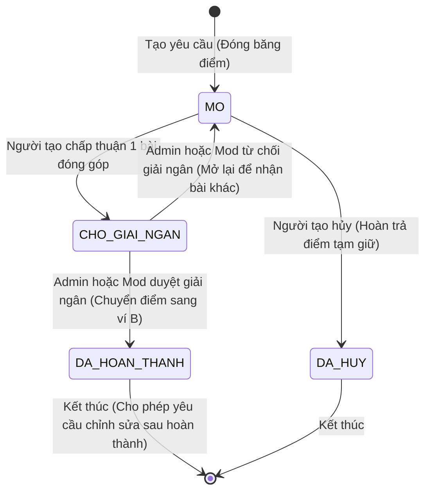
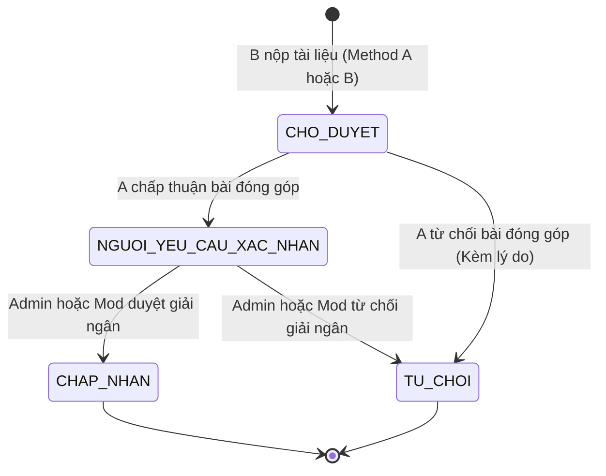
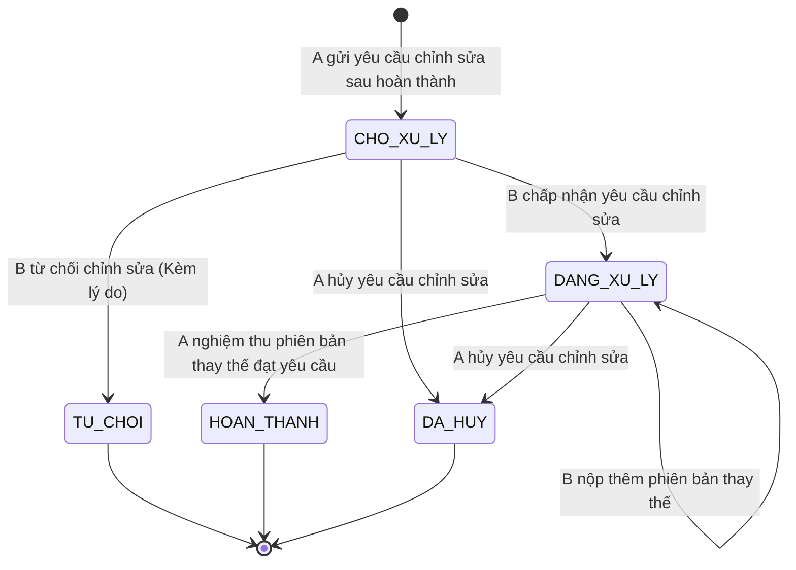
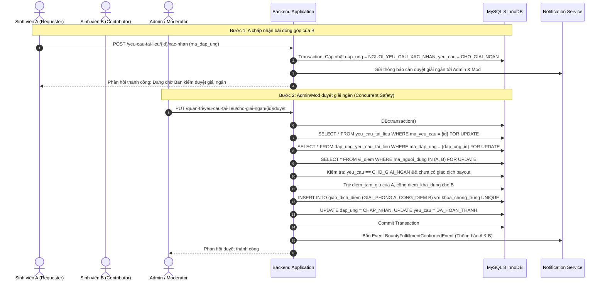
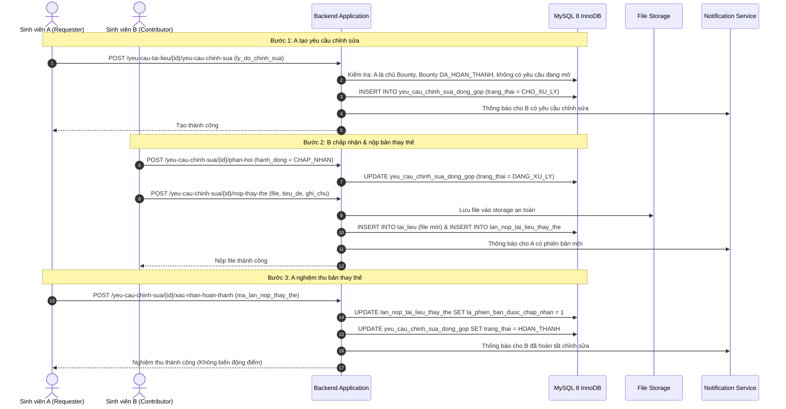
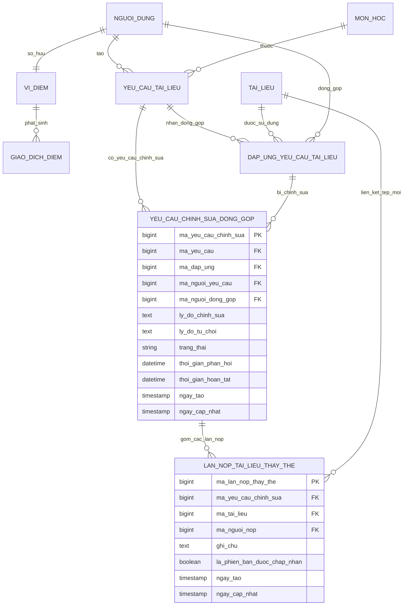

# TÀI LIỆU THIẾT KẾ KỸ THUẬT CHI TIẾT (PHASE 3)
## Phân hệ Sinh viên & Cựu sinh viên (Student/Alumni) — Hệ thống Yêu cầu Tài liệu & Săn thưởng (Wishlist/Bounty)
**Dự án:** AGU Academic Hub  
**Tác giả:** Senior Laravel Backend Engineer, Software Architect & Full-stack Developer  
**Ngày lập:** 10/11/2026  
**Trạng thái:** Bản thiết kế hoàn chỉnh (Approved Design)

---

## 1. TỔNG QUAN HỆ THỐNG VÀ USE CASES (STUDENT & ALUMNI)

Hệ thống cho phép Sinh viên (`SINH_VIEN`) và Cựu sinh viên (`CUU_SINH_VIEN`) có quyền hạn bình đẳng trong toàn bộ chu trình săn thưởng học thuật:
- **UC-01: Tạo Bounty**: Người dùng đăng yêu cầu tìm tài liệu, chọn môn học, nhập tiêu đề, mô tả và số điểm treo thưởng. Điểm thưởng được đóng băng ngay lập tức.
- **UC-02: Đóng góp tài liệu (Fulfillment)**: Người dùng khác đóng góp tài liệu qua 2 phương thức (A: Chọn tài liệu sẵn có; B: Tải tệp trực tiếp từ máy tính cá nhân).
- **UC-03: Người tạo nghiệm thu / từ chối đóng góp**: Người tạo xem trước tài liệu:
  - Nếu chấp thuận: Đóng góp chuyển sang trạng thái chờ Admin/Mod phê duyệt giải ngân (`CHO_GIAI_NGAN`).
  - Nếu từ chối: Nhập lý do từ chối. Đóng góp chuyển sang `TU_CHOI`. Bounty tiếp tục mở.
- **UC-04: Admin/Mod duyệt giải ngân cuối**: Một trong hai vai trò duyệt giải ngân. Điểm thưởng từ `diem_tam_giu` của người tạo chuyển sang `diem_kha_dung` của người đóng góp. Bounty chuyển sang `DA_HOAN_THANH`.
- **UC-05: Hủy Bounty & Hoàn điểm**: Người tạo hủy Bounty khi còn ở trạng thái `MO`. Điểm tạm giữ được hoàn trả 100% về ví khả dụng.
- **UC-06: Yêu cầu chỉnh sửa sau hoàn thành**: Người tạo gửi yêu cầu chỉnh sửa cho người đóng góp khi phát hiện sai sót sau khi Bounty đã hoàn thành. Điểm giữ nguyên, không mở lại Bounty.
- **UC-07: Người đóng góp phản hồi & nộp bản thay thế**: Người đóng góp chấp nhận hoặc từ chối chỉnh sửa. Nếu chấp nhận, có thể nộp một hoặc nhiều phiên bản thay thế (`lan_nop_tai_lieu_thay_the`).
- **UC-08: Người tạo xác nhận hoàn tất chỉnh sửa**: Người tạo xem các bản thay thế và bấm xác nhận hoàn tất.

---

## 2. STATE MACHINE DIAGRAMS

### 2.1. Vòng đời Trạng thái Yêu cầu Tài liệu (`yeu_cau_tai_lieu`)


### 2.2. Vòng đời Trạng thái Bài đóng góp (`dap_ung_yeu_cau_tai_lieu`)


### 2.3. Vòng đời Trạng thái Yêu cầu Chỉnh sửa (`yeu_cau_chinh_sua_dong_gop`)


---

## 3. SEQUENCE DIAGRAMS

### 3.1. Luồng Người tạo Xác nhận & Admin Duyệt Giải Ngân (Chống Race Condition)


### 3.2. Luồng Yêu Cầu Chỉnh Sửa Sau Hoàn Thành (Post-Bounty Correction)


---

## 4. ENTITY RELATIONSHIP DIAGRAM (ERD) & DATABASE SCHEMA

### 4.1. Sơ đồ Quan hệ Thực thể (ERD) — 100% Tiếng Việt Không Dấu


### 4.2. Chi tiết DDL Migration (100% Tiếng Việt Không Dấu)

```sql
-- 1. Bổ sung cột lý do từ chối đóng góp vào bảng dap_ung_yeu_cau_tai_lieu
ALTER TABLE dap_ung_yeu_cau_tai_lieu 
ADD COLUMN ly_do_nguoi_tao_tu_choi TEXT NULL AFTER ly_do_tu_choi_giai_ngan;

-- 2. Bảng Yêu Cầu Chỉnh Sửa Sau Hoàn Thành
CREATE TABLE yeu_cau_chinh_sua_dong_gop (
    ma_yeu_cau_chinh_sua BIGINT UNSIGNED AUTO_INCREMENT PRIMARY KEY,
    ma_yeu_cau BIGINT UNSIGNED NOT NULL,
    ma_dap_ung BIGINT UNSIGNED NOT NULL,
    ma_nguoi_yeu_cau BIGINT UNSIGNED NOT NULL,
    ma_nguoi_dong_gop BIGINT UNSIGNED NOT NULL,
    ly_do_chinh_sua TEXT NOT NULL,
    ly_do_tu_choi TEXT NULL,
    trang_thai VARCHAR(50) NOT NULL DEFAULT 'CHO_XU_LY',
    thoi_gian_phan_hoi DATETIME NULL,
    thoi_gian_hoan_tat DATETIME NULL,
    ngay_tao TIMESTAMP NULL,
    ngay_cap_nhat TIMESTAMP NULL,
    CONSTRAINT fk_yccs_yeu_cau FOREIGN KEY (ma_yeu_cau) REFERENCES yeu_cau_tai_lieu (ma_yeu_cau) ON DELETE RESTRICT,
    CONSTRAINT fk_yccs_dap_ung FOREIGN KEY (ma_dap_ung) REFERENCES dap_ung_yeu_cau_tai_lieu (ma_dap_ung) ON DELETE RESTRICT,
    CONSTRAINT fk_yccs_nguoi_yc FOREIGN KEY (ma_nguoi_yeu_cau) REFERENCES nguoi_dung (ma_nguoi_dung) ON DELETE RESTRICT,
    CONSTRAINT fk_yccs_nguoi_dg FOREIGN KEY (ma_nguoi_dong_gop) REFERENCES nguoi_dung (ma_nguoi_dung) ON DELETE RESTRICT,
    INDEX idx_yccs_yeu_cau_trang_thai (ma_yeu_cau, trang_thai),
    INDEX idx_yccs_nguoi_dg_trang_thai (ma_nguoi_dong_gop, trang_thai)
) ENGINE=InnoDB DEFAULT CHARSET=utf8mb4 COLLATE=utf8mb4_unicode_ci;

-- 3. Bảng Các Lần Nộp Tài Liệu Thay Thế
CREATE TABLE lan_nop_tai_lieu_thay_the (
    ma_lan_nop_thay_the BIGINT UNSIGNED AUTO_INCREMENT PRIMARY KEY,
    ma_yeu_cau_chinh_sua BIGINT UNSIGNED NOT NULL,
    ma_tai_lieu BIGINT UNSIGNED NOT NULL,
    ma_nguoi_nop BIGINT UNSIGNED NOT NULL,
    ghi_chu TEXT NULL,
    la_phien_ban_duoc_chap_nhan TINYINT(1) NOT NULL DEFAULT 0,
    ngay_tao TIMESTAMP NULL,
    ngay_cap_nhat TIMESTAMP NULL,
    CONSTRAINT fk_lntt_yccs FOREIGN KEY (ma_yeu_cau_chinh_sua) REFERENCES yeu_cau_chinh_sua_dong_gop (ma_yeu_cau_chinh_sua) ON DELETE CASCADE,
    CONSTRAINT fk_lntt_tai_lieu FOREIGN KEY (ma_tai_lieu) REFERENCES tai_lieu (ma_tai_lieu) ON DELETE RESTRICT,
    CONSTRAINT fk_lntt_nguoi_nop FOREIGN KEY (ma_nguoi_nop) REFERENCES nguoi_dung (ma_nguoi_dung) ON DELETE RESTRICT,
    INDEX idx_lntt_yccs_chap_nhan (ma_yeu_cau_chinh_sua, la_phien_ban_duoc_chap_nhan)
) ENGINE=InnoDB DEFAULT CHARSET=utf8mb4 COLLATE=utf8mb4_unicode_ci;
```

---

## 5. API CONTRACT VÀ BACKEND ROUTES

Tất cả các route được quản lý tập trung tại `app/Modules/Bounties/routes.php`:

### 5.1. Nhóm Yêu Cầu Tìm Tài Liệu & Săn Thưởng (`/yeu-cau-tai-lieu`)
| Method | URI | Tên Route | Quyền | Mục đích |
|---|---|---|---|---|
| GET | `/yeu-cau-tai-lieu` | `document-requests.index` | Auth | Danh sách Bounty toàn trường + Tabs "Của tôi", bộ lọc và tìm kiếm |
| POST | `/yeu-cau-tai-lieu` | `document-requests.store` | Auth | Tạo yêu cầu mới & đóng băng điểm |
| GET | `/yeu-cau-tai-lieu/{id}` | `document-requests.show` | Auth | Xem chi tiết yêu cầu, danh sách đóng góp, yêu cầu chỉnh sửa |
| DELETE | `/yeu-cau-tai-lieu/{id}` | `document-requests.destroy` | Creator/Admin | Hủy yêu cầu & hoàn điểm tạm giữ |
| POST | `/yeu-cau-tai-lieu/{id}/dong-gop` | `document-requests.fulfill` | Contributor | Nộp tài liệu đóng góp (Method A hoặc B) |
| POST | `/yeu-cau-tai-lieu/{id}/xac-nhan` | `document-requests.confirm` | Creator | Chấp thuận bài nộp -> chuyển chờ Admin/Mod duyệt giải ngân |
| POST | `/yeu-cau-tai-lieu/{id}/tu-choi-dong-gop` | `document-requests.reject-fulfillment` | Creator | Từ chối bài nộp kèm lý do |

### 5.2. Nhóm Yêu Cầu Chỉnh Sửa Sau Hoàn Thành (`/yeu-cau-chinh-sua`)
| Method | URI | Tên Route | Quyền | Mục đích |
|---|---|---|---|---|
| POST | `/yeu-cau-tai-lieu/{id}/yeu-cau-chinh-sua` | `document-requests.corrections.store` | Creator | Gửi yêu cầu chỉnh sửa cho bài đóng góp đã giải ngân |
| POST | `/yeu-cau-chinh-sua/{id}/phan-hoi` | `corrections.respond` | Contributor | Chấp nhận hoặc từ chối yêu cầu chỉnh sửa |
| POST | `/yeu-cau-chinh-sua/{id}/nop-thay-the` | `corrections.submit-replacement` | Contributor | Tải lên phiên bản tài liệu thay thế mới |
| POST | `/yeu-cau-chinh-sua/{id}/xac-nhan-hoan-thanh` | `corrections.confirm-completion` | Creator | Nghiệm thu phiên bản thay thế đạt yêu cầu |

---

## 6. PHÂN QUYỀN VÀ TRÁCH NHIỆM (AUTHORIZATION RULES)

1. **Sinh viên & Cựu sinh viên**:
   - Được tạo Bounty: yêu cầu tài khoản `trang_thai = DANG_HOAT_DONG`, số dư `diem_kha_dung >= diem_thuong`, môn học thuộc khoa đang hoạt động.
   - Được đóng góp: không được tự đóng góp vào Bounty của chính mình (`ma_nguoi_tao !== user.ma_nguoi_dung`).
   - Được xác nhận / từ chối đóng góp: chỉ người tạo (`ma_nguoi_tao === user.ma_nguoi_dung`).
   - Được hủy Bounty: chỉ người tạo hoặc Admin, chỉ khi Bounty đang `MO`.
   - Được tạo yêu cầu chỉnh sửa: chỉ người tạo, chỉ khi Bounty `DA_HOAN_THANH`, chỉ khi không có yêu cầu chỉnh sửa nào khác đang mở.
   - Được phản hồi & nộp thay thế: chỉ người đóng góp được chọn (`ma_nguoi_dong_gop === user.ma_nguoi_dung`).
2. **Admin & Kiểm duyệt viên**:
   - Là 2 vai trò song song ở bước duyệt giải ngân cuối.
   - Quyết định cuối cùng diễn ra tại hàng đợi `/quan-tri/yeu-cau-tai-lieu/cho-giai-ngan`.
   - Sinh viên tuyệt đối không thể tự kích hoạt giải ngân.

---

## 7. CƠ CHẾ BẢO VỆ GIAO DỊCH VÀ CHỐNG GIẢI NGÂN TRÙNG (DOUBLE PAYOUT PREVENTION)

Hệ thống thiết lập hàng rào 4 lớp bảo vệ:
1. **Lớp 1: Khóa bi quan (Pessimistic Locking)**:
   - `ViDiem::where('ma_nguoi_dung', ...)->lockForUpdate()`
   - `YeuCauTaiLieu::where('ma_yeu_cau', ...)->lockForUpdate()`
   - `DapUngYeuCauTaiLieu::where('ma_dap_ung', ...)->lockForUpdate()`
2. **Lớp 2: Kiểm tra trạng thái máy (State Transition Guard)**:
   - Đọc lại trạng thái sau khi đã lấy được khóa CSDL.
   - Nếu trạng thái khác `CHO_GIAI_NGAN`, lập tức rollback và trả về lỗi Conflict 409.
3. **Lớp 3: Ràng buộc duy nhất sổ cái (Unique Idempotency Constraint)**:
   - Cột `khoa_chong_trung` trong `giao_dich_diem` có ràng buộc `UNIQUE`.
   - Khóa giải ngân có định dạng ổn định: `giai_ngan_yc_{id}_nd_{id}_nguoi_tao` và `giai_ngan_yc_{id}_nd_{id}_nguoi_nhan`.
   - Dù có 2 request duyệt đồng thời lọt qua tầng ứng dụng, lệnh `INSERT` của request thứ 2 sẽ bị MySQL InnoDB chặn đứng bằng lỗi `SQLSTATE[23000]: Duplicate entry`.
4. **Lớp 4: Cơ chế không can thiệp điểm ở luồng Chỉnh sửa sau hoàn thành**:
   - Mọi thao tác chỉnh sửa, nộp bản thay thế, nghiệm thu bản thay thế **hoàn toàn không gọi bất kỳ phương thức nào của `ReputationEvaluator` hay `ViDiem`**, triệt tiêu nguy cơ phát sinh sai lệch điểm.

